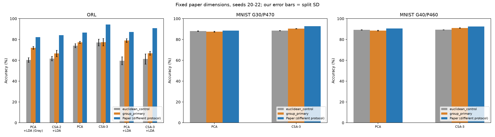
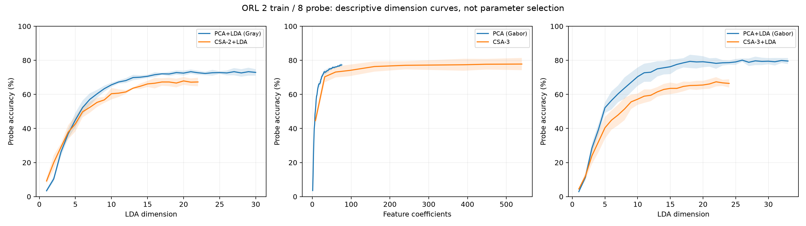
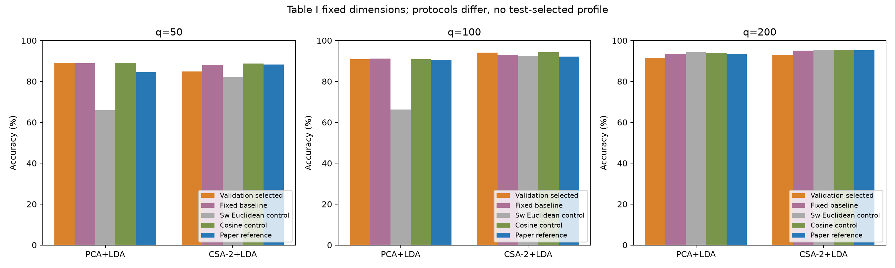
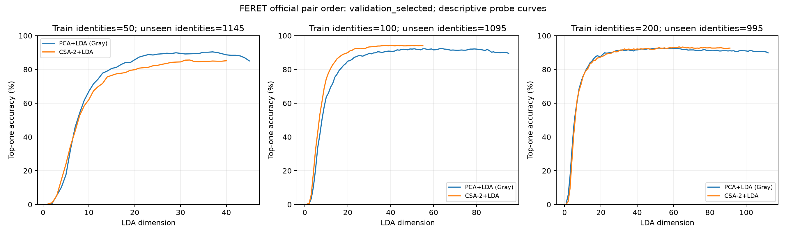
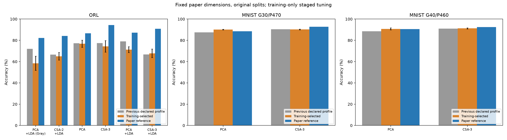
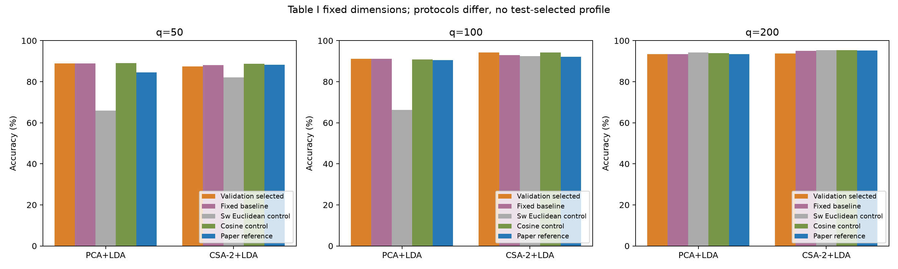
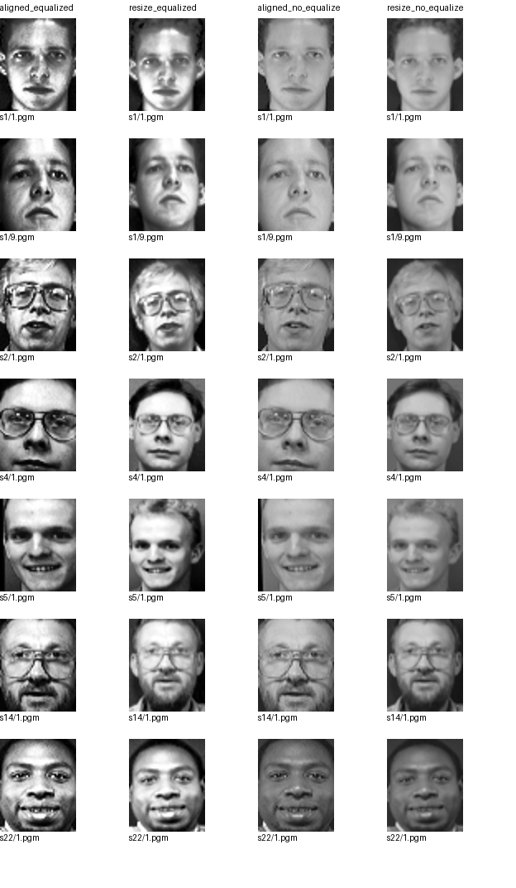

# Project History Archives

This file merges all 13 Markdown copies before collation. It retains plans, explanations, author/teacher replies, failed experiments, and results for traceability; the current results are subject to [REPORT.md](./REPORT.md), and the running entry is in [README](../README.md). The words "to-do", "final" and "not yet obtained" in history only represent the status of the paper at that time. Only file links are relocated; the original expired links are changed to historical path text.

> **Publication note:** This English translation preserves historical plans and status statements. Refer to the current [README](../README.md) for the public repository scope. All three datasets, numerical caches, and image-bearing examples are excluded; related historical links require local reconstruction. SHA-256 values attached to earlier documents identify their original source versions, not the translated text. Frozen experiment evidence is unchanged.

## Document index

- [Follow-up communication · 2026-10-07 TA reply](#history-14)
- [01 · COMP3314_group_project_Paper ranking and CSA reproduction planning.md](#history-01)
- [02 · CSA_full_reproduction_plan.md](#history-02)
- [03 · CSA_dataset_access_and_confirmed_protocols.md](#history-03)
- [04 · CSA_available_reproduction_results.md](#history-04)
- [05 · CSA_accuracy_and_laptop_diagnosis.md](#history-05)
- [06 · CSA_ORL_accuracy_improvement_results.md](#history-06)
- [07 · CSA_FERET_reproduction_results.md](#history-07)
- [08 · CSA_three_dataset_tuning_results.md](#history-08)
- [09 · CSA_ORL_method_diagnosis.md](#history-09)
- [10 · CSA_ORL_execution_plan.md](#history-10)
- [11 · CSA_ORL_followup_results.md](#history-11)
- [12 · PIE_unavailability.md](#history-12)
- [13 · README.md](#history-13)

---

<a id="history-01"></a>

## Historical document · COMP3314_group_project_Paper ranking and CSA reproduction planning.md

Original document SHA-256: `d6622e19b3b1215e126b25ec797091e5746f68be39cad519b95cad8502b6462d`.

<!-- BEGIN COMP3314_group_project_Paper ranking and CSA reproduction planning.md -->
# COMP3314 Group Project: Topic ranking and CSA reproduction planning

> This article contains the two previous answers in full. The list of course papers can be found on pages 6–7 of [Lec0 Introduction.pdf](<../../Lec0 Introduction.pdf>); the project requirements and grading basis are the screenshots provided by you.

## Part 1: Ranking of 12 papers (full text of original answer)

**If the goal is to securely get high scores, I recommend the 4th CSA; if the team members are good at linear algebra and want to do a more complete "thesis method vs baseline" experiment, choose the 7th SEC.** This is not a guarantee of the final score, but rather a ranking of difficulty of explanation, space for critical analysis, and investment in reproduction based on your grading requirements.

I checked the list of 12 on pages 6–7 of the handout [Lec0 Introduction.pdf](<../../Lec0 Introduction.pdf>). The scoring focuses on **paper understanding 40% + critical analysis 30%**; the report accounts for 10%, and the 9-minute presentation and Q&A account for 20%. Reproduction is subject to a further maximum of 10 percentage points, with full or partial reproduction being considered. Therefore, "easy to reproduce" in the table below mainly refers to whether the core phenomenon can be reproduced reliably, which does not mean that the original paper table can be reproduced item by item. The sorting assumes that you have an ordinary computer or the GPU resources provided by the course, but it is not preset that you can obtain all the raw data and pre-processed files used in the old papers.

| Ranking| Lecture number and paper| Core arguments and methods| Advantages and disadvantages suitable for analysis| reproduction judgment|
|---|---|---|---|---|
| **1** | **[4] CSA: Reconstruction and Recognition of Tensor Objects** | Preserve matrix/tensor structure and alternately learn mode subspaces to reduce reconstruction error, then recognize objects. The paper argues for advantages over flattened PCA in small-sample settings. [Paper overview](https://www.microsoft.com/en-us/research/publication/reconstruction-recognition-tensor-based-objects-concurrent-subspaces-analysis/) | **Strengths:** intuitive PCA control, useful reconstruction figures, explainable within3–4 pages. **Limits:** good reconstruction need not imply good classification; match storage and fitting-sample budgets for fairness. | **High (partial reproduction):** independently implement two-dimensional CSA and compare reconstruction/recognition with PCA. Reproducing every higher-order experiment is harder. |
| **2** | **[7] SEC: Spectral Embedding Clustering**| Add the constraint that "the clustering representation should be close to the linear mapping of the data" to the spectral clustering target, so that the clustering of seen samples and the allocation of new samples can be placed in the same framework; local regression composition is also studied. [Full text of the paper](https://citeseerx.ist.psu.edu/document?doi=247c90aabda047a6545774a33e55199fd378d5b5&repid=rep1&type=pdf)| **Excellent:**Directly connected to the clustering, dimensionality reduction, and matrix eigendecomposition of the course; there are K-means and ordinary spectral clustering for clear comparison. **Missing:** Neighborhood graph, regularization strength and spectral rotation will affect the results; how to select parameters when there are no actual labels is a good point of criticism.| **Higher**: 5,620 **Optdigits** used in the paper available from [UCI](https://archive.ics.uci.edu/ml/datasets/Optical). Reproduce the basic version of SEC and the two baselines first, and then try new sample predictions; do not use different `sklearn load_digits` data directly as the original paper data.|
| **3** | **[3] MFA and gait recognition, image retrieval variants**| replaces the global divergence of traditional LDA with the compactness of homogeneous neighbors and the separation of heterogeneous boundary samples; the paper extends it to matrix form and retrieval with correlation feedback. [Paper abstract](https://pubmed.ncbi.nlm.nih.gov/17990757/)| **Excellent:** "Why LDA may fail" is easy to explain, and it can analyze the number of neighbors, non-Gaussian categories and category boundaries. **Missing:** One article contains multiple applications and variations and must be narrowed down within 9 minutes; the original gait and Corel search process are difficult to restore item by item.| **Medium-high (core method)**: Comparing MFA with PCA/LDA from scratch is feasible; reproduction of the original table is significantly more difficult.|
| **4** | **[6] LDMGI: Local discriminant model and global clustering**| Each sample and its neighbors form a local set, establish a discriminant model locally, and then aggregate it into a global target. Clusters are obtained through spectral relaxation and rotation; the paper discusses the relationship with K-means and spectral clustering. [Paper abstract](https://pubmed.ncbi.nlm.nih.gov/20423802/)| **Excellent:**The course has strong relevance and can discuss the trade-off between local structure and global goals; [Code provided on the author's homepage](https://www.cs.cmu.edu/~yiyang/Publications.html). **Missing:** The derivation and spectrum rotation are complicated, the old version of `.rar` code still needs to check the environment, and the process of directly running the code is also difficult to show the team's own implementation contribution.| **Medium High**: Having author code reduces entry costs; it is recommended to redo at least one core module yourself and clearly mark the reused parts. The code is not actually run this round.|
| **5** | **[5] FME: Flexible Manifold Embedding**| jointly learns sample labels/embeddings, a linear regression mapping for new samples, and the residuals of both; relaxing the strict linear mapping assumption with the residuals. [Paper abstract](https://pubmed.ncbi.nlm.nih.gov/20215078/)| **Excellent:** The connection between semi-supervised, unsupervised, graph Laplacian and regression is well suited for course analysis. **Missing:** The impact of residual weights, graph construction and matrix solving must be explained, otherwise it is easy to just state the formula.| **Medium**: It is feasible to implement one setting on a small data set; covering all settings and data sets in the paper is time-consuming.|
| **6** | **[2] MDA: Multilinear Discriminant Analysis**| treats face images as high-order tensors, defines inter-class separation and intra-class compact tensor discrimination criteria, and alternately optimizes projection along each dimension. [Full text of the paper](https://mmlab.ie.cuhk.edu.hk/archive/2007/IP07_face02.pdf)| **Excellent:** Clear connection with LDA, able to analyze small samples and high-dimensional problems. **Missing:** The results of alternating optimization may depend on initialization; tensor expansion and preprocessing can easily take up display time.| **Medium**: The two-dimensional simplified version can be implemented; the complete comparison of the original paper ORL, CMU PIE, and FERET requires more detailed data and split verification.|
| **7** | **[1] Graph embedding unified dimensionality reduction framework**| uses "intrinsic graphs that should remain close" and constraint/penalty graphs to unify various dimensionality reduction algorithms and propose MFA. [Full text of the paper](https://cse.hkust.edu.hk/~qyang/Docs/2007/yanpami.pdf)| **Excellent:**High theoretical value, can connect PCA, LDA, and spectral methods. **Shortage:** The coverage is too large, and it can be easily covered in 9 minutes as a catalog of algorithms; if you choose it, you must focus on one derivation and MFA evidence, rather than introducing all extensions equally.| **Medium**: A set of experiments to reproduce MFA and LDA is feasible; there is no clear boundary for "reproduction of the entire framework".|
| **8** | **[10] Laplacian Embedded Regression** | introduces intermediate decision variables in manifold regularization to obtain a graph kernel that is more convenient for calculation; proposes LapERLS and LapESVR, and uses a small number of graph feature vectors to accelerate it. [Full text of the paper](https://citeseerx.ist.psu.edu/document?doi=3ca9047b15a27b89bddac3a5ab22aeaf58a05b12&repid=rep1&type=pdf)| **Excellent:** There is a clear trade-off between accuracy and computation time. **Missing:** Fair verification of "scalability" requires control over sample size, sparse graphs, and solvers; heavy technical burden in 9 minutes.| **Medium-low**: Small-scale LapERLS can be done; the scale advantage of papers makes it more difficult to reproduce rigorously.|
| **9** | **[9] Multi-source domain adaptation DAM**| utilizes base classifiers trained on multiple source domains to constrain the target classifier with prediction consistency on unlabeled samples in the target domain; proposes FastDAM and UniverDAM. [Paper abstract](https://pubmed.ncbi.nlm.nih.gov/24808555/)| **Excellent:** "Which source domains are trustworthy and when to migrate negatively" has great room for analysis and can also contact SVM. **Missing:**Multi-source weights, basic classifiers and target domain settings make the experiment more variable.| **Medium Low**: Simplified text data can be used to display trends; the original video concept detection experiment investment is high.|
| **10** | **[8] DTMKL: Domain Transfer Multi-core Learning**| learns kernel combinations and classifiers while reducing the distribution difference between the source domain and the target domain, taking into account SVM risk and MMD distribution measures. [Full text of the paper](https://citeseerx.ist.psu.edu/document?doi=49b32eabe38a895ef23732f1b58d30f9a5aac5db&repid=rep1&type=pdf)| **Best:** Direct link to course SVM/Kernel Methods. **Missing:** "Marginal distribution is more similar" does not necessarily mean that category discrimination is also better; joint optimization and fair comparison are difficult to clarify.| **Low to Medium**: Simplified core combination experiments can be done; it will take more time to implement the complete method and align it with the original experiment.|
| **11** | **[12] ITML+: Metric learning using depth information during training**| uses RGB and depth maps to learn distance metrics during training; only RGB is used for testing. Based on ITML, solve using circular projection. [Full text published by the author](https://wenli-vision.github.io/papers/Xu_TNNLS2015.pdf)| **Excellent:** The setting of "extra information during training, but not during deployment" is clear, suitable for analyzing when the information is really helpful. **Missing:** RGB-D alignment, preprocessing and paired sample construction will all affect the results, and the connection to the core content of the course is relatively indirect.| **Low**: Can be used for concept demonstration; full RGB-D indicator reproduction cost is higher.|
| **12** | **[11] Learning event recognition from online videos**| uses aligned spatio-temporal pyramids to match videos, and then uses adaptive multi-core learning to fuse features and handle the domain differences between network videos and user videos. [Full text of the paper](https://citeseerx.ist.psu.edu/document?doi=de43dcf9c42ce5a54a4f0fbdfcfbd43fda640e23&repid=rep1&type=pdf)| **Excellent:** The application presentation is very attractive. **Shortcomings:** Video features, matching, kernel learning, and domain adaptation coexist, making it difficult to judge which part brings improvement in short reports; old network video collection also hinders accurate reproduction.| **Low**: Suitable for groups that are particularly interested in applications and have experience in video processing. Not suitable as the first choice to save time and score points.|

**My topic selection suggestion:**Choose **[4] CSA** and narrow the question to "under the same compression budget and different number of training samples, is it better to preserve the two-dimensional structure of the image than PCA?" Implement two-dimensional CSA from scratch, reporting reconstruction error, example images, and a simple recognition metric; even if the results differ from the paper, you can analyze initialization, compression budget, and data differences. This also leaves a clear chain of evidence for reporting, presentation, Q&A and reproduction.

If you prefer clustering, choose **[7] SEC**: Use the Optdigits data of the same name in the paper, first perform the same conditional comparison of K-means, ordinary spectral clustering and the basic version of SEC, and then test the new sample allocation. No matter which paper you choose, your own data set or simplified implementation should be marked as "partial reproduction" and list the differences from the original paper in data splitting, preprocessing, parameters and indicators; this is more in line with the project requirements than claiming "reproduced original results".

---

## Part 2: CSA Presentation and Experimental Reproduction (Full text of original answer)

**CSA is very suitable for this project, but the key to getting points is not to show a few "clearer after reconstruction" pictures, but to explain clearly what it optimized, use fair experiments to test the paper's claims, and explain the results that do not meet expectations.** I suggest first implementing the **two-dimensional image version of CSA** and comparing PCA on face data; the three-dimensional tensor and all tables of the original paper are reserved for expansion when there is spare capacity.

The following is the implementation plan, the experiment has not been actually run yet. The paper's [Author Page](https://www.microsoft.com/en-us/research/publication/reconstruction-recognition-tensor-based-objects-concurrent-subspaces-analysis/) confirms its reconstruction, recognition, and small sample claims; what I have checked so far is a public abstract, and **the full experimental protocol for the full text of the journal in 2008 has not been obtained**. Before formally writing a report, you should obtain the full text from the HKU library and check the formulas, data splits, and the definition of "dimension" for comparison in the original paper item by item.

## The two most important questions to understand

Given an (h\times w) image (X), first subtract the average image (M) computed only from the training set to get (A=X-M). Two-dimensional CSA learns two orthogonal projection matrices (U\in\mathbb R^{h\times r}), (V\in\mathbb R^{w\times c}) that are shared across all training images:

$$
Z=U^\top A V,\qquad
\hat X=M+UZV^\top.
$$

(Z) is the compressed representation of (r\times c). The optimization goal is to make the total squared reconstruction error of the training images as small as possible. When (V) is fixed, find the first (r) eigenvectors of the matrix (sum_i A_iVV^\top A_i^\top) to update (U); after fixing the new (U), take the first (c) eigenvectors of (sum_i A_i^\top UU^\top A_i) to update (V). The two steps are carried out alternately. This gives the presentation a clear main line: **two-dimensional representation → reconstruction target → two PCA-like updates → experimental verification**. [About the author of the paper](https://www.microsoft.com/en-us/research/publication/reconstruction-recognition-tensor-based-objects-concurrent-subspaces-analysis/)

Here are two details that are likely to be asked in Q&A:

- **Flattening an image into a vector does not lose pixel information.** The potential advantage of CSA is that it imposes row and column structure constraints on the projection form, so that the representation learned under small samples may be more likely to generalize. Don't take "vectorization loses information" as an argument.
- **When also compressed into (k=rc) dimensions, the least square reconstruction error of PCA on the training set cannot theoretically be higher than CSA.** The projection of CSA is just a class of constrained subspaces among all (k)-dimensional linear subspaces. This is a conclusion derived from the optimal properties of PCA. Therefore, we should focus on comparing the error, recognition accuracy and small sample performance of images not involved in training. If "the training set PCA is better and the test set CSA is better", it can well explain the value of structural constraints.

Also note: The learning goal of CSA is **reconstruction** and does not directly optimize class separation. Therefore, "reconstruction error decreases" cannot automatically deduce "face recognition rate increases."

## Presentation

| corresponding score| Where points are easily lost| Recommended Evidence to Show|
|---|---|---|
| **Understanding 40%**| only says "tensors are better than vectors" without explaining the shared (U,V), objective functions and alternating updates| A shape diagram: (64\times64\to r\times c\to64\times64); a page explaining why it becomes a eigenvector problem after fixing a projection|
| **Critical Analysis 30%**| Only repeats the paper conclusion, ignoring fair comparisons and unsuccessful cases| shows the training/test reconstruction error and recognition rate at the same time; discusses the training error optimality, initialization, compression dimension and small sample impact of PCA|
| **Show and Q&A 20%**| There are too many inferences, and the results page only has a few good-looking pictures.| A method diagram, a quantitative curve, and a set of reconstruction samples; each diagram only supports one clear conclusion|
| **Report 10%**| The data split, random seeds and indicator definitions are not written; the original paper graphs are mixed with self-made graphs| Use a compact experimental setup table and label all figures with "original paper" or "our group results"|
| **reproduction bonus points (extra)**| calls the experiment after modifying the data and protocol "full reproduction"| is clearly marked as **section reproduction**, listing differences from the paper and their possible impact|

**Suggested 9 minutes, approximately 7 slides:**1 minute for questions and PCA baseline; 2 minutes for representing and reconstructing goals; 1.5 minutes for alternating updates; 1 minute for experimental design; 1.5 minutes for results; 1.5 minutes for limitations and team insights; 0.5 minutes for conclusions. Put the complete derivation on a spare page and prepare for the 3-minute Q&A. The same sequence is followed for pages 3–4 of the report, leaving about one page for critical analysis.

## Minimum Viable Reproduction Experiment

uses [scikit-learn's Olivetti Faces](https://scikit-learn.org/stable/modules/generated/sklearn.datasets.fetch_olivetti_faces.html): 40 people, 10 images per person, 400 images in total (64\times64). It is easy to obtain and suitable for small sample experiments; however, this is a version processed into (64\times64) and cannot be claimed to be completely consistent with the original face experiment of the paper without verification. [Dataset Description](https://scikit-learn.org/stable/modules/generated/sklearn.datasets.fetch_olivetti_faces.html)

1. **Fix the protocol first.** Each person draws (1, 3, 5) pictures for training and the rest for testing; each setting is repeated with, for example, 5 fixed random seeds. The average image, PCA projection and CSA projection are always calculated using this training set only.
2. **Implements two-dimensional CSA.** Use NumPy's matrix multiplication and symmetric matrix eigendecomposition; use fixed seed orthogonal initialization, alternately update (U, V), and record each round of training objectives. First set a maximum of 50 rounds and a clear stopping threshold for relative change.
3. **Establish PCA baseline.**PCA and CSA use the same training/testing split, centering and **compressed dimensionality** per image (k=rc). You can try ((r,c)=(2,2),(3,3),(4,4),(5,5),(6,6)) first. The total training amount when each person only trains on one page is 40, the highest (k=36); avoid using settings that exceed the effective training rank of PCA to create unfair results.
4. **Test two different questions.** Reconstruction: The average squared error of the training set and the test set, and displays the original image, PCA, and CSA reconstruction of the same test image**. recognition : Reports the mean and standard deviation of test accuracy using the same nearest neighbor rules in their respective compressed representations.
5. **Add a valuable analysis.** Change the CSA initialization and observe whether the final goal and results are stable; or draw the "number of training images per category - test error / recognition rate" curve. Just choose one of the two, and give priority to completing the main experiment.

recommends setting up three checks for implementation: (U^\top U) and (V^\top V) are close to the identity matrix; the training target should not change after alternating updates (small numerical errors are allowed); training/test samples should never be mixed. When submitting the code, provide public GitHub, running commands, dependencies, random seeds, and result tables according to the screenshot requirements, and indicate the CSA you wrote and the borrowed libraries. [About the author of the paper](https://www.microsoft.com/en-us/research/publication/reconstruction-recognition-tensor-based-objects-concurrent-subspaces-analysis/)

## Main risks and processing sequence

**The first risk is "fair comparison"**: identical (rc) only guarantees that the representation length of each figure is the same, CSA and PCA occupy different amounts of storage in the shared projection matrix itself. The main image can be compared according to the same representation length, and the model storage cost can be calculated in the report; do not generally say that the two have "the same compression rate".

**The second risk is that the results do not support one of the claims of the paper**: this does not mean that the project has failed. For example, if the test reconstruction is excellent but the recognition rate is not, it just means that the reconstruction goal and the discrimination goal are different; if both are not good, check the data preprocessing, split and parameters, and then discuss the applicable boundaries of this method truthfully. Don't use test set labels to repeatedly select the best parameters and then treat the results as independent tests.

**The third risk is range inflation**: The paper also discusses third-order tensors, but video or Gabor features will increase the data processing and explanation burden. Complete the two-dimensional CSA + PCA + small sample analysis first, and then consider the third-order expansion after achieving complete results that can be reviewed.

If it is a team of 3–4 people, it can be scheduled in about **5–8 effective working days**: the first two days to check the full text protocol and complete the baseline; the next two or three days to implement and check the CSA; the next two days to run fixed experiments, draw graphs and explain differences; and finally complete the report, slides and Q&A rehearsal simultaneously. The completion criteria are: **Others can rerun the table according to the README, and you can explain why each curve supports or does not support the thesis claim.**


<!-- END COMP3314_group_project_Paper ranking and CSA reproduction planning.md -->

---

<a id="history-02"></a>

## Historical document · CSA_full_reproduction_plan.md

Original document SHA-256: `a8004ae68f6bc13b2697efcc5f90081d6651a94c150ad8dcbd78542fc1fb4e26`.

<!-- BEGIN CSA_full_reproduction_plan.md -->
# CSA Full Reproduction: Experiments, Data and Code Feature List

**Final course scope (2026-10-06):** ORL / ​​MNIST / FERET implemented and running, latest [Tune Participation Result](#history-08). The original PIE has not been obtained after contacting the author, so it is omitted with permission from the teacher. See [PIE acquisition process](#history-12). The following content such as "PIE still needs to be obtained" is a historical plan; it is no longer a current to-do, nor does it state that all experiments in the paper have been completed.

**2026-10-06 Status:** FERET original grayscale official 1,195 pairs obtained, completed 50 / 100 / 200 training identities Table I / Fig. 6 Experiment with training-only validation selection; see [FERET results](#history-07). ORL/MNIST original work retained. The following FERET acquisition waiting items are historical plans; PIE is still to be acquired.

**Update after teacher reply:** Use [Data Request and Confirmation Agreement](#history-03) as the new course agreement record. It has been confirmed that 500 images per category of MNIST and ORL must be aligned with both eyes; if FERET/PIE cannot be obtained in time, it is allowed to omit and explain the difference. The earlier waiting conditions and "not to be omitted" suggestions below should be adjusted according to this reply; the full scientific experiment goal and the actual course submission scope are recorded separately.

updated with online verification date: 2026-10-05. This article is **Preparation and Implementation Plan**. The latest ORL grayscale/Gabor, convergence and reconstruction, and two MNIST splits have been run; for details, see [This implementation and results](#history-04). FERET/PIE has not been run yet. The original plan and the waiting conditions at that time are retained below. The realized parts are subject to the above result documents; the numerical targets below are still the paper values, not the results of our group.

Paper: Dong Xu et al., *Reconstruction and Recognition of Tensor-Based Objects With Concurrent Subspaces Analysis*, IEEE TCSVT 18(1), 36–47, 2008, DOI: 10.1109/TCSVT.2007.903317. The basis is the [Paper PDF](../Reconstruction_and_Recognition_of_Tensor-Based_Objects_With_Concurrent_Subspaces_Analysis.pdf) in this catalog, especially the printed pages 39, 41–45 of the paper; not just the abstract or previous answers.

## 1. First clarify the conclusion and completion standards

If you choose full reproduction, the goal should be to cover all the empirical experiments of this **2008 journal article: the 14 subfigures of Fig. 4–8, and the 28 accuracy entries of Table I–IV**.

specifically includes: three-dimensional CSA convergence, ORL/PIE-1 Gabor tensor reconstruction, FERET grayscale recognition, ORL grayscale and Gabor recognition, PIE-1/PIE-2 grayscale and Gabor recognition, and MNIST Gabor recognition. Fig. 1–3 are conceptual and algorithmic diagrams that can be redrawn for explanation; they do not increase the experimental tasks. The 13 posture simulation videos mentioned in the paper are the results of the early CVPR 2005 work. This article does not re-give the experimental values, so it is not included in the required scope of this article's full reproduction.

**Currently it is not possible to declare that the conditions for full reproduction are complete.**ORL, MNIST downloaded; raw grayscale FERET and raw CMU PIE not yet available. There are also missing items for sample indexing, Gabor implementation, centering and the full options grid. Full experimental coverage and complete line-by-item numerical coverage are two different things: the former is your implementation goal, the latter is limited by this missing information.

Preparatory phase completed:

- [x] Create `/goal`, tracking code verification, available data download and verification, experiments and feature planning.
- [x] Search author pages, paper websites, web searches, and GitHub repository indexes.
- [x] Download and unzip the ORL and examine all 400 PGMs.
- [x] Download the image file of the MNIST official test data and check the MD5 and IDX formats, quantity and category distribution.
- [x] Check all tables and key formulas directly from PDF images to avoid missing numbers through text extraction.
- [x] Organize all goals, modules to be written and acceptance criteria of full reproduction.
- [ ] Get the original grayscale FERET, original PIE, and index/preprocessing information used in the paper.
- [x] Implements core methods and passes independent numerical checks; runs ORL grayscale recognition of two sets of curves with dimensionality.
- [ ] Align unconfirmed protocols, generate Gabor features and complete the rest of the paper experiments.

**This plan recommends: implement core CSA by yourself, use NumPy/SciPy for basic linear algebra; public libraries are used for comparison verification.** This is an implementation choice that balances interpretability and the class's from-scratch bonus. Python is a suggested solution, not the original running environment of the paper.

## 2. Original code and reference implementation: find out first, then decide what to write

### 2.1 verification Conclusion

As of this verification, **no verifiable official CSA source code of the author has been found, nor has any available third-party reproduction repository that covers all experiments in this article** been found. This is the result of a limited search and cannot be written as "the author has never released code".

This time checked:

- [Microsoft Research's 2008 paper page](https://www.microsoft.com/en-us/research/publication/reconstruction-recognition-tensor-based-objects-concurrent-subspaces-analysis/): There is paper information, but no source code link was found.
- [HKU's Dong Xu page](https://ai.hku.hk/people/academic-staff/dongxu) and its personal website entrance: The corresponding source code has not been obtained.
- [2004 Coupled Subspaces Analysis page](https://www.microsoft.com/en-us/research/publication/coupled-subspaces-analysis/): It is the predecessor of two-dimensional and cannot be directly used as a complete implementation of this article.
- Exact title plus `code`, `MATLAB`, `implementation`, `download`, `GitHub` search.
- Three exact phrases `concurrent subspaces analysis`, `coupled subspaces analysis`, `Reconstruction and Recognition of Tensor-Based Objects` for GitHub repository search: all returned 0 repositories. A repository search does not mean that all code files are searched, and therefore does not constitute proof that the code does not exist.

Do not mistake attention, optimization algorithms or recent CSA projects with the same abbreviation for cost thesis implementation. Don’t directly rename the implementation of multilinear PCA, TensorFaces, or ordinary HOSVD to CSA.

### 2.2 Reference code that does work

| Source| Reference functions| ’s relationship to this article’s CSA How to use| |
|---|---|---|---|
| [TensorLy partial_tucker](https://tensorly.org/stable/modules/generated/tensorly.decomposition.partial_tucker.html) and page source| Tucker/HOOI alternating decomposition of specified mode| can be used as a numerical comparison of the shared mode subspace; it is not the author's original code| input is organized into `(N,H,W,G)`, only decomposes the image mode `[1,2,3]`, and retains the sample mode; two-dimensional uses `[1,2]`. initialization, iteration count, and centering must be aligned to compare|
| [scikit-image Gabor](https://scikit-image.org/docs/stable/api/skimage.filters.html#skimage.filters.gabor) | Complex filter kernel and real/imaginary response| is an image processing tool and is not guaranteed to use the same waveforms, normalization and boundaries as the paper| is used for understanding and independent comparison. It cannot be directly identified as the default parameters of the paper.|
| [Torchvision MNIST source code](https://docs.pytorch.org/vision/main/_modules/torchvision/datasets/mnist.html)| MNIST Download image and MD5| Data acquisition reference, not related to CSA model| This round downloads and verifies the test file source, and does not install or rely on PyTorch for training.|

TensorLy's default SVD initialization, 100 iterations, and error change stop are different from the paper's arbitrary column orthogonal initialization, recognition experiment `Tmax=3`, and base matrix similarity stop. Directly calling the library to get results is not enough to prove that you have implemented the paper algorithm.

**What you really need to write** is the tensor operation convention, paper Procedure 1, data protocol, Gabor feature configuration, PCA/LDA/nearest neighbor pipeline, and the experiment and recording logic of each graph and table. See Section 7 for details. No need to write your own eigendecomposition or FFT underlying libraries.

If you wish to request official information, you can contact the author. The email address published on the HKU page is `dongxu@cs.hku.hk`. No emails were sent this round.

## 3. Data: What has been downloaded and what is still missing

### 3.1 Current local data and verification results

All paths are relative to `COMP3314GP/`. Machine-readable download records and checksums are in [data/dataset_manifest.json](../data/dataset_manifest.json).

| data| local location| This verification| status|
|---|---|---|---|
| AT&T / ORL | `data/raw/orl/att_faces.zip`; `data/raw/orl/s1/1.pgm` to `s40/10.pgm`| ZIP CRC passed; 40 people, 10 pictures each, 400 pictures in total; all decoded successfully; original height 112, width 92| has been downloaded and decompressed; the paper preprocessing results have not been generated yet|
| MNIST official test set| `data/raw/mnist/t10k-images-idx3-ubyte.gz`, `t10k-labels-idx1-ubyte.gz`; also retain the decompressed IDX| Two MD5s are consistent with Torchvision published values; image magic=2051, label magic=2049; 10,000 pairs of samples, 28×28, file length is correct| Full test set downloaded; 5,000 sample subset of paper not yet generated|
| original gray scale FERET Fa/Fb| No local data yet| Unable to verify 1,195 common identities and 2,390 images required for the paper| Not obtained|
| Original CMU PIE| No local data yet| Unable to verify poses, illumination numbers, and 63 identities used in the paper| Not obtained|

ORL from [Cambridge University Original Archive](https://www.cl.cam.ac.uk/research/dtg/attarchive/facedatabase.html), downloaded ZIP size 3,769,022 bytes. MNIST comes from the `ossci-datasets.s3.amazonaws.com/mnist/` image listed on Torchvision, and only downloads the two test set files required by the paper; the standard 60,000-image training set does not belong to the data required for this experiment of the paper.

| file| check value|
|---|---|
| `att_faces.zip` | SHA256: `509d763bd2276aa054d260d7f1000e8be212738134f2f83d8ff13bc2adf1c8ec`; this value is the calculated value for this download and does not claim to be the official published value.|
| `t10k-images-idx3-ubyte.gz` | MD5：`9fb629c4189551a2d022fa330f9573f3` |
| `t10k-labels-idx1-ubyte.gz` | MD5：`ec29112dd5afa0611ce80d1b7f02629c` |

### 3.2 FERET: Looking for the original grayscale version, not just the data with the same name

[NIST official page](https://www.nist.gov/itl/products-and-services/color-feret-database) clearly states that the original grayscale FERET is not available for download at the moment; currently you can apply for Color FERET, and you need to read the release agreement and apply for a download account.

**This article targets 1,195 common identities of raw grayscale Fa/Fb.** Converting Color FERET to grayscale, there is no guarantee that the character collection, image shooting, cropping and alignment will be consistent with this article. The 200-person FERET subset online also cannot complete Table I.

You need to do:

1. Prioritize asking the course instructor/TA or paper author whether to retain the Fa/Fb subset of this article, especially the aligned 41×27 image.
2. requests a list of filenames, eye coordinates and ordering for 1,195 common identities; "first q persons" require a determinable ordering.
3. After obtaining the image, confirm that each person has one Fa/Fb, the identity and file are not repeated, and then save the original source and verification value.
4. If only the original image is available, eye alignment, cropping, scaling and histogram equalization must be implemented; the target eye position and interpolation method must be recorded.

Color FERET can be used to perform another clearly labeled extended experiment, but it cannot be filled in the paper Table I and labeled as full reproduction of the original data. This alternative data is not currently downloaded.

### 3.3 CMU PIE: camera / illumination information must be preserved

[CMU's data description page](https://www.cs.cmu.edu/~face/database.htm) provides a way to contact Simon Baker to obtain PIE, email `simonb@cs.cmu.edu`. This page is older and the contact information needs to be confirmed by the other party whether it is still responsible for data distribution. This time, no verifiable and publicly available direct download original package was found.

You do not need to download all poses and lighting for this experiment: ideally you would obtain the following two subsets of images and metadata, 630 images each, for a total of 1,260 images:

- PIE-1：C27、C05、C29、C09、C07 × illumination 08、11。
- PIE-2: Same five postures × illumination 10, 13.
- Each subset: 63 people, 10 photos each. The two illuminations for PIE-2 are another set, not four illuminations combined into 20 shots per person.

requires the author to confirm which 63 identities are used, as well as file naming fields such as expression, room lighting, etc. There are 68 people in the original PIE population, and we cannot directly take any 63 people and call them the same subset. Common `PIE_32x32.mat` If the paper file name, camera/illumination number or has been cropped to 32×32, it is not enough to restore the 64×64 input of this article; zooming in cannot retrieve the original information. Multi-PIE is also another dataset.

### 3.4 MNIST's paper Contradiction: must be recorded before starting the experiment

the paper also says to use "the first half of the test set, 5,000 pictures" and "500 pictures of each number". Directly checking the downloaded standard test labels this time, the actual number of the first 5,000 is:

| Category| 0 | 1 | 2 | 3 | 4 | 5 | 6 | 7 | 8 | 9 |
|---|---|---|---|---|---|---|---|---|---|---|
| Number of sheets| 460 | 571 | 530 | 500 | 500 | 456 | 462 | 512 | 489 | 520 |

So both descriptions cannot simultaneously hold true in the current official order. See the manifest for the complete 10,000 test set. Each category has at least 500 images. A balanced subset can be constructed, but that is an explanation to be confirmed.

processing priority:

1. requests the author's 5,000 index and train/test split, which is the best solution.
2. If the index cannot be obtained, record the two explanations separately:
   - **Balanced-500 protocol explanation**: Select 500 pictures for each category from the complete test set, for example, take the first 500 pictures of the category in the original order; this can be run as G30/P470, G40/P460, but not the confirmed original index.
   - **Literal-first-half sensitivity analysis**: Only the first 5,000 pictures are used, 30 or 40 pictures of each type are used for training, and the rest are tested; the total number of training/testing is still 300/4,700 or 400/4,600, but the number of various probes is not 470 or 460, so it cannot be pretended to completely match the paper category split.
3. Fixed subset rules and random seeds before seeing the results, saving the index. You cannot try different subsets until the accuracy is close to the paper, and then choose the best group.

**This round did not decide the main agreement for you, nor did it generate the above subset.** Both explanations will change the value and are listed as missing items in the agreement that must be confirmed or explicitly disclosed.

## 4. What shape should all data be in before entering the model?

The tables in this article are uniformly recorded according to the height H × width W × Gabor channel G**; the image reading API often returns the width first, so pay attention to the conversion.

| data/task| Grayscale preprocessing size| CSA input| Learning samples and gallery/probe|
|---|---|---|---|
| FERET：Fig. 6 / Table I | 41×27; fixed binocular alignment; histogram equalization| CSA-2：41×27 | The first q=50/100/200 people are used for learning, and each person is organized into two sheets of Fa/Fb, N=2q; the remaining 1,195−q people are Fa for gallery and Fb for probe. Training identity and test identity do not overlap|
| ORL：Fig. 4 / Fig. 5(a) | 56×46; histogram equalization| CSA-3：56×46×40 | One per person, total N=40. The paper did not reveal which one to choose, nor did it list another reconstructed test set.|
| PIE-1：Fig. 5(b) | 64×64; fixed binocular alignment; histogram equalization| CSA-3：64×64×40 | One per person, total N=63. Specific images have not been released|
| ORL：Fig. 7 / Table II | 56×46; histogram equalization| Grayscale 56×46; Gabor for recognition 28×23×40| Two random pieces for each person for training/gallery, N=80; the remaining eight probes, a total of 320|
| PIE-1、PIE-2：Fig. 8 / Table III | 64×64; fixed binocular alignment; histogram equalization| Grayscale 64×64; Gabor for recognition 16×16×40| Each subset has three random galleries for subspace learning, N=189; the remaining seven probes, a total of 441|
| MNIST：Table IV | 28×28; the paper does not mention using facial histogram equalization| CSA-3：28×28×40 | After confirming the equalization of 5,000 subsets: G30/P470→300 train, 4,700 probe; G40/P460→400 train, 4,600 probe|

Gabor unifies to **5 scales × 8 directions = 40 channels**. Reconstruction retains complete spatial position; ORL recognition spatial downsampling 2 times, PIE recognition 4 times downsampling; MNIST retains 28×28. The paper says that "extraction at downsampled positions" should be planned to filter on the normal grayscale input first, and then sample the response positions. Shrinking an image and then filtering it is usually not the same transformation.

FERET The organization of the "two per person" learning set is consistent with the Fa/Fb description, but the paper does not provide a file-level training list, which still needs to be verified after obtaining the original index. You cannot apply another standard training set of FERET to replace the first-q setting here.

## 5. All the paper experimental and numerical objectives

### 5.1 General task list: 8 batches of experiments

| No.| Must-do tasks| What to output| current dependency|
|---|---|---|---|
| E01 | ORL three-mode convergence, Fig. 4(a–c)| Three basis matrix similarity curves and records of each iteration| ORL obtained; Gabor/ initialization to be confirmed|
| E02 | ORL tensor reconstruction, Fig. 5(a)| RMSE–CR curves of PCA, CSA| ORL has been obtained; Gabor and image selection agreement to be confirmed|
| E03 | PIE-1 tensor reconstruction, Fig. 5(b)| Same as above| PIE To be obtained|
| E04 | FERET recognition of three q’s, Fig. 6(a–c) / Table I| Three sets of LDA dimension curves, 6 table values| FERET To be obtained|
| E05 | ORL Six types of pipelines, Fig. 7(a–c) / Table II| Three sets of curves, 6 table values| ORL has been obtained; the original random split needs to be confirmed|
| E06 | PIE-1 six types of pipelines, Fig. 8(a–c) / Table III first column| Three sets of curves, 6 table values| PIE To be obtained|
| E07 | PIE-2 Six types of pipelines, second column of Table III| 6 table values; the paper has no PIE-2 corresponding curve| PIE To be obtained|
| E08 | MNIST Two sample numbers, two methods, Table IV| 4 table values| MNIST Obtained; 5,000 sample agreement to be confirmed|

**Accuracy = correct number of nearest neighbor recognition / number of probes.** All recognition uses nearest neighbor; the paper does not fully explain distance measurement/feature normalization. It is recommended to implement Euclidean 1-NN as the main candidate to be confirmed, and label cosine, whitening, etc. as extensions separately and not mix them into the paper protocol by default.

### 5.2 E01: Fig. 4 three sub-figures

- ORL: One for each of 40 people, tensor 56×46×40.
- Core size `r1=r2=r3=10`.
- The horizontal axis iteration number; the vertical axis is not loss, but the adjacent base similarity corresponding to mode:

\[
a_k^{(t)}=\frac{\operatorname{tr}(|(U_k^{(t)})^TU_k^{(t-1)}|)}{r_k},\quad k=1,2,3.
\]

- absolute value calculated element by element; paper stopping threshold ε=0.001, `t>2` post-check.
- The original plot spans10 iterations and approaches1 around iteration3. Plan a diagnostic trajectory of at most10 iterations and record the actual stopping point. If early stopping is disabled for a full curve, label that choice and distinguish it from the recognition limit of3 iterations.
- stores SSE, orthogonality error, and projection matrix distance simultaneously. Sign flipping does not affect reconstruction; basis rotation under multiple root eigenvalues ​​will change this diagonal similarity, so algorithm errors cannot be determined based on just one curve.

### 5.3 E02/E03: Fig. 5 Reconstruction

Compare PCA and CSA under the same Gabor input for ORL and PIE-1 respectively. By default, the reconstruction error is first calculated based on the N learning samples in the paper; the paper does not have an independent held-out reconstruction set, and this picture cannot be called the test set generalization error.

Let `D=H×W×40`, PCA retains d dimension, and CSA takes three dimensions equal to r for convenience:

\[
s_{PCA}=d(N+D),\quad s_{CSA}=Nr^3+r(H+W+40),\quad CR=\frac{ND}{s}.
\]

\[
RMSE=\sqrt{\frac{1}{N}\sum_{i=1}^{N}\|\hat X_i-X_i\|_F^2}.
\]

implementation key points:

1. **CR includes shared basis matrices and low-dimensional coefficients for each graph**, not just ratios of d and r³. It counts numerical storage capacity, not JPEG byte compression ratio.
2. RMSE The denominator is N, not ND; what is reconstructed here is the Gabor tensor, not just the original grayscale face. Pixel-by-pixel RMSE and PSNR can supplement, but cannot replace, this metric.
3. can first scan all available non-zero dimensions of `r=1…40` and PCA, and then draw the image according to the CR range of the original image. This is our group's transparent scanning plan. The paper did not publish all the grids. The non-zero dimensions of PCA are limited by the sample rank; at most N-1 when centering is used, and at most N when not centering.
4. Both methods calculate CR separately and save all original points. When comparing common CR intervals, if interpolation is required, the interpolation method should be stated; the storage formula cannot be changed at will to coincide with the abscissas.
5. In the figure, the CR horizontal axis of ORL is about 0-40, and PIE-1 is about 0-65; the paper only gives curves, and there is no downloadable point-by-point table. The estimated numbers on the figure cannot be regarded as accurate ground truth.
6. paper shows lower CSA error under fixed total storage budget. When fixing the same number of low-dimensional coefficients, the same input and centering, the learned sample reconstruction SSE of exact PCA should be no higher than that of CSA subject to the Kronecker structure. This is key to code verification and showing a fair comparison.
7. If the mean-reduced version is used, the number of D required to retain the mean should be accounted for both in the additional actual storage analysis; the paper CR formula does not have a mean term and needs to be stated in parallel.

### 5.4 E04：FERET，Fig. 6 / Table I

Bracket convention: PCA `(pre-reduction dimension, LDA dimension)`; CSA `(two-dimensional kernel size, LDA dimension)`.

| training identity q| Number of training images N| test gallery / probe number of each picture| PCA+LDA (Gray) | CSA-2+LDA | CSA promotion|
|---|---|---|---|---|---|
| 50 | 100 | 1,145 | 84.6% `(45,25)` | 88.2% `(10×4,35)` | +3.6 pp |
| 100 | 200 | 1,095 | 90.6% `(95,40)` | 92.2% `(11×5,44)` | +1.6 pp |
| 200 | 400 | 995 | 93.4% `(112,69)` | 95.2% `(13×7,62)` | +1.8 pp |

Fig. 6(a–c) The fixed pre-dimensionality reduction settings are 45/10×4, 95/11×5, and 112/13×7 in the above table respectively, and the final LDA dimension is scanned. First specify the configuration in the stopwatch, and then draw the curve. Keep training identities isolated from test identities: subspace/LDA only uses the first q people for learning, and does nearest neighbor in the Fa gallery of the rest of the people during recognition; the test gallery can contain new identities, which are not used to fit the subspace.

Testable argument: Structural constraints are more helpful with small samples. However, 3.6, 1.6, and 1.8 are not strictly monotonic, and we cannot claim that the advantage will be strictly reduced every time we add samples. The optimal LDA dimensionality is also different for different methods.

### 5.5 E05：ORL，Fig. 7 / Table II

| method| the paper accuracy| the paper optimal configuration| required input|
|---|---|---|---|
| PCA+LDA (Gray) | 82.2% | `(30,18)` | 56×46 Grayscale flattening|
| CSA-2+LDA | 84.1% | `(11×2,16)` | 56×46 grayscale matrix|
| PCA (Gabor) | 86.6% | `d=76` | same 28×23×40 tensor flattening|
| CSA-3 | 94.4% | `15×1×26`, 390 coefficient| 28×23×40 |
| PCA+LDA (Gabor) | 87.2% | `(33,25)` | Gabor leveling|
| CSA-3+LDA | 90.9% | `(4×2×3,23)` | 28×23×40 |

Fig. 7：

- (a) Fixed PCA 30 with CSA-2 11×2, scanned LDA dimensions.
- (b) PCA(Gabor) scan d; CSA-3 scan kernel size, the abscissa is `r1×r2×r3`. The same product may come from different dimensions, so three r must be saved, not just the feature number.
- (c) Fixed PCA 33 with CSA-3 4×2×3, scanned LDA dimensions.

Key explanation: When both are Gabor, CSA-3 increases by 7.8 pp relative to PCA, CSA-3+LDA increases by 3.7 pp relative to PCA+LDA; grayscale increases by 1.9 pp. 94.4% uses a different CSA core than 90.9%, and it cannot be strictly proven that "adding LDA alone results in a decrease of 3.5 pp". The paper believes that LDA overfits in small samples; to verify this explanation, an additional comparison with/without LDA with fixed kernel size can be done, clearly marked as our group expansion.

### 5.6 E06/E07：CMU PIE，Fig. 8 / Table III

| method| PIE-1 accuracy and configuration| PIE-2 accuracy and configuration|
|---|---|---|
| PCA+LDA (Gray) | 91.6% `(67,23)` | 73.0% `(65,16)` |
| CSA-2+LDA | 98.2% `(9×6,39)` | 81.9% `(10×5,21)` |
| PCA (Gabor) | 80.1% `d=168` | 42.0% `d=189` |
| CSA-3 | 90.5% `10×1×34` | 59.4% `14×1×33` |
| PCA+LDA (Gabor) | 95.2% `(74,41)` | 75.5% `(65,62)` |
| CSA-3+LDA | 97.5% `(3×2×12,49)` | 84.8% `(6×1×13,45)` |

Fig. 8 only covers PIE-1:

- (a) Fixed PCA 67, CSA-2 9×6, scanned LDA dimension.
- (b) PCA(Gabor) scans d, CSA-3 scans three r, and the horizontal axis is the coefficient product.
- (c) Fixed PCA 74, CSA-3 3×2×12, scanned LDA dimensions.

needs discussion:

1. PIE-2 is more difficult to be affected by different flash locations, and the accuracy of each method decreases. The experiment compares the results of random splitting of the two subsets, which does not automatically equal the domain transfer in PIE-1 training and PIE-2 testing.
2. The improvements of CSA-2+LDA are +6.6, +8.9 pp respectively; the improvements of CSA-3 are +10.4, +17.4 pp; the improvements of CSA-3+LDA are +2.3, +9.3 pp.
3. 98.2% for CSA-2+LDA on PIE-1 is higher than 97.5% for CSA-3+LDA, it cannot be said that higher order/Gabor is always better.
4. The PCA(Gabor) of PIE-2 `d=189` is equal to the number of learning samples N. If centering is strict, the non-zero rank can be up to 188; this indicates that the paper centering or zero direction processing needs to be confirmed, and it cannot be automatically determined that the author must have adopted a certain version.

### 5.7 E08：MNIST，Table IV

| data split| PCA (Gabor) | CSA-3 | promotion|
|---|---|---|---|
| G30/P470 | 88.5%，`d=60` | 92.8%, `5×9×18`, 810 coefficient| +4.3 pp |
| G40/P460 | 90.5%，`d=50` | 92.4%, `15×5×13`, 975 coefficient| +1.9 pp |

**Check Correction: The first set of CSA dimensions are 5×9×18, not 6×9×18.** PDF can be confirmed by viewing Table IV directly, and previous possible misreadings cannot be used.

All four of these items use Gabor input and nearest neighbor. The paper does not require comparison of CNN, nor does it give the PCA+LDA table of MNIST. The two optimal configurations of CSA are different. 92.8→92.4 cannot explain that adding training samples will inevitably reduce performance; random splits and parameter selection differences may cause changes. The paper also does not specify the number of repetitions or error bars.

## 6. Which protocol deficiencies will affect “full reproduction”

| missing item Why does| affect the results?| requires processing|
|---|---|---|
| FERET/PIE image, identity, eye coordinates| Unable to reconstruct original image and subset| obtains the original/author preprocessing data and index; otherwise the relevant entries remain unfinished|
| MNIST 5,000 index| the paper text conflicts with the standard order| Request the original index; otherwise, the two agreement explanations will be disclosed side by side|
| ORL/PIE random split; reconstruct which one each chooses| The same method will result in different accuracy rates and curves| gives priority to the original index; otherwise, fix and save our group split, multiple seeds report stability|
| Gabor real part/amplitude, frequency and bandwidth| will change the absolute scale of recognition and Fig. 5 RMSE| implements candidates based on cited literature; retains explicit unconfirmed items|
| filter kernel truncation, DC, boundary, response normalization, downsampling offset| "40 channels" is not sufficient to specify a complete feature| Write configuration and cache flag; do not inherit library defaults and do not disclose them|
| input intensity [0,255] or [0,1]| RMSE difference ratio, some features will be affected by normalization| The original intensity is retained; each transformation is written clearly; never multiplied by coefficients afterward to align the plot axes|
| Whether to reduce training mean| affects PCA rank, CSA subspace, CR| provides explicit center configuration; the paper Eq. 5/Procedure 1 does not write the mean, and the conventional PCA convention cannot be regarded as a known protocol|
| initialization and update sequence| Results of non-convex alternating optimization may differ| implements Procedure 1 sequential update; candidate identity-truncated / seeded QR; original setting not confirmed|
| NN distance, normalization, LDA solution details| affects accuracy; especially singular divergence| Explicit parameter, check numerical rank; additional regularization marked separately|
| Complete dimension scanning and optimal value selection method| the paper only gives best results and best points, and cannot explain the entire search process.| Run the report configuration first; list the grid and rules during self-scanning to prevent probe parameter adjustment|

### A reasonable initialization for Gabor, and what it's still missing

This article is cited in [25] as Wiskott et al. 1997, [the original paper](https://cenl.ucsd.edu/pubs/ieee-1997.pdf) introduces a DC-free complex Gabor kernel, relative width σ=2π, 5 spatial frequencies with 8 directions, and uses ~4–16 pixel wavelengths on a 128×128 image.

can therefore be implemented as a candidate from this core formula, rather than randomly picking five `skimage` frequencies. The proportional wavelength `4,4√2,8,8√2,16` and the eight `[0,π)` directions can be used as candidates to be confirmed; this step cannot prove that the CSA author also uses these values ​​​​for 56×46, 64×64, and 28×28. The convolution boundary, kernel truncation, whether to take amplitude, intensity and channel normalization still need to be confirmed. CSA is not Elastic Bunch Graph Matching: this project is not required to implement the latter's graph matching, landmark bunch graph, or phase positioning.

The principle for solving missing information: confirm first; if it cannot be confirmed, provide both "the specific configuration we adopted" and "possible differences from the paper" in the result. After covering all experiments, you can write full experimental coverage with documented protocol differences; you cannot write exact numerical reproduction.

## 7. Required Code: Functions, Inputs and Outputs, and Acceptance Criteria

The functions required for full reproduction are listed below. At present, `csa.py` and `run_orl_gray.py` have completed the core method and ORL grayscale process; Gabor, FERET, PIE and MNIST tasks still need to be implemented or confirmed. Modules can be merged to avoid building complex frameworks for small projects.

### 7.1 Data and Features Module

| suggested module| must-have features| input→output| How to verify|
|---|---|---|---|
| `data.py` | ORL PGM / MNIST IDX / FERET / PIE Read; Identity and Metadata Index; Record Source| file→`X[N,H,W]`, label, filename, pose/lighting| Quantity, size, label, duplicate file and missing field checks; MNIST maintains official order|
| `splits.py` | reconstruct one person per image; ORL 2/8; PIE 3/7; FERET first-q; MNIST subset and 30/40 training| index and seed→fixed train/gallery/probe list| No crossover, no missing samples; number of each category; FERET identity isolation; output index CSV/JSON|
| `preprocess.py` | Grayscale, fixed binocular geometric alignment, cropping and scaling, histogram equalization; MNIST independent configuration| raw images+coordinates→paper size grayscale image| Alignment coordinates, several preprocessed images; H/W, range, interpolation and processing order documented|
| `gabor.py` | 5×8 core, filtering, amplitude selection/response, spatial sampling and channel arrangement, feature cache| `[N,H,W]`+config→`[N,H',W',40]`| Constant map check DC; pulse/stripe check kernel and orientation; 40 channel size; compared to independent convolution|

### 7.2 CSA Core: The part that really needs to be written from the paper

The learning data is `X[N,m1,...,mn]`, N is the sample batch, not the object dimension that needs to be compressed. Each mode shares a basis matrix `Uk[mk,rk]`; different samples only have different low-dimensional kernels.

\[
Y_i=X_i\times_1U_1^T\cdots\times_nU_n^T,
\quad\hat X_i=Y_i\times_1U_1\cdots\times_nU_n,
\quad U_k^TU_k=I.
\]

is to minimize `Σ||Xhat_i−X_i||F²`, which is equivalent to maximizing the projection energy under orthogonal constraints. This is the reconstruction goal of the learning phase and does not directly optimize category accuracy.

| function/class| What must be done| Output and Check|
|---|---|---|
| `mode_product` | performs matrix multiplication along the specified object dimensions, retaining batch| Compare two-dimensional `U.T @ X @ V`; confirm that the axis number is not offset by one digit|
| `unfold/fold` | Fixed flatten/restore order| Any non-square tensor round-trip recovery; consistent with the matrix expression of mode product|
| `CSA.fit` | Specify ranks, init, center, epsilon, max_iter, follow Procedure 1 Learning Sharing bases| bases, optional training mean, and iteration history; model parameters do not depend on probe|
| `update_mode` | first projects the remaining modes to form `Bi,k[mk,∏j≠k rj]`, and finds the first rk eigenvectors of `Ck=ΣBi,k Bi,k.T`| Eigenvalue descending order, real symmetric solution, column orthogonality|
| `transform` | Use the same trained bases for new images| low-dimensional kernel `[N,r1,...,rn]`, used for subsequent LDA/NN|
| `inverse_transform` | Rebuild the kernel back to the object size, subtract the mean version to make up for the training mean| `[N,m1,...,mn]`; close to the original input in full dimensions|
| `history/stop` | SSE, similarity, projection matrix distance and stop reason| ε=0.001; recognition `Tmax=3`; diagnostic configuration noted separately|

**Update order**: Each sweep is k=1...n. When updating k, the smaller mode uses the base updated in this sweep, and the larger mode uses the last base. Updating with all old bases at once is not Procedure 1 of this article.

two-dimensional specifically checks the formula: given V, `CU=Σ Xi V V.T Xi.T`; after updating U, `CV=Σ Xi.T U U.T Xi`. Three-dimensional implements the same general process without writing two mutually inconsistent algorithms.

It should be noted that "Concurrent" in this article describes the subspace of multiple object modes and does not represent parallel threads. During training, it is also not possible to decompose each face separately and then combine coefficients of different bases for nearest neighbor.

### 7.3 Baseline and recognition module

| module| Required Function| Problems that must be avoided|
|---|---|---|
| `PCA` | Identical to CSA input flattening; explicit centering; thin SVD/dual PCA; fit/transform/inverse; dimensional sweep| does not construct D×D giant covariance as the only implementation; it must not be whitening or normalized and then claimed to be the same as the paper without explanation|
| `LDA` | Calculate intra-class/between-class scatter on training labels, find Fisher subspace, and record numerical rank| does not fit the probe label; does not add shrinkage/ridge silently; there is a log for zero eigenvalue processing|
| `nearest_neighbor` | Find the nearest sample for each probe in the dimensionally reduced gallery; distance is calculated in blocks| Do not merge the probe into the gallery; output the prediction, distance and whether the prediction of each probe is correct|
| `metrics` | top-one accuracy, SSE, paper RMSE, CR, number of parameters/coefficients| The percentage and proportion are unified; error denominator and storage budget are consistent|

The first dimension of LDA limits the paper to `p≤N−Nc`, and the last dimension must also be `l≤min(p,Nc−1)`. The actual numerical rank may be lower:

- FERET: N=2q, Nc=q, pre-reduction dimension p≤q.
- ORL：N=80、Nc=40，p≤40。
- PIE：N=189、Nc=63，p≤126。

All +LDA configurations reported above satisfy these upper bounds on dimensionality. If it is not satisfied, you cannot secretly change the solver or use the test set to supplement the samples for the sake of successful operation. The reason should be reported.

### 7.4 Experiment and Product Module

It is recommended to use a simple `experiments.py` to manage E01–E08, with a drawing script `plots.py` and a readable configuration file to avoid duplicating a set of training logic for each picture.

supports at least:

1. Fixed configuration for running tabular reports.
2. fixes the pre-dimensionality reduction settings, sweeps the final LDA dimension, and covers Fig. 6, Fig. 7(a,c), Fig. 8(a,c).
3. Reconstruct scan r/d, output Fig. 5.
4. Gabor unsupervised recognition scans three ranks of PCA d and CSA, and outputs Fig. 7(b), Fig. 8(b).
5. Fixed split, repeated measurement of multiple seeds, output mean/std, but the paper target cannot be changed accordingly.
6. Compare paper value, our value, difference pp, protocol matching status.

Each run saves: experiment number, data/feature hash, split ID, seed, centering, Gabor parameters, ranks/PCA/LDA dimensions, initialization, number of iterations, measurement, running environment, time consumption and results. The entire set of bases for PCA and the same pre-reduced dimensionality representation can be cached, avoiding repeated training for each LDA dimension.

Don't just keep thesis-style images: the plot source data must be preserved. It is recommended that the result record field is: `experiment,dataset,split,method,pre_dims,lda_dim,center,seed,accuracy,sse,rmse,cr,iterations,status`; if the data cannot be obtained, write missing, otherwise write 0%.

## 8. Parameter selection, verification and result interpretation

### 8.1 Two different results must be separated

**A. the paper fixed configuration reproduction**: first run the best configuration published in Table I–IV. Compare the results of the same configuration and record the differences caused by the lack of the original random index. This route does not require rediscovering the “optimal parameters” on your own to start.

**B. Our group's transparent parameter selection analysis**: the paper states that it reports the best results, but does not publish the complete grid, validation set and number of repetitions. If you want to supplement the scan, you should first write down the rules for clearing the parameters. Don’t use probe results to pick the best one and then use it as an unbiased test performance.

Two practical options: keep the paper parameters fixed and do multiple independent split stability statistics; or do internal verification using only training samples and then refit. The latter will be very unstable when the ORL is only two per person and should be disclosed without having to change the main reproduction protocol for the sake of "spec". The test dimension curve in the style of the original paper can be drawn completely, but it is a descriptive analysis, not a validation set.

For Fig. 7(b)/8(b), the kernel size cannot be determined by the product alone. Get the original grid first; if not, fix our group grid and include table anchors, reporting which dimensions correspond to each product. Do not select the highest value for multiple dimensions with the same product on the probe and then draw a single unexplained curve. Completely enumerating all three-dimensional ranks is expensive and still does not guarantee a match to the original search method.

### 8.2 Numerical checks that should be passed before running on real data

- mode Multiplication and unfold/fold are verified with non-square small tensors to avoid equal dimensions covering errors.
- The two-dimensional general implementation has the same output as the matrix formula under the same initialization.
- `Uk.T @ Uk≈I`;Rebuilding SSE after each update should not increase significantly.
- The full-dimensional reconstruction is close to the original data; the inverse logic is correct under the mean switch.
- The exact PCA learning set SSE for the same input, same centering, and same coefficient dimension is no higher than the CSA, except for numerical tolerance.
- organizes batches into large tensors and only decomposes object mode , compared to independent HOOI implementations with the same initial value and number of iterations; compares projection matrices/reconstructions without forcing base elements to have the same sign.
- Splitter proves train/probe has no file crossing; FERET learning identity is isolated from test identity.
- RMSE, CR Check small examples of hand calculations. You cannot just check the same formula you wrote repeatedly.

These are necessary verifications for tensor axes, alternating updates, and fair baselines; there is no need to write tests for every plot color.

### 8.3 When the values are different, locate in this order

1. Data version, identity/image index, dimensions and preprocessing order.
2. Numerical scale, DC, bounds, amplitude and sampling offset for Gabor.
3. centering, initialization, three iterations, sequential update.
4. PCA rank, LDA divergence and zero direction, NN distance/feature normalization.
5. the paper Participant selection method and random fluctuation.

cannot be considered a failure just because it is 2 pp short, nor can it be considered correct just because it happens to hit 94.4%. Algorithmic properties, protocols and multiple splits should also be checked. The paper reports only one decimal place and no standard deviation; don't make unfounded "success only if all errors are less than 1%" rule.

## 9. Implementation sequence and resource planning

The following are workload estimates for a typical undergraduate team, not runtime commitments. Waiting for data requests is not included in the coding schedule; actual members and deadlines are unknown, and work can be divided by milestones.

| stage What does| want to accomplish?| recommended investment| Acceptance evidence|
|---|---|---|---|
| M0: Data/Protocol Confirmation| Contact the instructor or author to obtain FERET, PIE, indexing and preprocessing information; make unresolved list| will start first; it will be sorted out in about half a day to one day, and the waiting time is unknown.| Data source, integrity check, received protocol description|
| M1: minimum numerical implementation| Tensor operators, CSA, PCA, LDA, NN, first check the small tensor| 2–3 working days| Section 8.2 Numerical check passed; implemented corresponding to the formula|
| M2:ORL All tasks| Preprocessing with Gabor; E01, E02, E05| 2–3 working days| Fig. 4, Fig. 5(a), Fig. 7, Table II and original log|
| M3：MNIST | Confirm subset interpretation; Gabor cache; E08 two groups| 1–2 business days| Table IV Control, subset statistics, index and sample-by-sample prediction|
| M4：FERET/PIE | data alignment preprocessing, E03, E04, E06, E07| 3–5 working days| Remaining Fig. 5(b), Fig. 6, Fig. 8, Table I/III|
| M5: Analysis and submission| verification differences, supplement necessary sensitivity analysis, organize README and charts| 2–3 working days| full coverage matrix, comparison results, reproduction command, contribution description|

Total sequential investment of about 11–17 team days, familiarity, data status, and scan size will change it. Labor can be divided according to "Data and Characteristics / Methods and Numerical Validation / Experiments and Analysis", but everyone should be able to explain the objective function, CR fairness and key limitations in order to respond to the 3-minute Q&A.

recommends ORL first and then MNIST, which is to use the currently obtained data to advance the complete goal; it is not to change the project to only reproduce two data sets. The acquisition of FERET/PIE should be started at the same time from the first day, otherwise the second half will be blocked by data.

### Computing and Disks

- The model in this article is mainly a feature decomposition of small mode covariance, which can be started by the CPU; there is no need to build a deep learning training environment first.
- MNIST 5,000×28×28×40 156,800,000 numbers in total, features approximately 627.2 MB (float32) or 1.2544 GB (float64), both in decimal size, excluding temporary copies. The full 10,000 features are doubled and a subset is determined before generation.
- ORL rebuilds a 40×56×46×40 float64 input in about 33 MB; PIE-1 rebuilds in about 83 MB.
- MNIST It is not appropriate to save all convolutional intermediate complex responses, multiple float64 copies, and the complete probe×gallery×feature distance tensor at the same time. Use batches, cached/memory maps, and chunked nearest neighbors.
- It is recommended to have 16 GB of available memory and reserve GB of feature/result space for initialization; if you get the complete original PIE, additional disk requirements are subject to the data package, and priority is given to requesting the subset of this article.
- First test a fixed configuration and then estimate the total scan time. GPU farms can accelerate large-scale features or searches, but are not a prerequisite for implementing CSA.

## 10. Item-by-item correspondence with course bonus

is based on the course requirements of your screenshot, not another hypothetical grading rule.

| Course Requirements| full reproduction evidence to be delivered|
|---|---|
| reproduction numerical values, graphs or experiments| Coverage list of Fig. 4–8 and Tables I–IV; own plots, raw values, and comparison tables|
| clearly describe scope| Each item is marked completed / protocol differences / missing; if the data is incomplete, it cannot be written in all.|
| Compare with the paper and explain the differences| Compare paper/ours/difference; data, Gabor, centering, split and parameter selection differences are empirically checked|
| from scratch Extra consideration especially when there is no official code| Implement Procedure 1 and core tensor process by yourself; indicate the scope of the basic library/reference library, and do not regard the TensorLy wrapper as all originality|
| Public GitHub + README| Environment version, data acquisition, preprocessing, running commands, configuration, seeds, results, methods of regenerating charts|
| Distinguish between originality and reuse| Marks the implementation source module by module; cites papers, reference codes and data sources; the original picture and our group diagram are clearly marked|
| Evaluated by quality, scope, documentation and depth of analysis| Form a checkable record from algorithm correctness to data protocol to result interpretation, rather than just submitting the final screenshot|

**full reproduction is not automatically awarded 10 points.** The screenshot says up to 10 additional percentage points, depending on the quality above. The course also accepts partial reproduction; if FERET/PIE is not obtained in the end, you should honestly write that part of the experiment has been completed and analyze the reasons for failure to reproduce. You cannot claim full by replacing the data.

Opening the code repository does not mean that all original face data must be publicly uploaded. The repository provides legal access, identity/split indexing and pre-processing code; whether images can be redistributed is handled according to the terms of each data source. What the course explicitly requires is code and documentation to be made public.

recommends that the final README include: paper and reproduction scope, environment, four data sources and access restrictions, preprocessing, each batch of experimental commands, all parameters/seeds, result control, known protocol missing items, original/reuse instructions, and citations. Unconfirmed hypotheses are listed together.

### report and 9-minute presentation on how to use the full results

Put the full results in the repository and do not read 28 numbers one by one in 3–4 pages or 9 minutes. Recommended display main lines:

- 0–1 min: High-dimensional small-sample problems, motivation to preserve tensor structure.
- 1–3.5 minutes: mode projection, reconstruction targets, and alternating updates, taught with two-dimensional examples and then extended to three-dimensional.
- 3.5–5 min: Fig. 4 / Fig. 5, explaining convergence and storage budget including basis matrix.
- 5–7 minutes: Recognition control, showing coverage of four data sets and the most representative results/deviations.
- 7–8.5 minutes: Gabor and split missing terms, LDA overfitting evidence limits, fixed configuration or sensitivity analysis.
- 8.5–9 minutes: What you learned, reproduction boundaries and conclusions.

This directly serves understanding 40%, critical analysis 30%, reporting 10%, presentation/Q&A 20%, while showing separate evidence of reproduction bonus. All tables, original image comparisons and pre-processing details can be placed on the backup page for Q&A.

## 11. What exactly should you do now?

By priority:

1. **Solve data access first**: Ask teachers/TA/authors if they can provide grayscale FERET Fa/Fb and these two PIE subsets; prioritize requesting papers with processed images and indexes to avoid second-guessing eye alignment.
2. **Same query to list full protocol questions**: Whether the original source code of CSA is still preserved; rebuild the index of one person and one picture; random train/gallery/probe; Gabor full configuration; centering; NN distance; complete dimension grid; MNIST 5,000 sample list.
3. **Write a one-page protocol form**: Separate "the paper is clear", "the author adds", "our group agrees" and "still unknown", and fix them before starting the experiment. Don't wait for the results to come out before making up the parameters.
4. **Implement and verify the core functions of Section 7**: small tensor and two-dimensional first, then general three-dimensional, first pass the numerical properties and then run the real image.
5. **Run E01/E02/E05 with the downloaded ORL**: This is the first complete dataset milestone, providing three types of evidence: convergence, reconstruction, and recognition.
6. **Run E08 after confirming the MNIST subset**: Strictly use two configurations of 5×9×18 and 15×5×13.
7. **FERET/PIE Complete E03/E04/E06/E07** after getting it, and update the coverage matrix; the task is retained before, and difficult entries cannot be removed.
8. **Final audit and release**: The results can be regenerated from the saved configuration/index; the comparison table indicates the paper and our group; the public code README clearly states the from-scratch contribution and information that cannot be accurately restored.

List of questions that can be copied directly to the author/teacher (not a sent message):

> We are reproducing the experiments in your 2008 TCSVT CSA paper for a course project. Are the original CSA implementation, preprocessed FERET Fa/Fb images (41×27), PIE-1/PIE-2 subsets (64×64) and split indices still available? We would also like to confirm the Gabor kernel/response parameters, mean-centering, initialization, nearest-neighbor distance and rank-search grids. The standard MNIST test set's first 5,000 images are not balanced at 500 per digit; could you clarify the exact subset used in Table IV?

## 12. Subsequent catalog arrangement and final acceptance

`csa.py`, `check_numerics.py`, `run_orl_gray.py`, `requirements.txt`, `README.md` and ORL grayscale results currently exist. The following tree is still the **full project recommended structure**; `src/`, Gabor characteristics and other data directories have not yet been established. For simple implementation, the root directory module is temporarily used:

```text
COMP3314GP/
├─ Reconstruction_and_Recognition_of_Tensor-Based_Objects_With_Concurrent_Subspaces_Analysis.pdf
├─ CSA_full_reproduction_plan.md
├─ data/
│  ├─ dataset_manifest.json
│ ├─ raw/orl/ # Downloaded ZIP and 400 PGMs
│ ├─ raw/mnist/ # Downloaded test set gz and IDX
│ ├─ raw/feret_gray/ # To be obtained
│ ├─ raw/cmu_pie/ # To be obtained
│ ├─ splits/ # Future fixed index
│ └─ features/ # Future preprocessing and feature caching
├─ src/ # Future data, features, CSA, baselines and metrics
├─ experiments.py # Future experiment entrance
├─ plots.py # Future chart generation
├─ configs/ # Future protocol and experimental configuration
├─ results/ # Future running logs, tables, and sample-by-sample predictions
└─ README.md # Future public repository instructions
```

Final full reproduction acceptance:

- [ ] The four data sources are traceable to the subset actually used; FERET/PIE has not been impersonated by alternative data with the same name.
- [ ] All samples split are saved as files, and Gabor/alignment/centering and other processes can be repeated.
- [ ] Core numerical checks for CSA-2/CSA-3, PCA, LDA and 1-NN passed.
- [ ] The three sub-figures of Fig. 4, the two sub-figures of Fig. 5, and the three sub-figures of Fig. 6/7/8 all have our group curves and source data.
- [ ] Six items in Table I, six items in Table II, twelve items in Table III, and four items in Table IV all have our group results compared with the paper.
- [ ] The original configuration reproduction, additional parameters/stability experiments, and unconfirmed protocol differences are marked separately.
- [ ] README enables others to obtain data, reproduce features, run experiments, and reproduce results.
- [ ] Original and reused contributions, chart sources and restrictions in the public repository are clear.
- [ ] Reports and presentations contain critical analysis; convergence is not regarded as global optimum, nor is reconstruction regarded as recognition as necessarily good.

Before these conditions are met, the accurate description should be "full reproduction in progress"; currently, preparatory work and partial algorithm/ORL grayscale experiments have been completed, but full experimental coverage or precise numerical reproduction has not yet been achieved.

<!-- END CSA_full_reproduction_plan.md -->

---

<a id="history-03"></a>

## Historical document · CSA_dataset_access_and_confirmed_protocols.md

Original document SHA-256: `93f0965e223ed771b502c65367b9ae86a4a730d0f3b27355fc823711cb6c5bc3`.

<!-- BEGIN CSA_dataset_access_and_confirmed_protocols.md -->
# CSA: Data Request, Teacher Confirmation Agreement and Final Implementation Arrangements

**Follow-up status (2026-10-06):** FERET has obtained and completed the experiment; PIE confirmed distribution permission barriers based on two replies from Terence Sim, our group was omitted based on teacher permission. For details, see [PIE records](#history-12) and [Latest results of three data sets](#history-08). This article retains a historical record of the application stage and teachers’ emails.

updated: 2026-10-05, Asia/Taipei. Sources: Teacher responses provided by users, official data webpage of verification on that day, existing papers and codes of the project.

## 1. Current conclusions and completion criteria

- This round has completed data access method verification, English email draft, protocol update and implementation arrangements after data is obtained; no email has been sent or new FERET/PIE data has been obtained.
- User request only gets the subset needed for the paper; full FERET, PIE or Multi-PIE is not downloaded by default.
- The full experimental target in science is still the original paper Fig. 4–8 and Table I–IV; teachers explicitly allow FERET/PIE to be skipped if it cannot be obtained in time, and ORL and MNIST are sufficient for course projects. The actual scope should be written truthfully, and omitted experiments should not be marked as completed.
- The teacher made it clear: When the data or settings cannot be strictly matched, the differences will be explained in the report and will not affect the final grade. This relieves the course of concerns about these differences and does not guarantee a specific score or full bonus.
- Delivery requires a public repository of runnable code, itemized results, protocol and provenance records, reproduction instructions, and course requirements; data license restrictions still apply.

This article is a record of the agreement after a new reply. The arrangements of "MNIST must wait for the equilibrium subset explanation" and "FERET/PIE must not be skipped" in the old plan are subject to this article; the old experimental results are retained.

## 2. The two links provide different versions than the paper.

| link| verification results Impact of| on this project|
|---|---|---|
| NIST Color FERET | can apply for a Color FERET account; FAQ clearly states that the original grayscale FERET is currently not available for download| There is no guarantee in advance to obtain the paper 1,195 people Fa/Fb; distinguish the original version and available alternative versions when applying The|
| CMU Multi-PIE Home | page introduces the Multi-PIE of 337 people; the original purchase link currently jumps to the general Wellspring search homepage| is not an earlier CMU PIE of the paper; there is no verification to the download entry that can directly obtain the target PIE subset|

Source: [NIST](https://www.nist.gov/itl/products-and-services/color-feret-database), [Multi-PIE](https://www.cs.cmu.edu/afs/cs/project/PIE/MultiPie/Multi-Pie/Home.html), [its distribution link](https://www.flintbox.com/public/project/4742/).

Color FERET Converting to grayscale does not automatically become the original grayscale FERET; Multi-PIE does not automatically become PIE. If different versions are ultimately used, the version, number of people, images, and protocol differences should be documented and the results labeled as a surrogate data experiment. Teachers were allowed to account for such differences, but did not substitute the data themselves for this round.

## 3. NIST: Apply according to the website process and ask for another subset

### 3.1 Step 1: I will send an automatic account application after reading the agreement

Recipient: `colorferet@nist.gov`

Topic: `Color FERET download request`

The body uses only two sentences from [NIST_account_request_body.txt](../NIST_account_request_body.txt). The file contains only text and no To/Subject fields.

Use plain English text, turn off automatic signature; do not add attachments, HTML, Chinese or project introduction to the initial cover. Automatic processing of website descriptions relies on fixed formats. Read the [Release Agreement](https://www.nist.gov/document/colorferetreleaseagreementpdf) first, and only issue the commitment in the text if you are willing to accept it. After the account is created, it does not mean that the target grayscale subset has been obtained. The PDF of the

agreement is not exactly the same as the signature/application description on the page; if NIST subsequently requires signing of documents, I will handle it according to its reply and do not add attachments to the initial automatic application email.

### 3.2 Step 2: After receiving the reply, ask the target subset individually

Use [NIST_FERET_subset_enquiry.txt](../NIST_FERET_subset_enquiry.txt) as a follow-up manual inquiry letter or reply. Do not replace the body of your automated application with this long letter.

Request target:

- Original grayscale Fa/Fb, 1,195 identities; one per person, target 2,390.
- Fa/Fb correspondence list for common identities, identity order, eye coordinates, or standard image list.
- If the original version is not available, ask Color FERET if there is a corresponding subset and its version differences.
- Asks which files/compresses the required images and metadata are in, and whether download selection by file is supported.
- Ask course team members what access arrangements apply.

**The current web page only describes the subcontracted download of the entire database, and does not promise Fa/Fb separate download services.** Only by obtaining the file list after the account or the administrator's reply can we judge whether only the target data can be downloaded. If the data only exists in a large package that must be downloaded in full, it does not violate the user's "not all" requirement by default; priority is given to requesting subsets, and if this is not possible, it will be omitted according to the teacher's permission record.

obtains the data and puts it into `data/raw/feret/`, retaining the paper file name and metadata. Do not filter out "first 50/100/200" before downloading, because the experiment also requires the remaining identities as the test set; what is needed is the Fa/Fb pairing of all target identities, and additional poses and other test sets can be excluded.

The public GitHub repository only contains implementation, parameters, unrestricted statistical results and operation instructions, and does not contain FERET images. The NIST protocol has specific requirements for redistribution, image display, and acknowledgment, and submissions should be organized accordingly. [NIST Release Agreement](https://www.nist.gov/document/colorferetreleaseagreementpdf)

## 4. CMU: Apply for two small subsets of the original PIE

### 4.1 Official old channels and backup contacts that can be verified

CMU's [Original Data Description Page](https://www.cs.cmu.edu/~face/database.htm) describes the original PIE as 68 individuals, 41,368 sheets, and lists `simonb@cs.cmu.edu` (Simon Baker) as the application contact. The page is older and the address is still listed on the page, but there has been no reply to confirm whether it is still valid or distributed by them.

It is recommended to use [CMU_PIE_subset_request.txt](../CMU_PIE_subset_request.txt) to send to this address first. The original PIE paper also provides this channel; its "send to hard disk" description is a historical process and cannot be regarded as an operational requirement that is still in effect today. [Original PIE paper](https://www.cs.cmu.edu/~simonb/pie_db/pami.pdf)

If the address bounces or no one handles it, you can ask the original PIE author Terence Sim for the current manager: `terence.sim@nus.edu.sg`. This address has been verified from its [NUS official profile](https://www.comp.nus.edu.sg/~tsim/); it is not a verified download service. When reusing the draft, change the name to `Dear Dr. Sim,` and state that you are looking for current authorization channels for the original PIE. No need to send in bulk at the same time.

### 4.2 only requests the following images

| subset| Number of people| Camera / pose | Illumination | Number of photos per person| total|
|---|---:|---|---|---:|---:|
| PIE-1 | 63 | C27、C05、C29、C09、C07 | 08、11 | 10 | 630 |
| PIE-2 | Same as 63 people| The same five postures| 10、13 | 10 | 630 |
| Total| 63 | 5| 4| 20 | 1,260 |

quantity is premised on one image per identity/pose/illumination combination matching the acquisition conditions. It is also necessary to confirm that the illumination number corresponds to the file name, room light source switch, and expression conditions. Files with the same number under other shooting conditions cannot be mixed in.

If the list of 63 people in the original paper cannot be obtained, you can request all available identities of the above combinations; when the original database has 68 people, there are theoretically `68×5×4=1,360` matching combinations, instead of requesting the entire database. The 63 individuals were screened based on completeness of the document and the selection rules were made public; it cannot be claimed that the 63 individuals selected at random were the list used by the author.

also requests: subject/camera/illumination mapping, missing list, eye coordinates; if there is aligned 64×64 data, request its generation method. There is only a 32×32 matrix of unknown origin, and without these metadata, it is impossible to prove that it corresponds to the two subsets of this article.

data is stored in `data/raw/cmu_pie/`. Check first and then create a PIE-1/PIE-2 index to keep the original images traceable and not duplicate images to make up the number. There are currently no verified direct links to the target subset, and no downloads or purchases have been made.

## 5. What agreements were confirmed by the teacher’s reply?

The following dimensions are uniformly written as **Height H × Width W × Channel G**.

### 5.1 Data and Preprocessing

| data| confirmed| not yet given|
|---|---|---|
| FERET | Fa/Fb; 1,195 identity targets; binocular alignment, normalization and equalization; 41×27| original availability, file list, identity sequence, target eye coordinates|
| ORL | Binocular fixed alignment, normalization and equalization; 56×46; 40 persons| original eye coordinates, target eye coordinates and alignment/cropping implementation|
| PIE | 63 people; above poses and lighting; eyes aligned, normalized and balanced; 64×64| Specific 63 people, collection conditions and file mapping, eye coordinates|
| MNIST | 28×28; 500 per number, 5,000 total| Which 500 pictures to choose from each category, original index and random seeds|

**Impact on existing ORL:** The previous entry was equalized after scaling, without fixed binocular alignment based on eye coordinates. The teacher explicitly requested this processing this time, so the old results should be marked as not meeting the new alignment requirements; bilinear scaling cannot be equated with eye alignment, nor can it be guaranteed in advance how much accuracy the alignment will improve. When implemented,

uses the binocular coordinates of the source image and the unified target coordinates to estimate rotation, scaling, and translation, and then outputs the specified size. Eye coordinates and target positions must be saved; if automatic detection or manual annotation is required, the visual overlay must be checked and the method recorded. The target eye coordinates have not been specified this time, and our group's public agreement will be adopted in the future. If it is not silent, it will be called the original agreement.

"normalize" does not specify whether it is geometric normalization, intensity scaling, or mean/variance normalization; no additional per-image z-score is added accordingly. Grayscale conversion, pixel intensity, interpolation, cropping, and equalization methods should all be written into the final configuration.

MNIST's "500 per category" has become an explicit requirement for course reproduction, and the main experiment is no longer the first 5,000 in the original order. It is recommended to take the first 500 pictures of each category in the original order from the existing 10,000 official test sets and save the index as a reviewable our group selection; the teacher did not confirm that this is the author index. No need to download the MNIST 60,000 training set.

### 5.2 Gabor input size

Unified **5 scales × 8 directions = 40 channels**.

| experiment| input tensor|
|---|---|
| ORL reconstruction and three-mode convergence| 56×46×40 |
| PIE-1 Rebuild| 64×64×40 |
| ORL Gabor recognition| 28×23×40 |
| PIE Gabor recognition| 16×16×40 |
| MNIST Gabor recognition| 28×28×40 |

Subsequently, the complete grayscale image is filtered and then downsampled at the response position, as a clearly documented implementation convention; "reduce the image first and then filter" is not automatically equivalent. The email still does not specify specific scale frequencies, bandwidth, core support size, bounds, real part/magnitude, DC and channel normalization. These can be implemented and disclosed according to the original reference method, without turning the missing items into infinite waiting, but it cannot be pretended that all the core parameters have been given in the email.

### 5.3 split and training volume

| experiment| learn / gallery| Probe | Remarks|
|---|---|---|---|
| FERET q=50/100/200 | used by q people for learning| The remaining identities are Fa for gallery and Fb for probe.| gallery is the pairing Fa, which does not mean that the subspace is allowed to be learned with the test identity.|
| ORL | Two random tickets for each person: 80 train/gallery| The remaining eight cards per person: 320| The main reproduction is restored to 2/8, and the 2/2/6 of the improved experiment is not used.|
| PIE-1, PIE-2 each| Three random pictures for each person: 189 gallery, used as a subspace learning set according to the original experiment| The remaining seven per person: 441| recognize each of the two subsets, do not turn it into PIE-1 training/PIE-2 testing|
| MNIST G30/P470 | 30 pictures per category: 300 train/gallery| 470 sheets per category: 4,700| equalize split in 5,000 subsets|
| MNIST G40/P460 | 40 pictures per category: 400 train/gallery| 460 sheets per category: 4,600| Same equilibrium subset|

FERET The email did not specify which Fa/Fb files were used by the previous q people when learning. If you use two Fa and Fb per person to learn, then `N=2q, Nc=q`; this is a training file convention that needs to be recorded, not a complete list that has been provided in the reply. The identity order must be clear, and the operating system directory order cannot be regarded as the author order.

All recognition uses nearest neighbor. The distance metric and feature normalization have not yet been specified; the paper configuration and previous accuracy improvement experiments must be reported separately, and the cosine selected for verification cannot be automatically regarded as teacher-specified.

### 5.4 CSA iteration and LDA constraints

- `Tmax` is the upper limit of CSA iterations, and the recognition main experiment is fixed at 3. Random initialization, centering, and convergence thresholds still need to be documented.
- `N` is the number of learning samples, and `Nc` is the number of learning classes. The total number of PCA dimensions or CSA kernel elements before LDA does not exceed `N−Nc`. The upper limit of
- ORL is `80−40=40`; the upper limit of PIE is `189−63=126`; FERET if two pictures/person study, the upper limit is 50/100/200 respectively.
- The upper limit of dimensionality is a necessary protocol limit; linear correlation of data may still lead to insufficient actual numerical rank. It is necessary to continue to check the eigenvalue/rank of Sw. This upper limit cannot be regarded as an absolute full rank guarantee.
- The original table of MNIST only compares PCA(Gabor) to CSA-3, without LDA, so the number of CSA kernel coefficients of **810/975 is not limited by N−Nc before LDA**.
- The confirmation of Tmax=3 is for the recognition experiment; drawing the convergence curve can record more iterations, and the purpose must be clearly defined.

## 6. Final code work after data is obtained

follows the simple structure of the root directory and does not reconstruct the existing core; old results and improved experiments are retained.

| sequence| code function| Verification and Delivery|
|---|---|---|
| 1 | FERET/PIE Metadata reading, pairing, and subset filtering; MNIST 500 indexes per category| Image decodable, correct number of identities/combinations, missing and duplicate lists, file hashes|
| 2 | Aligns the eyes of the human face, unifies the size, and balances; already has ORL supplementary eye coordinate processing| Aligned eye position overlay; size/pixel range; metadata associated with output|
| 3 | 40-channel Gabor, spatial downsampling and batch caching| Independent convolution small sample comparison, channel shape, boundary/normalized record; original image and feature visualization|
| 4 | ORL Fig. 4、Fig. 5(a)、Fig. 7 / Table II | Convergence, RMSE–CR, three-class recognition curves, and six accuracy rates; save predictions and splits|
| 5 | MNIST Table IV | G30/P470 and G40/P460, each PCA/CSA, a total of four accuracy rates; fixed paper configuration and our group protocol|
| 6 | FERET Fig. 6 / Table I | Three q, two methods, a total of six accuracy and dimensionality curves; learning/testing identity isolation|
| 7 | PIE-1 Fig. 5(b)、Fig. 8；PIE-1/2 Table III | Reconstruction and two subsets with six methods each; a total of twelve accuracy rates; each subset is completely split|
| 8 | Unified Reporting and Operation Instructions| the paper / our group Values, differences, discrepancies and unfinished items; the public code repository does not contain restricted data|

MNIST paper fixed configuration: PCA d=60, CSA 5×9×18 for G30/P470; PCA d=50, CSA 15×5×13 for G40/P460. ORL, FERET, PIE and other fixed configurations continue to use the PDF-checked table values ​​from the original plan.

Each experiment records data version, subset index, eye coordinate source, preprocessing and Gabor full parameters, seed, CSA initialization/iteration, PCA/CSA/LDA dimension, NN distance, environment, time consumption and sample-by-sample prediction. First run the fixed configuration reported in the paper, and then draw the descriptive dimension curve; if you choose parameters, use a clear verification process and report it separately, and do not replace the fixed configuration results by the highest point of the probe.

Acceptance includes algorithm numerical check, input/split check, log and prediction readback, and image visual verification. The accuracy doesn't have to be exactly the same as the paper item by item; you can't skip validation just because you hit a certain number.

If you end up with ORL/MNIST only: Complete the relevant parts of items 1–5, 8 above, report Fig. 4, Fig. 5(a), Fig. 7 / Table II, Table IV, explicitly omitting the FERET/PIE entry and citing instructor permission. Such course scope can be advanced; the scientific sense of "all the experiments in the paper has been reproduced" still cannot be used.

## 7. Teacher replies to the paper archive

The following are the responses provided by users in this round. Save them as they are; do not mistake the external links as evidence that the target data has been obtained.

> Dear Zhengwei,
>
> FERET and CMU PIE are not held by the teaching team. Request them here:
>
> - FERET Fa/Fb, 1,195 subjects: https://www.nist.gov/itl/products-and-services/color-feret-database
> - CMU PIE: https://www.cs.cmu.edu/afs/cs/project/PIE/MultiPie/Multi-Pie/Home.html
>
> Use 63 subjects, poses C27, C05, C29, C09 and C07, illuminations 08/11 for PIE-1 and 10/13 for PIE-2.
>
> **If either set cannot be obtained in time, skip it. ORL and MNIST are enough.**
>
> Align FERET, ORL and PIE by fixing the two eyes, then normalize and apply histogram equalization: FERET 41×27, ORL 56×46, PIE 64×64. MNIST stays 28×28; use 500 images per digit.
>
> Gabor uses five scales and eight orientations. Reconstruction keeps 56×46×40 (ORL) and 64×64×40 (PIE-1). Recognition downsamples to 28×23×40 (ORL) and 16×16×40 (PIE); MNIST stays 28×28×40.
>
> FERET: first 50/100/200 subjects for training, the rest for testing; Fa is gallery, Fb is probe. ORL: 2 images per subject at random for training/gallery, the other 8 as probe. PIE: 3 per subject at random as gallery, the other 7 as probe. MNIST: G30/P470 and G40/P460. Classify with nearest neighbour.
>
> Tmax is the iteration limit of CSA. The paper sets Tmax = 3 for the recognition experiments. N is the number of training images and Nc is the number of classes; before LDA, keep the PCA or CSA dimension at most N − Nc, so the within-class scatter is not singular.
>
> If a dataset or setting cannot be matched exactly, **state the difference in the report. That will not affect the final grade**.

<!-- END CSA_dataset_access_and_confirmed_protocols.md -->

---

<a id="history-04"></a>

## Historical document · CSA_available_reproduction_results.md

Original document SHA-256: `c6606bb27c067c5b906d8a72840a1d669f23c313dfb16f3bb9694ceff929aef2`.

<!-- BEGIN CSA_available_reproduction_results.md -->
# CSA: Comparison of existing ORL/MNIST implementation and running results with the paper

**Latest status (2026-10-06):** [Three data set tuning participation results](#history-08) records subsequent in-training searches, and the v2 experimental values of this article remain unchanged. Original PIE omitted with instructor's permission, see [Author's reply and scope statement](#history-12).

**Follow-up status (2026-10-06):** FERET has been obtained and run, see [FERET Experiment Results](#history-07) for details. This article retains the ORL/MNIST experiment history of 2026-10-05 and the data status at that time, and existing results will not be replaced.

Date: 2026-10-05. Target paper: Xu et al., *Reconstruction and Recognition of Tensor-Based Objects With Concurrent Subspaces Analysis*, IEEE TCSVT 18(1), 2008, DOI 10.1109/TCSVT.2007.903317.

## 1. Completion status and conclusion of this project

has completed ORL grayscale/Gabor recognition, Gabor tensor reconstruction, three-mode convergence diagnosis supported by existing data, and Gabor recognition of two MNIST gallery/probe splits. Add the necessary preprocessing, Gabor, run and result verification code and actually run it.

Key results:

- MNIST CSA: G30/P470 **90.34%**, G40/P460 **91.04%**; the paper 92.8%, 92.4% respectively.
- ORL The main experiment using binocular alignment according to the teacher's requirements: grayscale CSA-2+LDA **66.56%**; pure Gabor CSA-3 **77.40%**; Gabor CSA-3+LDA **66.77%**, all significantly lower than the paper.
- Same ORL 2/8 split, model configuration, changed to only scaled and equalized sensitivity comparison: grayscale CSA-2+LDA **82.40%**. This control did not perform binocular alignment and was not a substitute for the main experiment to meet the instructor's requirements.
- These are the reproduction experimental results using the explicit convention of our group, and are not the exact numerical reproduction values ​​of all experiments in the paper. FERET/PIE has not yet been obtained or run; teachers are allowed to omit and explain when it cannot be obtained in time.

"The best way" is explained here as choosing a reasonable solution based on existing verification and numerical stability, rather than claiming to have found the global optimum parameter. The undisclosed original protocol cannot be inferred as a known fact, nor can only the best result on this probe be selected as the main score.

All mean values ​​this time come from three fixed splits of seeds **20, 21, and 22**; ± represents the sample standard deviation of these three splits, in percentage points (pp), not confidence intervals. Three splits provide only preliminary evidence of stability.

## 2. Coverage of the paper's experiments

| the paper entry| This implementation| status and differences|
|---|---|---|
| Fig. 4(a–c) | ORL Three mode neighbor base similarity, kernel 10×10×10| has been run; our group eye coordinates, Gabor and image selection convention; merged on the left side of one image RMSE–CR curve of|
| Fig. 5(a) | ORL PCA/CSA| has been run; Gabor absolute scale and raw point-by-point data cannot be fully verified|
| Fig. 7(a) | ORL LDA dimension curve of grayscale PCA+LDA / CSA-2+LDA| has run|
| Fig. 7(b) | ORL Pure Gabor PCA / CSA-3 dimensional curve| Run; CSA rank scan grid for our group convention|
| Fig. 7(c) | ORL Gabor PCA+LDA / CSA-3+LDA curve| has run|
| Table II six rows| ORL Six fixed paper configurations| have been run; no alternative dimensions were selected from this curve|
| Table IV four rows| MNIST G30/P470, G40/P460, each with PCA/CSA| are operational; faculty agreement of 500 per category adopted|
| Fig. 5(b)、6、8；Table I、III | PIE / FERET EXPERIMENT| data is missing and has not been run yet|

can currently be called "Completing the scope of reproduction experiments on available data". Course permission to omit data does not mean that all empirical results of the paper have been reproduced.

## 3. Code modification and usage

| file| This function|
|---|---|
| [csa.py](../csa.py) | retains the original default behavior; PCA adds a sample-Gram solver; CSA adds a diagnostic option to turn off early stopping|
| [gabor.py](../gabor.py) | self-implements DC-free complex Gabor core, batch FFT convolution, amplitude response, filtered sampling and hash cache|
| [prepare_available_data.py](../prepare_available_data.py) | ORL Binocular similarity transformation, equalization, review plot; MNIST 500 subset per category and original index|
| [run_available_reproduction.py](../run_available_reproduction.py) | Fixed configuration, two sets of clear conventions, sample-by-sample prediction, dimension curve, reconstruction and convergence, the paper comparison chart|
| [diagnose_available_alignment.py](../diagnose_available_alignment.py) | resize-only preprocessing sensitivity comparison for the same seed/same model|
| [check_available_numerics.py](../check_available_numerics.py) | Independent formula verification Gram PCA, spatial convolution and FFT consistency and existing core algorithms|
| [verify_available_results.py](../verify_available_results.py) | Read back this output, verification hash, split, all predictions, mean/standard deviation and reconstruction indicators|
| [data/annotations/orl_eye_coordinates.csv](../data/annotations/orl_eye_coordinates.csv) | Reviewable, replayable 400 images with approximate eye coordinates and source descriptions|

### 3.1 Computing performance optimization

The Gabor vector dimension is very high, and it is not appropriate to directly construct D×D covariance. PCA uses N×N sample Gram matrix decomposition and then restores high dimensionality:

\[
G=XX^T=V\Lambda V^T,\qquad U=X^TV\Lambda^{-1/2}.
\]

X is an N×D training matrix; the centering version first subtracts the training mean. Only numerical non-zero eigenvalues ​​are retained. This method is consistent with the corresponding subspace of a thin SVD under exact arithmetic; directions approaching numerical zero must be checked, and dimensionality cannot be forced.

Other optimizations include: Gabor cache is float32, memory mapped reading; model calculation uses float64; probe encoding is 128 pictures per batch, nearest neighbor distance is 256 pictures per batch; BLAS in this process is limited to four threads. No global threading settings are modified, and no GPU is required.

This final run counted about **125.57 seconds** before drawing when the feature cache already existed. This is an actual measurement of the current machine and current workload, and does not include initial dependency installation and any cold start preparation time, nor is it a peak memory measurement. ORL full Gabor cache is about 165 MB, MNIST is about 627 MB; total running memory also includes temporary arrays, cache size cannot be considered peak RAM.

## 4. Clear message and agreement with our group

### 4.1 Data, preprocessing and split

| project| settings| Information source|
|---|---|---|
| ORL | 40 people × 10 pictures; 2 gallery/train, 8 probe per person| the paper / teacher confirmation|
| ORL Grayscale| Height 56, width 46; align both eyes, and then histogram equalization| Size and alignment requirements come from instructor|
| ORL eye coordinates| Haar candidate; 400 overlays visually reviewed by Codex, 16 approximately corrected| **Our group convention; not official annotation or human expert ground truth**|
| ORL Geometric normalization| Both eyes are mapped to image coordinates (12,22), (34,22), similarity transformation; bilinear interpolation, black filling| **Our group convention**; coordinates are named after the left and right sides of the image|
| ORL Strength| warp post Pillow `ImageOps.equalize`; keep [0,255]| There are requirements for equilibrium; the specific operator and intensity scale are **our group’s agreement**|
| MNIST | From the official 10,000 test sources, take the first 500 pictures of each number in the original order, a total of 5,000 pictures| 500 per category from teachers; specific index is **our group convention**|
| MNIST processing| Keep 28×28; do not do face alignment or histogram equalization| The teacher requested that the size be maintained; the rest is **our group agreement**|
| MNIST gallery/probe | 30/470 or 40/460 per class, i.e. 300/4,700 or 400/4,600| the paper / teacher confirmation|
| split| NumPy `default_rng`; seeds 20, 21, 22; independent permutations for each class| **our group convention**, original index unknown The complete original implementation of|

"normalize" is still not given. Our group implements binocular geometric normalization and intensity equalization without assuming that the author has additionally performed zero mean/unit variance processing on each image. MNIST does not directly take the global top 5,000 images from the official test set because this does not guarantee 500 images per category; this difference is clearly documented.

Data source: [ORL official archive](https://www.cl.cam.ac.uk/research/dtg/attarchive/facedatabase.html). The existing original files and acquisition records can be found in [dataset_manifest.json](../data/dataset_manifest.json); this file is a historical acquisition snapshot, and the final preprocessing status shall be based on this `protocol.json`.

### 4.2 Gabor’s All Our Group Agreements

The tensor size of five scales, eight directions, and 40 channels has been confirmed; the following core parameters and implementation details have not been confirmed as the author's original code, and are all marked as **our group convention**.

\[
\lambda_s=4(\sqrt2)^s,\quad s=0,\ldots,4;\qquad
\theta_o=o\pi/8,\quad o=0,\ldots,7.
\]

Order \(k=2\pi/\lambda\), \(\sigma=2\pi\), using:

\[
\psi(x,y)=\frac{k^2}{\sigma^2}
\exp\left[-\frac{k^2(x^2+y^2)}{2\sigma^2}\right]
\left[\exp\{ik(x\cos\theta+y\sin\theta)\}-\exp(-\sigma^2/2)\right].
\]

- Wavelengths approximately 4, 5.657, 8, 11.314, 16 pixels; direction coverage [0,π).
- The radius is truncated by three standard deviations of the envelope; the finite kernel additionally subtracts the complex mean to ensure a constant response close to zero.
- The input bounds are in reflect; this is the bounds of the Gabor convolution, separate from the black padding of the face geometry warp.
- takes the amplitude of the complex convolution response; channels are sorted by scale first and direction second.
- does not perform channel normalization and image-by-image feature unit norm normalization; the cosine distance itself calculates the similarity based on the vector norm.
- ORL first filters on 56×46 to obtain 56×46×40, and then samples from zero offset according to `::2` to 28×23×40.
- ORL reconstruction uses full 56×46×40; MNIST uses 28×28×40.

Kernel form reference [Original paper by Wiskott et al.](https://cenl.ucsd.edu/pubs/ieee-1997.pdf). Its setting cannot be automatically equivalent to the author's implementation on the small-size image of this paper; in particular, it is not clear whether the author adjusts the frequency with the input size, so it cannot be written as "verified original parameters" here.

### 4.3 Algorithms and distance conventions

recognition CSA up to three iterations, truncated unit matrix initialization, ε=0.001; initialization is our group convention. Dimensions use the paper table values.

| settings| `euclidean_control` | `group_primary` (main agreement of our group)|
|---|---|---|
| PCA centering| No| Yes, only use training mean|
| CSA centering| No| No|
| LDA | Fisher; Solving in Sw numerically non-zero space, no ridge| same solver|
| LDA direction scaling| WᵀSwW=I | The Euclidean length of each column is normalized to 1|
| NN distance| All Euclidean| Grayscale CSA uses Euclidean; other methods use cosine|
| LDA feature origin| minus training gallery feature mean| Same as left|

The two profiles were fixed before the first main experiment scoring of this round, and were selected based on previous ORL verification and numerical considerations; they were not the best scores selected by this round of probes. But the ORL data has been explored before and is not the final blind test set that has never been touched. There are differences in distance/centering between methods, so differences in methods in the master convention cannot be entirely attributed to the CSA algorithm; a complete comparison of the unified Euclidean must also be presented.

Before LDA ORL N=80, Nc=40, the pre-dimension number is required not to exceed 40; CSA must calculate the **product** of the kernel dimensions. Meeting the upper bound of N−Nc does not mathematically guarantee that Sw is full of rank , the numerical rank is still checked. Pure CSA without LDA is not subject to this LDA; MNIST's 810/975 dimensional kernel is not against faculty requirements.

### 4.4 The real process of two rounds of preprocessing

The first round used target binoculars (14,20), (32,20) and reflective boundaries. After reviewing the first-round results and images, we found that reflections copied facial content; on average, about 12.8% of the target locations in the first version were outside the scope of the original image. Then modify the image geometry to 22 pixels eye spacing and black fill, and run v2.

**It cannot therefore be claimed that the entire final pretreatment scheme was determined at once without looking at any test results at all.** The model dimensions and two profiles have not changed. The target position/boundary modification is a geometric correction after the image problem is discovered; these parameters are not scanned to find the probe maximum value. The first round results and running code snapshots are completely retained in [available_reproduction](../results/available_reproduction), and the final round is in [available_reproduction_v2](../results/available_reproduction_v2).

## 5. Fixed configuration accuracy: comparison with the paper table

### 5.1 ORL Table II

All used 2/8 per person, the main experiment included eye alignment. The control group in the table is the unified Euclidean protocol, and the main convention is the above-mentioned `group_primary`.

| method| the paper configuration| the paper %| Euclidean control % ± pp| our group main agreement % ± pp| Main agreement − the paper pp|
|---|---|---:|---:|---:|---:|
| PCA+LDA (Gray) | 30 → 18 | 82.2 | 60.31 ± 2.17 | **71.98 ± 1.26** | −10.22 |
| CSA-2+LDA | 11×2 → 16 | 84.1 | 61.67 ± 2.13 | **66.56 ± 3.08** | −17.54 |
| PCA (Gabor) | 76 | 86.6 | 74.06 ± 1.88 | **77.29 ± 1.00** | −9.31 |
| CSA-3 | 15×1×26 | 94.4 | 77.08 ± 3.21 | **77.40 ± 3.51** | −17.00 |
| PCA+LDA (Gabor) | 33 → 25 | 87.2 | 59.58 ± 3.86 | **79.06 ± 1.74** | −8.14 |
| CSA-3+LDA | 4×2×3 → 23 | 90.9 | 61.25 ± 4.88 | **66.77 ± 1.83** | −24.13 |

This time ORL does not reproduce the overall advantages of CSA over PCA, especially there is a significant gap in performance after LDA. You cannot delete low-scoring results and then claim that reproduction was successful.

### 5.2 MNIST Table IV

| split / method| fixed dimension| the paper %| Euclidean control % ± pp| our group main agreement % ± pp| Main agreement − the paper pp|
|---|---|---:|---:|---:|---:|
| G30/P470 PCA | 60 | 88.5 | **88.09 ± 0.25** | 87.52 ± 0.40 | −0.98 |
| G30/P470 CSA-3 | 5×9×18 | 92.8 | 88.52 ± 0.13 | **90.34 ± 0.15** | −2.46 |
| G40/P460 PCA | 50 | 90.5 | **89.28 ± 0.18** | 88.58 ± 0.37 | −1.92 |
| G40/P460 CSA-3 | 15×5×13 | 92.4 | 89.33 ± 0.10 | **91.04 ± 0.25** | −1.36 |

Under the main agreement of our group, CSA is higher than PCA, and the difference in CSA in the two splits is about 2.46 / 1.36 pp respectively. After switching to the main convention, CSA improves by about 1.82 / 1.70 pp relative to Euclidean control; but the Euclidean control of PCA is actually better. PCA Euclidean scores and CSA master agreement grades cannot be combined into an unspecified "unified master agreement."



## 6. ORL Gap Positioning: Preprocessing Sensitivity Control

The same seed, 2/8 per person, model dimension, centering, LDA and distance are fixed here, and only the entire preprocessing process is replaced. resize-only is the original bilinear resize + equalize, no eye alignment.

| method (main convention)| Eye alignment %| resize-only % ± pp | the paper %|
|---|---:|---:|---:|
| PCA+LDA (Gray) | 71.98 | 83.02 ± 0.36 | 82.2 |
| CSA-2+LDA | 66.56 | 82.40 ± 3.62 | 84.1 |
| PCA (Gabor) | 77.29 | 83.75 ± 2.05 | 86.6 |
| CSA-3 | 77.40 | 85.31 ± 1.95 | 94.4 |
| PCA+LDA (Gabor) | 79.06 | 86.35 ± 2.82 | 87.2 |
| CSA-3+LDA | 66.77 | 78.85 ± 2.84 | 90.9 |

is about 15.83 pp, proving that **the current two sets of preprocessing combinations will produce a large performance difference**. It cannot alone prove that "the gap is entirely an eye coordinate error" because the similarity transformation also changes the crop, background, interpolation, boundaries, and equalized distribution. The current eye coordinates are approximate and the posture changes greatly, so the alignment quality is still at risk; the geometric residual after mapping is about 1.42×10⁻¹⁴ pixels. Only verifying the transformation formula cannot prove that the eye coordinate annotation is correct.

resize-only grayscale results are close to the paper, indicating that the entire gap cannot be simply attributed to CSA formula errors; independent numerical inspection and old entry regression did not find such errors. But other implementation differences on real data still cannot be ruled out.

Gabor's resize-only CSA is still lower than the paper, so just solving the eye alignment problem may not be enough. Original Gabor kernel scaling, response processing, sample splitting, LDA scaling, etc. may still be relevant; current evidence is insufficient to determine the contribution of each factor.

the paper ORL The resize/equalization described in the experiment and the new binocular alignment required by the teacher should be stated separately. The sensitivity control can be written into the critical analysis, and it cannot be quietly swapped out for the main experiment that meets the instructor's agreement just because the score is higher.

Previously, 83.50% of `orl_gray_improved` used 2 train / 2 validation / 6 test per person, which is not the 2/8 here, and cannot be used as a direct benchmark for this accuracy improvement.


## 7. Convergence, reconstruction and dimensional curves

### 7.1 Convergence

uses each person's first picture `s*/1.pgm`, a total of 40 pictures; this is **our group's agreement**, and the paper has not disclosed the specific picture selection. three-dimensional core 10×10×10. To draw ten diagnoses, turn off early stopping; recognition is still limited to three.

The adjacent basis similarity is recorded in the form of the paper:

\[
a_k^{(t)}=\frac{\operatorname{tr}(|U_k^{(t)T}U_k^{(t-1)}|)}{r_k}.
\]

This time around the third update, the similarity of each mode was close to 1; the SSE in the first round was 203,986,902.16, and the SSE in the tenth round was 203,365,618.93. The curve provides a fast and stable empirical phenomenon and cannot be used to prove global optimum. Numerical rounding may make the similarity slightly higher than 1.

### 7.2 Rebuild

reconstructs a 56×46×40 **Gabor tensor**, not inverting the original grayscale face from Gabor. Comparing the learned sample reconstructions of PCA and CSA using the same batch of 40 inputs cannot be called an unseen sample generalization test.

\[
D=56\cdot46\cdot40,\quad
S_{PCA}=d(N+D),\quad S_{CSA}=Nr^3+r(56+46+40),
\]

\[
CR=ND/S,\qquad RMSE=\sqrt{SSE/N}.
\]

PCA scan d=1…40; CSA scan r=1…40, each mode is r; CSA reconstruction upper limit is ten times, ε=0.001, normal early stop. Scan grid and iteration settings are our group conventions. Both methods do not subtract mean and do not store additional mean .

CR includes the shared base and the coefficients of each image, not just the core size, nor the file byte compression rate. The RMSE denominator is N, not N×D; the absolute magnitude is directly affected by the input and Gabor scale.

Example: CR≈9.996, RMSE≈3097.28 when PCA d=4; CR≈9.606, RMSE≈1263.64 when CSA r=22. **The budgets of these two points are close but not the same**, they are only used as an example for reading the picture. The plot across the common CR interval shows that, with our group input and scan settings, CSA has lower error in stored comparisons involving the basis matrix, supporting the paper's qualitative reconstruction argument.

the paper does not publish a point-by-point RMSE table, and the absolute scale of our group Gabor has not been confirmed; therefore, it is not claimed that the RMSE values ​​match exactly, and there is no post hoc multiplication of the proportional coefficient to align the vertical axis of the paper.


### 7.3 Descriptive Dimension Curves

curve retains all available LDA directions at a fixed pre-dimension; pure PCA scans the first 1…76 components; the rank grid of pure CSA is:

`(2,1,4), (4,1,8), (6,1,10), (8,1,12), (10,1,16), (12,1,20), (15,1,26), (16,1,28), (18,1,30)`。

The horizontal axis is the LDA dimension and the number of characteristic coefficients respectively. Shading is cubic split standard deviation. They are used to explain dimensionality sensitivity without replacing the main results of the fixed configuration of the paper with the highest point of the curve; the rank structure of each method is not determined only by the product.



## 8. Verification evidence and output location

[Numerical Check](../results/available_numerical_checks.json): 11 sets of checks passed, including independent two-dimensional / three-dimensional matrix formula, mode order, orthogonality, error monotonicity, full-dimensional reconstruction, first-order PCA equivalence, Fisher generalized characteristic equation, RMSE/CR hand calculation, Gram and SVD, spatial complex convolution and FFT, etc. The maximum absolute value difference of Gabor is about 1.22×10⁻⁷.

[Final output verification](../results/available_reproduction_v2/verification.json): Passed, and read back for confirmation:

- 60 groups of fixed configurations; 123,120 sample-by-sample predictions; 31,200 split records; 1,164 dimension curve records; 80 reconstruction points; 20 summary groups.
- The number of splits in each category is correct, there is no overlap between train/gallery and probe, and the coverage is complete; all record labels match the source.
- The most recent gallery predicted does belong to the training/gallery set; the correct number is consistent with all predictions, accuracy, mean, and sample standard deviation.
- The first dimension of LDA meets the upper limit, recognition CSA is up to three times, and ten diagnoses are marked separately.
- data, eye coordinates, feature cache match running code snapshot hash.
- All fixed results and dimension curves of the old `run_orl_gray.py` are exactly the same as those of `orl_gray_verified`.

Verification states that the implementation and documentation are internally consistent and **does not prove the same as the undisclosed author agreement**. The main outputs of

are in [results/available_reproduction_v2](../results/available_reproduction_v2):

| file| content|
|---|---|
| `protocol.json` | The teacher has confirmed the information, our group agreement, code/data hash, modification timing|
| `source_snapshot/` | This is the actual running version; only the horizontal axis label of the curve is corrected later, and the drawing code hash is recorded.|
| `fixed_results.csv` / `summary.json` | Each fixed configuration result, the difference between the cubic mean and the paper|
| `splits.csv` / `predictions.csv` | Full split, prediction, closest gallery and distance|
| `dimension_curves.csv` | Three types of dimensionality sensitivity data|
| `recognition_csa_history.json` | All recognition CSA iteration records|
| `orl_reconstruction.csv` / `orl_convergence.json` | Original reconstruction point and tenth convergence diagnosis|
| `feature_manifests.json` | feature implementation, input and cache hashing|
| `verification.json` | Output readback verification|

resize-only control in [results/alignment_diagnosis](../results/alignment_diagnosis); its [independent output verification](../results/alignment_diagnosis/verification.json) passes: 36 configurations, 11,520 predictions using the same split as the alignment main experiment, raw data hash, label, correct number, mean and standard deviation consistent. The first version is at `results/available_reproduction/`. Do not overwrite old experiments to avoid confusing the source of results.

## 9. Operation mode

In `COMP3314GP`, the existing Python environment is used. See [requirements.txt](../requirements.txt) for core dependencies. OpenCV is only for data preparation, installed to project `.deps`:

```powershell
python -m pip install -r requirements.txt
python -m pip install --no-deps --target .deps -r requirements-preprocess.txt
python check_available_numerics.py
python prepare_available_data.py
python run_available_reproduction.py --output results/available_reproduction_rerun
python verify_available_results.py --output results/available_reproduction_rerun
python diagnose_available_alignment.py --output results/alignment_diagnosis_rerun
```

A non-existent output directory was used when running the main portal; the script refused to overwrite the results. `verify_available_results.py` verifies the v2 saved this time without parameters. Use `--output` to verify a new complete run. The first Gabor cache will take more time, and subsequent caches will be reused according to input/configuration/code hash.

OpenCV is actually loaded this time 4.12.0, which has been tested and run with NumPy 2.4.6 of this project; the NumPy version constraints in the OpenCV package metadata are not completely consistent with the project version, so the `--no-deps` installation method within the project is used, and this combination is not declared as an officially supported combination for all platforms. System Python settings are not modified.

Automatically use `data/annotations/orl_eye_coordinates.csv` when rerunning reviewed data, without the need to re-randomly detect/redo eye annotations. The original data is not modified by the script.

## 10. The practical significance of course bonus and follow-up work

has added three-dimensional algorithm experiments, Gabor, MNIST, reconstruction and convergence evidence this time, instead of just running the ready-made author repository; it can support the course's requirements on numerical/image/experimental reproduction, implementation contribution and in-depth analysis. The code is written with the assistance of Codex based on formulas, and the author's implementation is not copied; the use and auxiliary sources of NumPy/SciPy, Pillow, Matplotlib, and OpenCV should be stated truthfully, and team members should review and understand the core steps. The recognition advantage of the paper in

In order to submit the bonus, you must still organize your code, conventions, running commands, chart sources, comparisons and difference analysis into the **public GitHub repository**, write a clear README, and distinguish the paper numbers, our group experiments and controls. There are currently no release repositories. Data is not automatically uploaded, and the public code should describe the data acquisition and preprocessing methods.

The report recommends explicitly writing:

> We reproduced the ORL and MNIST experiments using the instructor-confirmed dataset sizes and splits, with explicitly documented group conventions for unspecified preprocessing and implementation details. FERET and PIE were omitted due to access constraints, as permitted by the instructor. Our numerical results do not exactly match the paper.

Arguments from this round that can be directly used for critical analysis include:

1. The total storage budget including the shared basis is different from the number of low-dimensional coefficients; this explains the reconstruction advantage of CSA, but does not mean that it can surpass the optimality of learning sample reconstruction of exact PCA in the same dimensionality.
2. The CSA master convention in MNIST retains its advantages over PCA, but the absolute accuracy has not been matched; frequency scaling, source subsets, and distance conventions should be discussed. The recognition advantages of the paper in
3. ORL is not reproduced; the preprocessing combination under the same split significantly affects the results. Beautiful alignment plots and minimal geometric residuals do not equate to effective recognition.
4. LDA's scaling and nearest neighbor metrics are substantive experimental protocols and not irrelevant implementation details; "from scratch" also requires independent numerical inspection.

If we continue to improve accuracy, prioritize independent manual review of eye annotation and cropping quality, then select undetermined preprocessing/metrics through a separate validation set, and finally report independent test results after validation selection. Do not repeatedly use these three sets of probe adjustments until they are close to the paper, and do not confuse this improvement experiment with the paper 2/8 fixed configuration. After FERET / PIE is obtained, the corresponding experiments will be completed; it cannot be said that full reproduction has been completed at present.

bonus is ultimately evaluated by teachers based on quality, coverage, documentation and analysis; full quota cannot be guaranteed this time. The instructor's permission to "note that the differences in settings that cannot be matched will not affect the final grade" should be used for real results and not to cover up gaps.

<!-- END CSA_available_reproduction_results.md -->

---

<a id="history-05"></a>

## Historical document · CSA_accuracy_and_laptop_diagnosis.md

Original document SHA-256: `12a7b9f68b14ba40720e7f7ff2648127e7527ba2b98f0d6f4af4a6f90793581e`.

<!-- BEGIN CSA_accuracy_and_laptop_diagnosis.md -->
# Accuracy gap and notebook burden: actual measurement diagnosis

Date: 2026-10-05 (Asia/Taipei). The CSA/PCA/LDA main algorithm, default experimental configuration, or previous round results were not modified this time. The added experiments are diagnostic controls and are not confirmed author protocols.

## 1. Current conclusion

1. **The impact of implementation conventions on accuracy has been supported by actual measurements, and the gap cannot be simply attributed to improper adjustment of dimensions.** Keeping the data, split, PCA/CSA/LDA dimensions exactly the same, only changing the LDA direction scaling and NN distance, the cubic mean of centering PCA+LDA changes from 70.2083% to 81.25%.
2. **It has not been proven that all gaps are caused by missing information.** There are still gaps between CSA and the paper. Data preprocessing, random indexing, initialization and classifier details still need to be confirmed; core numerical inspection cannot replace the full pipeline and compare with the author's implementation.
3. **Notebook can easily support current experiments.** The actual measurement of the entire set of ORL grayscale scripts is about 2.125 seconds, and the peak workload of Python is about 136.1 MiB. The entire process uses the CPU; no independent GPU is used.

## 2. What exactly is missing from “missing information”?

The current ORL 400 original images are complete. The fact that FERET and PIE have not yet been obtained, as well as the missing Gabor parameter, will not explain the gap between the current two rows of grayscale experiments in Table II, because these two rows do not use those data or features.

Relevant missing items are the author's original ORL split, scaling and histogram equalization implementation, centering, initialization, LDA feature vector scaling, and nearest neighbor distance. The previous round of implementations used the explicit but not author-confirmed `W.T Sw W=I` with Euclidean nearest neighbor; therefore it is a runnable candidate protocol, not that the author's protocol has been reverted.

## 3. Pairwise comparison under fixed dimensions

data split is still seeds 0, 1, 2, each person has 2 train/gallery and 8 probe. The dimensions are always fixed as given in the paper:

- PCA+LDA：30 → 18。
- CSA-2+LDA: 11×2 → 16; initialization truncates the identity matrix, up to three iterations.

Compares two directional scaling (original `Sw` normalized / Euclidean unit length per column) and two distances (Euclidean / cosine). Each combination is kept intact, and the final protocol is not selected based on probe performance.

### minus training mean version: three times average accuracy

| LDA direction scaling| NN distance| PCA+LDA | CSA-2+LDA |
|---|---|---:|---:|
| `W.T Sw W=I` | Euclidean| 70.2083% | 76.6667% |
| `W.T Sw W=I` | cosine | 72.7083% | 77.0833% |
| Euclidean unit length of each column| Euclidean| 75.1042% | 77.8125% |
| Euclidean unit length of each column| cosine | 81.2500% | 79.3750% |
| Original paper (the protocol is not fully disclosed)| Unspecified| 82.2% | 84.1% |

non-centering version are: PCA 69.6875%→76.4583%, CSA 78.2292%→80.7292%. All 48 matching results and 16 group summaries are available in [orl_metric_diagnosis_verified.json](../results/orl_metric_diagnosis_verified.json). The joint change of

centering PCA improves by 11.0417 pp, leaving about 0.95 pp from the paper; this is a significant reduction from the original gap of about 11.99 pp, but it cannot be deduced that the author actually used this set of settings.

centering CSA combined change improved 2.7083 pp, which is still about 4.73 pp lower than the paper. The non-centering CSA combined change improved by 2.5 pp and was still about 3.37 pp lower. The two kinds of centering should be reported separately, and one cannot be chosen to pretend to be the original setting that is closer to the paper.

The three fixed splits are just preliminary observations; for example, centering PCA in unit direction + cosine is 82.8125%, 84.0625%, 76.8750%, and the sample standard deviation is about 3.84 pp. Close numerical values ​​do not equate to correct agreement or statistical adequacy.

### Why directional scaling affects nearest neighbor

Fisher direction satisfies `Sb w = λ Sw w`. Multiplying a direction by a nonzero constant does not change the direction or the eigenvalues, but it does change the projected dimension weights. The generalized eigenvector normalization used by the original implementation can be found in [SciPy eigh documentation](https://docs.scipy.org/doc/scipy/reference/generated/scipy.linalg.eigh.html).

If `z_j=w_j.T x`, after changing to `w'_j=c_j w_j`, the Euclidean distance becomes:

\[
d^2(x,y)=\sum_j c_j^2\big(z_j(x)-z_j(y)\big)^2.
\]

So "the characteristic equation is correct" does not mean that the different scaled LDA+ Euclidean nearest neighbors necessarily recognize the same. cosine also compares the angle between the projection vectors, as defined in [SciPy cosine](https://docs.scipy.org/doc/scipy/reference/generated/scipy.spatial.distance.cosine.html). The training mean of LDA is still subtracted before this cosine; this origin selection is also a pending agreement and cannot be ignored.

Compare the code to additionally check that the same generalized feature equation is still satisfied after scaling; what has changed is not the training labels, the direction of dimensionality reduction, or the number of features, but the measurement convention of recognition.

## 4. Is it because the iteration is not enough or the dimension is not adjusted properly?

The current PCA/CSA/LDA dimensions are the configurations corresponding to the two rows of Table II, and are not randomly selected default values. Therefore, the first step in explaining the gap in the original table should be to align the implementation and the protocol, rather than blindly expanding the dimensional search. **

All mode-basis similarities in the six current CSA runs exceed0.999 at iteration3, satisfying the paper's ε=0.001 threshold; each update has non-increasing SSE. There is therefore no clear evidence that the main gap is simply failure to converge within three iterations. This neither proves a global optimum nor removes initialization sensitivity.

Checked algorithm properties include: independent two-dimensional matrix formula, three-dimensional einsum comparison, orthogonality, single-step SSE non-increasing, full-dimensional reconstruction, first-order PCA equivalence, LDA generalized characteristic equation and true split leak-free. They support the core formula implementation, but do not guarantee that the preprocessor/classifier is the same as the paper.

The next steps should be confirmed in order: NN distance and LDA direction/feature normalization → original split and equalization/scaling implementation → centering/initialization → other numerical details. If you want to choose the protocol by yourself, you need to verify it separately or test it with a new split; this time the diagnostic probe has been observed, and it cannot be regarded as a completely unseen test set to prove that the new protocol is better.

## 5. Laptop measured configuration and operating burden

This time, Windows CIM and `nvidia-smi` are read, not based on machine models:

| project| Local reading result|
|---|---|
| CPU | Intel Core Ultra 9 275HX, 24 cores/24 logical processors|
| Memory| The actual available physical size is about 31.47 GiB, corresponding to the nominal size of about 32 GB|
| available memory when querying| About 17.37 GiB; will change with browsers and other programs|
| Discrete GPU| NVIDIA RTX 5070 Ti Laptop GPU |
| Independent video memory| `nvidia-smi` returns 12,227 MiB, ~12 GiB|
| Remaining space when querying D disk| approximately 79.23 GiB|

### Current ORL workload actual measurement

Full run of `run_orl_gray.py`: Contains 400 reads/preprocessing, 3 seeds, 2 centering versions, 2 methods, 312 LDA dimension records and chart/CSV output.

- Total wall clock time (including startup and drawing): **2.125 seconds**.
- Windows recorded Python peak working set: **136.1 MiB**.
- Minimum system memory available during measurement: **16.84 GiB**.
- GPU: Not used.
- The CSV of all results this time is consistent with the previous verified directory byte by byte. The

record can be found in [orl_resource_profile.json](../results/orl_resource_profile.json). This is a local measurement, which will be affected by background processes, etc., and is not a fixed time for any computer.

### Judgment of subsequent full reproduction

The current configuration is sufficient to facilitate these small sample matrix/tensor experiments, and there is no need to apply for a GPU farm first. The main additional burden of the three-dimensional task is Gabor features, PCA SVD and multi-configuration repeated calculations; the specific full amount of time has not been measured because the corresponding features/data have not yet been prepared.

MNIST 5,000×28×28×40 has 156,800,000 real numbers, and only the feature cache accounts for:

- float32: 627.2 MB, approximately 0.584 GiB.
- float64: 1,254.4 MB, approximately 1.168 GiB.

This is the feature array only, not the entire program peak; convolution response, type conversion, mean processing, SVD and copies will increase memory. The current 32 GB configuration has sufficient margin, but future implementations should still extract features in batches, fit only the training set, calculate block distances, and avoid concurrent copying of multiple sets of large arrays. The normal ORL/PIE subset is smaller than the full MNIST Gabor cache.

The current implementation is CPU code for NumPy/SciPy and does not automatically call RTX. Independent graphics is not the reason for the current low accuracy; this script does not reduce samples or dimensions due to hardware burden. The hardware here mainly affects the running time and the number of arrays that can be held simultaneously.

## 6. Rerun diagnosis

is executed from `COMP3314GP`, using new output names to preserve the results produced:

```powershell
python diagnose_orl_metric.py --output results/orl_metric_diagnosis_rerun.json
```

Original host experiment results and default settings remain. Do not directly rewrite the highest score in this diagnosis as "the original paper parameters have been found."

<!-- END CSA_accuracy_and_laptop_diagnosis.md -->

---

<a id="history-06"></a>

## Historical document · CSA_ORL_accuracy_improvement_results.md

Original document SHA-256: `f6a97fce4f36d29057493d017902b090f223a6190944229d7fe3ea50462c7d09`.

<!-- BEGIN CSA_ORL_accuracy_improvement_results.md -->
# CSA: ORL grayscale accuracy improvement experiment and execution results

Date: 2026-10-05. Scope: Existing ORL grayscale PCA+LDA / CSA-2+LDA part.

## 1. Conclusion first

An improved experiment in which the candidate range is fixed in advance and the set selection configuration is verified has been performed. All comparisons use the same five new splits.

| settings| PCA+LDA test mean ± split standard deviation| CSA-2+LDA test mean ± split standard deviation|
|---|---:|---:|
| Keep the old code default configuration| 70.92% ± 3.58 pp | 79.42% ± 3.01 pp |
| Pre-fixed candidate protocol, preserving paper dimensionality| 82.25% ± 1.20 pp | 82.00% ± 3.78 pp |
| The verification set selects an unknown protocol and retains the paper dimension.| 82.58% ± 1.46 pp | 81.58% ± 4.03 pp |
| Validation set selection protocol, dimensionality and iteration candidates| 81.50% ± 1.09 pp | **83.50% ± 4.44 pp** |

supported judgments:

- Fixed candidate protocols improve CSA by an average of **2.58 percentage points** and PCA by an average of **11.33 percentage points**.
- In this limited search, CSA's verification set parameter selection process reached an average test accuracy of **83.50%**, which was an increase of **4.08 percentage points** compared to the old configuration of the same split.
- CSA Single test results for this process are **76.25%–87.50%**. 87.50% is a single result and is not considered a stable average or a guarantee for the future.
- paper Table II are PCA 82.2% and CSA 84.1%. The CSA mean value this time is close to 84.1%, but the agreement is different. It cannot be declared that the paper value has reproduced based on this.
- There is no evidence to rank the undisclosed protocol as "most likely original to the author". The candidates here have mathematical and engineering foundations; a higher accuracy on the validation set only means that the candidate is suitable for the current validation sample.

"Optimal" in this article only means: pre-declaring the highest number of correct numbers in the validation set within the candidate range, and a tie will be selected in the pre-declared order. It does not represent global optimum, nor does it represent the highest scoring configuration on the test set.

## 2. The split used this time and the reasons

Original paper ORL experiment uses two training and eight probes per person. The original random index was not obtained.

In order to avoid repeatedly trying the parameters on the eight probes and picking the highest score, this time each person uses:

- Two training pictures that double as nearest neighbor gallery: 80 pictures in total.
- Two verifications: 80 in total, only used for configuration selection.
- Six-sheet test: 240 photos in total, evaluated only after configuration selection for this method has been completed.
- Random seeds: 10, 11, 12, 13, 14. Still covering all 40 people, 400 images each time.

The number of training samples is consistent with the paper, but the number of test samples is different. Each training mean, PCA/CSA base, and LDA base are only learned from 80 training images. Histogram equalization of the image itself does not use other images or labels.

Limitation: These 400 ORL images have been previously used for exploration, so these are hold-out tests in the new split, not a newly acquired and never-touched dataset. Five splits also reuse images from each other; the standard deviation describes the split variation, not the statistical uncertainty of five independent new data sets.

The old experimental results or core implementation are not changed this time, and the improved experiments are saved separately in `results/orl_gray_improved/`.

## 3. What is actually adjusted?

### 3.1 Pre-fixed candidate protocols

This is the configuration determined before the search, and is not selected based on the scores of this test:

| project| settings|
|---|---|
| image| Grayscale; scaled to height 56 × width 46|
| Interpolation and equalization| Pillow bilinear; after scaling `ImageOps.equalize`|
| PCA/CSA centering| minus training set mean|
| PCA dimensions| 30, then LDA 18|
| CSA core shape| 11×2, then LDA 16|
| CSA initialization / iteration upper limit| truncate identity matrix / 3|
| LDA column scaling| Euclidean norm normalized to 1 for each projection direction|
| LDA output origin| subtract training feature mean back projection|
| nearest neighbor| cosine distance，1-NN |

This set of fixed configurations actually achieved PCA **82.25%** and CSA **82.00%**. It is a runnable and clearly documented hypothetical version, not a factual completion of the paper's unknown settings.

### 3.2 Why LDA scaling and distance deserve prioritization

LDA finds directions that are separable between classes and compact within classes. Our original implementation used the scaling convention of `Wᵀ S_w W = I` after solving. This is a legal mathematical convention, but the Euclidean length may be different in different directions.

Changing the opposite direction `w_j` to `w_j / ||w_j||₂` will not change the direction itself, but will change the relative scale between the projected coordinates. Subsequently using Euclidean distance or cosine distance, the ranking of nearest neighbors may change.

Let the training feature mean be μ and the projection be `z = (x - μ)W`:

- Euclidean distance: Compares the difference between two z coordinates; directional scaling changes the weight of each coordinate.
- Cosine distance: `1 - z₁ᵀz₂ / (||z₁||₂ ||z₂||₂)`; pays more attention to the direction, but is also affected by the relative scaling of each coordinate.
- For Euclidean distance, all samples are uniformly subtracted by the same μ without changing the distance. For cosine distance, changing the origin will change the direction, so `train_mean` and `zero` are different protocols.

The pairing results on this verification set are as follows. The dimensionality, bilinear/Pillow preprocessing, CSA identity matrix initialization and cubic upper limit are all fixed; only centering, scaling and distance are compared in the table. They are **validation accuracy**, not additionally selected test scores.

| centering| LDA scaling| distance| PCA verification mean| CSA verification mean|
|---|---|---|---:|---:|
| No| Sw normalization| Euclidean| 72.25% | 80.00% |
| No| unit-norm columns norm| Euclidean| 73.75% | 85.50% |
| No| Sw normalization| cosine| 75.50% | 80.00% |
| No| unit-norm columns norm| cosine| 79.75% | 84.75% |
| Yes| Sw normalization| Euclidean| 73.00% | 80.50% |
| Yes| unit-norm columns norm| Euclidean| 77.00% | 84.00% |
| Yes| Sw normalization| cosine| 76.50% | 82.00% |
| Yes| unit-norm columns norm| cosine| 81.00% | 83.00% |

Explanation:

1. **unit-norm columns norm values are preferred as explicit options.** CSA changes the scaling so that the validation mean goes from 80.00% to 85.50%, or from 80.50% to 84.00% when fixing centering and Euclidean distance.
2. **Cosine distance is helpful for PCA, but is not necessarily the best distance for CSA.** The unit-norm columns norm of CSA + Euclidean is slightly higher in this controlled validation comparison.
3. **centering is not a unified answer.** PCA usually benefits here, CSA reduces the training mean but reduces the validation mean under the unit-norm columns norm setting.
4. Fixed assumption that centering, scaling and distance are modified at the same time. The test improvement is a combined effect and cannot be attributed to a single step.

### 3.3 Complete bounds for validation set search

search fixed before evaluating test set, both code and protocol save SHA256.

| project| candidate|
|---|---|
| interpolation| bilinear、Lanczos |
| Histogram equalization| Pillow; self-written 256-level CDF-min equalization|
| minus training mean| Yes, No|
| PCA pre-dimension| 30、20、40 |
| CSA core shape| 11×2、8×3、6×4、5×6、6×6、10×4 |
| CSA initialization| Truncated identity matrix; random orthonormal basis with fixed seed 2026|
| CSA maximum number of iterations| 3, 10; it can stop early if the convergence conditions are met|
| LDA dimensions| Prioritize the paper dimension, then enumerate 8, 12, 16, 18, 24, 30, 39 and the maximum available dimension, remove duplication and eliminate invalid values|
| LDA scaling| `sw_identity`、`unit_columns` |
| 1-NN distance| Euclidean, cosine|
| origin| Euclidean only trains mean; cosine compares training mean to zero origin|

The dimensionality of the PCA/CSA input LDA does not exceed `N_train - N_classes = 40`, and the LDA output does not exceed 39 and its numerically available number of directions. No ridge regularization was added, and no classifier was changed.

CDF-min equalization is a candidate written explicitly by our group, and the implementation maps to [0,255] minus the first non-zero CDF; **No claim of equivalent to the author's MATLAB `histeq`**. Neither the candidate parameters nor the interpolation method can be inferred from the results to be implemented by the author. [Pillow resize official document](https://pillow.readthedocs.io/en/stable/reference/Image.html#PIL.Image.Image.resize)

performed a total of **37,920 verification candidate scoring**, and the entire data reading, candidate training, parameter selection and test scoring took about **27.43 seconds**; the timing ended before the final drawing, not the model-by-model training time, and the peak memory of this search was not measured. The search output is kept intact, and the search scope is not modified according to the test results.

## 4. CSA actual results each time

Unit: Test accuracy %.

| seed| old default| fixed candidate protocol| Paper dimensionality reduction protocol| Protocol and Dimension Search|
|---|---:|---:|---:|---:|
| 10 | 77.50 | 77.92 | 77.92 | 76.25 |
| 11 | 77.92 | 81.67 | 81.25 | 83.33 |
| 12 | 79.58 | 86.25 | 83.33 | 86.67 |
| 13 | 77.50 | 78.75 | 77.92 | 83.75 |
| 14 | 84.58 | 85.42 | 87.50 | 87.50 |
| mean| 79.42 | 82.00 | 81.58 | 83.50 |

Protocol and dimension search CSA settings selected from the validation set:

| seed| preprocessing| centering| Kernel/LDA Dimension| LDA zoom/distance| test|
|---|---|---|---|---|---:|
| 10 | Lanczos + Pillow Balance| Yes| 10×4 / 30 | unit-norm columns norm / Euclidean| 76.25% |
| 11 | bilinear + Pillow equalization| No| 6×4 / 24 | Sw normalization / cosine| 83.33% |
| 12 | Lanczos + CDF-min | No| 11×2 / 22 | unit-norm columns norm / cosine| 86.67% |
| 13 | Lanczos + CDF-min | Yes| 8×3 / 24 | unit-norm columns norm / Euclidean| 83.75% |
| 14 | bilinear + Pillow equalization| No| 11×2 / 16 | unit-norm columns norm / cosine| 87.50% |

These settings all use the identity matrix initialization, the maximum three iterations, and the training mean as the LDA origin. More iterations and random initialization did not win out in this validation selection; ties retained the top candidates, so it cannot be inferred that they are worthless on all problems.

**83.50% is the mean of the five splits passing through the verification set parameter selection process, not the result of a fixed configuration on the five splits.** You cannot name a line of configuration global optimum.

## 5. Why validation is better but testing can be worse

CSA's "Protocol Only" validation mean is 86.75% and test mean is 81.58%; "Protocol and Dimension Search" validation mean is 89.75% and test mean is 83.50%. After PCA expanded the search, the test mean dropped from 82.25% for fixed candidates to 81.50%.

There are only two verifications per type, and there are only 80 verifications overall. A single change in judgment changes the validation accuracy by 1.25 percentage points; a large number of candidates will easily match the accidental characteristics of this small validation set. Only two training images per category make expression, posture or lighting coverage very unstable. This is a reasonable explanation for uncertainty in parameter selection; there is no proof that every error is caused by the same factor.

For example, the CSA search result test for seed 10 is only 76.25%, which is lower than the old default of 77.50%, despite the higher verification score. The result is retained intact and cannot be deleted and the "best mean" recalculated.

## 6. This shows that the previous gap came from lack of information or parameter issues.

Available evidence supports that **protocol choice explains part of the accuracy gap**. On the same training volume and test split, fixed candidates improved performance after changing scaling, distance, and centering, and finite-dimensional search improved the process mean of CSA.

At present, the total gap cannot be strictly decomposed into "how much information is missing and how much bad parameters are":

- The author's random split and specific recognition protocol remain unknown.
- Preprocessing, centering, LDA scaling, and distance are both implementation parameters and original protocol content that may be missing. They are not mutually exclusive.
- Passing the core numerical check can only prove that the mathematical properties being checked are true, but cannot prove that all implementation details of the author are exactly the same.
- The small sample split fluctuation is still obvious.

Therefore, it cannot be promised that "filling in the unknown items into the optimal default will stably reach 84.1%, 90% or higher". The current measured results that can be reported are: the fixed hypothesis CSA **82.00%**, the verification parameter selection process **83.50%**, and the variance, complete split and agreement difference are attached.

## 7. How to use reproduction and course bonus next

It is recommended to keep two experimental lines at the same time:

1. **Paper control line:** Keep the kernel shape and LDA dimension given by the paper, recording each unknown protocol hypothesis. Get the original index or author confirmation before aligning the paper 2/8 split. The current and old results are kept intact.
2. **Improved analysis line:** Use this 2/2/6 split and verification parameter selection process, clearly marked as protocol sensitivity and expansion experiments, to demonstrate success and failure, the difference between PCA and CSA, and the problem of small verification set parameter selection.

To rate the course, this work provides self-implementation, numerical results, comparative analysis and executable documents, which can be used to apply for reproduction bonus; it also provides evidence that it is suitable for Critical Analysis & Insight. Full reproduction cannot be claimed just because the average accuracy is close to the original table. There is still a lack of other data and experiments, and bonuses are evaluated by teachers based on quality, scope, and depth of analysis.

If subsequent reports are to highlight "LDA scaling as the main reason", the specific conditions for the controlled comparison should be cited. To assert which factors contributed to each of the final 83.50% improvements would require additional pre-designed ablations; the search itself does not provide a complete causal breakdown.

## 8. How to run and view files

is executed at `D:\HKU\COURSE\y2s1\COMP3314\COMP3314GP`:

```powershell
python improve_orl_gray.py --output results/orl_gray_improved_rerun
```

The output directory must not already exist to avoid overwriting old results. The core `csa.py` and the original entrance `run_orl_gray.py` have not been modified; the new entrance provides this limited search.

| file| content|
|---|---|
| `improve_orl_gray.py` | Fixed candidates, training, validation parameters, test scoring and drawing|
| `results/orl_gray_improved/protocol.json` | candidate ranges, splits, data and code hashes, assumptions and limitations|
| `validation_search.csv` | 37,920 fully verified ratings|
| `selected_configs.json` | 40 final evaluation configurations and verification/test results|
| `splits.csv` | 2,000 sample roles and sequences of five splits|
| `test_results.csv` | Two methods × four schemes × five splits, a total of 40 lines of test results|
| `test_predictions.csv` | 9,600 predictions, accuracy, and recent gallery files|
| `summary.json` | mean, sample standard deviation, range, timing|
| `verification.json` | This result readback verification record|
| `test_comparison.png` | Mean and split standard deviation plots of each scheme|

Check after completion: 2/2/6 for each category and mutually exclusive; test file and gallery role are correct; prediction recount is consistent with aggregation; verify winner and draw order are consistent; fixed candidates have not drifted; dimensionality constraints hold; source code hashes match. All passed.

This code is written with the help of Codex. The team needs to review and understand the implementation, and truthfully distinguish self-written content, auxiliary sources and dependencies in course submission. Public GitHub repositories and README still need to be submitted according to course requirements.

<!-- END CSA_ORL_accuracy_improvement_results.md -->

---

<a id="history-07"></a>

## Historical document · CSA_FERET_reproduction_results.md

Original document SHA-256: `7c109458078140b0fcbd0c542d803272709f724f9ae0d3120fb1a154a703b123`.

<!-- BEGIN CSA_FERET_reproduction_results.md -->
# FERET: Official Fa/Fb pairing reproduction, training-only validation selection and the paper comparison

**Follow-up v3:** The internal validation is changed to 10/20/10 fold to retain the PCA dimension of the paper. For details and new results, please see [Three datasets tuning participation results](#history-08). This article retains the parameters and results of v2 and does not serve as the current v3 results.

Date: 2026-10-06. Paper: Xu et al., *Reconstruction and Recognition of Tensor-Based Objects With Concurrent Subspaces Analysis*, IEEE TCSVT 18(1), 2008. Have read back printed pages 41 and 43 of the paper to check FERET data processing, Table I six configurations and Fig. 6.

## 1. Complete content and main conclusions

has accessed the downloaded original grayscale FERET, completed binocular alignment, 41×27 geometric normalization and histogram equalization, ran PCA+LDA, CSA-2+LDA of 50/100/200 training identities, and output complete predictions, LDA dimension curves and paper comparison charts.

strictly used the 1,195 pairs of [FERET/official_fa_fb_pairs.csv](../FERET/official_fa_fb_pairs.csv), without selecting additional photos from the 3,680 candidates. The official left and right eyes of the human body are sorted by the x-coordinate of the screen. The local hash review of 2,390 pictures and a total of 7,170 files corresponding to `.gnd` and XML passed, and the coordinates of the eyes are consistent with `.gnd`.

In order to implement "the settings specified by our group to maximize the accuracy", we implemented **5-fold verification using only the first q training identities, and selected the setting with the highest verification accuracy within the candidate range**. When the accuracy rates are tied, the verification recognition intervals are compared, and then decided in a fixed candidate order. The test scores of the remaining 1,195−q identities do not participate in candidate scoring or winner calculations.

But a distinction must be made: **Highest validation accuracy does not guarantee highest final test accuracy**. This discrepancy did occur this time; all results were reported in full, and higher-scoring controls were not post hoc changed to "validate selected primary results." Finite grids also do not represent global optimum.

In the fixed unified cosine control, the three groups of CSA accuracy are **88.73%, 94.25%, 95.38%**; the paper is 88.2%, 92.2%, 95.2%. This set of comparisons has been stated before the first test score. There are still unknown items in the original protocol such as centering and distance. It cannot be concluded that it completely matches the original implementation based on close numbers.

## 2. Data and Strict Identity Splitting

has first read [README](../FERET/README.md), [download_report.json](../FERET/download_report.json), [verification.json](../FERET/verification.json) of the download directory. The data is the **original grayscale library** that comes with the outer Color FERET archive. It is not a conversion of Color FERET to grayscale by itself.

| training identity q| subspace / LDA fitting image number| test identity| Fa gallery pictures| Fb probe image number|
|---|---:|---:|---:|---:|
| 50 | 100 | 1,145 | 1,145 | 1,145 |
| 100 | 200 | 1,095 | 1,095 | 1,095 |
| 200 | 400 | 995 | 995 | 995 |

**Our group agreement**: According to the relative order of the official gallery retained in the pairing table, the first q matching identities are taken. the paper and the instructor specify "first q" but do not disclose the full order adopted by the authors. `official_gallery_order` in the download table is the sequence number 1–1,195 after pairing filtering; do not mistake it for the official original list line number. Gallery unique identity 00989 has no Fb and has been excluded according to the established matching list.

Fa **and** Fb of the first q identities are used for learning; test identities are completely isolated from learning identities. During testing, the corresponding Fb is retrieved from the Fa of the remaining identities. The labels of the test gallery are only used for the last nearest neighbor return identity, not for PCA, CSA, LDA, mean estimation, or parameter selection.

The same identity can be in the test set of q=50 and in the independent training set of q=100, which is determined by the three nested training scales. Each q's selection parameter uses its own first q identity independently, and does not share the settings selected by a certain test score across q's.

## 3. Preprocessing and our group candidate agreement

Original TIFF width 256, height 384; mix `L` and grayscale palette `P` mode, unify `Image.open(...).convert('L')`. The original files and annotations are not modified. The source image coverage of the

1. Read `(x,y)` from official annotation; sort by x for screen left/right.
2. Similarity transformation unifies scaling, rotation, and translation so that both eyes are mapped to the target location.
3. OpenCV bilinear sampling, output `(width=27,height=41)`, with black filling outside the source image.
4. Pillow `ImageOps.equalize` after alignment. Some source images originally had the historical annotation `histogram_adjusted`. Our group still performs this determined equalization step as required by the teacher and records the difference.
5. Candidate intensity processing: retain [0,255] after equalization; or subtract mean and divide pixel standard deviation for each image itself. The latter does not count across graphs and does not use test labels.

All specific coordinates, interpolations, boundaries, equalization operators and additional intensity normalization below are **our group conventions** and are not confirmed author parameters.

| Eye position candidate| Screen left eye (x,y)| Right eye of the screen (x,y)| spacing The source image coverage of the|
|---|---|---|---:|
| `wide` | (7,16) | (20,16) | 13 |
| `medium` | (8,15) | (19,15) | 11 |
| `compact` | (8.5,15) | (18.5,15) | 10 |

wide-spacing benchmark averages 99.984% and the lowest is about 89.160%; the maximum eye mapping error is about 7.11×10⁻¹⁵ pixels. This only verifies the geometric implementation and does not guarantee that all eye annotations are absolutely accurate or cropped best for recognition.

Baseline original image/alignment image review see [alignment_review.png](../data/processed/feret/alignment_review.png). The preprocessing record saves the identity, role, source, eye coordinates, original mode, coverage and hash of each image.

## 4. Maximize verification accuracy: search method

### 4.1 Keep the paper requirements fixed

| q | PCA → LDA | CSA core → LDA| the paper PCA %| the paper CSA %|
|---|---|---|---:|---:|
| 50 | 45 → 25 | 10×4 → 35 | 84.6 | 88.2 |
| 100 | 95 → 40 | 11×5 → 44 | 90.6 | 92.2 |
| 200 | 112 → 69 | 13×7 → 62 | 93.4 | 95.2 |

All final training uses the fixed dimensions in the above table; CSA has a maximum of three iterations, ε=0.001. Table dimensions are not replaced by test curve peaks. FERET This experiment is two-dimensional gray scale without adding Gabor.

The pre-LDA N=2q, Nc=q, so the pre-dimension is ≤q. The CSA kernel size is checked by product, which are 40, 55, and 91 respectively; the actual Sw numerical rank is also checked, not just the upper limit of the dimension.

### 4.2 Candidate range

| project| candidate|
|---|---|
| eye position| wide / medium / compact |
| Strength| equalized / equalized picture-by-picture z-score|
| PCA / CSA training centering| false / true; mean only from current fitting image|
| CSA orthogonal initialization| Truncated identity matrix/random QR, seed 3314|
| LDA direction scaling| Euclidean unit-norm columns / WᵀSwW=I|
| nearest neighbor| Euclidean / Cosine|

Each q: 48 candidates for PCA, 96 candidates for CSA. There are **432 candidates** for the three types of q, each 5-fold, with a total of 2,160 fold results.

### 4.3 Training internal 5-fold

For each q, permute the first q identities using `default_rng(3314+q)` and partition them into5 folds. For each fold:

- Fa+Fb fit PCA/CSA/LDA for 80% identity.
- The Fb of the remaining 20% ​​identities are verification probes; neither of the two images of these identities participate in the fitting.
- Verify gallery using all Fa** of the first q identities. Fa of the inner training identity acts as a distractor; the verification target identity remains unseen in the fit.
- 5-fold merge provides exactly one held-out Fb probe per top-q identity.

There is still a distribution difference between this solution and the final 995–1,145 all-unseen gallery identities: the number of verification galleries is only 50 / 100 / 200, and contains interference identities that have been used for fitting. This difference affects parameter generalization and cannot be ignored.

In order to meet the N−Nc limit of the inner LDA, the verification pre-dimension number of PCA adopts `min(the paper pre-dimension number, the inner layer training identity number)`: 45→40 when q=50, 95→80 when q=100, and 112 for q=200. **Final workout still 45/95/112**. The first two scales of validation are approximate surrogate conditions and are not identical to the final model, which is an explicit limitation.

### 4.4 Maximum value and tie rule

Main goal: Maximize the correct number after 5-fold merging. If tied, then maximize the average normalized recognition interval:

\[
m_i=\frac{d_{wrong,i}-d_{true,i}}{d_{wrong,i}+d_{true,i}+10^{-12}}.
\]

where `d_true` is the distance to the correct identity Fa, and `d_wrong` is the distance to the nearest wrong identity Fa. Only use validation data and validation tags. A large interval means that the relative false identity is more discriminative; however, the numerical properties of Euclidean and cosine distances are different, so this tie-break is also a heuristic convention, not a proof of generalization optimality. Finally, a complete tie is determined by candidate number.

All candidate configurations, 5-fold results, and selected settings are saved before final test classification is performed. Test curves are for description only.

### 4.5 Two-round process and real limitations

In the first round, only Fa with held-out status will be used as the verification gallery, and the candidate order will be fixed in parallel. Verification gallery only 10 / 20 / 40 identities, a large number of candidates full score. After reviewing the first round of verification and test output, in response to this specific limitation, the second round was expanded to the Fa interference items of the first q identities and added spacing rules.

The candidate grid remains consistent between the two rounds; the winner objective function of the second round does not read the first round or final test scores. But **the second round of solution design occurs after the first round of testing has been seen and cannot be called a new blind test**. The first round remains intact at [feret_validation_selected](../results/feret_validation_selected), and the final round remains at [feret_validation_selected_v2](../results/feret_validation_selected_v2). Currently, parameters will no longer be changed based on the final low score.

## 5. The final selected agreement of our group

The following tables all use Euclidean unit-norm columns LDA scaling; CSA random initialization uses seed 3314.

| q / method| eye position| Strength| minus training mean| initialization| NN | 5-fold accuracy|
|---|---|---|---|---|---|---:|
| 50 PCA | wide | equalized | Yes| PCA decomposition| cosine| 100% |
| 50 CSA | medium | z-score | No| Random QR| cosine| 100% |
| 100 PCA | wide | z-score | No| PCA decomposition| cosine| 100% |
| 100 CSA | wide | equalized | No| Random QR| cosine| 100% |
| 200 PCA | medium | z-score | No| PCA decomposition| Euclidean| 99.5% |
| 200 CSA | compact | equalized | Yes| Random QR| cosine| 100% |

The number of candidates with the highest accuracy tie: 9/12/5 for PCA and 19/6/4 for CSA. The spacing rule accomplishes certain selection, but the large number of juxtapositions itself suggests that verification discrimination is still limited.

This set of parameters is optimized independently for each method/q, so preprocessing, distance, and centering may be different between methods. It cannot be used alone to attribute differences in accuracy solely to the CSA algorithm; the following fixed-protocol comparisons also need to be reported.

## 6. All fixed dimension results: comparison with Table I

Each number below corresponds to the final test accuracy for a fixed identity split; there are no randomly repeated identity splits, so no spurious standard deviations are provided.

| q / method| the paper %| Validate selected %| Fixed base %| Sw Euclidean Control %| Uniform cosine comparison %|
|---|---:|---:|---:|---:|---:|
| 50 PCA+LDA | 84.6 | **89.08** | 88.91 | 65.94 | 89.08 |
| 50 CSA-2+LDA | 88.2 | **84.80** | 88.03 | 82.10 | 88.73 |
| 100 PCA+LDA | 90.6 | **90.78** | 91.14 | 66.21 | 90.87 |
| 100 CSA-2+LDA | 92.2 | **94.06** | 92.97 | 92.42 | 94.25 |
| 200 PCA+LDA | 93.4 | **91.56** | 93.37 | 94.17 | 93.87 |
| 200 CSA-2+LDA | 95.2 | **92.96** | 94.97 | 95.38 | 95.38 |

Three fixed controls were declared before the first final test scoring:

- **Fixed datum**: wide eye position, equalized, PCA centering / CSA without centering, CSA unit matrix initialization, unit-norm columns LDA, Euclidean NN.
- **Sw Euclidean control**: wide, equalized, PCA / CSA without centering, CSA unit matrix initialization, Sw normalized LDA, Euclidean NN.
- **Uniform Cosine Versus**: Same as fixed baseline, but both methods use cosine NN.

The Sw control also changes PCA centering, and the difference in this column from the fixed baseline cannot be attributed entirely to LDA scaling. Only the distance between the fixed datum and the unified cosine changes, which is a more direct metric comparison.

validates the difference of selected relative papers, PCA is +4.48 / +0.18 / −1.84 pp; CSA is −3.40 / +1.86 / −2.24 pp. The CSA of the unified cosine contrast relative to the paper is +0.53 / +2.05 / +0.18 pp.

**You cannot spell out a "leak-free optimal protocol" ex post facto from the maximum test numbers per row.** In the run controls, the highest CSA observed was 88.73 / 94.25 / 95.38 respectively; this is a description of the evaluated results and not an unbiased score from another independent validation of the selected model.



## 7. How to interpret the results The implementation of

### 7.1 is obviously close to the numerical value of the paper.

The fixed baseline CSA is 88.03 / 92.97 / 94.97, which is −0.17 / +0.77 / −0.23 pp different from the paper; the unified cosine CSA is 88.73 / 94.25 / 95.38. It shows that the current official pairing, official eye coordinates and two-dimensional implementation can obtain recognition results close to the magnitude of the paper.

But close numbers do not prove complete agreement. The order of the author's identity, eye target position, normalization, initialization, centering, distance, and LDA scaling have not yet been fully disclosed; the paper also states that the best parameter results are reported, and our group did not use the final probe to select the table dimension.

### 7.2 Why does the verification maximum value not become the test maximum value?

The first q people are internally verified for only q galleries, which ends up being 995–1,145 identities; category competition intensity varies. Many validation candidates have reached 100%, and there is significant saturation. The PCA inner layer with q=50 / 100 also uses surrogate pre-dimensioning due to the upper limit of legal dimensions. The training set is small in size and parameter selection may be unstable; selecting 96 CSA candidates also risks overfitting in the validation set.

Therefore, random initialization, z-score or tighter cropping selected for this verification cannot guarantee that the final test will be better. In particular, the CSA with q=50 and the two models with q=200 do not outperform the fixed baseline. These data should be analyzed critically, not deleted.

currently implements the search for "maximizing within-candidate validation accuracy". If it is required to ensure that the real test accuracy is the highest, existing data and no test parameter conditions cannot provide such a guarantee.

### 7.3 Whether the CSA advantage of the paper is reproduced

Under the unified cosine, same geometry and intensity process, the difference between CSA and PCA is about −0.35 / +3.38 / +1.51 pp: q=100 / 200 has an advantage, q=50 does not reproduce the relative advantage of the paper. PCA centering and CSA centering are still one of the differences, and the entire difference cannot be attributed to structural constraints.

Description needs to be evaluated separately: whether the absolute values ​​are close, whether the relative advantage of CSA over PCA is consistent, and whether the trend of training scale is consistent. Just because a certain group of CSA outperforms the paper does not mean that all arguments are proven.

### 7.4 Fig. 6 Dimensional curve

Our group scanned all available LDA directions after fixing the number of pre-dimensions, saving 1,752 points for all four protocols. The figure below shows the validation selected scenario; the curve peaks were not used to reselect the main reporting dimension. The single-fold identity split has no repeated standard deviations and no misleading error bars in the plot.



the paper Fig. 6 / Table I is located on printed page 43 of the paper. There are no point-by-point values ​​available for download by the author on the graph, and our group does not regard the estimated curve as precise ground truth.

## 8. Verification and cost calculation

[verify_feret.py](../verify_feret.py) read back verification passed, [verification.json](../results/feret_validation_selected_v2/verification.json) record:

- 24 final configurations, 25,880 final probe predictions, 7,170 final split records.
- 432 candidates, 2,160 5-fold scores, 50,400 verified predictions, 4,900 verified split records.
- The training identity is strictly isolated from the final test identity; the verification target identity is isolated from the inner fitting identity.
- Calculate all correct numbers and verification intervals; select and set the maximization rule that truly satisfies accuracy first and interval second.
- All final predicted nearest Fa belong to the correct test gallery, with labels consistent with the official pairings.
- Table dimension matching, LDA legal, CSA recognition exactly three times and update SSE monotonic.
- Run code snapshot, preprocessed file and final signature file hash match.

nearest neighbor prefix dimension computed using column-wise accumulation and chunking; standalone SciPy `cdist` A small test example of Euclidean/cosine was checked, along with all nearest neighbors and distances for each final fixed configuration. For one-dimensional cosines there exists a perfect alignment of vectors of the same sign, using the first minimum in gallery order; this is an explicitly deterministic convention.

The final round of training-only validation selection takes about **12.74 seconds**, and the selection time is about **33.95 seconds** before final calculation to drawing, excluding original download and first preprocessing. CPU four threads, no GPU; this is not a peak RAM measurement.

has both ORL/MNIST main entrance, core `csa.py` and experimental results preserved. Run the original [verify_available_results.py](../verify_available_results.py) again, the original 60 configurations, 123,120 predictions and the old grayscale regression still pass.

## 9. File, Run and Submit

New entry:

- [prepare_feret.py](../prepare_feret.py): Official source checking, annotation consistency, alignment, candidate image generation.
- [select_feret.py](../select_feret.py): Training identity parameters selection, final retraining, four-protocol complete results and diagrams.
- [run_feret.py](../run_feret.py): Only runs the pre-declared fixed three protocols, and also provides public FERET configuration and prefix distance calculation.
- [verify_feret.py](../verify_feret.py): Complete parameter selection run output verification.

runs in `COMP3314GP`, using project dependencies and local OpenCV:

```powershell
python prepare_feret.py
python select_feret.py --output results/feret_rerun
python verify_feret.py --output results/feret_rerun
```

The default final round directory already exists, and a new directory must be used for reruns. Fixed protocol entries can be executed individually:

```powershell
python run_feret.py --output results/feret_fixed_rerun
```

`verify_feret.py` Output for a full parameter selection run; fixed-entry results perform dimensionality, identity isolation, and independent distance checks during calculation, and the output structure does not contain training-only validation selection records.

The main file is at [results/feret_validation_selected_v2](../results/feret_validation_selected_v2):

| file| Purpose|
|---|---|
| `protocol.json`、`source_snapshot/` | candidates, conventions, real modification timing and actual running code|
| `validation_folds.csv`、`validation_predictions.csv` | In-training validated index and all predictions|
| `validation_results.csv`、`candidate_scores.csv` | each fold and merge candidate scores and intervals|
| `selected_configs.json` | Six winners saved before testing|
| `splits.csv`、`predictions.csv` | Final training / not seen gallery / probe with full prediction|
| `fixed_results.csv`、`summary.json` | four agreement results, the paper difference and time|
| `lda_dimension_curves.csv`、`csa_history.json` | Curve and CSA Update Track|
| `features_*.npy`、`feature_hashes.json` | Actual preprocessing input and hash used|
| `verification.json` | result verification The|

code is implemented with the help of Codex based on the formula of the paper. It should be explained truthfully and team members must review it and be able to explain it. Public GitHub submissions provide code, README, reproducible commands, paper citations, and complete results; the original FERET and fully processed image arrays are not uploaded, and ignore rules have been added. There are currently no release repositories.

Course progress is now **ORL + MNIST + FERET run, PIE not taken/run yet**. The teacher allows you to omit and indicate if the data cannot be obtained in time; you should still not claim to have completed all the data set experiments of the paper. The value of the bonus lies in the realization of clear sources, credible verification, clear data/protocol differences, and the ability to explain that the verification optimal is not equal to the test optimal, etc. Full quota cannot be guaranteed.

<!-- END CSA_FERET_reproduction_results.md -->

---

<a id="history-08"></a>

## Historical document · CSA_three_dataset_tuning_results.md

Original document SHA-256: `31153d38326c2aa987a7d6d87f003ff70f295e8b72ab7d11c97ab816e5404491`.

<!-- BEGIN CSA_three_dataset_tuning_results.md -->
# CSA: Parameter debugging, final results and course submission instructions for three data sets

**Latest ORL follow-up:** [Execution and Gabor gap troubleshooting](#history-11) has been completed; the paper describes that the 39×39 support diagnosis of pure CSA is **91.77%±0.36%**, and the teacher eye alignment zero padding diagnosis is **83.65%±2.30%**. The parameter adjustment results below are retained as history, and the diagnostic winner is replaced with the blind test main result without pressing the final probe.

Date: 2026-10-06. Paper: Xu et al., *Reconstruction and Recognition of Tensor-Based Objects With Concurrent Subspaces Analysis*, IEEE TCSVT 18(1), 36–47, 2008, DOI 10.1109/TCSVT.2007.903317.

**Follow-up ORL positioning correction:** [Method and preprocessing diagnosis](#history-09) It was found that the ORL paragraph of the paper did not explicitly require eye alignment, and the teacher's email provided additional requirements. Under the same model/split, the grayscale PCA/CSA of resize+balance reaches **83.02%/82.40%**, and the current alignment+balance is 71.98%/66.56%. The independent real data CSA and LDA solution verification was passed; the internal selected results on this page are reserved for parameter selection and exploration and should not be used as the only demonstration of algorithm capabilities. Teacher alignment requirements remain, and resize alignments cannot silently replace course branches.

## 1. Conclusion and actual completion scope

has completed the two-stage in-training selection rerun of ORL / MNIST, and a new round of in-training identity verification for FERET; the new output and the old output are saved separately. No modification of the original data, no overwriting of old ORL/MNIST caches, image reconstructions, dimensionality curves, and results. The PCA of

- MNIST improves on both splits, reaching 90.12% / 90.75%, which is higher than the paper 88.5% / 90.5%. This means that the corresponding entries under our group agreement exceed the reference value of the paper, but does not mean that the algorithm is proven to be superior on the same split by the author.
- MNIST's CSA G40 improved slightly, and G30 regressed slightly, still not reaching the paper; among the six ORL items, only Gabor CSA+LDA improved, and most regressed. Unsuccessful searches are not hidden.
- FERET CSA for validation options: 87.51% / 94.25% / 93.77%. The 100 training identity entries are 92.2% higher than the paper; the other two are lower than the paper.
- FERET Previously stated unified cosine fixed control: 88.73% / 94.25% / 95.38%, all three corresponding CSA entries were higher than the paper. It is a fixed control and cannot be renamed the main solution selected in this round of verification due to better final test performance.
- Original CMU PIE not obtained, omitted with permission of instructor. The scope is three available datasets; it cannot be claimed that full reproduction of all datasets of the paper has been completed.

**The implementation definition of "maximizing accuracy": Maximize the in-training verification accuracy among the limited candidates listed in advance, then freeze parameters, retrain, and evaluate the final probe. It does not guarantee improved test accuracy, nor does it prove global optimum.** The test results of the old round have been observed, and this round is an evaluation after continued development; although the selection program of this round did not read the final probe results, it cannot be called a new completely blind test.

## 2. ORL/MNIST: Results for all fixed paper configurations

The old scheme is `group_primary` of `available_reproduction_v2`. Each item in this round is the average accuracy ± sample standard deviation of seeds 20, 21, and 22; "change" is measured in percentage points (pp), and positive numbers represent improvements. The dimensions are still fixed to the corresponding configuration of paper Table II/IV.

| Dataset/Protocol| method| the paper %| Old scheme mean %| current round mean ± SD %| relatively old solution pp| relative to the paper pp|
|---|---|---:|---:|---:|---:|---:|
| ORL | PCA+LDA (Gray) | 82.2 | 71.98 | 58.44 ± 6.68 | -13.54 | -23.76 |
| ORL | CSA-2+LDA | 84.1 | 66.56 | 65.00 ± 3.60 | -1.56 | -19.10 |
| ORL | PCA (Gabor) | 86.6 | 77.29 | 76.77 ± 3.34 | -0.52 | -9.83 |
| ORL | CSA-3 | 94.4 | 77.40 | 74.38 ± 5.42 | -3.02 | -20.03 |
| ORL | PCA+LDA (Gabor) | 87.2 | 79.06 | 71.25 ± 2.72 | -7.81 | -15.95 |
| ORL | CSA-3+LDA | 90.9 | 66.77 | 67.81 ± 4.06 | +1.04 | -23.09 |
| MNIST G30/P470 | PCA (Gabor) | 88.5 | 87.52 | 90.12 ± 0.34 | +2.60 | +1.62 |
| MNIST G30/P470 | CSA-3 | 92.8 | 90.34 | 90.22 ± 0.35 | -0.12 | -2.58 |
| MNIST G40/P460 | PCA (Gabor) | 90.5 | 88.58 | 90.75 ± 0.92 | +2.17 | +0.25 |
| MNIST G40/P460 | CSA-3 | 92.4 | 91.04 | 91.22 ± 0.49 | +0.18 | -1.18 |



### Fixed configuration and sample protocol

| experiment| Data and training/gallery, probe| PCA / CSA pre-dimension → LDA dimension|
|---|---|---|
| ORL Grayscale| 40 people, each person has 2 training/gallery and 8 probes; 56×46| PCA 30→18；CSA 11×2→16 |
| ORL Gabor | original image 56×46 filtered and sampled to 28×23×40; same as 2/8| PCA 76；CSA 15×1×26；PCA 33→25；CSA 4×2×3→23 |
| MNIST G30/P470 | Each number is fixed at 500 pictures, including 30 training/gallery pictures and 470 probe pictures; 28×28×40| PCA 60；CSA 5×9×18 |
| MNIST G40/P460 | The same 500 pictures of each category, including 40 training/gallery and 460 probe| PCA 50；CSA 15×5×13 |

MNIST still uses the first 500 images of each category in the official test set that have been previously recorded, without re-selecting "easy" samples. All classifications are still 1-NN; CSA `Tmax=3`, epsilon=0.001, random initialization candidates use fixed seed 3314. There is no increase in iterations, the number of training sheets, or arbitrary adjustment of the paper dimensionality to produce higher results with the same name.

### our group convention: What unspecified details were debugged

1. **ORL Eye target position** (screen coordinates x,y): original=(12,22)/(34,22), medium=(14,23)/(32,23), fuller=(15,23)/(31,23). All three perform similar transformation, bilinear interpolation, black boundary and histogram equalization based on the same eye coordinates. A smaller distance between the eyes means accommodating a larger raw facial area. The old coordinate file contains automatic detection and manual approximate correction, and is not an official precise annotation. This is the source of errors that still exist.
2. **Gabor shortest wavelength**: base wavelength 4 or 2 pixels, subsequent five scales are base×sqrt(2)^s; eight directions θ=oπ/8, sigma=2π, truncation and DC-free, reflect boundary, scale-major order maintain the original implementation. Filter first and then downsample.
3. **Response processing**: Original complex response amplitude A, or sqrt(A). Square root compression is part of our group's feature processing extension and cannot be written as a step explicitly used in the paper; it would reduce the relative dominance of large responses.
4. **One-sample normalization**: No additional normalization, or L2/Frobenius norm normalization of the entire tensor; each image is calculated independently, no statistics learned across test images.
5. **Model and distance**: whether PCA/CSA is centering; CSA unit basis or fixed random orthogonal basis initialization; LDA unit-norm columns scale or preserve Sw whitening scale; Euclidean distance or cosine distance. are included in the training candidates.

These choices may affect recognition, especially the scaling of low-dimensional LDA. The separate selection of parameters for each method means that different preprocessing and distances may be used between methods, and all differences cannot be attributed to the superiority of CSA over PCA; the fixed controls of the original common agreement must be retained.

### How to choose to participate in preventing direct use of the final probe in this round

**ORL:** Original outer training with 80 images in total. Divide the 40 training identities into four identity blocks; each fold uses 60 pictures of the remaining 30 people to train PCA/CSA/LDA, and the remaining 10 people take turns to gallery/probe with two pictures. The gallery also contains 60 internal training images as interference items; a total of 8 directions and 80 verification queries, all from the original training/gallery. In the end, 320 probes did not participate in the selection. The internal PCA 76 dropped temporarily to 59, and the PCA+LDA 33 dropped temporarily to 30, meeting the internal sample limit; the final retraining restored the paper dimension.

This only has "one verification gallery per person", and ultimately two per person; the training identity and PCA dimensions are also reduced internally. It is therefore limited proxy validation and is not guaranteed to be optimal for the final task. Two sets of each category cannot be used to draw additional independent verification sets with the same conditions. **This round of ORL regression is compatible with this mismatch, but has not been independently proven to be the sole cause.**

**MNIST:** Deterministic layering 80/20 set aside twice within each outer gallery. G30 has 24 training/gallery + 6 verification images per category; G40 is 32+8. In the end, 470/460 probes did not participate in the selection. The samples held out twice may overlap, so 120/160 verification records do not equal the same number of independent samples.

**Two stages:** screen preprocessing with fixed model defaults, then fix that preprocessing and search centering, initialization, LDA scaling, and distance. Maximize pooled validation accuracy; ties prefer higher worst-fold accuracy, then lower candidate index. There are1,092 candidate records,7,152 candidate-fold scores, and103,200 validation predictions. All30 final configurations are written to `selected_configs.json` before final probe evaluation.

This is a moderated staged search; the first stage default model may miss preprocessing combinations that work with other model settings. No claim is made to exhaustively exhaust all combinations or continuous parameters. Search code: [tune_available.py](../tune_available.py).

## 3. FERET: Results after correcting internal validation dimensions

Use only the official `official_fa_fb_pairs.csv`:1,195 identities and2,390 images. Fit on Fa+Fb from the first50/100/200 identities; remaining Fa is gallery and Fb is probe. Align from official eye coordinates, geometrically normalize, and equalize to41×27. Retain the recorded official gallery order rather than selecting easier test identities.

v2 allows PCA to retain only 40/80 dimensions when q=50/100; this round uses 10/20/10 identity folds respectively, so that the number of internal training identities is 45/95/180, and PCA can use the full paper pre-dimension number 45/95/112. Verify that the gallery contains all Fa of the q as interference items, and only the Fb of the reserved identity is used as query; the reserved identity does not participate in the subspace/LDA fitting.

Retain the three original eye-target candidates, equalization/additional zscore, centering, initialization, LDA scaling, and distance grid:432 candidates. Selection now prioritizes pooled accuracy, worst-fold accuracy, and candidate index; the former margin criterion is recorded descriptively and no longer decides the winner.

| training identity| method| the paper %| v2 Verify selected %| v3 Verify selected %| relative v2 pp| relative to the paper pp|
|---:|---|---:|---:|---:|---:|---:|
| 50 | PCA+LDA (Gray) | 84.6 | 89.08 | 88.91 | -0.17 | +4.31 |
| 50 | CSA-2+LDA | 88.2 | 84.80 | 87.51 | +2.71 | -0.69 |
| 100 | PCA+LDA (Gray) | 90.6 | 90.78 | 91.14 | +0.37 | +0.54 |
| 100 | CSA-2+LDA | 92.2 | 94.06 | 94.25 | +0.18 | +2.05 |
| 200 | PCA+LDA (Gray) | 93.4 | 91.56 | 93.37 | +1.81 | -0.03 |
| 200 | CSA-2+LDA | 95.2 | 92.96 | 93.77 | +0.80 | -1.43 |

### Unified cosine fixed comparison reserved alone

| training identity| PCA+LDA % | CSA+LDA % | Paper CSA+LDA %|
|---:|---:|---:|---:|
| 50 | 89.08 | 88.73 | 88.2 |
| 100 | 90.87 | 94.25 | 92.2 |
| 200 | 93.87 | 95.38 | 95.2 |

This fixed control follows the wide eye position, equalization, no additional intensity zscore, PCA centering / CSA without centering, unit-norm columns LDA, cosine 1-NN. The 18 fixed control configurations and correct counts for v2→v3 are consistent. The fixed solution does not require adaptive parameter selection in this round and can achieve high scores; the verification selection is not necessarily better than it.

There is significant saturation of the internal FERET score: the optimal CSA candidate achieves 100% verification accuracy at all three q's; this does not mean that the independent identity test will achieve 100%. Each fold leaves few queries open to multiple candidates, and differences in bisection rules and gallery sizes will still affect the final selection. The compact validation winner with q=200 ends up being lower than the wide fixed cosine control, which is practical evidence of uncertainty in parameter selection. Final test scores cannot be read to replace the winner.



Final CSA selections: q50=wide/equalized/centered/identity/unit-column LDA/Euclidean; q100=wide/equalized/uncentered/identity/unit-column LDA/cosine; q200=compact/equalized/uncentered/identity/unit-column LDA/cosine. The three q's of PCA are all wide/equalized/centered/unit-column LDA/Euclidean.

## 4. How should the accuracy gap be explained?

- **Missing data and protocols are not the only factors.** The new internal verification and feature processing do change the accuracy, indicating that unknown implementation details are important; however, many ORL items have regressed, indicating that "reasonable parameter adjustment" does not necessarily make up for the gap. It is still not possible to attribute all deviations to the lack of parameters in the paper, nor to prove that the core algorithm is wrong.
- **Numerical checking has reduced the risk of implementation errors.** The original core CSA/PCA/LDA independent checks are retained. In this round, the direct spatial deconvolution kernel is additionally used to compare the nine cores of the new base=2 Gabor; the maximum amplitude error is about 5.37e-7. Verification is not a second complete independent implementation of each model's results and still has its boundaries.
- **ORL Alignment remains a specific unresolved factor.** The approximate eye point, target geometry, face position in the original image and histogram balance can have a greater impact; the previous resize-only comparison with 2/8 split was higher, which can only be used as evidence of preprocessing sensitivity, does not meet the teacher's binocular fixation requirements, and cannot replace the main experiment. If we continue to study in the future, our group should first review the eye points according to unified rules and then fix the protocol in advance. This will be more interpretive than continuing to read the probe parameters.
- **The paper's random split cannot be fully reconstructed.** Three public seeds gave reproducible results for our group; the paper sample index and the same random seeds were missing, and the ~0.25 pp excess cannot be interpreted as statistically significant. The SD here is the three-split change, not a strict significance test.
- **Feature processing extension needs to be specified.** sqrt response and normalization can improve PCA, not the paper confirmed process; exceeding the paper value does not automatically equal more faithful reproduction. The comparison between retaining the old baseline and the current round of expansion is more academically valuable.

## 5. PIE not obtained: accurately recorded according to the author's reply

Both replies are from **Terence Sim**, where Simon refers to **Simon Baker** (the user confirmed to be the original instructor mentioned). Sim's [NUS Teacher Page](https://www.comp.nus.edu.sg/cs/people/tsim/) can verify current employment.

> Unfortunately, I do not have the rights to distribute the CMU PIE dataset. The rights belong to CMU.

> I do not have Simon's current contact. But he left cmu a long time ago.
>
> He also does not have the rights to distribute.

Accordingly, it should be written: PIE distribution rights belong to CMU; Sim has no rights to distribute, and the reply stated that Baker has already left CMU and has no rights to distribute, and Sim does not have his current contact information. Our group was unable to obtain the original PIE through existing channels within the deadline, omitted with permission of the instructor. **The reply does not prove that the author cannot access the data; you cannot change "not authorized to distribute" to "no longer accessible".** Nor can it be claimed that PIE is not available to all applicants.

Please see [PIE_unavailability.md](#history-12) for the scope description and PIE omitted entries that can be used directly in English. Our group does not default Multi-PIE to an equivalent replacement for the original PIE and does not fill in the PIE numbers in Table III. Omit the twelve entries of Fig. 5(b), Fig. 8(a–c), and Table III.

## 6. Implementation, running costs and verification evidence

- [tune_available.py](../tune_available.py): Reuse proven algorithms, add in-train candidate selection, three alignment geometries for ORL, two Gabor caches, sqrt/L2 processing, final retraining, and graphs. The old `csa.py`, `gabor.py` and the old ORL/MNIST main runner maintain the original implementation.
- [verify_tuned.py](../verify_tuned.py): Independent readback of source hashes, outer split, inner isolation, prediction labels, pooling accuracy, bisection rule, fixed dimensionality, three-seed aggregation with CSA monotonic residuals, and new Gabor numerical checks.
- [select_feret.py](../select_feret.py), [verify_feret.py](../verify_feret.py): Adjust internal identity number of folds and winner split rules; validator compatible with old 5-fold results. Old FERET v1/v2 output retained.
- [ORL/MNIST all output](../results/available_tuned): 30 final experiments, 61,560 final predictions, verification [verification.json](../results/available_tuned/verification.json) passed.
- [FERET v3 output](../results/feret_validation_selected_v3): 24 final configurations, 25,880 final predictions, 50,400 verification predictions, verification [verification.json](../results/feret_validation_selected_v3/verification.json) passed.
- Each round saves `protocol.json`, actual running source code snapshot and SHA-256, selected configuration, all splits, one-by-one predictions, candidate scores and charts. The original image is not overwritten with the old cache; the new features are in `data/processed/tuning/`.

runs natively using the CPU with 4 BLAS threads, no GPU required. This round of ORL/MNIST search takes 8.11 minutes, including 8.79 minutes from final evaluation to drawing; FERET search takes about 34.89 seconds, and evaluates to about 53.87 seconds before drawing. The time is related to the cache status; the peak memory is not recorded, and the measured peak value cannot be given. The eight new float32 caches total about 1.40 GiB (1.50 GB) and are actually running successfully on the current machine.

### Run again The installation method of

follows the existing README and locking dependencies; no system settings are modified this time. The output directory must not yet exist:

```powershell
python tune_available.py --output results/available_tuned_rerun
python verify_tuned.py --output results/available_tuned_rerun
python select_feret.py --output results/feret_selected_rerun
python verify_feret.py --output results/feret_selected_rerun
```

ORL/MNIST Previous reconstruction, convergence, and dimensionality curves remain at `results/available_reproduction_v2/`. This round only optimizes the fixed configuration recognition; the original Gabor reconstructed RMSE is not rewritten with the recognition features processed by sqrt, nor is the expanded feature reconstruction value passed off as the original dimensional result of the paper.

## 7. How to use course report / presentation and bonus

The teacher has explicitly allowed skipping when the data cannot be obtained in time and explained the setting differences; no specific bonus has been promised. The scoring in the screenshot focuses on understanding 40%, critical analysis 30%, reporting 10%, presentation/Q&A 20%; reproduction will add up to 10 percentage points. High accuracy is just one piece of evidence.

1. The main result juxtaposes the paper value, the old fixed scheme, and the scheme selected in this round of training; the FERET fixed cosine scheme is listed separately. The presentation could highlight the fact that the three fixed CSA entries of FERET and the MNIST PCA exceeded the reference values ​​while honestly stating that the ORL did not match CSA-MNIST.
2. uses actual diagrams to explain "preserving tensor structure" and "optimal reconstruction energy does not guarantee optimal classification"; uses internal validation/final score inconsistency as a critical analysis, and explains how Gabor, centering, LDA scale and training data volume affect recognition.
3. reproduction bonus materials should include self-written algorithm implementation, independent numerical checks, clear executable commands, result files, protocol differences, PIE access process and README. Distinguish between our group implementation, NumPy/SciPy and other dependencies, and Codex assistance; team members need to be able to explain the core code and experiments. The public GitHub repository required by the
4. course has not yet been released; the code, README and experimental results can be made public before submission. FERET raw data should be processed in accordance with its license and not submitted with the code; existing `.gitignore` has excluded raw data and feature caching.
5. Condenses the results table and key gaps in a 3-4 page report; the 9-minute presentation can be divided into about 4 minutes for questions/methods, about 3 minutes for reproduction evidence, and about 2 minutes for limitations/insights, and be prepared to answer questions about eye spots, optional parameter isolation, and PIE omission.

## Appendix: ORL/MNIST various sub-final our group conventions

`center` is whether to reduce the training mean before fitting; `identity/random` is the CSA initialization (identity placeholder in the PCA row, not a free parameter of PCA); `unit_columns/sw_identity` is the LDA scale (no LDA row is the placeholder). `standard4/smaller2` is the basic wavelength 4/2, and the kernel/response in the gray line does not participate in Gabor. The verification accuracy is only the basis for parameter selection.

| data set| seed | method| eye position| Gabor | response| Normalization| center | init | LDA scale| distance| Verify %|
|---|---:|---|---|---|---|---|---|---|---|---|---:|
| ORL | 20 | PCA+LDA (Gray) | fuller | standard4 | linear | l2 | True | identity | unit_columns | euclidean | 50.00 |
| ORL | 20 | CSA-2+LDA | original | standard4 | linear | l2 | False | identity | unit_columns | cosine | 46.25 |
| ORL | 20 | PCA (Gabor) | original | smaller2 | linear | l2 | True | identity | unit_columns | euclidean | 66.25 |
| ORL | 20 | CSA-3 | fuller | standard4 | sqrt | none | False | identity | unit_columns | cosine | 56.25 |
| ORL | 20 | PCA+LDA (Gabor) | original | smaller2 | sqrt | none | True | identity | unit_columns | euclidean | 70.00 |
| ORL | 20 | CSA-3+LDA | original | smaller2 | sqrt | l2 | False | identity | unit_columns | cosine | 55.00 |
| ORL | 21 | PCA+LDA (Gray) | original | standard4 | linear | none | False | identity | unit_columns | euclidean | 65.00 |
| ORL | 21 | CSA-2+LDA | original | standard4 | linear | l2 | True | identity | unit_columns | cosine | 67.50 |
| ORL | 21 | PCA (Gabor) | medium | standard4 | sqrt | l2 | True | identity | unit_columns | euclidean | 75.00 |
| ORL | 21 | CSA-3 | medium | smaller2 | linear | none | False | identity | unit_columns | cosine | 75.00 |
| ORL | 21 | PCA+LDA (Gabor) | original | standard4 | sqrt | l2 | True | identity | unit_columns | euclidean | 76.25 |
| ORL | 21 | CSA-3+LDA | medium | standard4 | sqrt | none | False | identity | unit_columns | cosine | 71.25 |
| ORL | 22 | PCA+LDA (Gray) | original | standard4 | linear | none | True | identity | unit_columns | euclidean | 53.75 |
| ORL | 22 | CSA-2+LDA | medium | standard4 | linear | l2 | False | identity | unit_columns | cosine | 52.50 |
| ORL | 22 | PCA (Gabor) | original | standard4 | sqrt | l2 | True | identity | unit_columns | euclidean | 68.75 |
| ORL | 22 | CSA-3 | medium | standard4 | sqrt | none | False | identity | unit_columns | cosine | 60.00 |
| ORL | 22 | PCA+LDA (Gabor) | original | standard4 | sqrt | l2 | True | identity | unit_columns | euclidean | 72.50 |
| ORL | 22 | CSA-3+LDA | medium | smaller2 | sqrt | none | False | identity | unit_columns | cosine | 56.25 |
| MNIST G30/P470 | 20 | PCA (Gabor) | unchanged | standard4 | sqrt | l2 | True | identity | unit_columns | euclidean | 92.50 |
| MNIST G30/P470 | 20 | CSA-3 | unchanged | smaller2 | sqrt | none | False | identity | unit_columns | euclidean | 92.50 |
| MNIST G30/P470 | 21 | PCA (Gabor) | unchanged | standard4 | sqrt | l2 | True | identity | unit_columns | cosine | 91.67 |
| MNIST G30/P470 | 21 | CSA-3 | unchanged | standard4 | linear | l2 | False | identity | unit_columns | cosine | 91.67 |
| MNIST G30/P470 | 22 | PCA (Gabor) | unchanged | standard4 | sqrt | l2 | True | identity | unit_columns | euclidean | 92.50 |
| MNIST G30/P470 | 22 | CSA-3 | unchanged | standard4 | linear | none | False | identity | unit_columns | cosine | 92.50 |
| MNIST G40/P460 | 20 | PCA (Gabor) | unchanged | smaller2 | sqrt | none | True | identity | unit_columns | euclidean | 94.38 |
| MNIST G40/P460 | 20 | CSA-3 | unchanged | standard4 | linear | l2 | False | identity | unit_columns | euclidean | 96.25 |
| MNIST G40/P460 | 21 | PCA (Gabor) | unchanged | smaller2 | sqrt | l2 | True | identity | unit_columns | euclidean | 88.75 |
| MNIST G40/P460 | 21 | CSA-3 | unchanged | smaller2 | linear | l2 | False | identity | unit_columns | cosine | 90.00 |
| MNIST G40/P460 | 22 | PCA (Gabor) | unchanged | standard4 | sqrt | none | False | identity | unit_columns | cosine | 93.75 |
| MNIST G40/P460 | 22 | CSA-3 | unchanged | standard4 | sqrt | none | False | identity | unit_columns | cosine | 94.38 |

<!-- END CSA_three_dataset_tuning_results.md -->

---

<a id="history-09"></a>

## Historical document · CSA_ORL_method_diagnosis.md

Original document SHA-256: `2d917ee321f0e5c1803ae06338ecf234dea9f903e859ea64cf930bb5ff03a27e`.

<!-- BEGIN CSA_ORL_method_diagnosis.md -->
# ORL Gap positioning: core algorithm, alignment process and parameter selection method

**Follow-up has been executed:** [Process correction and Gabor troubleshooting results](#history-11) completed eye point review, five-branch rerun and single-factor diagnosis; the pure CSA described in the paper only changed 39×39 and the support reached 91.77%±0.36%. The following is a record of a previous diagnosis, including the next steps that had not yet been performed.

Date: 2026-10-06. Purpose: To respond to "ORL is too different, is the method implemented wrong?" Based on local the paper Printed pages 39, 41–44, existing code, and paired diagnostics from this actual run.

## 1. Give the conclusion first

**No evidence has been found that the CSA master update formula or LDA solver was written incorrectly; it has been confirmed that our current ORL alignment pipeline is causing a large accuracy drop. The last round of internal candidate selection did not steadily improve this problem.** Therefore, the latest scores of 65% / 74% cannot be directly understood to mean that CSA itself can only achieve this level, nor can we continue to attribute the entire gap to the undisclosed parameters of the paper.

previously mixed the teacher's additional ORL eye alignment requirements with the paper's ORL description, and expanded the parameter adjustment first without prioritizing sufficient positioning. The processing sequence was not rigorous enough. This time, paired experiments with the same split, the same model, and the same dimension are used to supplement the evidence; the original results have been completely retained.

## 2. Compare the protocol differences found in the paper

the paper IV-A clearly states in the FERET and PIE paragraphs that the position of the two eyes is fixed; **The ORL paragraph only clearly states that the grayscale image, normalization to 56×46 and histogram equalization are not explicitly required to align additional eyes.** See this table of contents [paper PDF](../Reconstruction_and_Recognition_of_Tensor-Based_Objects_With_Concurrent_Subspaces_Analysis.pdf), printed pages 41–42.

Teacher email additional request "Align FERET, ORL and PIE by fixing the two eyes". This is a course implementation requirement and should still be followed; but it cannot be regarded as the original sentence of the paper for ORL. The absence of alignment in the paper does not constitute proof that "the author must not have done other alignment".

therefore needs to be listed separately:

- **Teacher's request branch**: Approximate eye point → Binocular similarity transformation → 56×46 → Histogram equalization.
- **Control branch constructed as explicitly described in the paper**: original ORL → 56×46 resize → histogram equalization; no additional eye transformation. This branch is a positioning comparison. It cannot claim that all undisclosed details are the same as the author, nor can it silently replace the teacher's request for a branch.

Official [AT&T/ORL File](https://www.cl.cam.ac.uk/research/dtg/attarchive/facedatabase.html) Description The image is originally a 92×112 grayscale human face that is mainly frontal, allowing a certain sideways movement, and has changes in expressions, eye opening and closing, and glasses. These changes will increase the instability of approximate eye detection, but no official precise eye coordinate ground truth has been established at this time.

## 3. Key matching results: the algorithm remains unchanged, only the input processing is changed

The three seeds are still 20, 21, and 22. Each person has two training/gallery and eight probes, and the total amount of 80/320 remains unchanged. The dimensions of PCA/CSA and LDA are fixed as Table II; the three rounds of CSA, the original 40-channel Gabor with base=4, and the original centering/distance/LDA scale are all fixed. The following are the three average accuracy rates.

| method| paper %| Current eye alignment + equalization %| resize+balance %| Change after removing current eye alignment pp|
|---|---:|---:|---:|---:|
| PCA+LDA (Gray) | 82.2 | 71.98 | 83.02 | +11.04 |
| CSA-2+LDA | 84.1 | 66.56 | 82.40 | +15.83 |
| PCA (Gabor) | 86.6 | 77.29 | 83.75 | +6.46 |
| CSA-3 | 94.4 | 77.40 | 85.31 | +7.92 |
| PCA+LDA (Gabor) | 87.2 | 79.06 | 86.35 | +7.29 |
| CSA-3+LDA | 90.9 | 66.77 | 78.85 | +12.08 |

**Grayscale PCA+LDA returns 83.02%, the paper is 82.2%; grayscale CSA+LDA returns 82.40%, the paper is 84.1%.** Even if you don’t change the algorithm, choose new training images, or adjust new parameters, you can still get back to the paper. This is direct evidence that the current preprocessing has a significant negative effect, and more than ten or twenty percentage points can no longer be explained by just "random seed differences".

removes the current alignment and also removes its rotation, scaling, cropping and resampling, rather than just an abstract "eye fixation" switch. So what is confirmed is the impact of this specific set of alignment pipelines; it has not been proven which of these factors accounts for how much, and it cannot be inferred that all correct eye alignments will reduce ORL accuracy.

### Specific factors in input processing that still need improvement

- Eyespots come from Haar detection and approximate manual correction, and are not official annotations. The center of the detection frame is not necessarily equal to the consistently defined pupil center; parts of the image with eyes closed, wearing glasses, or moving sideways will increase geometric errors.
- The original target eye distance is 22 target pixels, which will change the facial scale and cropping range of the original image; in the visual sample, the face is larger and the head edge/upper and lower areas are changed.
- Bilinear interpolation and rotation change local textures; both Gabor and pixel position may be affected.
- The transformed black padding then participates in histogram equalization, which will change the intensity mapping. The average effective original image support is about 98.48%, and the minimum is about 66.77%, which shows that some images have a large proportion of padding; this indicator is not the face cropping loss rate, nor can it be directly equivalent to the eye point error rate.



## 4. Are there any formula or program errors: independent verification of actual data

There is no repeated reading of the old `verification.json` this time:

1. **CSA independent rewrite control**: two-dimensional uses sample-by-sample matrix formula, three-dimensional uses sample-by-sample einsum, independently calls NumPy eigendecomposition, and does not call the mode product/expansion function of the main CSA. For 80 training images of real ORL, check the projection matrix, reconstruction residual and gallery/probe Euclidean distance of each mode after three rounds of sequential updates. A total of six sets of real data comparisons for the three CSA configurations of the two branches of eye alignment and resize are consistent.
2. **LDA independent solution**: Compare with the complete generalized eigenproblem of SciPy `eigh(Sb, Sw)`, checking eigenvalues, projected subspaces, and characteristic equation residuals. The maximum relative residual error of the real data is about **1.53×10^-12**, and there is no current whitening solution error.
3. **Tag/split readback**: 108 diagnostic configurations, 34,560 predicted gallery/probe tags, correct count and triple aggregation all checked. The average accuracy of the six items of alignment + balancing + original initialization is consistent with the old v2 main solution item by item.
4. Existing Gram PCA and independent SVD, Gabor FFT and spatial deconvolution checks are still valid. They confirm the numerical implementation of the definition chosen by our group and do not prove that the authors used the same undisclosed parameters.

The mathematical update of CSA is still: for mode k, first project other modes into the current subspace, then expand it into B_i, calculate C_k=sum_i B_i B_i^T, and take the column orthogonal basis corresponding to the largest eigenvalue. Enter the next mode after updating; sample axis is not compressed. Independent results support that this part of the implementation is correct.

**Passing the check does not mean proving that all codes are error-free.** It more effectively eliminates the axis order, covariance update, feature vector selection, LDA feature problems and label mismatching covered by this inspection; the problems of preprocessing design, unknown original parameters and generalization of selected parameters still exist. Is

### initialization the main reason?

The original truncated unit basis belongs to the column orthogonal initialization allowed by the paper. An additional candidate is fixed: only the covariance of each mode of the training graph is used to generate the HOSVD orthogonal initial basis, and then the same three rounds of sequential CSA are performed; no probe is used to generate the initial basis.

| Data processing| CSA Grayscale: original initialization / HOSVD %| Pure Gabor CSA: original initialization / HOSVD %| Gabor CSA+LDA: original initialization / HOSVD %|
|---|---:|---:|---:|
| Eye Alignment + Balance| 66.56 / 66.56 | 77.40 / 77.40 | 66.77 / 66.88 |
| resize+balance| 82.40 / 82.40 | 85.31 / 85.31 | 78.85 / 78.02 |

initialization substitution did not change the accuracy of the main CSA term, with only a small change on Gabor CSA+LDA. Therefore, the initialization suspicion I raised earlier has not become the main explanation after this diagnosis, and HOSVD cannot be packaged as a fix to solve the ORL gap.

## 5. Why was the last round of “optimization” even lower?

ORL There are only two training images per person. Internal verification leaves some identities aside, with only one gallery/query; the identities used for training are reduced to 30 people, the 76 dimensions of PCA can only be reduced to 59 internally, and the 33-dimensional PCA+LDA is temporarily reduced to 30. The final task was 40 people, two galleries, and a complete paper.

This proxy validation is different from the final task, and there are only 80 internal queries. Rankings for large numbers of candidates may be unstable. It is true that the outer probe was not used directly to select parameters in the last round, but this only means that this kind of direct leakage is avoided, and it does not mean that the verification design is enough to select a better final model**.

For example, grayscale PCA+LDA: fixed old alignment scheme 71.98%, internal selected scheme 58.44%; grayscale CSA: 66.56%→65.00%. These are the results of failed parameter selections and should not be the only demonstration value of "algorithmic capability". The original paper also clearly states that it reports the best parameter results of each algorithm, but does not explain the same internal verification method as our group; the best value of the paper is not exactly the same statistical caliber as the cubic fixed seed mean.

The revised report structure should be: **Thesis value/Teacher’s required fixed plan/Thesis description comparison/Internal parameter selection exploration**, instead of treating the internal winner as the main reproduction that has been proven to be better. All numbers retained, no "optimal protocol" for each method was post hoc assembled by probe score.

## 6. What remains unexplained

The grayscale process is close to the paper; but pure Gabor CSA with resize+balance is still 85.31% (94.4% in the paper), and Gabor CSA+LDA is 78.85% (90.9% in the paper). **Cannot say that all ORL issues have been resolved.**

The rest should be focused on: author Gabor's definition and numerical processing, whether/how to normalize, LDA direction scaling and NN distance, unpublished random splits and the best result selection caliber. Based on the existing evidence, we cannot conclude that an unknown setting is the only cause, nor can we guarantee that we can continue to adjust parameters to reach 94.4%.

In the additional diagnosis of removing equalization, the resize grayscale CSA reaches 84.27%, but this does not meet the clear histogram equalization step of the paper and cannot be used as the main result of "more faithful reproduction". The remaining de-equalization results are also kept intact and are only used for sensitivity analysis.

## 7. Corrections made and boundaries of subsequent work

- Added [diagnose_orl_pipeline.py](../diagnose_orl_pipeline.py), which can rerun four fixed preprocessing, legal HOSVD initialization control, independent formula checking and complete prediction; no cross-dataset side effects.
- [Output](../results/orl_pipeline_diagnosis) Preserves the source code snapshot and hashes, protocols, all results and predictions; [verification](../results/orl_pipeline_diagnosis/verification.json) passed.
- The latest summary and README have been supplemented with the paper/teacher agreement differences and positioning results, and the old form has not been covered. `csa.py` The original main runner with the three data sets has not been rewritten to not fictionalize undiscovered formula errors as fixed.
- The teacher requires the branch to continue to explicitly preserve the alignment of both eyes; if it continues to improve its accuracy, it should first review the eye points according to the unified pupil center rule, determine the target cropping based on the training map geometry, and then verify the fixation process. You cannot silently cancel the teacher's request for a high score, or continuously use the observed probe to reversely adjust the cropping.
- Description branch of the paper, with fixed resize+equalization as a control to help explain preprocessing sensitivity; this is not the complete original protocol from the identified author.

Rerun (the output directory must not exist):

```powershell
python diagnose_orl_pipeline.py --output results/orl_pipeline_diagnosis_rerun
```

This round is an error localization and sensitivity experiment, not a new blind test, nor is it the final optimization result selected by the diagnostic probe.

<!-- END CSA_ORL_method_diagnosis.md -->

---

<a id="history-10"></a>

## Historical document · CSA_ORL_execution_plan.md

Original document SHA-256: `46e4751d5028672bf2f50a41e009f0b15608e2d2d540147ff54f1a914ad29ac2`.

<!-- BEGIN CSA_ORL_execution_plan.md -->
# ORL branch correction and Gabor CSA troubleshooting plan

2026-10-06. First correct the process according to user requirements, and then troubleshoot the remaining Gabor gaps.

## execution completion record

- Steps 1–3 completed: 400 eyepoint reviews, 6 revisions, five branch reruns and verification. The training median cropping was rejected by the quality rules due to excessive padding; the revised eye point + original target cropping was retained as the teacher branch. Quality rules are added after v2 development inspection and executed before v3 scoring. The first blind test is not claimed.
- Step 4 completed: 12 Gabor feature settings, model factors and LDA scaling of the two main branches were independently compared, a total of 252 groups; all prediction, caching and training scaling readback passed. Increasing the iteration limit still resulted in early shutdown, and then forced another ten rounds, but all predictions remained unchanged.
- The final parameter readback found that the adaptive core radius floating point rounding was 1 pixel larger, and another 18 sets of isolated supplementary tests were completed. The actual theoretical core size check passes, and the pure CSA mean changes by no more than 0.11 pp, which cannot explain the major gap.
- Step 5 Completed: [Execution Report](#history-11), README, full results, images, and verification record saved. The 39×39 support of the paper description branch for pure CSA is 91.77%±0.36%; the teacher zero padding diagnosis is 83.65%±2.30%. This is not proof of restoration of the author's complete original agreement.

## Sequence and Completion Criteria

1. **Separate protocol**: The paper description control uses 56×46 resize+equalization; the teacher branch retains binocular fixation. Save the samples, parameters, predictions and sources of each branch; same seed 20/21/22, 2/8 per person, fixed Table II dimension.
2. **Recheck eye points, correct cropping**: View all 400 eye point overlays of the original image, zoom in to identify suspicious samples; correct only by image, save the old values, new values, reasons and uncertainty of approximate annotations. The target eye position is geometrically determined by the median center/distance half-size of each outer training set eye point, and is not selected based on recognition accuracy. Only the training image is used to determine the target, and the probe only performs fixed image-by-image transformation.
3. **Execution and Verification**: Run the old teacher branch, revised eyepoint/crop teacher branch, paper description branch in parallel; keep model, distance and LDA scaling unchanged. Check eye mapping error, padding, image quality, number of classes per class, training/test isolation, all predictions and three sub-means. Old ORL/MNIST/FERET work retained.
4. **Then check Gabor**: Check the filtering formula of CSA the paper and reference [25]. Perform pre-listed single-factor diagnosis on the two fixed branches, check filter boundary/scale/limited support, local normalization/response, sampling method, centering/distance and iterative diagnosis. Pure CSA has no LDA; the LDA scale is used additionally for positioning of CSA+LDA. For all candidate reports, the winner of the observed probe will not be regarded as the blind test result.
5. **Delivery**: Update the Chinese results document and README to list the old and new results, confirmed causes and unresolved factors. There will be no guarantee of reaching 94.4% of the paper, and no mismatched protocols will be used to impersonate the paper results.

## our group agreement

- Artificial eye points are still approximate annotations, not official true values; images with closed eyes or glasses are reviewed according to the center of the visible eye slit/pupil and uncertainty is retained.
- The cropping target comes from the training data geometry, giving priority to reducing unnecessary face magnification; maintaining the similar transformation of rotation + unified scaling + translation.
- search is only for diagnosis, the main branch is fixed by the above rules; the main plan is not re-selected according to the final test results.
- Core CSA/PCA/LDA does not make extraneous modifications to other dataset runners.

<!-- END CSA_ORL_execution_plan.md -->

---

<a id="history-11"></a>

## Historical document · CSA_ORL_followup_results.md

Original document SHA-256: `17fea1169fb519cf42b0598f7576acde7d60e01043d0ae0515b2f8fb139abe70`.

<!-- BEGIN CSA_ORL_followup_results.md -->
# ORL Process Correction and Gabor CSA Gap Troubleshooting: Execution Results

Date: 2026-10-06. First perform the protocol separation, eyepoint/crop review and fixed configuration rerun in [Plan](#history-10), and then perform Gabor single factor diagnosis. The old ORL, MNIST, and FERET jobs are all retained.

## 1. Conclusion first

- **The largest gap involves two factors that have been supported by paired experiments: our group's additional ORL alignment process, and Gabor's finite kernel support/scale/boundary convention.** No evidence found that the CSA master update formula needs to be rewritten.
- After revising the eyespots for 6 images, the pure Gabor CSA for the teacher branch is **77.60%±3.55%**, down from 77.40%±3.51%; eyepoint errors do exist, but correcting these points is not enough to explain the overall decrease.
- The resize+balanced control described in the paper, grayscale CSA+LDA **82.40%±3.62%**, the paper 84.1%; pure Gabor CSA baseline **85.31%±1.95%**.
- only changes the Gabor limited core support to 39×39 on the latter, and the pure CSA reaches **91.77%±0.36%**, which is **2.63 percentage points** away from the paper's 94.4%. This diagnostic agreement of our group has not been confirmed by the original authors and cannot be written as a complete restoration of the original agreement.
- retains the teacher's eye-aligned branch, and simply changes the zero padding, the pure CSA reaches **83.65%±2.30%**; the teacher branch here is still obviously low, and it cannot be replaced by the higher result of another protocol.
- After forcing ten rounds of CSA, all 1,920 predictions for the six groups were the same as for three rounds. Centering, Euclidean distance, and LDA scaling also did not resolve the remaining gaps.

The above results are all based on seed 20/21/22, the same 2 training/gallery+8 probes per person, mean ± sample standard deviation (percentage). The probe has previously observed that this round is a development diagnosis; there is no candidate winner pretending to be a new blind test result. The paper reports the best parameter results and does not give the three substandard deviations here, and the statistical caliber is not completely consistent.

## 2. Step One: Separate Agreement, Keep Course Requirements

the paper printed pages 41–43: ORL describes grayscale 56×46 and histogram equalization; FERET/PIE explicitly fixes eye points. ORL does not explicitly require binocular alignment, nor can it be concluded that the authors did not handle alignment at all. Teacher emails additionally require ORL binocular alignment, so now two main branches are saved:

1. `eyes_only`: revised eye point + original fixed target eye point `(12,22)`, `(34,22)`, similarity transformation, bilinear interpolation, zero padding, equalization after transformation, 56×46. As the teacher branch retained in this round.
2. `paper_description`: Original 112×92 directly bilinearly scaled to 56×46, then equalized. As a comparison to the readable description of the paper, rather than the confirmed complete official original process.

The model and comparison configuration are fixed, and the optimal crop is not selected for different methods:

| method| Predecessor dimension| LDA dimensions| paper %|
|---|---|---:|---:|
| Grayscale PCA＋LDA| 30 | 18 | 82.2 |
| Grayscale CSA-2＋LDA| 11×2 | 16 | 84.1 |
| Gabor PCA | 76 | — | 86.6 |
| Gabor CSA-3 | 15×1×26 | — | 94.4 |
| Gabor PCA＋LDA | 33 | 25 | 87.2 |
| Gabor CSA-3＋LDA | 4×2×3 | 23 | 90.9 |

Gabor: First filter on 56×46, then sample to 28×23×40; CSA three rounds; PCA centering, CSA not centering. The original `group_primary` is used: LDA projection direction unit-norm columns norm; grayscale CSA uses Euclidean NN, and the rest uses cosine NN. These distances/scaling are our group conventions, the paper only explicitly refers to nearest neighbor .

## 3. Step 2: 400 eye point review and cutting quality judgment

### 3.1 Practical inspection and revision

All 400 original images covered by 10 contact sheets have been viewed. For suspicious images, enlarge the original image and old annotations, and use a pixel grid to review; it is not a manual inspection after automatic statistics.

The old [eyepoint table](../data/annotations/orl_eye_coordinates.csv) is retained; the new table is [orl_eye_coordinates_v2.csv](../data/annotations/orl_eye_coordinates_v2.csv). Six revised sheets:

| image| New left eye `(x,y)`| New right eye `(x,y)`| Main reasons|
|---|---|---|---|
| s1/4 | (15.5,44.0) | (57.5,41.5) | The old right eye point is towards the outside of the eye/temple|
| s13/1 | (21.5,51.5) | (57.5,53.5) | The eye point is offset from the center of the visible eye|
| s13/6 | (38.5,51.5) | (70.5,52.0) | Two points are on the left side of the visible pupil|
| s13/7 | (16.0,50.5) | (51.5,52.0) | Visible eye center repositioning|
| s13/8 | (18.5,50.0) | (56.5,52.5) | Visible eye center repositioning|
| s36/10 | (26.5,48.5) | (61.5,47.5) | The old left eye (37.25,62.25) falls on the nose, the error is most obvious|

[Itemized old values, new values and reasons](../results/orl_eye_review_v2/changes.json), [Revised Figure](../results/orl_eye_review_v2/corrections.png) have been saved. The coordinates are still artificial approximations; there is no official true value for closed-eyes/glasses, etc. pictures, and the remaining 394 "unmodified" pictures cannot be equated to all accuracy.

The left/right of ORL in this section is defined according to the image screen; the official FERET annotation is defined according to the left and right of the human body, and the two cannot be directly interchanged.

### 3.2 Why is the attempted training geometry clipping rejected?

Each experiment only calculates the median of the midpoint of both eyes and the median distance between the eyes from 80 training images, and then obtains the horizontal target eye position according to half the size of the original image; the probe does not participate in these statistics. The revised goals for Seed 20/21/22 are:

- (13.65579,26.09375)、(30.65671,26.09375)
- (14.34259,25.87500)、(31.21991,25.87500)
- (13.81042,26.15625)、(30.68958,26.15625)

However, this geometric rule of "less zooming in on the face" causes a large number of areas outside the original image to enter the output: the original cropped effective original image support ratio mean is about **98.48%**, the revised eye point + original crop is about **98.56%**; the three seeds of the new median crop are only **88.19% / 87.47% / 87.57%**, that is, the average padding is about 12% , the worst graph effective support is only about 43%–44%. [Image comparison](../data/processed/orl_branches_v2/branches.png) You can also see that the black edges have expanded.

Therefore, quality rules are added: the effective support is at least 95% for mean and at least 60% for the worst image. If the new median crop is not satisfied, it will fall back to retain the revised eye point + the original fixed crop. Here "effective support" is calculated by transforming all-1 masks, representing geometric coverage, not face region segmentation.

**Development order disclosed:** v2 evaluates the median geometry candidates first, and only adds the quality rule after seeing the failure results and inspecting the image; v3 executes the rule before recognition scoring, but not a new pre-registration experiment that has never seen the probe. Fallback decisions are based on image coverage and no accuracy threshold is used.

The failure of the new cropping also shows that using the training set statistics itself does not guarantee better; "avoiding test leakage" and "geometrically fitting the task" are two different things. The target eye position, edge loss, interpolation and approximate annotation of the teacher branch still need to be studied. It cannot be considered that just filling in six points fixes the entire alignment process.

## 4. Step 3: Fixed rerun of five branches

| method| paper| old teacher| Revised eye point teacher (reserved)| New crops only (rejected)| New eye point + new cropping (rejected)| paper description comparison|
|---|---:|---:|---:|---:|---:|---:|
| PCA+LDA (Gray) | 82.2 | 71.98 ± 1.26 | 72.50 ± 2.17 | 66.77 ± 1.18 | 67.92 ± 2.13 | 83.02 ± 0.36 |
| CSA-2+LDA | 84.1 | 66.56 ± 3.08 | 66.98 ± 2.80 | 56.98 ± 1.26 | 57.60 ± 1.72 | 82.40 ± 3.62 |
| PCA (Gabor) | 86.6 | 77.29 ± 1.00 | 78.23 ± 1.26 | 73.54 ± 0.90 | 73.85 ± 0.65 | 83.75 ± 2.05 |
| CSA-3 | 94.4 | 77.40 ± 3.51 | 77.60 ± 3.55 | 71.98 ± 0.36 | 71.98 ± 0.18 | 85.31 ± 1.95 |
| PCA+LDA (Gabor) | 87.2 | 79.06 ± 1.74 | 79.79 ± 2.08 | 76.15 ± 1.10 | 76.67 ± 0.48 | 86.35 ± 2.82 |
| CSA-3+LDA | 90.9 | 66.77 ± 1.83 | 65.94 ± 2.56 | 56.77 ± 2.13 | 54.90 ± 3.55 | 78.85 ± 2.84 |

The two new clippings are failed controls, all are retained and not deleted afterwards. Only the eye point correction has a small impact on each method and is not a full increase; for example, Gabor CSA＋LDA dropped from 66.77% to 65.94%. The two main branches are `eyes_only` and `paper_description`. Gabor troubleshooting will be performed on these two branches in the future.

[Full branch output](../results/orl_branches_v3): 90 sets of fixed models, 28,800 predictions, 6,000 split records, 30 summary groups, 45 CSA histories, 2,829 descriptive curve points. Accurate reproduction of the old teacher's six-item mean; each training/test image, cache hash, training median target, eyepoint mapping and accuracy readback passed [verification](../results/orl_branches_v3/verification.json).

## 5. Step 4: Gabor source and why these parameters are worth checking

checked the paper Printed Page 43 for 5 scales, 8 directions, downsampled locations and its reference [25]: [Wiskott et al., 1997 the paper](https://cenl.ucsd.edu/pubs/ieee-1997.pdf). The reference uses the DC-corrected form of complex Gabor, σ=2π, 40 responses; its wavelength 4–16 pixels is illustrated for a **128×128** image. The ORL of CSA is only 56×46; how to migrate scale, truncation, padding and feature numerical processing is not fully explained.

our group's original implementation is:

\[
\psi_{\lambda,\theta}(x,y)=\frac{k^2}{\sigma^2}\exp\!\left(-\frac{k^2(x^2+y^2)}{2\sigma^2}\right)
\left[\exp\!\left(ik(x\cos\theta+y\sin\theta)\right)-\exp(-\sigma^2/2)\right],\quad k=2\pi/\lambda.
\]

λ=4√2^s, s=0…4; θ=oπ/8, o=0…7; σ=2π. The numerical implementation additionally reduces the mean on the finite kernel, preserving the complex convolution amplitude. After the three envelope standard deviations are truncated, the theoretical core side lengths are **25, 35, 49, 69, 97**; the final parameter readback found that since the floating point number slightly exceeds the integer and is taken as ceil, the old implementation is actually **25, 35, 51, 69, 99**. See 6.5 for the impact of supplementary testing. The latter two kernels are larger than the ORL width, and the impact of the reflection padding area may be strong. CSA minimizes the input tensor reconstruction error; boundary pseudo-structures and low-frequency strong responses will also enter the energy it wants to save, and the algorithm will not automatically recognize what is the face discrimination information.

This is a combination of mechanistic explanation and experimental support, not proof that the author must use 39×39 or zero padding. Wavelength/σ changes also change core width, and it is not appropriate to attribute all of their improvements independently to one frequency factor. Finite kernel mean reduction and truncation will change the frequency response; fixed 39×39 supports small scale expansion and large scale reduction.

## 6. Complete results of single factor diagnosis

### 6.1 What has been changed?

Fixed 12 feature settings before this round of scoring, keeping the same split and paper dimensions. The joint grid is not expanded with the results:

| setting name| The only parameter/handling that changed|
|---|---|
| baseline | Original reflect, λ4–16, σ2π, 3σ adaptive support, amplitude, step size 2|
| zero_boundary | only changes to zero padding|
| wrap_boundary | only changes to period padding; pure boundary sensitivity control|
| fixed39_support | All 40 cores are fixed at 39×39, and other filtering conventions remain unchanged.|
| wavelength2 | The base wavelength is changed from 4 to 2, resulting in 2–8; adaptive support changes with wavelength|
| sigma_pi | σ changed from 2π to π; adaptive support also changes with envelope width|
| jet_l2 | L2 normalization of 40-channel vectors at each position|
| sqrt_response | The square root of the amplitude, reducing the weight of strong responses|
| offset11 | samples `[1::2,1::2]`, replacing `[::2,::2]`|
| mean_pool2 | response does 2×2 average pooling instead of interval sampling|
| tensor_l2 | Each whole tensor L2 normalization|
| train_channel_rms | Calculate the RMS of each channel from only 80 training images of this seed, and then scale all images according to a fixed vector|

Normalization is our group diagnostic convention; the local jet comparison of [25] is not exactly the same as flattening the entire tensor CSA encoding and using NN. Just because the reference mentions jet, it does not mean that CSA the paper uses `jet_l2`.

### 6.2 All feature candidates mean ± standard deviation

| Single factor setup| Teacher: CSA| Teacher: PCA| Teacher: CSA＋LDA| Paper description: CSA| Paper description: PCA| Paper description: CSA＋LDA|
|---|---:|---:|---:|---:|---:|---:|
| baseline | 77.60 ± 3.55 | 78.23 ± 1.26 | 65.94 ± 2.56 | 85.31 ± 1.95 | 83.75 ± 2.05 | 78.85 ± 2.84 |
| zero_boundary | 83.65 ± 2.30 | 80.31 ± 2.86 | 74.27 ± 3.82 | 87.40 ± 0.36 | 87.92 ± 1.72 | 85.62 ± 3.80 |
| wrap_boundary | 75.42 ± 3.07 | 78.75 ± 1.43 | 66.15 ± 1.30 | 84.58 ± 2.66 | 87.81 ± 2.19 | 79.38 ± 0.31 |
| fixed39_support | 81.04 ± 2.08 | 81.15 ± 1.26 | 71.25 ± 2.48 | 91.77 ± 0.36 | 87.19 ± 2.78 | 84.17 ± 4.84 |
| wavelength2 | 78.44 ± 3.17 | 78.23 ± 1.18 | 67.40 ± 4.88 | 90.73 ± 2.22 | 86.15 ± 2.66 | 81.46 ± 1.18 |
| sigma_pi | 83.12 ± 1.65 | 81.04 ± 1.00 | 75.73 ± 2.35 | 90.52 ± 2.62 | 86.56 ± 2.19 | 86.88 ± 1.95 |
| jet_l2 | 77.40 ± 2.55 | 77.92 ± 1.26 | 60.62 ± 1.08 | 83.12 ± 3.08 | 85.10 ± 0.95 | 71.15 ± 2.39 |
| sqrt_response | 80.21 ± 1.78 | 81.67 ± 2.82 | 71.77 ± 2.37 | 87.40 ± 2.13 | 86.88 ± 2.36 | 82.19 ± 3.92 |
| offset11 | 78.02 ± 3.82 | 77.50 ± 1.08 | 66.46 ± 1.30 | 85.10 ± 1.88 | 83.75 ± 2.05 | 80.00 ± 3.92 |
| mean_pool2 | 77.81 ± 3.68 | 78.02 ± 1.30 | 66.77 ± 1.83 | 85.00 ± 2.05 | 83.54 ± 2.08 | 79.69 ± 2.98 |
| tensor_l2 | 77.71 ± 3.73 | 78.85 ± 1.98 | 66.25 ± 0.54 | 85.10 ± 2.30 | 84.27 ± 1.54 | 78.54 ± 0.48 |
| train_channel_rms | 80.21 ± 1.57 | 81.56 ± 2.86 | 68.85 ± 1.98 | 88.44 ± 1.36 | 87.60 ± 2.80 | 82.29 ± 1.41 |

PCA fixes 76 dimensions; CSA fixes 15×1×26; CSA+LDA fixes 4×2×3→23. The three algorithms in the table are listed separately, and they are not combined with different settings as a so-called optimal protocol.

**Pairing evidence:** The paper describes the fixed 39×39 branch. Compared with the baseline, the three seeds corrected 20/29/17 probes that were originally erroneous, and added 0/2/2 erroneous probes. The net increase in correct numbers is 20/27/15, and the improvement does not just occur in one lucky split. The corresponding accuracy rates are **92.1875%, 91.5625%, and 91.5625%**.

The teacher branch only changes zero padding, and the net correct number of the three seeds is 15/20/23, corresponding to **86.25%, 82.8125%, and 81.875%**. It illustrates that boundary handling is important in this process but does not address all alignment losses.

### 6.3 Pure CSA model factors and real ten rounds of verification

| Pure CSA setup (baseline characteristics)| Teacher| paper description|
|---|---:|---:|
| default | 77.60 ± 3.55 | 85.31 ± 1.95 |
| centered | 77.50 ± 2.78 | 85.00 ± 3.55 |
| euclidean | 77.29 ± 3.34 | 83.75 ± 3.17 |
| iterations10 | 77.60 ± 3.55 | 85.31 ± 1.95 |

`centered` only uses the training tensor mean; `euclidean` only changes the distance. `iterations10` initially only increased the upper limit, and the original stopping criteria were still stopped in the third round. Therefore, another [forced ten-round comparison](../results/orl_gabor_forced10) was run to determine `stop_on_convergence=False`:

- Two branches × three seeds, all actually run for ten rounds.
- Ten rounds compared to three **1,920 predictions all the same**.
- After three rounds, the maximum relative SSE decrease is only about **3.77×10⁻¹²**.
- This pair of current baselines proves that running more rounds is not the source of the gap; it does not infer that any other data or configuration converges after three rounds.

initialization Control and independent CSA/LDA formula check see [Previous Round Diagnosis](#history-09). Factors that are not currently improving cannot be described as successfully repaired.

### 6.4 CSA＋LDA independent investigation

| LDA direction scaling/distance| Teacher CSA＋LDA| Paper description CSA＋LDA|
|---|---:|---:|
| unit-norm columns / cosine (baseline)| 65.94 ± 2.56 | 78.85 ± 2.84 |
| unit-norm columns / Euclidean| 63.96 ± 2.35 | 77.60 ± 1.54 |
| Sw Whitening / Cosine| 63.96 ± 4.24 | 74.79 ± 2.51 |
| Sw Albino / Euclidean| 63.12 ± 3.44 | 74.58 ± 3.15 |

These four controls use the same baseline Gabor, the same CSA 4×2×3 and LDA 23 dimensions. `Sw whitening` refers to the direction scaling according to WᵀSwW=I; unit-norm columns are normalized according to the Euclidean norm in each direction. The same direction subspace does not mean the same distance weight, so it is listed clearly.

The current baseline unit-norm columns + cosine is better, and the other three are reduced; **90.9% of the paper cannot be restored by replacing these two items**. The paper description branch CSA+LDA of the narrower envelope `sigma_pi` is **86.875%±1.95%**, which is 4.025 pp short of the paper. It is not the same setting as the fixed 39×39 best candidate of pure CSA, and cannot be mixed into a unified master protocol.

In addition, pure CSA has 390 kernel coefficients; the CSA+LDA pre-stage has only 24 coefficients, and then changes to 23 dimensions. The difference in recognition is not just "adding or not adding LDA", so the gap between the two lines cannot be attributed entirely to LDA overfitting. The unstable estimation of small samples is a reasonable explanation, but it is not the only causal conclusion that has been rigorously verified this time.

### 6.5 Radius rounding error found in final readback

The floating point representation of λ=8/16 is slightly larger than the exact integer, and `ceil(3σ/k)` accidentally takes 1 pixel more radius. This is a real numerical boundary problem. Another single-factor supplementary test is fixed: only round the envelope radius to 12 decimal places before taking ceil, and restore the theoretical core size; keep reflect, original wavelength/σ, three rounds, and all model dimensions unchanged.

| After rounding and correction| Teacher| paper description|
|---|---:|---:|
| CSA-3 | 77.60 ± 3.55 | 85.21 ± 1.83 |
| PCA (Gabor) | 78.23 ± 1.26 | 83.75 ± 2.05 |
| CSA-3+LDA | 66.04 ± 2.60 | 78.85 ± 3.04 |

The pure CSA of the teacher branch is still 77.60%, and the paper description branch is 85.21%, which only decreases by about 0.10 pp relative to the old baseline. **This rounding detail is not the main reason for the difference of more than ten percentage points.** It also does not change the 39×39 candidate, since fixed support does not go through the adaptive radius formula. Fixed diagnostic code in isolation implemented as `stable_radius=True`, old global `gabor.py` with MNIST/FERET unchanged.

[radius supplementary test output](../results/orl_gabor_radius_rounding) saves 18 sets of models, 5,760 prediction and theoretical size records, and passes prediction, hash and CSA monotonic error [ verification ](../results/orl_gabor_radius_rounding/verification.json). This supplementary test is added after the final parameter verification finds specific problems, rather than continuing to jointly search for high score settings afterwards.

## 7. Cause Grading: What can be said now?

| Judgment| Evidence and Scope|
|---|---|
| Confirmed impact: our group ORL alignment pipeline| Under the same data split, dimension, model and distance, resize+balance is significantly better than additional alignment; it cannot be attributed to only six eyepoint errors.|
| Confirmed Impact: Gabor Support/Boundary/Scale Conventions| keeps the main CSA implementation unchanged, with only limited support changes improved by about 6.46 pp; zero padding, wavelength or σ are also improved|
| The current baseline is not the main explanation: insufficient iterations| forces the ten rounds of predictions to be exactly the same, and the residual error decreases very little.|
| exists but has little effect: radius floating point rounding| Theory 49/97 unexpected 51/99; corrected pure CSA mean changes no more than 0.11 pp|
| No improvements for current tests: centering, Euclidean NN, local L2, LDA scaling| Single factor/independent LDA control intact|
| Error not found: CSA update with LDA generalized eigendecomposition| The front-wheel independent real data verification passed; the six independent spatial convolution errors of this round are ≤3.1×10⁻⁷, and the parameterized baseline playback is consistent with the old cache|
| Not sure yet: Author's complete Gabor implementation, ORL actual tailoring, random split/statistical caliber| The original code and precise settings have not been obtained; the remaining 2.63 pp cannot be attributed to randomness, nor can it be proven that the author parameters have been retrieved|

The more reliable statement now is: **The set of preprocessing/filtering conventions selected by the previous implementation are obviously not suitable for the high score setting of ORL; the correctness of the CSA formula does not mean the correctness of the complete reproduction pipeline.** This round has used a readable single-factor experiment to narrow the scope of the problem without falsifying the original authors' agreement.

## 8. How to use course reports and bonuses

The main report distinguishes between fixed branches required by teachers, fixed controls for paper descriptions, and development of sensitivity experiments; the source of each picture and number is clearly stated, and 94.4% of the paper is not marked as our results. Use the section/range reproduction allowed in the course to describe differences and difficulties.

The work that can reflect the bonus in this round includes: self-implementation and verification of parameterized Gabor; CSA formula verification; artificial eye point review of all images; diagnosis of failed cropping; fixed branch pairing experiment; explanation of why support/scale affects tensor compression; provision of all predictions and runnable commands. Merely downloading data or picking a high-scoring torrent does not amount to this work. **Full 10 points are not guaranteed**, bonus points are based on quality, scope, documentation and analysis.

9 minutes presentation This part can be condensed into: ① Why the two protocols were separated; ② The six-method diagram of the same split; ③ Gabor 39×39 single factor improvement and pairing error correction; ④ The original protocol is unknown, still lower than the paper, and the teacher branches are insufficient. Q&A is ready to answer why CSA was not modified directly, why multiple iterations are invalid, and why our group convention cannot claim the author's original settings.

submission still needs to organize the public GitHub repository and README according to the screenshot requirements, and acknowledge reused code and our group contributions; no repository has been created or released in this round. The PIE license status follows [Corrected Acquisition Record](#history-12), and does not write "No distribution rights" as "Author has no access rights". MNIST/FERET No reruns or changes.

## 9. File, run and verification

- [run_orl_branches.py](../run_orl_branches.py): Prepare five grayscale branches, quality rules, fixed recognition and dimension curves; the feature cache is deduplicated according to the input hash.
- [verify_orl_followup.py](../verify_orl_followup.py): Read back eyepoints, preprocessing, training targets, splits, predictions, mean, curves and source hashes.
- [diagnose_orl_gabor.py](../diagnose_orl_gabor.py): 12 feature settings, pure CSA model comparison, LDA scaling comparison, PCA control; does not modify global gabor.py/csa.py.
- [verify_orl_gabor.py](../verify_orl_gabor.py): Read back 252 models, 80,640 predictions, 84 summaries, 24 feature files, 180 CSA history, and 6 training scaling vectors; 5,760 baseline predictions and nearest neighbor exactly as in the first stage.
- [diagnose_orl_iterations.py](../diagnose_orl_iterations.py): The original shutdown rule is forced to run to ten rounds after three rounds, and 6 sets of results and prediction verification are saved.
- [diagnose_orl_radius_rounding.py](../diagnose_orl_radius_rounding.py): Isolate correction radius floating point rounding, save 18 sets of results and prediction-by-prediction verification.
- [Gabor output](../results/orl_gabor_diagnosis) and [verification](../results/orl_gabor_diagnosis/verification.json), [forced ten rounds of verification](../results/orl_gabor_forced10/verification.json).

is executed in COMP3314GP, and the rerun directory must not exist yet:

```powershell
python run_orl_branches.py --output results/orl_branches_rerun
python verify_orl_followup.py --branches results/orl_branches_rerun
python diagnose_orl_gabor.py --output results/orl_gabor_rerun
python verify_orl_gabor.py --output results/orl_gabor_rerun
python diagnose_orl_radius_rounding.py --output results/orl_radius_rerun
```

Gabor diagnosis fixedly uses verified `results/orl_branches_v3` as the first-stage baseline, retaining the stage order; the default output path of the forced ten-round script already exists, and the results of this time can be directly consulted without repeated coverage. The first stage of this model runs about **35.4 seconds**; the Gabor batch takes about **131.5 seconds**, both with BLAS 4-thread CPU and no GPU requirements. The peak memory is not measured separately here, and there is no guarantee that any computer will be the same. Approximately 989 MB (decimal) for 24 full signature files; old cache remains, increased disk usage is evidence of deliberate retention.

## 10. Image generated

[Five-branch preprocessing plot](../data/processed/orl_branches_v2/branches.png), [Eyepoint revised overlay plot](../results/orl_eye_review_v2/corrections.png), [Six-method fixed comparison](../results/orl_branches_v3/comparison.png), [Gabor all single factor comparison](../results/orl_gabor_diagnosis/gabor_comparison.png), [Gabor response plot](../results/orl_gabor_diagnosis/gabor_response_examples.png). The response map selects s1/4 and s36/10 that were pre-marked during the eye point review, and displays the average amplitude in the eight directions of the maximum scale. The same row uses the same color range, and the image is not selected according to whether the recognition is correct or not. the paper [Table II image](../results/visual_comparison/paper_tableII_orl.png) is retained, from the original paper, not our group result.

<!-- END CSA_ORL_followup_results.md -->

---

<a id="history-12"></a>

## Historical document · PIE_unavailability.md

Original document SHA-256: `eb25335abcb8a8dcb9ff7a3e4594d49fdaf3188c3ad9568c6221fc0401583806`.

<!-- BEGIN PIE_unavailability.md -->
# Original CMU PIE not obtained: sources, reasons and scope of this project

Record date: 2026-10-06.

Our group decided to use the obtained **ORL, MNIST, original grayscale FERET** to complete the course reproduction range, and omit the original CMU PIE corresponding experiment. According to the teacher’s email: If FERET or PIE cannot be obtained in time, you can skip it; ORL and MNIST are sufficient, and the differences should be explained.

## Obtaining process and evidence

our group provided two responses from PIE author Terence Sim:

> Unfortunately, I do not have the rights to distribute the CMU PIE dataset. The rights belong to CMU.

> I do not have Simon's current contact. But he left cmu a long time ago.
>
> He also does not have the rights to distribute.

The user confirms that Simon here refers to **Simon Baker**, the original instructor stated by the user. The above is the original sentence of the author's email as paraphrased by the user; this project did not directly access the email account, and did not include an unprovided reply date or email header.

Terence Sim is currently employed at NUS and can be verified from his [NUS Teacher Page](https://www.comp.nus.edu.sg/cs/people/tsim/). As to Simon Baker having left CMU, having no distribution rights and Sim having no current contact details for him, the evidence is the above Sim reply letter.

**The precise reason is a failure to obtain data authorized for distribution through existing contact channels, rather than proof that the authors do not have access to the data.** Employment at NUS does not automatically result in a lack of access rights; the original sentence only confirms that there is no right to distribute, and cannot be reworded to "no copies of the data", "CMU has destroyed the data" or "no one can obtain PIE".

Accordingly, our group failed to obtain the original PIE within the project period and stopped continuing to apply, which was omitted according to the teacher's permission. The Multi-PIE link previously provided by the instructor corresponds to another database and cannot be defaulted to an equivalent replacement for PIE-1/PIE-2 in this article.

## Instructions that can be used directly in English reports

> We were unable to obtain the original CMU PIE dataset within the project timeframe. We contacted Terence Sim, a PIE author who is currently at the National University of Singapore. He informed us that he does not have the rights to distribute the dataset, as those rights belong to CMU. He also explained that Simon Baker had left CMU long ago, that Baker likewise did not have distribution rights, and that he did not have Baker's current contact details. We therefore omit the PIE experiments, as permitted by the course instructor, and report our reproduction scope explicitly as ORL, MNIST, and grayscale FERET.

## corresponds to the omitted entry

- Fig. 5(b): PIE-1 Gabor tensor reconstruction.
- Fig. 8(a–c): Three types of recognition dimension curves of PIE-1.
- Table III: Twelve accuracy entries for PIE-1/PIE-2.

does not mark these entries as complete, does not populate the PIE table with results from other datasets, and does not claim to have reproduced the entire dataset for the paper. The three existing data sets can form sufficient course reproduction and critical analysis materials, and the bonus is still graded by teachers on the quality of implementation, recording and analysis.

<!-- END PIE_unavailability.md -->

---

<a id="history-13"></a>

## Historical document · README.md

Original document SHA-256: `4a81606ac7e5ceb7a07050f055d6160359c5e15ab559e3fb1de74e0418d34709`.

<!-- BEGIN README.md -->
# CSA: Currently runnable partial reproduction

This catalog targets Xu et al., *Reconstruction and Recognition of Tensor-Based Objects With Concurrent Subspaces Analysis*, TCSVT 2008. For the full production plan, see [CSA_full_reproduction_plan.md](#history-02).

## Current submission scope: ORL/MNIST/FERET, PIE omitted with permission of instructor

**Latest ORL execution and Gabor troubleshooting:** [Full results](#history-11) includes 400 eyepoint reviews (revised 6 images), failed cropping and quality rollback, five-branch fixed reruns and all single-factor diagnoses. The paper describes that the control only changes the Gabor support to 39×39, and the pure CSA reaches **91.77%±0.36%** (94.4% of the paper); the zero padding diagnosis of retaining the teacher's eye alignment is **83.65%±2.30%**. These are diagnostic conventions developed by our group and have not been confirmed by the author's original agreement. The forced ten-round prediction is exactly the same as the three-round prediction.

[branch verification](../results/orl_branches_v3/verification.json), [Gabor verification](../results/orl_gabor_diagnosis/verification.json) and [mandatory ten rounds of verification](../results/orl_gabor_forced10/verification.json) all passed. The new results do not replace other data sets or old experiments; the previous parameter adjustment and positioning contents are retained as historical records.

**ORL Gap positioning:** [Method Diagnosis](#history-09) Pairing preprocessing and independent real data formula verification have been completed; the same 2/8 split only removes the current extra eye alignment, and grayscale PCA+LDA / CSA+LDA returns from **71.98% / 66.56%** to **83.02% / 82.40%**. Paper ORL descriptions and faculty additional alignment requirements are documented separately; core CSA/LDA checks found no formula errors. The results of internal parameter reduction are retained as exploration and do not represent successful optimization.

[Latest training and participation results report](#history-08) includes training-only validation selection, comparison of all old and new results, and our group agreement. MNIST PCA reaches **90.12% / 90.75%**; FERET validation selected CSA is **87.51% / 94.25% / 93.77%**. The fixed cosine FERET comparison remains **88.73% / 94.25% / 95.38%**. Most ORL entries have not been improved, keep them intact and analyze the differences.

New output: [ORL/MNIST](../results/available_tuned), [FERET v3](../results/feret_validation_selected_v3), both rounds of verification passed. Old experiments and original data will be retained; the winner of this round will not be selected based on the final probe.

[PIE Acquisition Process](#history-12): Both replies were from Terence Sim, involving Simon Baker. CMU has the right to distribute, the duo does not; our group was unable to obtain the original PIE and was omitted with faculty permission. The response did not demonstrate that the authors had no access to the data. It is currently not claimed that all experiments in the paper have been completed.

```powershell
python tune_available.py --output results/available_tuned_rerun
python verify_tuned.py --output results/available_tuned_rerun
python select_feret.py --output results/feret_selected_rerun
python verify_feret.py --output results/feret_selected_rerun
```

The following retains historical results from previous rounds.

## 2026-10-06: FERET initial access and v2 history

[FERET Implementation and Results](#history-07) Records official 1,195 pairs, binocular alignment to 41×27, 50 / 100 / 200 training identity experiments, and a search to maximize verification accuracy within the training identity only. The unified cosine fixed control CSA was **88.73% / 94.25% / 95.38%**; the validation selected master solution was **84.80% / 94.06% / 92.96%**. Both were reported separately, and the main scenario was not selected based on final test numbers.

[Final FERET output](../results/feret_validation_selected_v2) saves four protocols, all verification searches and predictions; [verification](../results/feret_validation_selected_v2/verification.json) passed. The first round is retained, and the original ORL/MNIST results still pass verification. The PIE has not yet been obtained and cannot be called a thesis as all experiments have been completed.

```powershell
python prepare_feret.py
python select_feret.py --output results/feret_rerun
python verify_feret.py --output results/feret_rerun
```

FERET The original data is placed in this project `FERET/`, which is read-only and does not reselect images from additional candidates. The output directory must not exist.

Teacher's latest reply and data website verification see [Data Application and Confirmation Agreement](#history-03): MNIST main experiment has 500 images per category; faces need to be aligned with fixed eyes; teachers are allowed to skip and explain when FERET/PIE cannot be obtained in time. This project now comes with an accompanying original grayscale library from the licensed FERET archive. The CMU link given is a Multi-PIE; the final omission decision for the original PIE is shown above for the current scope.

## 2026-10-05: ORL/MNIST full available range run For the detailed implementation of

, our group’s agreement, all results and gap analysis, please see [results of this reproduction](#history-04). Added ORL binocular alignment, 40-channel Gabor, ORL six fixed configurations and three types of dimensional curves, tensor reconstruction and convergence, and two MNIST splits. FERET/PIE has not been run and cannot be called the paper. All experiments have been reproduced.

- MNIST Main agreement CSA: G30/P470 **90.34%**, G40/P460 **91.04%**; the paper 92.8%, 92.4%.
- ORL Binocular alignment main convention: Grayscale CSA **66.56%**, Gabor CSA **77.40%**, Gabor CSA+LDA **66.77%**, significantly lower than the paper.
- resize-only grayscale CSA control of the same 2/8 split **82.40%**; does not meet the teacher's eye alignment requirements and is only used to locate preprocessing differences.
- [Final output](../results/available_reproduction_v2): 60 configuration groups, 123,120 predictions; [Numerical check](../results/available_numerical_checks.json) and [Output verification](../results/available_reproduction_v2/verification.json) passed. The first version of the results remains with the snapshot of the actual running code.

```powershell
python -m pip install -r requirements.txt
python -m pip install --no-deps --target .deps -r requirements-preprocess.txt
python check_available_numerics.py
python prepare_available_data.py
python run_available_reproduction.py --output results/available_reproduction_rerun
python verify_available_results.py --output results/available_reproduction_rerun
```

The output directory must not yet exist. OpenCV 4.12.0 is actually loaded; see the results document for version constraints of installation and NumPy in the project. The history of earlier grayscale experiments is retained below, and its scores and protocols do not represent this final round.

## Earlier stage: Grayscale implementation and results

1. **Core Algorithm**: [csa.py](../csa.py) Implements general n-order CSA, sequential mode update, encoding/reconstruction, thin SVD PCA, Fisher LDA, Euclidean 1-NN, paper RMSE and total storage CR.
2. **Numerical verification**: [check_numerics.py](../check_numerics.py) Use independent matrix/einsum formula to verify two-dimensional and three-dimensional updates, check orthogonality, monotonic error, full-dimensional reconstruction, first-order PCA equivalence, generalized LDA characteristic equation and data split.
3. **ORL grayscale recognition**: [run_orl_gray.py](../run_orl_gray.py) corresponds to the first two rows of Table II and the method and pre-dimensionality reduction configuration of Fig. 7(a). Three fixed seeds, two centering versions, saving parameters, indices, all predictions and dimensionality curves.

**The above is part of the earlier stage of reproduction with clear protocol differences.** At that time, the three-dimensional core only used synthetic tensor verification; the real Gabor experiment added this time is shown in the results document above.

## Environment and Operation

runs from `COMP3314GP`. The dependent version is the version actually used locally this time, see [requirements.txt](../requirements.txt). The first installation can be performed in your own Python environment:

```powershell
python -m pip install -r requirements.txt
python check_numerics.py
python run_orl_gray.py
```

The default experiment directory already exists, and the script will refuse to overwrite it. Specify a new directory when rerunning:

```powershell
python run_orl_gray.py --output results/orl_gray_rerun --seeds 0 1 2
```

data is located at `data/raw/orl/`, 40×10 PGMs have been downloaded. See [data/dataset_manifest.json](../data/dataset_manifest.json) for source, raw archive hash, and MNIST fetch status. ORL from [Cambridge AT&T Archives](https://www.cl.cam.ac.uk/research/dtg/attarchive/facedatabase.html), used with acknowledgment of Olivetti Research Laboratory.

## This agreement: Which ones are given in the paper and which ones are agreed by our group

| project| adopt settings| message status|
|---|---|---|
| image size| height 56, width 46, grayscale| the paper clear|
| Number of people and number of splits| 40 people, 2 train/gallery and 8 probes per person| the paper clear|
| PCA+LDA | PCA 30、LDA 18 | Table II Clear|
| CSA-2+LDA | core 11×2, LDA 16; up to three iterations| Table II / The experimental section is clear|
| Zoom| Pillow bilinear; scale first and then equalize| our group agreed, the original interpolation is not disclosed|
| Histogram equalization| Pillow `ImageOps.equalize`；float64 [0,255] | the paper requires balance; the specific implementation is our group agreement|
| random split| NumPy `default_rng`, seeds 0, 1, 2, all indexes are saved| our group convention, original seed/index unknown|
| centering| Run false and true at the same time. Each method uses training mean| Sensitivity analysis does not mean that both are original protocols|
| initialization| truncate the identity matrix; ε=0.001| The orthogonal initial value complies with Procedure 1; the specific initial value of the original experiment is unknown|
| LDA | Solve Fisher problem in Sw non-zero space; `W.T Sw W=I`; no ridge| our group clearly agreed; the original solver and eigenvector scaling are unknown|
| 1-NN | Euclidean distance, no additional feature normalization| the paper only specifies nearest neighbor, the metric is to be confirmed|

LDA directions can be scaled differently; this scaling affects the Euclidean distance, so numerical validation does not equate to full agreement with the author recognition implementation. Currently, there is no way to choose a scaling method or adjust parameters based on probe performance.

Fig. 7(a) The corresponding curve changes the LDA dimension one by one under a fixed pre-dimension, which is a descriptive analysis; the fixed configuration result always uses the 18/16 dimensions of the paper, and does not select the best point from the curve.

## Current results

Numerical check: [results/numerical_checks.json](../results/numerical_checks.json), seven groups of checks passed.

| Whether to reduce training mean| method| This time's average accuracy ± sample standard deviation, 3 fixed splits| the paper|
|---|---|---|---|
| No| PCA+LDA (Gray) | 69.6875% ± 3.4375 pp | 82.2% |
| No| CSA-2+LDA | 78.2292% ± 0.4774 pp | 84.1% |
| Yes| PCA+LDA (Gray) | 70.2083% ± 0.7864 pp | 82.2% |
| Yes| CSA-2+LDA | 76.6667% ± 1.0045 pp | 84.1% |

These gaps still need to be located, and it cannot be claimed that the paper values ​​have been reproduced. Factors that may be relevant but not yet confirmed include raw random indexing, equalization/scaling implementation, centering, initialization, LDA feature vector scaling, and NN distance. Three seeds are only used for preliminary stability observations and do not represent sufficient statistical conclusions.

Follow-up pairwise diagnostics have demonstrated clear effects of LDA directional scaling/NN distance: fixed dimensionality and split , centering PCA+LDA achieves 81.25% cubic mean on another candidate metric, but there is no evidence yet that that is author agreement. The current main configuration has not been changed. For details, see [Accuracy and Notebook Diagnosis](#history-05) and [diagnose_orl_metric.py](../diagnose_orl_metric.py). The current actual measurement time of the entire set of ORL grayscale workload is about 2.125 seconds, and the peak workload of Python is about 136.1 MiB.

The results corresponding to the current code are located at [results/orl_gray_verified/](../results/orl_gray_verified). `orl_gray_initial/` retains the snapshot of the first run; the second run uses the same index and configuration, and all fixed configuration results are consistent, verifying repeatable execution. The following file names refer to the verified directory:

- `protocol.json`: Explicit configuration, environment, code/data hashes and unconfirmed items.
- `splits.csv`: All train/gallery/probe file indexes and sequences of the three splits.
- `fixed_config_results.csv`: 12 fixed configuration results and pp difference relative to the paper.
- `predictions.csv`: 3,840 probe predictions, nearest gallery and distance.
- `lda_dimension_curves.csv`: 312 dimensional curve records.
- `csa_history.json`: error, similarity and projection distance for each update.
- `summary.json`: mean and sample standard deviation of three fixed splits.
- `orl_gray_lda_curves.png`: Two centered versions of the dimensional curve, shaded by the standard deviation between splits; not the paper diagram, nor an exact redraw of the original curve.

## ORL Grayscale accuracy improvement experiment

Added [improve_orl_gray.py](../improve_orl_gray.py), the original core and original entrance remain unchanged. 2 training, 2 validation, and 6 testing per person, seeds 10–14, only validation set selection configuration. Under the same split, the old default test mean of CSA is 79.42%, the fixed candidate protocol is 82.00%, and the protocol and dimension search process is 83.50% ± 4.44 pp; the corresponding PCA values ​​are 70.92%, 82.25%, and 81.50%. These are improvement experiments, not numerical reproduction of the paper 2/8 protocol.

The complete settings, step-by-step results and restrictions can be found in [ORL Accuracy Improvement Results](#history-06). The output is saved in [results/orl_gray_improved/](../results/orl_gray_improved) and contains the full validation search, splits, predictions, configurations, aggregation and result reconciliation.

Rerun using a directory that does not yet exist: `python improve_orl_gray.py --output results/orl_gray_improved_rerun`.

## Current range limit

- ORL Fig. 4, Fig. 5(a), Fig. 7 / Table II and MNIST Table IV have been run according to the teacher's confirmation information and clear our group agreement; details such as Gabor and eye coordinates are still not confirmed to be the author's original implementation.
- FERET Original grayscale standard pairing obtained and run; PIE still missing. The FERET wait state in the earlier document above is historical.
- Full and accurate alignment: the original random split, complete parameter selection grid, etc. are still waiting for the teacher/author's reply.

The feature layer is now implemented; unconfirmed details are documented by our group convention, and these choices cannot be written as known original settings.

## Implementation source and course submission

The current code was written by Codex with assistance from the paper formula; no author code, TensorLy or off-the-shelf PCA/LDA algorithm implementations were copied. NumPy/SciPy provides eigendecomposition, SVD and distance calculation, Pillow is responsible for image processing, and Matplotlib is responsible for drawing. The team should review the code and be able to explain each core step, and truthfully describe their work and auxiliary sources when submitting.

Basic API reference: [SciPy eigh](https://docs.scipy.org/doc/scipy/reference/generated/scipy.linalg.eigh.html), [SciPy cdist](https://docs.scipy.org/doc/scipy/reference/generated/scipy.spatial.distance.cdist.html), [Pillow ImageOps](https://pillow.readthedocs.io/en/stable/reference/ImageOps.html).

No GitHub repository was created or published this round. The current results can form evidence of partial reproduction of the course; bonuses still depend on the quality of implementation, comparative analysis, documentation and submission requirements, and cannot be automatically scored according to the paper table.

<!-- END README.md -->


---

<a id="history-14"></a>

## Follow-up communication · Qiyuan’s TA reply

project record date: 2026-10-07 (provided by the user in the chat, which does not represent the verified email sending date). The following reply is saved as it is; please see [Current Report](./REPORT.md#submission) for the final decision.

> Dear Zhengwei,
>
> This is a 2008 project and is no longer maintained. The teaching team does not have the original code or hyperparameter records, so please set the remaining ORL alignment and Gabor choices from the public literature and standard practice. Keep them fixed across methods, and state each difference in the report. An exact match to the published numbers is not required and will not affect the grade.
>
> Best regards,
> Qiyuan
> TA, COMP3314
