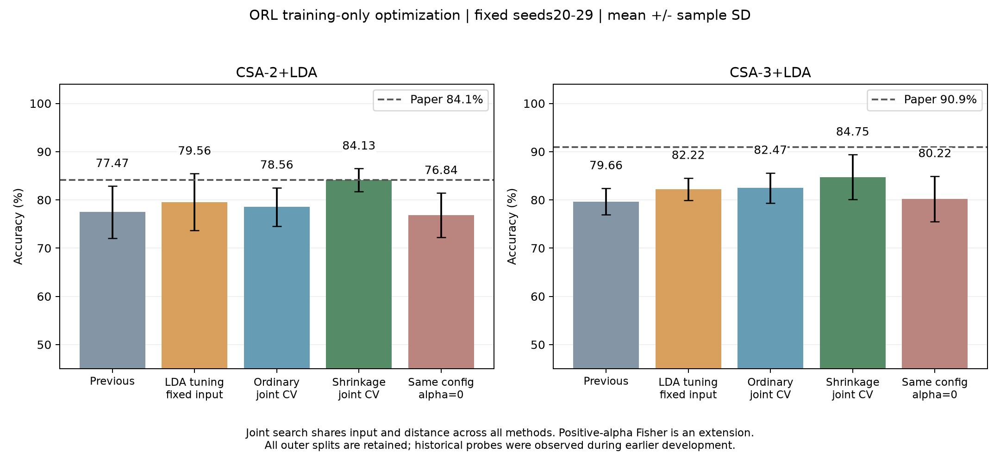
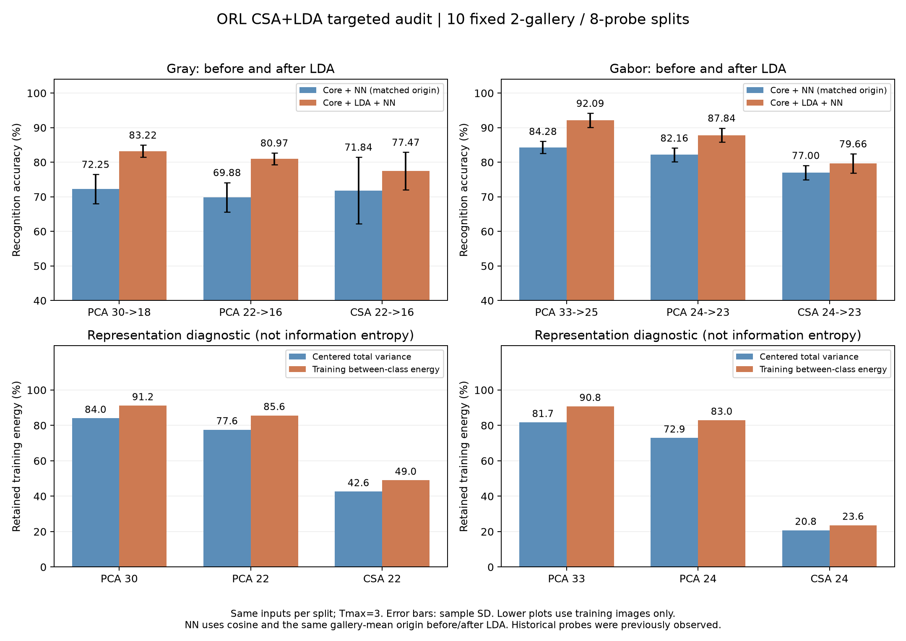

# CSA reproduction: Current results, protocols and submissions

**Project classification: full reproduction within the instructor-approved ORL, MNIST, and original grayscale FERET scope.** PIE omission is authorized. This classification does not assert author-identical implementation, complete recovery of undisclosed parameters, or exact agreement with every reported value. All numerical differences and extension/selection categories remain disclosed.

**Report/slide exports:** [27-page vector atlas](../output/pdf/CSA_figure_atlas_20261030.pdf) and [complete27-figure catalogue](./TEAM_BRIEF.md#figure-pack), covering all16 main recognition cases plus reconstruction, convergence, curves, and extensions. No new model fits; the final curve panel re-scores existing saved models.

<a id="orl-gray-recovery-20261030"></a>

## ORL grayscale follow-up, 2026-10-30: unpublished-setting exploration at 11x2 to LDA16

**Current grayscale representative: 81.84% +/- 1.96%, versus the historical shared reference 77.47% +/- 5.41% and the paper 84.10%.** This is +4.38 percentage points over the historical reference, with nine improved splits and one lower split. The remaining paper gap is -2.26pp. The configuration was selected using already-observed probes; it is an exploratory winner, not a new blind test or a globally optimal parameter solution. README and the current headline charts use81.84%; the old shared77.47% is retained only as a historical comparison. The existing Gabor88.75% representative and shrinkage84.13% grayscale extension are separate results.

### Fixed requirements and candidate design

- All400 original ORL images, identities1-40, seeds20-29, G2/P8, 80 fitting/gallery images and320 probes per split; no discarded seed, image, or synthetic sample.
- Aligned56x46 grayscale; CSA11x2=22 coefficients followed by ordinary unregularized LDA16; Tmax3 and epsilon.001. No new rank, LDA output dimension, shrinkage, weighted Fisher metric, ensemble, or classifier was introduced.
- Twelve input bundles were frozen before initial fitting/scoring: historical per-split shared inputs; YuNet eye distance/y20/24,18/24,22/24,20/22,20/26,16/24; cubic and Lanczos4 interpolation at20/24; zero warp fill at20/24; CDF-min equalization at20/24; and the existing Haar/manual-reviewed eyes at20/24. Other fixed inputs use linear warp, replicate fill, PIL histogram equalization.
- Four CSA variants per initial input: final-rank rectangular identity; gallery-derived HOSVD; full-square identity progressively reduced during the first sweep; and gallery-mean-centered HOSVD. The latter two are separately disclosed interpretations. HOSVD estimates mode bases only from each fitting gallery, not by fitting each image independently or compressing the sample axis.
- Six unweighted numeric conventions: unit-column or Sw-normalized LDA directions, each with gallery-centered cosine, linear-origin cosine, or Euclidean NN. Every input/policy is also scored for PCA30->LDA18 and the equal-budget PCA22->LDA16 controls.
- The initial best was at eye distance16, the lower crop-range boundary. A single probe-informed refinement froze six new geometries:14/24,15/24,17/24,16/22,16/26,12/24. It retained rectangular/HOSVD uncentered starts and both PCA controls. No further automatic expansion follows this completed neighborhood.
- Initial batch:480 CSA+240 PCA fits; refinement:120 CSA+120 PCA fits. Total960 models,5760 scores and1,843,200 repeated probe predictions. There are360 CSA configuration means, not360 independent test datasets. Every batch completed all its model fitting before its new probe scoring; the second batch was designed after seeing the first batch's probes.

### Before, after, and paper comparison

| Result | Mean +/- sample SD, % | Paper reference, % | Difference, pp | Category |
|---|---:|---:|---:|---|
| Historical shared CSA11x2 -> ordinary LDA16 |77.47 +/- 5.41|84.10|-6.63|Preserved shared reference; historical input/policy can vary by split |
| Initial finite-pool best: d16/y24, rectangular identity, unit-column Euclidean |81.34 +/- 2.10|84.10|-2.76|Probe-selected global ten-split configuration |
| Final finite-pool best: d15/y24, rectangular identity, unit-column centered cosine |**81.84 +/- 1.96**|84.10|-2.26|Probe-informed crop refinement; original output dimensions retained |
| HOSVD at that final input/policy |81.84 +/- 1.96|84.10|-2.26|Same per-split correct counts as rectangular identity; no accuracy gain |
| Matched PCA30 -> ordinary LDA18 |83.50 +/- 2.29|82.20|+1.30|Same final input/splits/NN policy as the CSA winner |
| Matched PCA22 -> ordinary LDA16 |81.44 +/- 2.24|No matching paper row|--|Equal-output-budget control |
| Earlier gallery-selected shrinkage extension |84.13 +/- 2.38|84.10, contextual only|+0.03|Different ranks/LDA dimensions and positive shrinkage; not original11x2->ordinary16 |

The final CSA beats equal-budget PCA by0.41pp in mean, but remains1.66pp below paper-dimension PCA30->18. These are descriptive differences; repeated splits reuse the same400 photos and do not establish statistical significance. The original paper's gray CSA-over-PCA ordering at their respective reported dimensions is still not recovered.

Final configuration: existing YuNet eyes; target left(15.5,24), right(30.5,24); OpenCV INTER_LINEAR similarity warp into46x56, BORDER_REPLICATE; PIL per-image histogram equalization; no CSA tensor-mean subtraction; rectangular identity at56x11 and46x2; three sequential CSA sweeps; ordinary LDA16, unit-length projection columns; fitting-gallery mean as origin; cosine1-NN. The smaller target eye separation increases the original-image field of view. There is no Gabor/context convolution in this gray experiment; adding an outer canvas and discarding it would not itself add gray input information.

The highest single score in the combined candidate pool is **85.9375% (275/320)**: d14/y24, rectangular identity, unit-column Euclidean, seed22. It is not the mean winner. The mean-winning d15/y24 centered-cosine configuration ranges79.0625%-85.00%. Neither single maximum replaces81.84375% as the ten-split mean.

### What the optimization established

- Crop/field of view and the numeric NN convention are useful adjustment directions within this tested pool. At the final winner, rectangular identity and HOSVD give the same ten per-split correct counts and the same correctness flags. One seed22 probe receives a different incorrect class label, so the full prediction vectors are not identical. Initialization is not demonstrated as the source of the final accuracy gain.
- At the fixed d20/y24 reference, the best initial-pool uncentered score is77.09%; d18/y24 reaches80.22%. Haar eyes69.09%, CDF-min76.53%, cubic76.72%, Lanczos77.56%, and zero fill75.09% are retained as input-specific best candidate means, not isolated causal effects or independent headline winners. Each such maximum may use a different start/policy. The full per-input table prevents silent removal of negative results.
- Ordinary versus shrinkage results remain distinct. Earlier84.13% used8x4 ranks in7/10 splits,11x2 in2,11x3 in1, LDA dimensions19-31, and positive shrinkage in all ten. It cannot be reclassified as the present paper-dimension result.
- TA permits disclosed choices for missing alignment/Gabor settings and requires fixed comparison conditions across methods. This batch retains the explicit count/size/iteration/dimension/NN requirements and shares each scored input/policy across methods. TA has not individually confirmed these eyes, targets, centering, starts, direction scaling, or distance, nor endorsed probe-selected parameter choice as independent validation. Full-square and centered variants remain labeled. The paper reports best parameter configurations but leaves split aggregation unspecified; it does not establish that the authors selected a best seed.

### Verification, files, and rerunning

Both batch verifications pass. The initial verifier independently recomputes all720 saved models' embeddings and4320 prediction vectors, checks all summary statistics, confirms all ten historical correct counts, recomputes selected full CSA trajectories via sample-matrix covariances, and checks Fisher equations and frozen hashes. The refinement checks all240 models and1440 NN vectors with a second distance calculation and saved-prediction readback, with24 independent CSA trajectory recalculations. Maximum trajectory projector discrepancy is below6.5e-13; maximum independent Fisher relative residual is below8.1e-13. Historical CSV/JSON/source evidence remains unchanged.

Sources: [combined final analysis](../results/orl_gray_recovery_20261030/final_analysis.json), [all576 configuration summaries](../results/orl_gray_recovery_20261030/combined_summary.csv), [ten paired final comparisons](../results/orl_gray_recovery_20261030/final_paired_comparison.csv), [per-input exploratory maxima](../results/orl_gray_recovery_20261030/per_input_best_exploratory.csv), [initial protocol](../results/orl_gray_recovery_20261030/protocol.json), [initial verification](../results/orl_gray_recovery_20261030/verification.json), [refinement protocol](../results/orl_gray_recovery_20261030/refinement/protocol.json), [refinement verification](../results/orl_gray_recovery_20261030/refinement/verification.json). Drivers: [initial experiment](../run_orl_gray_recovery.py), [independent verifier](../verify_orl_gray_recovery.py), [refinement](../run_orl_gray_refinement.py), [consolidation](../analyze_orl_gray_recovery.py). Raw images, generated inputs, models and prediction NPZs stay local under the existing dataset/cache exclusions.

After reconstructing ORL, the two existing eye records, and historical audit inputs, use a new output directory:

```powershell
python run_orl_gray_recovery.py --output results/orl_gray_recovery_rerun
python verify_orl_gray_recovery.py --output results/orl_gray_recovery_rerun
python run_orl_gray_refinement.py --output results/orl_gray_recovery_rerun/refinement
```

The consolidation script targets this recorded20261030 batch and does not fit models. The current27-figure edition is updated20261030: headline figures01/02/05 use gray81.84% +/- 1.96% and gap-2.26pp. The20261027 edition remains an unchanged historical archive. Detailed crop/distance and selection notes remain in captions and this section, outside the main result table.

<a id="orl-recovery-20261027"></a>

## ORL follow-up, 2026-10-27: original output dimensions, bounded recovery study

**Current representative result:** **88.75%±2.89%** (HOSVD start, context extension; ten splits, −2.15pp versus the paper90.90%). The full-square identity result **88.81%±2.97%** (full-square identity initialization variant; −2.09pp) is listed separately as an initialization-shape variant. Rectangular identity gives88.72%±3.01%. The pool's single-run maximum is **93.125% (298/320)**, with rectangular identity, d18/y25, seed22, and default centered-cosine NN. This is an exploratory best run with a context extension, not the ten-split mean or an author-confirmed original setting. Historical batch data are retained separately.

### Design and source interpretation

The local CSA paper was checked visually on printed pages39 and43–44: TableII/Fig.7(c) specify4×2×3 before23-dimensional LDA. SectionIV-C reports best parameter configurations, but does not specify the repetition count, seed aggregation, or whether the reported score is a split mean or maximum. We therefore report both mean/SD and observed maximum. The text does not justify attributing best-seed selection to the authors. [Paper metadata/DOI](https://doi.org/10.1109/TCSVT.2007.903317), [local paper](../Reconstruction_and_Recognition_of_Tensor-Based_Objects_With_Concurrent_Subspaces_Analysis.pdf).

The public search did not identify a verified official implementation or missing ORL hyperparameter record. General Gabor/HOSVD sources support candidate construction, not recovery of a secret author setting. [Gabor reference](https://cenl.ucsd.edu/pubs/ieee-1997.pdf), [tensor/HOSVD reference](https://www.kolda.net/publication/TensorReview.pdf).

- All ten existing seeds20–29, all400 ORL images, G2/P8, no discarded splits; CSA4×2×3, ordinaryLDA23, Tmax3, no centering/shrinkage/new ranks/synthetic gallery samples.
- Three predefined geometry bundles: eye distance/y=20/24,18/25,22/22. All use sigma=pi, wavelength base4,39×39 kernels, magnitude power1, PIL equalization, context convolution, and28×23×40 output. Context remains a field-of-view extension. Distance and eye height vary together, so their individual effects are not isolated.
- Three starts: rectangular identity at final mode ranks; fitting-only HOSVD at final ranks; full square identities progressively reduced in the first sweep. The third is an initialization-shape interpretation/variant, not an author-confirmed correction. Report the rank-conforming starts separately.
- Six unweighted NN/scaling policies plus six Fisher-eigenvalue-weighted policies. Positive weighting exponents change the metric and are explicitly extensions. All settings were frozen before the new scores.
-90 new CSA models and30 matched PCA24 controls were fitted. All120 models froze before outer scoring;12 policies yield1440 scores and460800 repeated probe predictions. Maximum/mean-based candidate selection uses already-observed probes and is exploratory, not new nested validation.

### Ten-split results, shared default NN policy

| Input/start | Mean±sample SD, % | Single maximum, % | Mean minus CSA paper90.9, pp | Category |
|---|---:|---:|---:|---|
| d20/y24 rectangular identity |88.72±3.01|92.50|−2.18|Fixed rank-conforming start; context extension |
| d20/y24 HOSVD (current representative) |**88.75±2.89**|92.19|−2.15|Fixed rank-conforming start; context extension |
| d20/y24 full identity |88.81±2.97|92.50|−2.09|Alternative initialization shape; context extension |
| d20/y24 gallery-SSE-selected start |88.81±2.91|92.19|−2.09|Additional training-only start selection at fixed input/metric |
| d18/y25 full identity |88.59±2.23|93.13|−2.31|Geometry/initialization variant |
| d22/y22 HOSVD |88.31±1.84|90.94|−2.59|Geometry/initialization variant |
| Matched PCA24→23, d20/y24 |90.59±1.94|94.06|No matching PCA24 paper row|Equal-output-budget control |

The default policy is unit-length LDA columns, fitting-gallery centering, and cosine1-NN. Full versus rectangular identity on identical d20/y24 input changes the mean by only **+0.09375pp (3 wins,7 ties,0 losses)**. It does not explain the original11.24pp shared-reference gap. The best weighted metric averages86.16%, below the unweighted choices; retain this negative result. The matched PCA mean remains above CSA, so the paper's relative low-dimensional CSA advantage is still unrecovered.

The gallery-SSE analysis selects the lowest reconstruction SSE among the three starts using only fitting data, with input/metric fixed. It does not turn the probe-selected input/metric winner into an independent validation estimate. In the raw summary, differences/thresholds refer to the CSA90.9 reference even for PCA control rows; there is no matching paperPCA24 row and no claim that its paper result is90.9.

### Verification, reproducibility, and stopping

- Every mode covariance is checked by independent sample-matrix accumulation; final bases are orthonormal, and retained energy is non-decreasing across the three sweeps.
- Rectangular/HOSVD updates are cross-checked against the existing CSA implementation. Full-square initialization is checked by the covariance/eigen-equation route; it is not claimed identical to rectangular initialization.
- Ordinary Fisher eigenvalues are checked independently; all1440 NN score vectors match an independent distance calculation. Input/model/source hashes, split isolation/counts, and all ten results per configuration are checked.
- d20/y24 regenerated features exactly match the historical context_sigma_pi hash. This helps distinguish genuine setting effects from a feature-generation discrepancy.
- No original algorithms, old scores, data, or frozen source snapshots were modified. New numerical caches remain excluded from GitHub.

Sources: [protocol](../results/orl_recovery_20261027/protocol.json), [complete summary](../results/orl_recovery_20261027/summary.csv), [per-split scores](../results/orl_recovery_20261027/results.csv), [verification](../results/orl_recovery_20261027/verification.json), [supplementary paired/SSE analysis](../results/orl_recovery_20261027/supplementary_analysis.json), [figure](../results/orl_recovery_20261027/comparison.png), [driver](../run_orl_recovery.py), [analysis script](../analyze_orl_recovery.py).

For a fresh output after obtaining ORL and the eye records, run `python run_orl_recovery.py --output results/orl_recovery_rerun`. The default full run needs a previously nonexistent output directory; it reuses existing project eye annotations. The supplementary analyzer's output root is fixed to this recorded batch. Local full model/feature reconstruction requires the omitted data/caches; the public checkout provides evidence and code, not a data bundle.

**Next useful direction, not executed:**A small preregistered wavelength×sigma interaction study on the best fixed geometry, with proper gallery-only selection and matched PCA, or independent/manual eye truth to isolate alignment. These are hypotheses rather than promised gains. Larger ranks, shrinkage, augmentation, ensembling, or classifier changes may improve recognition but must remain method/protocol extensions. This bounded pool is complete; no automatic full-grid or seed expansion follows.

**The latest DATER extension has been completed and verified according to subsequent authorization, and has not been improved:**Fixed 2π cropped inner input, 4200–4219 twenty split, 24 dimensions, DATER direct NN is**71.64%±3.18%**, followed by ordinary LDA 23 is **67.11%±3.59%**; under the same conditions, CSA is 74.33%/80.13% and PCA is 82.70%/88.81%. 20 new DATER models, 40 reused controls, 120 scores and 38,400 predictions were verified; 19 DATER models reached the upper limit of 20 rounds, and it cannot be claimed that all convergence or DATER is invalid as a whole. It is an extension of the supervision method and does not replace the main CSA reproduction form; formal submission materials have not yet been produced. [Protocol, Negative Results and Validation Limitations](#orl-dater).

**All three of the latest controlled experiments have been completed and verified:**Error/cost reuse of existing models; σ × context four inputs, 20 predetermined splits, four methods 320 fittings; the four-way probe eye point disturbance score of the reused model is 1280. Fixed π context CSA24+ordinary LDA 23 is**87.08%±2.30%**, which is 6.95pp higher than 80.13% in this round of 2π clipping, but still 3.82pp lower than the paper's 90.9%, and PCA with the same budget is 91.08%. The context is extended, and the unknown author setting is not confirmed; the controlled round retains the DATER plan at that time, and the subsequent DATER execution is as shown above, and the formal submission materials still retain the plan. [Full Results, Costs, Robustness and Planning](#orl-controlled).

The gallery selection parameters in the previous cropping were **81.41%±2.41%**, which is only +0.16pp compared to its paired baseline of 81.25%; the negative results are retained. [Optimized within previous crop](#orl-ta-crop).

The gallery-only validation selection that previously included context/power expansion **87.84%±3.28%** continues to be retained in a single column, which is 3.06pp away from 90.9% of the paper; it must not be confused with the same result as the process within this round of tailoring. [Previous limited iteration](#orl-unknown-parameters). The original shared main table and the exploration maximum selected by probe will not be replaced.

updated: 2026-10-08. **200 G2/P8 limited explorations have been completed: ordinary CSA32+LDA24 is up to 95.00%, pure CSA560 is up to 97.50%, pure CSA retaining 390 dimensions is up to 97.19%. These are explorations filtered by probe extreme value, which have been independently rerun, and are not proof of stable mean or the same statistical caliber of the original authors.** For details, see [Best Observation Results](#orl-best-search). The ten ordinary CSA+LDA mean 83.28% and all sample size experiments of the previous gallery-only validation selection are still retained. The complete history of the paper is at [HISTORY.md](./HISTORY.md). For the operation entry, installation and directory description, see [README](../README.md). This article is not a formal formatted report of 3–4 pages.

## Table of Contents

- [1. Scope and Conclusion](#scope)
- [2. Teacher confirmation agreement and our group agreement](#protocols)
- [3. ORL: Fixed results and gap troubleshooting](#orl)
- [4. MNIST: current result](#mnist)
- [5. FERET: current result](#feret)
- [6. Convergence, reconstruction and numerical verification](#validation)
- [7. PIE description omitted](#pie)
- [8. Four-step completion status and course submission](#submission)
- [9. Run and result files](#outputs)
- [10. Overview of all performed experiments, data and differences from the paper](#experiment-overview)

<a id="scope"></a>

## 1. Scope and Conclusion

Paper: [Xu et al., *Reconstruction and Recognition of Tensor-Based Objects With Concurrent Subspaces Analysis*](../Reconstruction_and_Recognition_of_Tensor-Based_Objects_With_Concurrent_Subspaces_Analysis.pdf), IEEE TCSVT 18(1), 36–47, 2008, DOI 10.1109/TCSVT.2007.903317.

- Actual range: **ORL, MNIST, original grayscale FERET**; original CMU PIE not obtained, omitted by instructor permission. This is full reproduction within the instructor-approved three-dataset scope; original CMU PIE is outside that approved execution scope.
- Current ORL24→23 report/presentation representative: **88.75%±2.89%**, HOSVD start plus context extension, ten observed splits, **−2.15pp** versus the paper90.90%. The full-square identity result **88.81%±2.97%** is a separate initialization variant. Historical study-specific scores below remain unchanged. [Current protocol and limits](#orl-recovery-20261027).
- ORL's previous fixed controlled experiment: Twenty identical splits, σ ​​× context four inputs are all reported; CSA24→23 is 80.13/84.56/81.25/87.08%, and the fixed π context is +6.95pp (20/20 improvement) relative to the current round of 2π cropping. CSA390 prefers 2π in the context, indicating that it is not the joint optimal of the four methods. Verification of 1,280 eye point disturbances, errors, and measured projection costs was completed; DATER has subsequently completed independent expansion, and the submitted materials are still planned. [Complete controlled evidence](#orl-controlled).
- ORL has previously had limited optimization within tailoring: CSA24+ordinary LDA 23 is 81.41%±2.41%, which is only +0.16pp (2 wins,4 ties,and4 losses) relative to the paired baseline of 81.25%; shared CSA390 is 88.41%, and two PCA are 88.41%/91.69%, both lower than the paired baseline. 90.9% of the papers were not recovered; clear TA conditions were met, and unknown settings were still disclosed. [Actual results and verification](#orl-ta-crop).
- ORL Previously the paper's dimensions unknown parameter iteration: gallery-only validation selection CSA24+ordinary LDA 23 is 87.84%±3.28%, 6.59/3.53pp higher than the fixed baseline/context; shared CSA390 is 91.03% and 0.53pp lower than the context. Input contributions contribute major gains, unknown settings and preprocessing extensions are still listed separately, and no restoration of author agreement is claimed. [All stages, parameters and verification](#orl-unknown-parameters).
- ORL The first three inputs are fixed controls: 120 times of fitting/verification completed, CSA24+ordinary LDA 23 baseline 81.25%→context 84.31% (+3.06pp), pure CSA390 is 90.00%→91.56% (+1.56pp); TT+equilibrium is 78.31%/89.56% respectively, and negative results are retained. The new preprocessing is an extension and does not replace the shared main table. [Complete matching evidence and consistent range](#orl-next-directions).
- ORL adds 200 new explorations: ordinary CSA32+LDA24 is up to **95.00%**(the fixed configuration means 86.42%); pure CSA560 is up to**97.50%**(mean 91.43%); pure CSA390 is up to**97.19%** (mean 92.00%). All select maximum according to probe, which is separated from the training-only validation selection results; only 88.44% of the maximum 24→23 dimensional anchor points of the paper are retained. [Complete parameters, value range and verification](#orl-best-search).
- ORL historical targeted Gabor iteration: ordinary CSA+LDA **83.28%±3.30%**, shrinkage expansion **85.47%±4.57%**, which are respectively 0.81/0.72pp higher than the previous optimization mean in training; pure CSA390 with ordinary process **89.97%±2.23%**. There is still a gap from 94.4%/90.9% of the paper, see [latest iteration](#orl-csa-refinement). The grayscale still uses the previous normal/shrinkage result **78.56%±3.98% / 84.13%±2.38%**, which has not been readjusted in this round.
- ORL Corrected eyespot/cropping and completed training-only validation selection. New shared input + paper dimension, 10 seeds: pure CSA **90.19%±2.37%**, CSA+LDA **79.66%±2.77%**; the first round of training parameter selection corresponds to **89.72%±2.26% / 80.34%±3.79%**. Additional balanced rank searches did not improve mean , all were retained. The paper corresponds to 94.4%/90.9% and cannot be claimed to have been accurately reproduced.
- MNIST Common process reuse verified fixed settings: PCA **87.52% / 88.58%**, CSA **90.34% / 91.04%**. The old results of parameter selection for each method are used as a single column for exploration and are not integrated into the shared main table.
- FERET Common Process Multiplexed Fixed Cosine Control: CSA **88.73% / 94.25% / 95.38%**. The original validation selection remains; the higher fixed control cannot be renamed the validation winner.

The final ORL training-only validation selection main results are reported according to the seed 20–29, mean ± sample SD; the new exploration maximum is reported according to the predetermined 200 splits and parameter grid; the development control and MNIST still use 20/21/22; FERET is a fixed identity split, and the random split SD is not reported. The existing probe has been used for development observation, and continuing development is not a new blind test. The paper does not provide a corresponding random index and the same statistical caliber; exceeding a certain number does not prove statistical significance or restore the same original agreement. [Current three data set master table](../results/orl_protocol_audit/shared_comparison.csv) records source, configuration and number of repetitions; FERET SD is left blank because there is only one fixed identity split. The SD=0 of the old master table was a placeholder and does not represent zero uncertainty.

<a id="protocols"></a>

## 2. The teacher confirms the agreement and our group agreement

### Confirmed Course Agreement

| data set| input and preprocessing| training, gallery and probe|
|---|---|---|
| ORL | Binocular alignment, normalization, equalization, 56×46; Gabor recognition 28×23×40| 40 people, each person randomly receives 2 training/gallery cards and 8 probe cards|
| MNIST | 28×28, 500 sheets per category; Gabor 28×28×40| G30/P470 and G40/P460|
| FERET | Eye alignment, normalization, balance, 41×27| Fa+Fb learning of the first 50/100/200 identities; the remaining identities Fa is gallery and Fb is probe|

unifies 5 Gabor scales, 8 directions, 40 channels, nearest neighbor classification; recognition CSA `Tmax=3`. The number of front dimensions of LDA is at most `N−Nc`. Faculty allow FERET/PIE omissions that cannot be obtained in a timely manner and request clarification of protocol differences. The complete message is saved in [History 03](./HISTORY.md#history-03).

**TA's latest reply (project record date 2026-10-07):**Qiyuan clarified that the original code and hyperparameter records can no longer be provided by the teaching team; the remaining ORL alignment and Gabor settings are determined according to public literature and common practices,**fixed and consistent across methods**, and the differences are explained item by item in the report. Exactly matching paper numbers is not a requirement and will not affect your grade. See [History 14](./HISTORY.md#history-14) for the complete reply. This does not mean that the new eyepoint/Gabor settings have been confirmed by the original authors, nor does it remove the previous ORL eye alignment requirement.

### data source and our group supplementary agreement

- ORL The original 400 PGMs are in [data/raw/orl](../data/raw/orl/), the source and hash are in [data list](../data/dataset_manifest.json). Currently, Haar v2 and [YuNet Eyepoint Table](../results/orl_protocol_audit/yunet_eye_coordinates.csv) are reserved for comparison within training. Both are approximate coordinates, left/right refers to the left and right of the screen.
- MNIST uses the first 500 pictures of each number in the official test set, fixed at 5,000 pictures and then split; the specific sample index of the paper is unknown. Each training-only validation selection and final settings are saved in [selected_configs.json](../results/available_tuned/selected_configs.json).
- FERET Priority use [Official Matching Table](../FERET/official_fa_fb_pairs.csv): 1,195 identities, 2,390 Fa/Fb, both with binocular coordinates. The total download also contains 3,680 original grayscale TIFFs, and it is not possible to re-pick easier samples from additional candidates. See [FERET/README.md](../FERET/README.md) for data description. Use `Image.open(path).convert('L')` for reading; the official left and right eyes refer to the left and right sides of the human body and must be converted into screen order.
- Among the specific eye point targets, interpolation, intensity numerical processing, Gabor parameters, PCA/CSA centering, LDA direction scale and NN distance, the parts that have not been confirmed by the original authors belong to our group agreement; the complete operation protocol is subject to `protocol.json` in each output directory.
- Old baseline Gabor: λ=4√2^s, θ=oπ/8, σ=2π; finite core minus mean, complex response amplitude, reflect padding, complete image filtering first and then sampling. Old core side lengths 25/35/51/69/99, isolation corrections for radius float rounding did not address major gaps. **The previous four steps of ORL** use the theoretical side length 25/35/49/69/97, zero padding; retain λ, θ, σ, amplitude and `[::2,::2]` sampling. The current ORL training selection is between theoretical support and the 39×39 zero boundary. The old global `gabor.py` has not been overwritten, and MNIST/FERET maintains the original protocol with existing reconstruction experiments.

<a id="orl"></a>

## 3. ORL: Fixed results and gap troubleshooting

<a id="orl-dater"></a>

### 2026-10-08: Fixed 24-dimensional DATER supervised tensor extension, completed

The user subsequently explicitly authorized "complete the execution of dater", so the previously reserved **one input, 20 DATER model** plan was executed. Uses inputs within 2π clipping predetermined by controlled experiments, rather than looking at four-input probe results and switching to a higher-scoring π context; does not search for input, rank, stopping threshold, distance, or seed. Source code: [dater.py](../dater.py), [Freeze Fitting and Result Driven](../run_orl_dater.py), [Independent Model Verification](../verify_orl_dater.py), [Score Reading Correction Entry](../evaluate_orl_dater.py). The original `csa.py`, `gabor.py` and all old results remain unchanged; MNIST/FERET parameters have not been adjusted.

#### fixed protocol and the paper/TA boundary

algorithm source: [Yan et al., Discriminant Analysis with Tensor Representation, CVPR2005](https://mmlab.ie.cuhk.edu.hk/archive/2005/01467312.pdf), [Local verification PDF](./sources/DATER_CVPR2005.pdf). Checked Figure 3: full square unit matrix initialization, updated in mode order, using the updated pre-order mode and the previous round of post-order mode to construct inter-class/within-class scatter aggregated by expanded columns, solve `Sb U = Sw U Λ` and take the leading direction; when t>2, stop according to the base matrix change. **DATER directions generally do not satisfy Euclidean orthogonality, and CSA orthogonality constraints or QR are not used for fitting.** The generalized feature update of Figure 3 is not interpreted in this experiment as a joint trace-ratio global optimum or monotonic rise guarantee.

| project| Actual settings for this round| evidence boundary|
|---|---|---|
| data and split| Original ORL 400 sheets, 40 categories, G2/P8; seeds 4200–4219, exactly the same as the controlled control| retains the TA quantity conditions that have been clarified; 400 photos and probes have been observed under development, not a new blind test|
| shared input| Binocular alignment/PIL equalization 56×46; λ₀=4, σ=2π, 39×39 core, limited DC, zero convolution padding; cropping inner filtering and then stride00 sampling, 28×23×40| follows the frozen `2pi_crop`; automatic eye points, eye targets, kernels and σ are still agreed by our group and have not been confirmed by the author one by one.|
| Output and Supervision| rank (4,2,3), 24 dimensions; only 80 gallery labels participate in mode divergence; additionally connected to ordinary LDA 23| and CSA24/PCA24 and other budgets; DATER is a new algorithm and cannot be called the original CSA+LDA|
| initialization and solution| I28/I23/I40 complete initialization; 0→1→2 order; leading generalized feature direction, no ridge/shrinkage/QR/singular fallback| Press DATER Figure3; All Sw values ​​in this round are positive definite, the maximum condition number is about 26,503, no fallback is required|
| numerical convention| Euclidean unit length of each column, positive sign of the maximum absolute coordinate; Tmax=20, ε=0.001; the first round or upper limit that meets the stopping condition| the paper does not give these values ​​and column scale/symbol details, they are all frozen settings of our group before scoring. TA's CSA Tmax=3 is not equal to DATER Tmax=3|
| Classification and LDA| shared gallery mean centering cosine NN across methods; ordinary LDA, α=0, direction unit-norm columns; 24≤80−40, output 23| retains the NN and LDA budget; the distance/column scale has not been confirmed by TA or the author one by one; DATER followed by LDA is an additional branch of our group|
| Comparison and rating freeze| 20 new DATER model, reusing 20CSA24 and 20PCA24 models/LDA; all DATER models are frozen and verified first, and then scored for the first time| No control refitting, no probe selection/iteration; verification and 20 complete reference recalculations, excluding new candidates|

[Full protocol](../results/orl_dater/protocol.json), [Scheduled split](../results/orl_dater/splits.json), [Input/Source Freeze](../results/orl_dater/freeze.json), [Model Freeze](../results/orl_dater/model_freeze.json). DATER the paper experiment is PIE/FERET, **there is no paper result that can directly correspond to the ORL24 dimension of this round**; PIE is still omitted according to the teacher's permission. This round only constitutes a transparent method extension for the course project, and TA did not confirm these DATER settings.

#### Same as split Result: mean ±sample SD

| method| 24-dimensional direct NN (%)| 24→ ordinary LDA 23 (%)| Pairing changes with LDA (pp)|
|---|---:|---:|---:|
| CSA24, reused fixed control| 74.33±3.95 | 80.13±3.49 | +5.80, 20 rises, 0 flats, 0 drops|
| PCA24, reuse and other budget comparison| 82.70±2.95 | 88.81±2.47 | +6.11, 20 rises, 0 flats, 0 drops|
| DATER24, new supervision extension| **71.64±3.18**|**67.11±3.59**|**−4.53, 1 rise, 0 flat, 19 drop**|

| DATER minus the same condition control| Direct NN pairing change (pp); rise/level/fall| +LDA pairing change (pp); rise/flat/fall|
|---|---:|---:|
| CSA24 | −2.69；4/2/14 | −13.02；0/0/20 |
| PCA24 | −11.06；0/0/20 | −21.70；0/0/20 |

CSA paper Gabor CSA24+LDA23 is 90.9%; this round of CSA80.13% is 10.78pp lower, and DATER+LDA67.11% is 23.79pp lower, but the latter is the reference difference of different algorithms, not the reproduction error of DATER paper. The budget PCA24+LDA23 is not the line of PCA33+LDA25 in the CSA paper. There is no matching DATER the paper ORL reference, and a paper target number is not filled in. The old original sharing 79.66%, the clipping gallery selection 81.41%, the context gallery selection 87.84%, the fixed π context 87.08% and the probe extreme value are all retained; the difference across inputs or across seeds cannot be written as the current round pairing optimization gain.

The explanation is limited to the current scheduled setting: supervised compression does not outperform CSA, and additional ordinary LDA does not guarantee gain; it cannot be inferred that "tag participation must be beneficial". Small gallery, 24-dimensional rank allocation, the relationship between non-orthogonal directions and shared cosines, and iterations not meeting the threshold are all factors that may affect performance. **Isolation ablation was not performed in this round, and the only reason cannot be specified or the DATER as a whole** cannot be specified. Supervision, initialization, iteration budget, and non-orthogonal metrics change simultaneously, so it is not a causal control that only changes "whether to use a label".

Training stopped: 19 models reached the upper limit of 20 rounds, 1 (4219) met the stop threshold in the 18th round; a total of 1194 mode updates. There are 165 drops in the joint DTC in the record. Iterations are not selected according to the maximum training DTC, nor are they declared to have converged or reached the global optimum. Negative results do not trigger automatic addition of iterations, changing inputs, or adding new grids. [Training step-by-step record](../results/orl_dater/training.csv), [Stop/condition number summary](../results/orl_dater/training_summary.json), [Step-by-step score](../results/orl_dater/results.csv), [mean SD](../results/orl_dater/summary.csv), [Pairing changes](../results/orl_dater/paired_changes.csv), [Result graph](../results/orl_dater/comparison.png).

#### Verification, failure record and rerun

Synthetic verification before scoring: single mode and ordinary LDA direction maximum error 2.91×10⁻¹⁵; three-dimensional independent reference 48 times updated maximum base error 9.84×10⁻¹⁴. The first complete iteration path verification failed: different generalized feature solution paths accumulated approximately 10⁻¹² starting rounding differences, and 4200 exceeded the frozen divergence 1e−9 comparison threshold in the 8th round of mode 1. [Initial failure record](../results/orl_dater/initial_verification_failure.json) is retained; **The fitting source code, model, stop and tolerance have not been changed**. Supplementary independent verification actually saved track: 1194 times of divergence and leading feature direction, 20 items of LDA and all stopping conditions passed, the maximum divergence relative error is 4.02×10⁻¹⁵, the single direction error is 7.32×10⁻¹², and the feature residual is 3.19×10⁻¹³. The other 20 free reference recalculations only report sensitivities: maximum final direction difference 1.01×10⁻⁵, projection subspace difference 1.97×10⁻⁶, gallery core relative difference 1.85×10⁻⁵, all stop lengths are the same; **does not claim that the two free path values ​​are exactly equal or that their probe predictions are the same**. [Independent model verification](../results/orl_dater/model_verification.json), [Model-by-model inspection](../results/orl_dater/model_update_checks.csv), [Numerical sensitivity](../results/orl_dater/numerical_sensitivity.csv), [Pre-scoring verification source/evidence freeze](../results/orl_dater/verification_freeze.json).

The first scoring entry also failed before writing any scores because `controls.json` was mistakenly submitted to the CSV reader; [read failure record](../results/orl_dater/evaluation_reader_failure.json) is retained. `evaluate_orl_dater.py` only modifies the JSON read distribution and continues to use the freeze driver to complete all scoring logic without changing the fitting or comparison. The corrected entry was [frozen before the first successful score](../results/orl_dater/evaluation_adapter_freeze.json). Actually completed 120 lines of scoring/38,400 repeated probe predictions, 40 historical LDA comparison predictions and neighbors were consistent one by one; independent dot product NN replay, source/input/history/model/prediction hashing all passed. [Final verification](../results/orl_dater/verification.json), [Score frozen](../results/orl_dater/score_freeze.json). In addition, all 120 actual saved files are read back to check G2/P8, non-overlapping indexes, complete coverage of 400 pictures, 24/23 dimensions and six groups of mean/sample SD/plus LDA pairing changes. The pictures have been visually verified; [Supplementary readback](../results/orl_dater/supplementary_readback.json) is the product of manual verification, and it is not generated automatically by the standard stage.

A full rerun requires using a non-existent output directory; first ensure that frozen controlled inputs/controls are available. The following uses supplementary verification and score reading entrances, **does not use the original `--stage verify_models` or original `--stage evaluate` entrances that are known to be too strict**:

```powershell
python run_orl_dater.py --stage prepare --output results/orl_dater_rerun
python run_orl_dater.py --stage fit --output results/orl_dater_rerun
python verify_orl_dater.py --output results/orl_dater_rerun
python evaluate_orl_dater.py --output results/orl_dater_rerun
python run_orl_dater.py --stage verify --output results/orl_dater_rerun
python run_orl_dater.py --stage analyze --output results/orl_dater_rerun
```

The original protocol/model/score freeze is generated by the driver; the additional freeze, failure record, and supplementary statistical readback of this independent verification and read entry are generated by this audit step. It is not claimed that the above command will automatically reconstruct these manual evidences. **This round is completed and stopped**; DATER is an extended material with verification and negative results. The official 3-4 page LaTeX report, 9-minute presentation and public repository release are still planned.

<a id="orl-controlled"></a>

### 2026-10-08: Error/cost, σ×context fixed control and probe eyepoint perturbation

The user requested full planning and execution of feasible parts from previous suggestions, followed by a clear choice to complete controlled experiments first, DATER and submittal retention planning**. This time, gallery selection will not continue, and candidates will not be added based on the results; MNIST/FERET will not adjust parameters. Entry: [run_orl_controlled.py](../run_orl_controlled.py), independent result root: [orl_controlled](../results/orl_controlled/).

| project| Fixed workload| Completion standards and current status|
|---|---|---|
| has error analysis| Zero fitting, reuse predictions from previous context expansion stage_C and fixed context, same-budget PCA| has read back 3200 duplicate probe records, output record-by-record/per-photo CSV, eye points and two-method nearest neighbor graph; do not treat duplicate records as independent photos|
| represents cost and local timing| Zero fitting, CSA24 and PCA24 of stage_C seed 20/25/29, a total of 6 models| 830/618792 projection weights have been checked, 320probe projection + LDA + NN under the actual measured pre-calculation characteristics; 1 warm-up, 7 timings each, each replay prediction|
| σ×context 2×2 fixed control| seeds 4200–4219, four inputs × four methods × 20 split, 320 fitting| Completed and independently verified 320 models, 102400 predictions; reports pairing effects/interactions for all four sets of inputs, no more parameters|
| eye point disturbance| reuses 320 models, each model has four fixed probe perturbations, a total of 1280 ratings, and zero fitting| Completed; independent NN verification 409600 predictions and readback of all 1280 saved files indexing, predictions and corrected/newed errors|
| DATER | This controlled wheel has not been implemented, and the follow-up has been completed, see [Individual expansion](#orl-dater)| retained the plan at that time: if the next round is authorized, first check the paper solution/normalization/stop, and then use this round's 2π cropping inner input, the same 4200–4219 split and 4×2×3 output; about 20 supervised tensor models, direct NN and 23-dimensional LDA to compare with the existing CSA/PCA core|
| Official Course Materials| Not produced or published this round| 3–4 pages of LaTeX, 9-minute presentation and Q&A, and public repository are planned and prepared as follows. They need to be reviewed by the group and released separately.|

The four sets of inputs are `2pi_crop/2pi_context/pi_crop/pi_context`, only changing σ=2π/π and whether to take the 19 pixel context outside the crop. Eye target (13,24)/(33,24), linear affine replicate, 56×46 center PIL equalization, λ₀=4, 39×39 finite kernel minus mean, amplitude first power, filter first and then stride00, convolution zero, identity, CSA without centering /Tmax3, ordinary LDA and unit-norm columns / mean-centered cosine are all fixed. Each method is CSA24→23, CSA390, PCA24→23, PCA33→25. All 320 models are newly fitted, and the old 20–29 tenth mean and the new twentyth mean are not used to calculate the optimization gain.

20 seeds are scheduled before scoring, input/method is not selected by probe, four sets of results and σ main effect, context effect and difference of difference are fully reported. Still reusing the same 400 photos, the splits overlap each other, **not a new blind test or independent subject sample**; mean/SD/win, draw, and lose are descriptive stability evidence, and are not declared statistically significant based on repeated probe records.

#### There is actual evidence of errors and costs

Previously, stage_C corrected 224 old errors and added 111 new errors relative to the fixed context; 2653 correct for both CSA/PCA with the same budget, 158 correct for CSA alone, 249 correct for PCA alone, and 140 errors for both. 3200 records cover 400 different photos, and one photo can be repeated in multiple groups and the results change with the gallery. [Record by record](../results/orl_controlled/historical_errors.csv), [Photo by photo count](../results/orl_controlled/historical_photo_counts.csv), [Check](../results/orl_controlled/historical_error_summary.json), [Original image eye points and nearest neighbor examples](../results/orl_controlled/historical_error_montage.png), [Actual alignment/balanced crop side-by-side images](../results/orl_controlled/historical_aligned_error_montage.png). The legend takes the first two different photos of each category in seed/query order, which cannot represent the distribution of all errors. It can be seen that the side-turned face of s1 and the posture/expression of s8 are different from the CSA error neighbor; the red dot is roughly located at the eye in the original image shown. The 24-panel affine target eye point error is ≤3.56×10⁻¹⁵, which proves that the calculation of mapping to the target is correct, **does not prove that the automatic eye point positioning is accurate**; without the true value of the artificial eye point, it cannot be determined that the eye point error or posture is the cause of the entire gap based on these figures alone. [Manual visual readback record](../results/orl_controlled/visual_inspection_readback.json) is not a standard stage automatic product.

| Same as 24→23 budget| Actual projection weight element| float64 weight bytes| Counted deployment array bytes| three groups of 320probe timing median range|
|---|---:|---:|---:|---:|
| CSA24＋LDA23 | 830 | 6,640 | 228,272 | 21.28–29.27 ms |
| PCA24＋LDA23 | 618,792 | 4,950,336 | 5,171,968 | 59.67–82.14 ms |

The projection weight differs by 745.5 times; the calculated deployment array differs by 22.7 times, because this statistic also includes the actual stored input mean (CSA is an all-zero array), LDA mean, 80 gallery output and label index. Does not include training divergence, probe/core cache, Python object and library overhead, not peak RSS, compressed NPZ size, or full system memory. The PCA/CSA ratio of the three pairs of paired timings is 3.29/2.08/2.81; it is only the projection + LDA + NN under this machine, two BLAS threads, and precomputed power features. It does not include alignment/Gabor, training, disk writing or power consumption, and is not generalized to end-to-end acceleration multiples. [Group-by-group timing](../results/orl_controlled/cost_benchmark.csv), [Definition and prediction verification](../results/orl_controlled/cost_verification.json).

#### Fixed control and perturbation results

Fixed comparisons are all completed and verified. They are all mean ± sample SD of 20 identical splits, unit %; the paper is the best result of the original table, and the statistical caliber is inconsistent. PCA24→23 has no corresponding paper line.

| fixed input| CSA24＋LDA23 | CSA390 | PCA24＋LDA23 | PCA33＋LDA25 |
|---|---:|---:|---:|---:|
| σ=2π, within cropping| 80.13±3.49 | 88.66±2.71 | 88.81±2.47 | 92.33±2.09 |
| σ=2π, context| 84.56±2.44 | **91.16±1.99** | 90.89±2.11 | 93.98±1.91 |
| σ=π, within cropping| 81.25±3.03 | 88.70±2.65 | 89.20±2.76 | 93.38±1.86 |
| σ=π, context| **87.08±2.30**| 90.09±2.46 |**91.08±1.48**|**94.14±1.69** |
| paper| 90.90 | 94.40 | No corresponding line| 87.20 |

| Pairing factor changes (pp)| CSA24→23 | CSA390 | PCA24→23 | PCA33→25 |
|---|---:|---:|---:|---:|
| Cropping inner σ: 2π→π| +1.13 | +0.05 | +0.39 | +1.05 |
| contextσ:2π→π| +2.52 | −1.06 | +0.19 | +0.16 |
| σ=2π: Crop within → context| +4.44 | +2.50 | +2.08 | +1.66 |
| σ=π: crop within → context| +5.83 | +1.39 | +1.88 | +0.77 |
| Difference of differences: σ change under context − σ change within clipping| +1.39 | −1.11 | −0.20 | −0.89 |

CSA24→23 changes σ to 14 rise/0 flat/6 drop in the clipping, and changes σ to 17/1/2 in the context; when σ=π, add context 20/0/0. From 80.125% in this round of σ=2π clipping to 87.078125% in σ=π context, the pairing increased by 6.953125pp, and all 20 groups improved. Still 3.82pp away from the paper; the highest 90.9375% should not replace the 87.08% mean . The pruning inner π branch is still 9.65pp lower than the paper. **Reducing σ itself is not enough to restore the paper number**. PCA with fixed π context and the same budget is still 4.00pp higher than CSA, and the advantage of CSA over PCA in the paper has not been restored; CSA390 reduces σ in the context but decreases by 16 losses,2 ties,and2 wins. It cannot be claimed that π input is generally better or that the four methods share the best.

This fills the previous evidence gap that "most galleries choose π" cannot replace the fixed π verification: under the predetermined 20 split and fixed rest settings, π has a positive descriptive average effect on low-dimensional CSA, and the effect changes with the context. It still does not recognize all influencing factors, demonstrate global optimum or significant interactions. The previous 87.84% was the result of gallery selection/expansion of different 10 splits, the clipped 81.41% was another selection program, and the old shared 79.66% was another input configuration; **Do not subtract the current round 87.08% from them as a pairing gain**. Each historical result is retained in a separate column.

All input cache verification hashes, four sets of 320 channels direct float64 convolution verification passed; source code, index, input and reused historical models/predictions are frozen before scoring. 320 new models, 160 CSA three rounds of independent recalculation, 160 PCA characteristic equations and 102,400 NN predictions passed, with a maximum CSA projection error of 1.15×10⁻¹² and a Fisher residual of 1.45×10⁻¹². The total phase of 320 fitting/encoding/scoring and result saving takes 106.34 seconds, with two BLAS threads; the timing of model-by-model CSV includes fitting, gallery/probe encoding and NN, and cannot be mistaken for only training time. All source code, features and historical evidence hashes remain unchanged.

TA explicitly preserves G2/P8, 400 image 40 categories, binocular processing/center size, 5×8 channels, NN, Tmax3, LDA budget and cross-method sharing conditions; CSA/LDA and PCA paper dimensionality is preserved. However, the context outside the cropping changes the effective field of view, which belongs to our group input expansion, and cannot be called the original cropping protocol confirmed by TA item by item; σ/core/eye target/distance has not been confirmed by the author item by item. Unknown bounds for cosine, mean/best and random indexing remain. [Full protocol](../results/orl_controlled/protocol.json), [Input verification](../results/orl_controlled/feature_verification.json), [Scheduled split](../results/orl_controlled/splits.json), [Sequential scores](../results/orl_controlled/results.csv), [mean /SD](../results/orl_controlled/summary.csv), [Pairing factors and interactions](../results/orl_controlled/factorial_effects.csv), [Independent verification ](../results/orl_controlled/verification.json), [Comparison chart](../results/orl_controlled/comparison.png).

Eyepoint perturbation is all completed and verified. Only the probe is changed, and both eyes move together ±1 pixel along the x/y axis of the original image, without refitting, and the gallery remains unchanged. The following table shows the equally weighted average of 20 split changes in each of the four directions, unit pp; positive numbers are average improvements, and the direction of accidental improvement is not regarded as the new optimal alignment.

| fixed input| CSA24→23 | CSA390 | PCA24→23 | PCA33→25 |
|---|---:|---:|---:|---:|
| σ=2π, within cropping| −0.46 | −0.004 | −0.08 | −0.21 |
| σ=2π, context| −0.42 | +0.02 | +0.01 | −0.01 |
| σ=π, within cropping| −0.53 | −0.23 | −0.05 | −0.25 |
| σ=π, context| **−0.08** | −0.18 | −0.004 | −0.12 |

CSA24→23 are x−1: −0.28, x+1: +0.55, y−1: −0.52, y+1: −0.08pp, with an average of −0.08203125pp; the worst direction means −0.515625pp, and the worst single split/direction −1.875pp. 240 errors were corrected and 261 new errors were added (four directions × 20 split, a total of 25,600 duplicate probe records). Compared with the mean within 2π clipping -0.45703125pp and the worst direction mean -1.03125pp. **π context has a smaller average decrease under this small co-translation, but does not demonstrate general alignment robustness or rule out eyespots/cropping as a cause of gaps.** Only one original image pixel level is tested; the post-affine displacement is also affected by the original eye distance and rotation, and does not cover single-eye independent errors, rotations, severe detection failures, other noise scales or real acquisition disturbances. No independent new data, no causal/significant conclusions.

The 640-channel direct convolution check of 16 sets of perturbation features passed, and the first two full channels of four input zero perturbations were consistent element by element. The 409,600 predictions of 1,280 ratings are consistent with the independent normalized dot product NN; then all NPZ readbacks are saved, and the query/gallery index, neighbor attribution, prediction label, accuracy, and corrected/newed errors are checked again and passed. The source code, original input, 320 model and historical evidence hash remain unchanged; the perturbation phase takes 150.01 seconds, two BLAS threads, including redoing features/scoring/writing, and excluding clean model fitting.

Evidence: [Sequential perturbation score](../results/orl_controlled/robustness.csv), [Summary of all 64 groups of directions](../results/orl_controlled/robustness_summary.csv), [Average and worst changes](../results/orl_controlled/robustness_aggregate.csv), [Perturbation independent verification ](../results/orl_controlled/robustness_verification.json), [Supplementary readback of all saved results](../results/orl_controlled/supplementary_readback.json), [Low-dimensional CSA perturbation map](../results/orl_controlled/robustness.png). Supplementary statistical readbacks and perturbation plots are generated by manual verification steps and are the automatic product of non-standard stages.

**This round is completed and stopped.** Zero new fittings with errors/costs, 320 controlled experimental models and 160 CSA independent numerical recalculations, zero fitting with 1280 disturbance scores; no DATER, report/display production, repository release or MNIST/FERET re-tuning. Only verification of existing clean models can run `python run_orl_controlled.py --stage verify`; a complete rerun must use an output directory that does not yet exist, and execute in sequence:

```powershell
python run_orl_controlled.py --stage prepare --output results/orl_controlled_rerun
python run_orl_controlled.py --stage errors --output results/orl_controlled_rerun
python run_orl_controlled.py --stage costs --output results/orl_controlled_rerun
python run_orl_controlled.py --stage evaluate --output results/orl_controlled_rerun
python run_orl_controlled.py --stage verify --output results/orl_controlled_rerun
python run_orl_controlled.py --stage analyze --output results/orl_controlled_rerun
python run_orl_controlled.py --stage robustness --output results/orl_controlled_rerun
```

#### follow-up plan, not yet implemented

1. DATER planning has now been completed according to subsequent authorization, see [Fixed extension results](#orl-dater). The following retains the current scope: first read [Yan et al., CVPR2005 original paper](https://mmlab.ie.cuhk.edu.hk/archive/2005/01467312.pdf), check mode inter-class / within-class scatter, generalized feature problem, direction normalization and iteration stop. The plan uses fixed input and the same 4200–4219 split in this round of 2π cropping to avoid selecting input from four sets of probe results and retain a total of 24-dimensional tensors of 4×2×3. About 20 DATER models, direct NN and 23-dimensional ordinary LDA are reported respectively; the existing CSA24/PCA24 core direct NN can be reused, and its fitting will not be added. Independent mode divergence/characteristic equations, learned indexes and NN verification are reported only after passing. If regularization or special singular processing is required, it should be stated in advance and marked as a DATER-style extension, and does not claim to be faithful to DATER or CSA reproduction; do not mix it with the original CSA results. The same 400 pictures that have been observed are still used, not a new blind test; the input/split is only for our group's scheduled extended comparison, not the original setting of the DATER author.
2. LaTeX target 3–4 pages: about 0.5 pages of questions and contributions; 1 page of CSA formula/alternative solution, tensor representation and PCA/LDA course connection; 1 page of three data sets original protocol anchor points and paper comparison; 0.75 pages of fixed comparisons, errors/costs and limitations; margin for source, PIE license and auxiliary implementation disclosure. Expansion and exploration extreme value are marked separately, and the entire historical grid is not included in the main text.
3. 9-minute presentation schedule: 1 minute questions/contributions, 2 minutes CSA and course connection, 1 minute original protocol/unknown settings, 2 minutes three data sets and ORL controlled evidence, 2 minutes errors/costs/limitations, 1 minute team understanding and conclusion. Prepare a 3-minute Q&A answer: why low reconstruction error does not guarantee the classification advantage, why not use probe maximum as mean, LDA small sample limit, whether the context is extended, and what is excluded from cost statistics. The division of labor between members is determined by the group.
4. The public code repository first compiles a reviewable list locally: code sources/dependencies, data acquisition methods, restricted FERETs and cache exclusions, fixed protocols/random seeds, run/verification entries, small result tables and figures, licenses and auxiliary sources; use a separate output directory to verify a minimal example. Publish after user review. No public repositories are currently being created/published, and no formal reports or slides are being produced.

<a id="orl-ta-crop"></a>

### Previous 2026-10-08: Optimization of shared settings at the paper's dimensions within clipping under explicit constraints of TA

user is authorized to perform a limited optimization according to the previous round of answers: retain the original 400 pictures, 40 categories, G2/P8, binocular alignment/balanced 56×46, 5 scales 8 directions and 28×23×40 output, ordinary LDA, NN, Tmax=3, fixed CSA4×2×3→LDA23. This round does not use clipping external context, response power transformation, shrinkage LDA or new rank; historical 79.66%, context expansion 87.84% and probe filter extreme value continue to be retained.

Entry: [optimize_orl_ta_crop.py](../optimize_orl_ta_crop.py); Output: [orl_ta_crop_optimized](../results/orl_ta_crop_optimized/). **Parameter selection, freezing, outer scoring and independent verification are all completed; no substantial improvements have been made, and negative results are kept intact.**

The four predetermined inputs are σ=2π/π × Gabor zero/reflect padding. The rest are fixed: YuNet eye point, target (13,24)/(33,24), linear affine/replicate, PIL histogram equalization; λₛ=4√2ˢ, θₒ=oπ/8, 39×39 finite kernel minus mean, complex response amplitude; first 56×46 filtering and then [::2,::2]. The reflect is `np.pad(...,mode='reflect')`, the edges are not repeated, and only the pixels within the mirror crop are mirrored; affine padding and Gabor padding are recorded separately.

1. Each seed 20-29 only uses its own 80 gallery, and each of the four inputs has a complete 16-fold validation; each fold 75 learning/5 verification, retaining 40 categories, and each gallery is verified once. The identity, unit-norm columns / mean-centered cosine are fixed first, and the first two inputs are taken.
2. The first two inputs×identity/HOSVD×six existing LDA direction scales/NN rules, a total of 24 configurations; still fixed at 24→23, amplitude first power and ordinary LDA α=0. Inner layer 24≤75−40=35; outer layer 24/33≤80−40=40. The bisection is based on the worst fold, the declared input order, identity, and the declared NN rule order.
3. All ten sets of parameters and inner models are frozen, and the independent candidate NN and selected model will only be scored after verification. The parameter selection target is only CSA24+ordinary LDA 23; CSA390, PCA24→23, PCA33→25 are used as controls under the same input/initialization (when applicable)/distance, and the optimal input is not selected separately.
4. actually completed 960 inner CSA models, 280 candidates, and 40 new outer layer fittings; 40 verified fixed-cut inner baselines were reused, with a total of 80 scores. The baseline CSA24→23 is 81.25%, which is different from the historical shared input configuration of 79.66%; the pairing improvement is only calculated relative to the 81.25% baseline of this round.

TA explicitly allows for supplementation of remaining ORL alignments/Gabors as per published literature/common practice, consistent across methods, and accounting for differences; it does not confirm item-by-item σ, padding, NN, initial values, or LDA column scaling. The paper allows identity or arbitrary column orthogonal initialization, and HOSVD is generated only by the current learning fold. This round is executed according to the specified TA number, model and sharing conditions. **It cannot be claimed that the details of all unknown authors are consistent** based on this. The historical probe has been observed, but it is still not a blind test; pruning the four inputs according to the default rules may miss better inputs under other rules, and "optimal" only refers to retaining the candidate gallery verification winner.

#### Before and after and paper comparison

are all seeds 20–29 ten times mean ± sample SD, unit %; variation is the same seed pairing mean difference, unit pp. The paper does not have a corresponding line for PCA24→23. This item is only a comparison of our group and other budgets.

| method| This round of matching baseline| Final gallery selection| pairing change| paper| Final minus thesis| rise/flat/fall|
|---|---:|---:|---:|---:|---:|---:|
| CSA24＋ordinary LDA 23| 81.25±2.78 | **81.41±2.41**|**+0.16** | 90.90 | −9.49 | 2/4/4 |
| CSA390 | 90.00±1.69 | 88.41±1.84 | −1.59 | 94.40 | −5.99 | 1/3/6 |
| PCA24＋ordinary LDA 23| 88.63±1.20 | 88.41±1.31 | −0.22 | No corresponding line| — | 3/3/4 |
| PCA33＋ordinary LDA 25| 92.72±1.53 | 91.69±2.16 | −1.03 | 87.20 | +4.49 | 2/3/5 |

CSA24→23 has a minimum of 77.81%, a maximum of 85.63%, and 0/10 reaches 90.9%; CSA390 also reaches 94.4% with 0/10. PCA33→25 are all higher than 87.2% of the paper, which does not prove the same author agreement or statistical significance. The difference between the historical sharing of 79.66% and the current round of 81.41% is 1.75pp, but the input configuration is different. **1.75pp cannot be written as the matching optimization gain of this round**. The previous context expansion of 87.84% has not been rerun or replaced in this round; the extreme value selected by probe does not belong to this table.

The inner layer correct number summary is from the default baseline 508/800 (63.50%) → stage A input selection 566/800 (70.75%) → stage B final 568/800 (71.00%). The outer layer only scores the frozen final B, and does not select A/B based on the outer layer score. The inner layer gain does not translate into obvious outer layer gains: the selection variance of the limited gallery, and the fact that there is only one fitting image left for the verified category in the inner layer and two fitting images per category in the outer layer are all possible explanations; this experiment cannot independently prove overfitting or confirm the only reason. The optimization target is low-dimensional CSA + LDA, and the simultaneous decline of the control method also shows that this is not the jointly optimal input of the four methods. It cannot be deduced from this that σ=π is generally invalid, or the original authors must have used another σ.

#### The final parameters of each gallery freeze

Ten groups of uniformly selected unit LDA direction columns + cosine NN minus gallery mean. See above for other fixed conditions; there is no uniform "best parameter" selected by probe.

| seed| Gabor σ | convolution padding| CSA initialization| The inner layer is correct/80| outer layer CSA24→23 (%)|
|---|---|---|---|---:|---:|
| 20 | 2π | zero | identity | 57 | 83.4375 |
| 21 | π | zero | identity | 57 | 77.8125 |
| 22 | π | reflect | HOSVD | 57 | 82.5000 |
| 23 | π | reflect | HOSVD | 53 | 81.8750 |
| 24 | π | reflect | identity | 53 | 82.5000 |
| 25 | 2π | zero | identity | 57 | 80.3125 |
| 26 | 2π | zero | identity | 55 | 80.6250 |
| 27 | π | reflect | identity | 56 | 85.6250 |
| 28 | π | reflect | identity | 67 | 81.5625 |
| 29 | π | reflect | identity | 56 | 77.8125 |

Count: π/reflect six groups, π/zero one group, 2π/zero three groups; identity/HOSVD is 8/2. 2π/reflect did not become the final winner, which can only mean that it was not selected in this limited selection procedure.

#### Validation, evidence and limitations

- Input: All 400 grayscale center crops are consistent with the existing cache element by element; all Gabor features of the first two baselines are completely consistent; the other 320 channels are independently checked with float64 direct convolution, with a maximum absolute error of 6.09×10⁻⁵, which meets the float32 cache tolerance.
- Before scoring: original 400 file hashes, 160 inner splits, learning/verification indexes and actual dimensions of all 960 models, 8 frozen source codes passed; no probe score. 280 candidates, 22,400 inner-layer verification predictions and 304 selected CSAs passed three rounds of independent recalculation, with a maximum projection error of 2.16×10⁻¹⁴.
- Outer layer: 40 new models, 20 independent CSA recalculations, 20 PCA characteristic equations, 40 historical baseline NN replays, and 25,600 prediction records passed. The maximum CSA projection error is 2.22×10⁻¹², and the Fisher relative residual error is 8.02×10⁻¹³; the source code, input, and selection hash remain unchanged. Additional independent readback of all 80 actual dimensions, shared settings, mean/SD/wins, draws and losses; a total of 12 new scores for the three seeds with unchanged configurations are completely consistent with the baseline predictions.
- TA clear number, binocular processing/size, 5×8 channels, NN, Tmax=3, LDA budget and cross-method sharing conditions are retained; the original paper corresponds to CSA24→23, CSA390, PCA33→25 dimensions are retained, ordinary LDA has no shrinkage. The Euclidean tensor norm definition of the paper is not equal to the normalized NN used in the confirmed recognition; the cosine implementation of this round is publicly disclosed and has not been confirmed by TA or the author on an item-by-item basis. The evidence that TA allows the remaining alignment/Gabor to be reasonably set by itself can be found in [Section 2](#protocols) and [original reply](./HISTORY.md#history-14).
- This round contributes parameter-sensitivity evidence and negative results to the full-reproduction study, and the CSA paper value has not yet been restored. The historical probe has been observed, the original random index and the best/mean caliber are unknown, and the staged pruning is limited. It cannot be called a blind test, global optimum, or exactly the same as the original authors protocol. 241.53 seconds for parameter selection with two BLAS threads, 14.61 seconds for 40 new outer layers, excluding preparation, independent verification and drawing, not a full running cost or peak memory measurement.

Evidence: [sequential data before and after](../results/orl_ta_crop_optimized/comparison.csv), [summary](../results/orl_ta_crop_optimized/summary.json), [group-by-group parameters](../results/orl_ta_crop_optimized/selected_settings.csv), [protocol](../results/orl_ta_crop_optimized/protocol.json), [input verification](../results/orl_ta_crop_optimized/feature_verification.json), [inner layer independent verification ](../results/orl_ta_crop_optimized/selection_verification.json), [Read back before scoring](../results/orl_ta_crop_optimized/pre_score_readback.json), [Outer layer independent verification](../results/orl_ta_crop_optimized/verification.json), [Supplementary statistics read back](../results/orl_ta_crop_optimized/supplementary_readback.json), [Historical shared anchor point](../results/orl_ta_crop_optimized/historical_shared_reference.json), [Comparison chart](../results/orl_ta_crop_optimized/comparison.png). Manually added JSON readback is not automatically output by the standard stage.

This round has been stopped, no candidates, ranks, seeds or regularizations will be appended. Only verify existing results using `python optimize_orl_ta_crop.py --stage verify_selection` and `--stage verify`; a complete rerun must use an output directory that does not yet exist, and execute in sequence:

```powershell
python optimize_orl_ta_crop.py --stage prepare --output results/orl_ta_crop_rerun
python optimize_orl_ta_crop.py --stage select --output results/orl_ta_crop_rerun
python optimize_orl_ta_crop.py --stage verify_selection --output results/orl_ta_crop_rerun
python optimize_orl_ta_crop.py --stage evaluate --output results/orl_ta_crop_rerun
python optimize_orl_ta_crop.py --stage verify --output results/orl_ta_crop_rerun
python optimize_orl_ta_crop.py --stage analyze --output results/orl_ta_crop_rerun
```

<a id="orl-unknown-parameters"></a>

### Previous: Limited, phased optimization within the gallery with unknown parameters

The user is further empowered to list unknown parameters that may cause ORL gaps and actually iteratively optimize them. **The gap cannot be concluded a priori that it must come from a certain agreement inconsistency**: the original authors split / the statistical caliber is unknown, the difference between the 24-dimensional CSA reconstruction target and the classification target, the LDA estimation and selection variance under the 80-image gallery may also be involved. This time, the paper's dimensions are retained, and there is no need to increase samples, increase rank, or shrinkage LDA to circumvent the problem.

entry: [optimize_orl_unknowns.py](../optimize_orl_unknowns.py); result root: [orl_unknown_parameters](../results/orl_unknown_parameters/). **Three phases with ten identical splits all completed and passed independent verification.** This round is independent of the previous shared main table, variable dimension gallery selection parameters, probe filtering exploration extreme value, and three-input fixed expansion; the ordinary CSA24→23 dimension is retained, and the preprocessing expansion specifies a single column.

#### The most unknown unknown quantity worth checking and its value range

Ordering represents troubleshooting priority, not proven cause or author setting. Preorder controls have found that context can be improved, so it is a priority to examine its interaction with wavelength, finite kernels, without repeating large rank grids.

| sequence| Unknown quantities and possible impacts| Limited value in this round| evidence boundary|
|---|---|---|---|
| 1 | Gabor calculation grid, pixel units of wavelength; changes effective frequency band and anti-aliasing properties| The original image is filtered and then sampled, λ₀=4/8; first INTER_AREA is reduced to 28×23 and then filtered, λ₀=4/2| the paper is written to extract the response at the downsampling position, and supports filtering first and then sampling; the first thumbnail is only for differential diagnosis, and is not regarded as an equivalent original agreement and has not been confirmed item by item.|
| 2 | σ, core limited support, DC processing, clipping external context; affects low-dimensional energy distribution and edge response| Context σ=2π/π and λ₀=4/8 cross four terms; 39×39 and 3σ adaptive support; parse DC term and extra finite kernel minus mean; retain the context-free baseline| The previous context had a pairing gain, but the gain could not be attributed exclusively to the edge; added effective field of view as an extended single column|
| 3 | Binocular target and equalization algorithm; affects facial proportion, position and grayscale distribution| Default (13,24)/(33,24), alternative (14,25)/(32,25) and (12,22)/(34,22); PIL and CDF_min balance| The original photo, 400 samples, and YuNet eye points remain unchanged; the two alternatives change the eye distance and y position at the same time, and the causal effects of the two factors cannot be separated.|
| 4 | Amplitude transformation of Gabor response; may reduce the dominance of a few strong responses and may also lose useful information| 1, 0.75, 0.5 power of amplitude| 0.75/0.5 is our group extension; not the amplitude normalization confirmed by the author|
| 5 | Orthogonal initialization of three rounds of CSA; low-dimensional non-convex optimization may rely on initialization| identity, HOSVD generated by the current learning fold| the paper allows arbitrary column orthogonal initial values; HOSVD is not a confirmed author's initial basis|
| 6 | NN distance, feature origin and LDA direction scaling; especially affects cosine and relative weight of each direction| unit-norm columns /Sw whitening scale × mean-centered cosine, origin cosine, centered Euclidean, six rules in total| the paper distance definition supports Euclidean candidates; the teacher/TA only specifies NN and does not specify any of the six items|
| No numerical optimization| The author's actual split, number of repetitions, and best aggregation rules| reports all 20–29 ten identical splits and mean ±SD; no seed selection| is unknown and cannot be restored by adjusting parameters; the best of the paper is not equivalent to our group mean|

Gabor's public basis can be found in [Wiskott et al. the paper §2.1](https://cenl.ucsd.edu/pubs/ieee-1997.pdf), and HOSVD can be found in [Kolda–Bader review](https://www.kolda.net/publication/TensorReview.pdf). Citing mathematical/literary basis for a candidate does not constitute confirmation by the CSA authors of the specific numerical selection of our group. All Gabor uses five scales λₛ=λ₀√2ˢ, eight directions θₒ=oπ/8, and complex response amplitude; the specific canvas, support, equalization and parameters are fully written in [protocol.json](../results/orl_unknown_parameters/protocol.json).

#### Three stages of freezing and verification method

1. **A, input**: 12 sets of scheduled inputs, 16% off each complete, identity, 1st power, unit-norm columns / mean-centered cosine fixed; retain the first two sets of scores. The default context is included in the candidate, and the original baseline without context is retained at the same time.
2. **B, amplitude**: Only the first two sets of A are compared to three powers, with a complete 16-fold validation; the selected plan at this stage is retained, and the probe score is not used to determine subsequent candidates.
3. **C, initialization and NN**: The first two inputs of A × 3 powers × 2 initialization × 6 rules = 72 sets, choose the one with the highest correct number for complete gallery verification; if divided equally, look at the worst fold first, and then follow the context priority/declaration order, power, identity, and NN rule order. The selection target is only **CSA4×2×3+ordinary LDA 23**, and the PCA or CSA390 score is not incorporated into the selection target.
4. **Scoring and verification after freezing of all ten choices**: Each stage fits four terms CSA24→23, CSA390, PCA24→23 and PCA33→25 under the same input, power and distance of the split. 80 existing fixed baseline/context scores are reused; A/B/C × 10 × 4 = 120 new outer layer fittings are performed. Keep all stages and negative results, and do not replace the final C plan with the highest stage of probe.

Each outer split only uses its own 80 gallery selection parameters. The inner layer has 16 folds. Each fold has 75 learning/5 verifications, 40 categories are all retained, and each gallery is verified exactly once; the inner layer LDA is 24≤75−40=35, and the outer layer is 24/33≤80−40=40. Ordinary LDA α=0; pure CSA390 is not connected to LDA and is not subject to the upper limit of dimensionality before LDA. CSA is not centered and Tmax=3; PCA uses learning samples with mean centering. Fixed geometry, equalization and power transformations per image do not estimate cross-image statistics, and the fitted mean/subspace can only be generated by the current learning fold.

In the end, it is **the parameter scheme selected by each gallery**, rather than summarizing other split galleries to select parameters for the current split. After A pruning, all 12 inputs are not traversed in the subsequent stages, so "optimal" only refers to the gallery verification optimal in retaining candidates and declaring rules, and cannot claim global optimum. The historical probe has been used for development, and the blind test that is still not new continues to be optimized; with multiple candidates and a small gallery, the verification winner may not be able to generalize.

#### iteration result: CSA24 + ordinary LDA 23, all ten are the same split

| stage What does| gallery verification cumulative correct/800 (%)| probe mean ±sample SD %| relative to the previous stage pp|
|---|---:|---:|---:|
| Historical fixed baseline, cropped inner convolution| will not participate in this round of phased selection| 81.25±2.78 | — |
| 0, completed pinned context| 542/800（67.75） | 84.31±2.49 | +3.06 |
| A, select input| 616/800（77.00） | **87.81±3.62**|**+3.50** |
| B, select the amplitude power| 623/800（77.88） | 87.78±3.10 | −0.03 |
| C, select initialization/NN, final freeze plan| 627/800（78.38） | **87.84±3.28** | +0.06 |

The cumulative gallery verification proportion is only a parameter selection diagnosis for repeated splits, not an independent test estimate. **The input stage brings the main gain; more complex subsequent searches do not translate into probe gains in equal proportion.** C is only +0.03125pp relative to A. The verification number of B increases while the probe mean decreases slightly. This is a direct example of small gallery selection variance. The negative results are retained and the probe is not used to roll back or change the final solution.

#### Before and after and original paper: Four comparisons of shared input and distance

| method| Paper Table II %| Historical fixed baseline| Previous round fixed context| Final C, mean ±SD %| C−contextpp|
|---|---:|---:|---:|---:|---:|
| CSA4×2×3＋ordinary LDA 23| 90.90 | 81.25±2.78 | 84.31±2.49 | **87.84±3.28**|**+3.53** |
| Pure CSA15×1×26=390| 94.40 | 90.00±1.69 | **91.56±0.90**| 91.03±1.43 |**−0.53** |
| PCA24+ordinary LDA 23, waiting for budget diagnosis| No corresponding line| 88.63±1.20 | **91.00±1.77** | 90.69±1.63 | −0.31 |
| PCA33+ ordinary LDA 25, paper dimension| 87.20 | 92.72±1.53 | **94.38±1.00** | 94.16±1.28 | −0.22 |

The final C's CSA24→23 is +6.59375pp relative to the historical fixed baseline, and the paper gap is 9.65→**3.05625pp**; relative to the previous round of context win/draw/loss is **8/1/1**. Its ten-time range is 81.875–91.5625%, and **2/10 reaches 90.9%**; maximum is only used as a description of the complete ten sets of results, and split or configuration is not selected accordingly. The maximum 92.50% of stage A is also completely preserved, and it cannot be used to pretend to be the maximum of final C. Pure CSA390 has a C range of 88.75–92.8125%, with 0/10 reaching 94.4%; win/draw/lose 2/3/5 with context. The C of the two-item PCA is still slightly lower than the context.

**This is a set of sharing solutions with low-dimensional CSA + LDA as the parameter selection target. It is not the optimal parameters of each of the four methods.** Do not combine the higher old CSA390/PCA results with the new CSA24 into a "unified protocol winner table", and do not replace the original shared master table. The number of papers is best, and our group table is mean ± SD; there is no random index or aggregation rule that accurately returns the original authors. The improvement does not prove that the original authors used σ=π, nor does it prove that the entire difference in the paper comes only from hyperparameters.

#### Final actual parameter scheme

Shared parts: original ORL 400 images, 40 categories; YuNet eye points, target (13,24)/(33,24), linear affine/replicate; center 56×46, 19 pixel context on each side, canvas 94×84. The equalization only constructs the LUT according to the center histogram and applies it to the entire canvas; 39×39 Gabor finite kernel subtracts mean, λₛ=4√2ˢ, θₒ=oπ/8, complex response amplitude, and zero padding at the outermost edge of the canvas; first convolve, crop back to the center, and then [::2,::2] to obtain 28×23×40. CSA is not centering, three rounds, ordinary LDA 23, direction column unit L2, gallery core mean center, cosine NN.

| seed | selected input| Amplitude power| CSA initialization| gallery verification/80| CSA24→23 probe % |
|---:|---|---:|---|---:|---:|
| 20 | Original context: σ=2π, PIL equilibrium| 1 | identity | 58 | 86.5625 |
| 21 | Context: σ=π, PIL equilibrium| 1 | HOSVD | 65 | 90.0000 |
| 22 | Context: σ=π, PIL equilibrium| 0.75 | HOSVD | 63 | 91.2500 |
| 23 | Context: σ=π, PIL equilibrium| 0.75 | HOSVD | 58 | 84.6875 |
| 24 | Context: σ=π, PIL equilibrium| 1 | identity | 59 | 91.5625 |
| 25 | Original context: σ=2π, CDF_min equilibrium| 1 | identity | 64 | 81.8750 |
| 26 | Context: σ=π, PIL equilibrium| 1 | HOSVD | 62 | 89.6875 |
| 27 | Context: σ=π, PIL equilibrium| 1 | identity | 68 | 90.6250 |
| 28 | Context: σ=π, PIL equilibrium| 1 | identity | 69 | 87.1875 |
| 29 | Context: σ=π, PIL equilibrium| 0.75 | identity | 61 | 85.0000 |

σ=π is selected as 8/10; powers 1 and 0.75 are 7/3; identity/HOSVD is 6/4; unit-norm columns / mean-centered cosine is selected for all ten groups. **No evidence was found this round to force a change to Euclidean.** λ₀=8, thumbnail first, surrogate eye target, adaptive kernel and cancellation of extra finite kernel DC correction are not final inputs. The total number of gallery CVs for the ten groups of fixed σ=π input alone is 609/800, and the original context is 542/800; this is the in-training diagnosis of the existing candidates, not the ten additional probe experiments of fixed σ=π.

What is recommended is to declare **according to the current gallery parameter selection process** and list the σ=π context as a priority candidate; the majority configuration of 8/10 cannot be called a single global optimum without refixing/verifying. σ=π is based on the public Gabor formula for bandwidth sensitivity testing, and does not pretend to be Wiskott's default value; the original authors' actual σ is still unknown.

Training representation diagnosis: The mean change energy between training classes retained by CSA24 is context 22.67%→A26.33%→B25.77%→C25.89%; the Sw condition number median is 717.58→660.65. Indicates that there are consistent parts with changes in classification, but these are not identity information percentages, causal proofs, or probe indicators and cannot explain all gains.

#### TA／ the paper requirements, verification and stopping boundaries

has reserved 40 categories, G2/P8, 56×46 center, 28×23×40 output, 5 scales and 8 directions, NN, Tmax=3, ordinary LDA and pre-LDA dimension restrictions; the three corresponding dimensions in Table II are reserved, and PCA24 is an additional equal budget diagnosis. Each comparison group of four methods share inputs, amplitudes, and NN rules. **Conforms to specified quantity/model constraints and transparent reporting and cross-method sharing requirements; cannot be described as consistent with full author agreement.** σ, equilibrium details, initial value and NN are still agreed by our group; the contextual extra view and 0.75 power are preprocessing extensions and have not been confirmed by TA/the original authors item by item. The first thumbnail is only for differential diagnosis and was not selected in the end.

12 inputs a total of 480 items of float64 spatial convolution verification, the maximum absolute difference is 4.16×10⁻⁵, and the first two features of the two historical anchor points are the same element by element. The actual 24→23 dimensions and indexes of 3520 inner-layer models were all read back; 900 candidates and **72,000 verification predictions**were recalculated by independent NN, and 416 different selected inner-layer models were recalculated independently for three rounds of CSA, with a maximum projection matrix difference of 3.79×10⁻¹⁴. The new 120 outer layer models were all checked, including 60 CSA independent three-round recalculations and 60 PCA characteristic equation checks; 80 historical NN replays, a total of**64,000 outer layer predictions** were consistent. The maximum CSA projection difference in the outer layer is 6.17×10⁻¹³, ​​and the Fisher relative residual is 1.51×10⁻¹². The prediction number reuses the same 400 photos, not the number of independent samples. The original image has 400 hashes, 160 inner folds, seven source code snapshots, 200 outer actual dimensions, 50 shared four-method groups and 20 groups of summaries and passed the readback.

Evidence: [Freeze Agreement](../results/orl_unknown_parameters/protocol.json), [All Stage Parameters](../results/orl_unknown_parameters/selected_settings.csv), [All Candidates and Selection](../results/orl_unknown_parameters/selection/), [Inner Verification](../results/orl_unknown_parameters/selection_verification.json), [Outer Verification ](../results/orl_unknown_parameters/verification.json), [200 ratings](../results/orl_unknown_parameters/evaluation/results.csv), [Summary](../results/orl_unknown_parameters/comparison.csv), [Input/split supplementary verification](../results/orl_unknown_parameters/pre_score_readback.json), [Statistics/Shared supplementary readback](../results/orl_unknown_parameters/supplementary_readback.json), [Iteration graph](../results/orl_unknown_parameters/iteration_comparison.png). Manually supplementing reading back JSON is not an automatic phase of the CLI. All source code/input/select frozen hashes remain unchanged; core csa.py/gabor.py and MNIST/FERET/PIE remain unchanged. This machine has 2 BLAS threads, the inner layer parameter selection takes 832.55 seconds, and the outer layer fitting takes 39.10 seconds. It does not include preparation/independent verification/charts, and the peak memory is not measured.

Stops after this round is completed and does not automatically append candidates, seeds, supervised dimensionality reduction or other extensions. Only read back the existing results to run `python optimize_orl_unknowns.py --stage verify_selection` and `--stage verify`; a complete rerun requires an output directory that does not yet exist, and execute in sequence:

```powershell
python optimize_orl_unknowns.py --stage prepare --output results/orl_unknown_parameters_rerun
python optimize_orl_unknowns.py --stage select --output results/orl_unknown_parameters_rerun
python optimize_orl_unknowns.py --stage verify_selection --output results/orl_unknown_parameters_rerun
python optimize_orl_unknowns.py --stage evaluate --output results/orl_unknown_parameters_rerun
python optimize_orl_unknowns.py --stage verify --output results/orl_unknown_parameters_rerun
python optimize_orl_unknowns.py --stage analyze --output results/orl_unknown_parameters_rerun
```

relies on the existing original image, eye points and three-input experiment to verify the cache; it is not an empty repository data download entry. prepare/select/evaluate refuses to overwrite existing executions. All ten groups of selections must be frozen first and verify_selection passes before they can be evaluated.

<a id="orl-next-directions"></a>

### Previously: 120 pairing experiments with three sets of fixed inputs have been completed, context convolution improved, and lighting combination regressed

The user first asked for planning after finishing MNIST, and then explicitly authorized the execution of three sets of fixed inputs: "baseline + lighting processing + context convolution". 3 inputs × 4 methods × 10 seeds = **120 times of outer fitting** and independent verification have been completed. There are no new parameter grids, random seeds or input combinations. The main target is the 90.9% difference between ordinary Gabor CSA24→LDA23 and the paper under G2/P8; pure CSA390 and PCA are used as shared input controls. Shared settings at the paper's dimensions Results, gallery-only validation selection, probe selection, exploration of maximum and extended experiments continue to be separated.

Entry: [run_orl_fixed_inputs.py](../run_orl_fixed_inputs.py); Result: [orl_fixed_input_extensions](../results/orl_fixed_input_extensions/). This round is a fixed-parameter preprocessing extension/sensitivity comparison, not a new gallery-only validation selection winner, nor does it replace the previously shared master table. All parameters and inputs are frozen before the current probe score; the historical probe has been observed and is still not a blind test.

#### is the same as the original paper: ten splits, mean ± sample SD (%)

| method| Paper Table II| fixed baseline| Lighting TT + Histogram equalization| Contextual convolution| context-baselinepp|
|---|---:|---:|---:|---:|---:|
| CSA4×2×3=24＋ordinary LDA 23| 90.90 | 81.25±2.78 | 78.31±2.94 | **84.31±2.49**|**+3.06** |
| Pure CSA15×1×26=390| 94.40 | 90.00±1.69 | 89.56±1.24 | **91.56±0.90**|**+1.56** |
| PCA24+ordinary LDA 23, waiting for budget diagnosis| No corresponding line| 88.63±1.20 | 87.75±2.42 | **91.00±1.77**|**+2.38** |
| PCA33+ ordinary LDA 25, paper dimension| 87.20 | 92.72±1.53 | 92.34±1.10 | **94.38±1.00**|**+1.66** |

Displayed values ​​are rounded to two digits as usual; CSV/JSON retains full values. The paper is the best-result number, our group is the ten-time split mean, and the statistical caliber is different. PCA24→23 is not the paper PCA33→25, and you cannot fill in 87.2 as the corresponding original value for it.

The split-by-split wins/draws/losses of the context scheme are **9/0/1, 8/1/1, 8/1/1, 9/0/1**; all four means are improved, but not all splits are improved. The paper gap of CSA24+LDA23 shrank from 9.65 to **6.59pp**, and pure CSA390 shrank from 4.40 to **2.84pp**; the highest contextual scheme was 87.81%/93.75% respectively. This round did not reach the two CSA paper values. You cannot mix the previous exploration 95.00%/97.50% with the current round fixed the paper's dimensions mean. PCA33→25 is still higher than CSA24→23 in this round, and the relative advantages and disadvantages of the two methods corresponding to the paper are not restored.

The change of lighting combination compared to the baseline of CSA24+LDA23 and CSA390 is **−2.94/−0.44pp**, the win/draw/loss is 1/0/9, 3/0/7; the change of PCA24 and PCA33 is −0.88/−0.38pp. It only means that this set of pre-frozen TT + equalization combination has not improved under our group conditions and cannot be generalized to standard Tan–Triggs. All lighting treatments or other parameters are invalid. In this round, the negative results are kept intact and no candidate bonus points are added.

#### Input control and mechanism diagnosis

The three sets of inputs share the YuNet eye target (13,24)/(33,24), replicate geometric padding, 5 scales and 8 directions, λ=4√2^s, σ=2π, 39×39 kernel, amplitude and [::2,::2] sampling. CSA uses identity, no centering, Tmax=3; PCA centering; LDA uses ordinary α=0, direction column L2 unit normalization. All methods use cosine NN after centering the gallery output mean without adding training images, changing rank or search distance.

- **Lighting combination:** For the aligned grayscale/255 before equalization, make γ=0.2, DoG(σ0=1,σ1=2), nearest boundary, Gaussian truncate=4; robust contrast α=0.1, τ=10. After outputting τ·tanh(x/τ), [-10,10] is fixedly mapped to uint8, and then PIL histogram equalization is done. There is no standard TT separate branch in this round; adding histogram equalization and grayscale mapping is the combination convention of our group.
- **Context:** Expand the four sides by 19 pixels to 94×84, and generate the context from the original photo geometry; the equalization LUT still only estimates the center 56×46, and applies to the entire canvas. The 39×39 convolution is calculated on the extended canvas, and is cropped back to the center only every 2 samples. The sampling phase cannot be changed because 19 is an odd number. There is zero padding on the outermost edge of the canvas, and there is still a replica outside the original photo.
- **Interpolation control:** First preprocessing verification found that OpenCV expanding the canvas will cause 4878/1,030,400 central pixels to change due to rounding; this occurs before scoring, and no outer layer fitting is generated. Corrected to expand the center block of the canvas to be covered by the old 56×46 accurate warp, and then perform center histogram equalization. The final 400 center warp and equalization results are consistent element by element with the old process. The preprocessing, protocol and source code that failed for the first time are stored in `results/orl_fixed_input_extensions_preflight/` and are not a scoring result.

The following is only a diagnosis represented by CSA24 pre-training, not a percentage of identity information, an upper limit of accuracy, or a unique mechanism proof:

| input| centering total change retained mean %| Inter-class variation preserved mean %| Sw condition number median| relative kernel change mean of ±0.5 pixels at eye spot level in seed20 gallery|
|---|---:|---:|---:|---:|
| baseline| 20.65 | 23.18 | 1029.66 | 0.06165 |
| TT＋EQ| 14.40 | 16.95 | 347.82 | 0.08684 |
| context| 20.00 | 22.67 | 717.58 | 0.05606 |

The improvement in context accuracy is not accompanied by an increase in the energy retention rate between training classes; its Sw condition number and the perturbation sensitivity of this single seed are reduced. TT's Sw condition number is lower but its accuracy decreases, indicating that simply improving the condition number is not enough to ensure recognition. Eye point diagnosis is only performed on the 80 galleries of seed20 and the fitted model. The x-coordinates of the original images of both eyes are ±0.5 in total; there is no additional fitting, probe scoring or parameter selection using it. The context changes the clipping edge response and the effective field of view, and existing controls can no longer separate the gain solely into "artificial edges are eliminated" or "more identity content is obtained."

#### verification, course requirements and actual reproduction boundaries

verification 240-item float64 direct spatial convolution, maximum absolute difference 3.18×10⁻⁵; 3 lighting inputs are independently recalculated with explicit Gaussian kernel and direct convolution, and the quantified output is consistent. All 120 models in the outer layer were read back, and 60 CSAs were recalculated independently for three rounds with direct einsum and object-by-object divergence accumulation, with a maximum projection matrix difference of 2.38×10⁻¹²; 60 PCA checks for orthogonality and front-row characteristic equations; the maximum coding absolute difference was 4.55×10⁻¹², and the Fisher maximum relative residual was 4.53×10⁻¹³. Independent normalized dot product replay **38,400 predictions**, not 38,400 independent photos; 30 accurately reproduce the baseline correct number corresponding to the old sample size experiment.

verification entry was corrected after 120 fits. The modification only involves `verify`/`check_freeze`; the original fitting source code snapshot is retained, and the AST checks that the remaining functions/configurations remain unchanged and is recorded in [verifier_amendment.json](../results/orl_fixed_input_extensions/verifier_amendment.json). Protocols, splits, input freeze hashes were not changed, and scores were not rerun or changed to accommodate verification. In addition, 400 original image hashes, 12 sets of statistics, 120 actual dimensions, and 24 gallery diagnoses without additional fitting were independently checked.

| project| Actual processing in this round| Judgment|
|---|---|---|
| Teacher data volume, split, Gabor output, iteration and NN| 40 categories, 2/8 for each category; center 56×46, output 28×23×40; 5 scales and 8 directions; Tmax=3, shared mean-centered cosine NN| retains the specified quantity/output and model constraints; the teacher/TA did not specify cosine|
| LDA front dimension and ordinary LDA| CSA24, PCA24/33 are both ≤80−40=40; LDA23/23/25, no positive α| retains the original ordinary LDA method constraints; pure CSA390 is not connected to LDA, and this upper limit does not apply|
| the paper Dimensions and comparison| CSA24→23, CSA390, PCA33→25 correspond to Table II; PCA24→23 is a new budget diagnosis| the paper's dimensions anchor point is retained; PCA24 does not call the original table configuration|
| Histogram equalization and new input| All three retain histogram equalization; TT combination changes lighting processing, and context changes effective field of view| belongs to our group preprocessing extension and has not been confirmed item by item by TA or the original authors; it cannot be said that the complete original protocol is consistent|
| Optional parameters, aggregation and independence| Three sets are fixed before this round of scoring, ten of the same seeds, all results are retained| There is no probe parameter for this round, but the historical probe has been used for development; the paper best is not the same as our group mean|

**Closing Decision:** The context is an improvement direction supported by paired evidence for this round, but still as an extended single column, not renamed gallery-only validation selection winner or replacement of the shared master table due to higher scores. Keep negative lighting results, stop the scope of this round, do not implement DATER, do not merge two new inputs, and do not automatically add meshes or seeds. MNIST, FERET, PIE and core CSA/Gabor code were not modified.

Evidence: [Protocol](../results/orl_fixed_input_extensions/protocol.json), [Input verification](../results/orl_fixed_input_extensions/feature_verification.json), [Model/Prediction verification ](../results/orl_fixed_input_extensions/verification.json), [All 120 ratings](../results/orl_fixed_input_extensions/results.csv),[Pairing changes](../results/orl_fixed_input_extensions/paired_changes.csv),[Summary](../results/orl_fixed_input_extensions/comparison.csv),[Training table Display diagnosis](../results/orl_fixed_input_extensions/representation_statistics.csv), [gallery eye point diagnosis](../results/orl_fixed_input_extensions/gallery_eye_sensitivity.csv), [Supplementary readback](../results/orl_fixed_input_extensions/supplementary_readback.json), [Figure](../results/orl_fixed_input_extensions/comparison.png). The supplemental readback is a manual verification file for this round, not an automatic phase of the CLI. Only the outer layer fitting takes 48.27 seconds, 2 BLAS threads, does not include feature generation, independent verification and analysis; peak memory is not measured.

This round is completed one by one according to `prepare`→`evaluate`→`verify`→`analyze`; it relies on the existing ORL original image, YuNet eyepoint and baseline cache, and is not an empty repository download entry. The existing directory is protected from overwriting and cannot be prepared/evaluated repeatedly. Just read back the verification results and run:

```powershell
python run_orl_fixed_inputs.py --stage verify
```

#### Reserved: planning basis and backup direction for this round

**Existing evidence and non-duplicate range:** In the pre-order comparison with the same input and the same 24-dimensional budget, PCA24→LDA23 is 87.84%, CSA24→LDA23 is 79.66%; the variation energy between training classes retained by CSA24 is about 23.62%, and PCA24 is about 82.96%. These are diagnostics of specific existing processes and cannot be directly used to baseline new processes, nor are they percentages of identity information. At present, we should check whether the low-dimensional tensor representation is suitable for the input. We cannot just say that LDA destroys the 390-dimensional CSA. Eye distance/cropping, zero/reflect boundary, limited kernel support, wavelength/σ, stride offset/average pooling, effective area equalization/z-score, jet/tensor L2, channel RMS, power transformation, mode rank, identity/HOSVD/random initialization, centering, LDA directional scale/distance and shrinkage have all been experimented; forcing ten rounds did not improve the prediction of the old diagnosis.

| Priority/New Direction| Specific limited comparison and basis| Validation and Boundaries|
|---|---|---|
| 1: Local lighting preprocessing, tested| Under fixed binocular geometry, a set of fixed Tan–Triggs processing is used for the 56×46 image before equalization: gamma, DoG, robust contrast equalization; γ=0.2, σ0=1, σ1=2, and no parameter grid is used. The gamma here acts on the grayscale image, not the square root/0.75 power of the previous Gabor amplitude.| In this round, only TT is executed and then mapped to uint8 and then combined with histogram equalization. Single column expansion; there is no independent branch of standard TT, so we cannot pretend that standard TT has been completely evaluated.|
| 2: Gabor convolution with clipping context| maintains the central 56×46 eye target and 39×39 core, and expands 19 pixels to each side to form a 94×84 working canvas; first convolve on the larger canvas, then take the center 56×46 and [::2,::2] to obtain 28×23×40. The equalization LUT is still generated only from the center area and applied to the entire canvas to avoid mixing the expanded histogram range into this comparison| It uses the context outside the crop in the original photo, which is different from switching zero/reflect within the crop. The outermost edge of the extra canvas still needs padding. Check that the central original image is consistent with the old alignment image, the LUT is consistent, the direct spatial convolution/cropping index and the final shape; the effective field of view changes, belongs to our group's preprocessing extension, and is not called the author's original Gabor protocol|
| 3: Supervised tensor dimensionality reduction, fallback expansion| If the fixed-dimensional input improvement is ineffective, the DATER discriminant tensor projection can be compared with CSA24 to allow labels to participate in the compression of each mode, instead of pressing the reconstruction energy to 24 dimensions first and then connecting to LDA| This is another supervised method that may overfit on the 80-image gallery; it does not replace the CSA core code, does not name it the original CSA+LDA, and does not continue to use unchecked CSA solution/convergence assumptions. This round does not come true|

The public basis for direction 1 is [Tan–Triggs the paper](https://inria.hal.science/inria-00548674/document): gamma, DoG and robust contrast processing are used to suppress illumination changes and may also remove useful low-frequency information; its default parameters come from other face data conditions, and migration to 56×46 ORL is a convention of our group. The article also explains that the strong gradient introduced by clipping edges may interfere with subsequent processing; this provides motivation for direction 2 and does not directly prove that the Gabor context scheme will improve CSA**. Direction 2 is also based on our group's existing boundaries/support ablation, and the specific implementation is our group inference. Direction 3 refers to [Yan et al., DATER, CVPR2005](https://mmlab.ie.cuhk.edu.hk/archive/2005/01467312.pdf). Its goal is to increase inter-class scatter and reduce within-class scatter under tensor representation, which cannot be equivalent to the CSA reconstruction goal.

**This round of freezing execution plan (completed):**

1. Freeze baseline input `yunet_d20_replicate_fixed39_zero`, seeds 20–29, G2/P8, identity, non-centering CSA, Tmax=3, ordinary LDA α=0; NN fixed gallery mean mean-centered cosine, LDA direction unit-norm columns. This is an existing traceable anchor, not a winner selected based on a new probe. Keep the paper CSA24→23 and pure CSA390; add budget diagnosis such as PCA24→23 and paper PCA33→25, and share input/distance with the same conditions. The original shared master table is retained separately.
2. The first batch only compares the baseline, a local illumination combination that preserves histogram equilibrium, and a context convolution scheme, changing single factors respectively, without combining the two; a total of 3 inputs × 4 methods × 10 split = 120 outer layer fittings. All processing parameters and method dimensions are frozen before scoring. There is no need to select parameters for each sub-input/distance, and no probe decision is needed to continue adding candidates.
3. Read back input source/hash/shape, sample-by-sample prediction, and changes before and after the same split; reports mean, sample SD, win/tie/loss, and all failure results. Preservation of variation between training classes, Sw condition number, and sensitivity to slight eyepoint perturbations on gallery images only serve as mechanism diagnoses and cannot pretend to be test accuracy or prove the sole cause.
4. After completing the whole batch, judge whether it has improved, or keep the negative results and stop this round; it will not be terminated due to a high score or crossing 90.9%, and no new random seeds will be added to find extreme value. The old probe has been used for development, and the new round is still not a blind test; the mean improvement cannot alone prove that the original authors protocol has been restored.

**Course/the paper Boundary:** The first batch retains 2 images per person, 8 probes, 56×46 center map, 28×23×40 output, 5 scales and 8 directions, NN, Tmax=3 and before LDA ≤N−Nc; TT combination retains histogram equalization, but neither new input has been confirmed by the teacher/TA one by one. TA allows for the determination of remaining ORL alignment/Gabor as per the literature and is consistent across methods and does not equate to approval of any new algorithm or confirmation of additional valid fields of view. Therefore, the new input serves as a transparent extension/sensitivity comparison, and the original protocol anchor point must be retained at the same time; DATER is more clearly a method extension.

<a id="orl-best-search"></a>

### New: Limited exploration search for best G2/P8 observations

entrance: [search_orl_best.py](../search_orl_best.py); result root directory: [orl_best_search](../results/orl_best_search/). This run refines parameters as required by the user, increases the number of replicates, and records runs that come close to/exceed the paper. **It selects exploration maximum by probe score; separate from the ten main results below in gallery-only validation selection.** All scheduled runs are retained, do not stop on first target crossing, do not delete low-scoring splits.

#### Completed high-score run and corresponding configuration

All 200 scheduled splits have been completed, with a total of 9,000 CSA fittings, 6,003 valid fixed configurations, and 1,200,600 rating records. These scores reuse the same 400 images and multiple posterior dimensions/distances of the same model, **not 1,200,600 independent experimental samples**.

| high score record| Best accuracy (number of corrects/320)| CSA rank and LDA dimension in brackets| seed| This fixed configuration 200 times mean ±SD %| The number of times this configuration reaches the paper value|
|---|---:|---|---:|---:|---:|
| Ordinary CSA+LDA, the highest grid| **95.00%（304）**|**(4×1×8, 24)**|**3158** | 86.42 ± 2.45 | 5/200（≥90.9） |
| Pure CSA, highest grid| **97.50%（312）**|**(14×2×20)**, 560 dimensions| **3188** | 91.43 ± 1.86 | 8/200（≥94.4） |
| Pure CSA, limited paper 390-dimensional budget| **97.19%（311）**|**(15×1×26)**|**3025** | 92.00 ± 1.92 | 15/200（≥94.4） |
| Ordinary CSA+LDA, limited paper 24→23 dimensions| **88.44%（283）**|**(4×2×3, 23)**|**3166** | 80.16 ± 2.90 | 0/200（≥90.9） |

All high scores have been refitted and predictions independently checked. 95.00% is 4.10pp higher than 90.9% of the paper; 97.50% is 3.10pp higher than 94.4%. **These are explorations of single extreme values, not mean over papers.** The 390-dimensional record also exceeds the value in the paper, indicating that it is not necessary to increase the pure CSA budget to achieve a higher single score; however, the ordinary CSA+LDA retaining 24→23 dimensions has not yet reached the original table value. Larger dimensions do not guarantee a higher mean: the highest 560-dimensional configuration here has a mean of 91.43%, which is lower than the listed 390-dimensional configuration of 92.00%. The input distance rules of the two are also different.

#### complete high score configuration

| settings| Ordinary CSA+LDA 95.00%| Pure CSA560 97.50%| Pure CSA390 97.19%|
|---|---|---|---|
| Eye target coordinates (x,y)| (13,24)/(33,24) | (14,25)/(32,25) | (14,25)/(32,25) |
| affine clipping padding| replicate | zero | zero |
| Gabor | All three are 39×39 finite core, zero padding, 5 scale×8 directions, DC-free complex response amplitude; follow λ=4√2^s, θ=oπ/8, σ=2π, first 56×46 filtering, and then [::2,::2] sampling to 28×23×40| Same as left| Same as left|
| Extra amplitude processing| **0.75 power**| **square root**| **square root**|
| CSA rank| **4×1×8=32**|**14×2×20=560**|**15×1×26=390** |
| CSA centering/initialization| does not center, train HOSVD| does not center, train HOSVD| does not centering or identity|
| LDA | **ordinary LDA 24, α=0**| None| None|
| NN | **Euclidean**; LDA output is centered at gallery mean, direction column L2 unit normalized| **gallery mean mean-centered cosine**| **origin cosine**, does not reduce gallery feature mean|
| iteration upper limit/random seed| 3 / **3158**| 3 /**3188**| 3 /**3025** |

For the high score configuration, range and statistics, see [best_results.json](../results/orl_best_search/best_results.json), [Paper Dimension Subgroup](../results/orl_best_search/paper_dimension_best.json), [All Fixed Configuration Statistics](../results/orl_best_search/configuration_summary.csv). A total of **6,432 scoring records** for approaching/exceeding papers are saved in [near_or_exceed.csv](../results/orl_best_search/near_or_exceed.csv). Approaching is defined as not lower than the value of the corresponding paper minus 1pp. Ordinary CSA+LDA has 2,306 entries reaching 90.9%, involving 62 different splits; pure CSA has 133 entries reaching 94.4%, involving 28 different splits. These are records filtered from the entire grid, and 62/200 or 28/200 cannot be interpreted as the success rate of a fixed configuration. [Count](../results/orl_best_search/threshold_counts.json).

#### Same as input comparison and verification range

In order to comply with TA's cross-method sharing input requirements, another fixed paper dimension case is compared under the same split, the same input, and the same distance rule where the winner is located; the parameters are not selected again based on these comparisons:

| fixed condition| our group winner| CSA24+LDA23 | Pure CSA390| PCA33+LDA25 |
|---|---:|---:|---:|---:|
| seed3158, eye distance 20, 0.75 power, unit-norm columns direction/Euclidean| CSA32+LDA24 **95.00%** | 84.06% | 87.19% | 85.31% |
| seed3188, eye distance 18, square root, mean-centered cosine| Pure CSA560 **97.50%**| 81.88% | 96.56% | 96.56% |

This is just a post-hoc comparison at the winner. It does not mean that CSA is better than PCA on all splits, nor is it a strictly equal-dimensional budget experiment. [Sharing condition control and verification](../results/orl_best_search/same_input_controls.json).

In this round, the two methods were independently and compositely fitted with 10 different high-scoring seeds, and 6,400 actual predictions were checked; the winners of the 390-dimensional and 24→23-dimensional subgroups were also compositely fitted and shared conditions were compared. Verification includes direct tensor shrinkage encoding, divergence accumulation, Fisher equation, independent NN, all index CSV and score grid consistency; in addition, the mean, SD, range and number of compliance are independently back-calculated for 6,003 configurations. The frozen source code hashes are all consistent. **All 9,000 models were not refitted independently**, all their scores were saved and read back. [Model/prediction verification](../results/orl_best_search/verification.json), [Statistics and supplementary readback](../results/orl_best_search/statistical_readback.json), [Distribution map](../results/orl_best_search/best_distribution.png). There are three 2-thread CPU processes on this machine. The search takes about 23 minutes, and the peak memory is not measured.

#### The frozen search range is agreed with our group

| link| Fixed protocol and search range|
|---|---|
| data and split| Complete ORL 400 pictures, 40 categories, G2/P8; reserved NumPy seeds 3000–3199, 200 times in total|
| Align/Gabor| reuses the existing 56×46 input for binocular alignment, normalization and equalization; 5 scales, 8 directions, 28×23×40 recognition tensors; 39×39 cores, zero padding|
| Three shared input branches| YuNet eye distance 20/replicate cropping + no additional amplitude transformation; same input + amplitude 0.75 power; YuNet eye distance 18/zero cropping + amplitude square root|
| Low-dimensional CSA| 24, 32, 33, 40 dimensions, a total of 10 rank / centering / initialization cases; including 4×2×3, 4×2×4, 4×1×8, 2×2×8, 2×1×16, 3×1×11, 4×2×5, 4×1×10|
| ordinary LDA| only uses α=0, no new ridge or shrinkage; the previous stage ≤80−40=40, the subsequent stage traverses effective 2–39 dimensions; the numerical zero space processing follows the original implementation|
| Pure CSA| 15×1×26=390-dimensional identity/HOSVD initialization; there are also 14×2×20=560, 12×3×20=720, 14×4×20=1120-dimensional HOSVD initialization|
| Iteration and initial basis| Tmax=3, retain the original early convergence rule; HOSVD and mean are only generated from the current 80 gallery|
| nearest neighbor| follows six common LDA direction scale/distance rules; pure CSA compares mean-centered cosine, origin cosine, and centered Euclidean. LDA column scale is not applicable to pure CSA|
| Result Index| All runs that differ by no more than 1pp or higher from the corresponding value in the paper are stored in near_or_exceed.csv; 200 scores and statistics are saved for valid and complete configurations|

The larger pure CSA dimension is not limited by "before LDA ≤ N − Nc" because LDA is not connected; but its budget is higher than the 390 dimensions of the paper and must be listed separately. Power of 0.75, square root, different rank, centering, initial basis and distance are our group exploration settings, not the confirmed settings of the original authors. Both the existing feature cache and the source code/protocol of this round have hash records. The fitting never uses probe images or labels, but the probe accuracy is used to pick configurations with split , so the parameter selection stage already uses the test information.

#### The best result expression and statistical caliber required by users

> we report the best results, with the optimal parameter configurations given in brackets.
>
> In this reproduction, “best” denotes the maximum probe accuracy observed across 200 predefined random splits and the finite configuration grid. “Optimal” is restricted to that grid. Probe scores were used to select the configuration and split, so these results are exploratory maxima, not an independently validated estimate of generalization. We also report the corresponding fixed configuration's mean and standard deviation over all 200 splits and retain the complete search records.

Chinese explanation: Report the optimal configuration and best observation score of our group grid in parentheses, and make it clear that it also filters by probe score between parameters and random splits. Attached are the mean, standard deviation and full search size for 200 times for this fixed configuration. **These means are also derived from post-hoc winner configurations and cannot be called independent unbiased performance estimates.** The original paper does not explain the number of repetitions/aggregation rules. Our group does not claim to restore the same value range, nor does it replace the main results of the previous gallery-only validation selection with this extreme value.

The global top record for each method may come from different inputs, distances or splits, so it is a list of high-scoring runs and the merits of methods cannot be explained by the difference between rows. Cross-method comparisons use controls for the same input, split, and distance; previously shared process master tables remain intact.

<a id="orl-csa-refinement"></a>

### Previous: In-training iteration of G2/P8 input and low-dimensional CSA adaptation

Entry: [refine_orl_csa.py](../refine_orl_csa.py); Result: [orl_csa_refined](../results/orl_csa_refined/). Still using the complete ORL 400 images, 40 people, 2 images per person training/gallery and 8 probes, 5 scale × 8 direction Gabor, 28 × 23 × 40 recognition tensor, nearest neighbor and CSA iteration limit 3. Seeds 20–29 all reported. This time, only the Gabor block is re-adjusted, and the grayscale, MNIST, FERET and existing reconstruction results maintain the original records.

#### What was changed and why

1. **The input is initially screened according to low-dimensional CSA instead of original feature NN.**The front round first selects the original feature NN, and then the grayscale/Gabor joint target selection; this may miss inputs suitable for low-dimensional Gabor CSA. In this round, the 24-dimensional HOSVD initialization CSA is fitted on each 80-image gallery, and the mean-centered cosine is used to retain the existing eye points/Gabor cache of the NN initial screening. Keep the input anchor point of the normal/shrinkage of the previous round of the seed, the first place in the initial screening and the new normalized first place, up to 4 items, and then re-do the in-training verification.**The initial screening and fitting has seen 80 gallery images, which is an approximate candidate pruning and is not an unbiased leave-one-out verification accuracy.** The real validation phase is refitting each fold.
2. **Added local/global amplitude normalization.** `jet_l2` divides each pixel's 40-dimensional Gabor amplitude vector by its own L2 norm; `tensor_l2` normalizes by the entire tensor norm of each image. Compare with none, training fold estimation channel RMS and square root processing. The new scheme does not estimate statistics from the probe, and each method uses the same input and processing in the same profile. The motivation is to reduce the impact of the overall response amplitude, but it may also remove valid identity information and cannot presuppose an inevitable improvement. The public basis for Gabor jet amplitude/normalization can be found in [Wiskott et al. the paper](https://cenl.ucsd.edu/pubs/ieee-1997.pdf); our group has not implemented its complete elastic graph matching method.
3. **Make the channel rank of low-dimensional CSA more flexible.** In addition to the 4×2×3=24-dimensional anchor point in the paper, compare 4×2×4, 3×3×3, 2×2×6, 2×3×4, 3×2×4, 2×4×4, 4×1×8, 2×2×8, 3×2×5, 2×3×5, 7×1×5, etc., with a total dimension of 24–35, which still meets the constraints of 75−40=35 for the inner layer and 80−40=40 for the outer layer. Changing the budget of each mode is not equivalent to increasing training samples.
4. **Compare the HOSVD orthogonal initialization and centering generated by training.**Each learning fold calculates the main left singular subspace of three mode expansion matrices, intercepts the corresponding rank, and serves as the initial basis for three rounds of alternating updates of CSA; retains the identity anchor point and the 24-dimensional initialization of fixed random seed 3314. The paper Procedure1 allows arbitrary columns of orthogonal initial values; HOSVD is a common initialization in the public tensor decomposition literature, see [Kolda–Bader Review §4.1](https://www.mathsci.ai/publication/TensorReview.pdf).**HOSVD/ centering belongs to our group's supplementary convention and cannot be written as the author's original settings have been restored.** `csa.py` only adds optional `initial_bases`; the identity/random path without passing this parameter is consistent with the historical implementation of element-by-element regression, and the CSA update formula has not been changed.
5. **Only optimize the current Gabor CSA+LDA target.** Each candidate first retains the main case at a predetermined 4 prespecified validation folds, and then evaluates it at the full 16-fold validation; each fold has 75 learning pictures, 5 verifications, 40 category reservations, and each gallery verification once. The ordinary profile limits α=0; the shrinkage profile retains the α grid and expands it as a single column. Input, rank, centering, initialization, LDA dimension and six existing NN/direction scaling rules are only selected by gallery. The probe is evaluated after all ten selected files are frozen, and the 60 selected training scores are re-fitted and recalculated. PCA33 and CSA390 are used as controls under the same input/distance; the initialization/centering of pure CSA390 is also selected within the same training.

The above implementation satisfies TA's confirmed experimental constraints and the requirements of "unknown details are determined according to literature/standard practice, shared across methods, and differences explained"; **does not mean that every unknown detail of the original authors has been matched**. Limited pruning may miss the optimal item, and comparing many hyperparameters on a small gallery of 80 photos will also increase the selection variance. The probe has been developed and observed before. This round cannot be called a new blind test, and there is no guarantee that the test score of each split will improve.

#### Main result: G2/P8, 10 times mean ± sample SD and maximum (%)

| settings| ten times mean ±SD| Top ten times| paper corresponding value|
|---|---:|---:|---:|
| Fixed input for user form pure CSA390| 90.00 ± 1.69 | 92.50 | 94.4 |
| This round of normal profile corresponds to pure CSA390| **89.97 ± 2.23**|**93.44** | 94.4 |
| Fixed input of user form normal CSA24+LDA23| 81.25 ± 2.78 | 85.94 | 90.9 |
| Optimize ordinary CSA+LDA in previous training| 82.47 ± 3.14 | 87.50 | 90.9 |
| Optimize ordinary CSA+LDA in this round of training| **83.28 ± 3.30**|**89.06** | 90.9 |
| Optimized shrinkage CSA+LDA extension within previous training| 84.75 ± 4.66 | 90.31 | does not belong to the original ordinary LDA|
| Optimize shrinkage CSA+LDA extension in this round of training| **85.47 ± 4.57**|**90.00** | does not belong to the original ordinary LDA|

Ordinary CSA+LDA improved by 2.03pp compared with the user fixed table, and improved by 0.81pp compared with the previous in-training optimization, with a maximum improvement of 1.56pp for ten times; the mean for ten times was still lower than 90.9% of the paper by about 7.62pp. The pure CSA390 mean decreases by 0.03pp compared with the fixed table, and the maximum increase of 0.94pp cannot be written as a stable increase. The shrinkage mean increased by 0.72pp, but the maximum decreased from 90.31% to 90.00%. This round did not replace the seeds according to the probe score or select a certain row in the table as the global optimum.

compared with previous optimizations seed by seed: ordinary LDA **3 times improved, 4 times flat, 3 times dropped**; shrinkage **4 times improved, 4 times flat, 2 times dropped**. 0.81/0.72pp is the descriptive mean gain for the current ten splits and cannot be claimed to be statistically significant or better every run. [Complete pairing difference](../results/orl_csa_refined/paired_changes.csv).

#### Same as input comparison and verification

- Under the input and NN of this round of ordinary profile selection, the mean of the retained paper CSA4×2×3→ordinary LDA 23 is **80.81%±3.26%**, while the adjusted 83.28% is 2.47pp higher. This isolates the effect of "overall adjustment of CSA/post-stage parameters under the same input", and cannot further attribute all the gain to HOSVD, a certain rank or centering.
- The PCA33+ ordinary LDA with the same input in this round means **92.09%±2.36%**, and the CSA is still 8.81pp lower. The front-end budgets/constraints of PCA and CSA are not exactly the same. This is a shared input control, not a strict equal-budget experiment; the previous 24-dimensional PCA experiment is still for reference.
- Training projection diagnosis with the same input: selected ordinary CSA retains centering total change energy mean **22.60%**, inter-class change energy **26.07%**; the 24-dimensional anchor point of the paper is **19.11% / 22.11%**. The direction of improvement is consistent with the representation adaptation explanation, **These are not identity information retention rates, nor can they be converted to accuracy gains**. Rank / initialization / centering change at the same time, and their respective contributions cannot yet be separated. [Successive training energy](../results/orl_csa_refined/training_energy.csv).
- shrinkage The winner only removes shrinkage and keeps other settings. The mean is reduced to **77.00%±8.68%**; the original shrinkage is 85.47% higher than 8.47pp. These configurations are selected based on the shrinkage effect. You cannot use 77.00% to replace the ordinary LDA 83.28% with re-selected parameters, nor can you claim that the shrinkage of any configuration increases by 8.47pp.
- Full readback of 80 ratings, 25,600 outer predictions, independent verification of tensor/PCA projections, divergence matrices, LDA generalized characteristic equations and NN. Maximum Fisher relative residual **2.45×10⁻¹³**, select file hash unchanged. [verification record](../results/orl_csa_refined/evaluation/verification.json), [all results](../results/orl_csa_refined/evaluation/results.csv), [parameter list](../results/orl_csa_refined/selected_settings.csv), [comparison chart](../results/orl_csa_refined/refinement_comparison.png).

#### 100 times fixed configuration: Can we get close to the paper with only split and maximum?

Before ten probe scores in this round, freeze the [Diagnosis Plan](../results/orl_csa_refined/randomness_plan.json): the winner in the gallery using the seed20 normal profile will be fixed and will not be modified based on subsequent results. The input is `yunet_d20_replicate_fixed39_zero`, no additional amplitude processing, unit-norm columns LDA direction, gallery mean mean-centered cosine NN. Fixed comparison: ordinary CSA24→LDA23, ordinary CSA32 (4×2×4)→LDA28, and pure CSA390; all are identity, no centering CSA, Tmax=3, G2/P8. All reserved seeds 1000–1099 are reserved.

| fixed configuration| 100 times mean ±SD %| lowest %| Max %| The number of times the corresponding value of the paper is reached|
|---|---:|---:|---:|---:|
| Normal CSA24→LDA23| 80.93 ± 2.98 | 73.44 | 87.50 | 0/100（90.9） |
| Ordinary CSA32→LDA28| **84.36 ± 2.84**| 77.19 |**90.31** | 0/100（90.9） |
| Pure CSA390| 89.27 ± 1.99 | 83.75 | **93.75** | 0/100（94.4） |

The 32-dimensional ordinary CSA+LDA of this set of fixed parameters is 3.43pp higher than the 24→23-dimensional anchor point mean, but it is a predetermined parameter diagnosis and does not replace the ten main results of "each gallery selects its own parameters", which is 83.28%. Looking only at maximum, the improved CSA+LDA is 0.59pp away from the paper, and the pure CSA is 0.65pp away; **maximum is not a typical performance**. Even if the 24→23 dimensional anchor point of the paper is taken 100 times, the highest is only 87.50%, which shows that under the current fixed input, the random split / maximum caliber does not recover 90.9% of the paper alone.

This diagnosis reuses the same 400 pictures, 100 splits depend on each other, and it is not a new blind test. It neither proves that the author picked one out of many, nor does it rule out that the original authors have different randomness under the input/distance implementation. The report should be juxtaposed with mean, SD, range and maximum, and maximum should not be used to pretend to be stable reproduction. [All 100 scores](../results/orl_csa_refined/randomness/results.csv), [Distribution map](../results/orl_csa_refined/randomness_distribution.png). Independent NN and result readback verification 300 ratings, 96,000 prediction records (not 96,000 independent photos), all passed. [verification](../results/orl_csa_refined/randomness/verification.json).

**Current judgment:** Low-dimensional mode rank adaptation and small-sample instability are supported by further evidence; parameter iteration brings limited improvement, and no computational errors sufficient to explain the remaining gap are found. Input unknown details, differences in representation target and discriminant information, selection variance and the paper's statistical caliber may still work together, and existing experiments cannot be uniquely positioned. The current results are sufficient to form evidence-based reproduction and critical analysis, and cannot be written as "accurately restoring the paper" or "justifying the author's selection of results". All new details should be marked with our group convention, with shrinkage as an extended column; bonuses are still assessed by the course on scope of work, quality, documentation, and analysis.

<a id="orl-sample-size"></a>

### Previous: Training sample size expansion of fixed probe compared with same-dimensional PCA

Entry: [run_orl_sample_size.py](../run_orl_sample_size.py); Result: [orl_sample_size](../results/orl_sample_size/). This round does not modify the CSA core algorithm, old results, FERET or MNIST, and does not create additional MD. After the main experiment is completed, a fixed 24-dimensional PCA control will be added; no parameters will be changed based on the probe results of this round.

#### frozen our group extended agreement

- Complete ORL 400 images, 40 identities, NumPy seeds 20–29 are all retained. Each identity is first randomly arranged 10 pictures, the first 5 pictures are used as the candidate training pool, and the last 5 pictures are fixed probes. Take the first 2/3/5 images from the training pool respectively, which satisfy G2⊂G3⊂G5; the remaining candidates under smaller G will not be trained, nor will they enter the P5 test. The 200 probes of each G are exactly the same in the same seed.
- In order to retain the original protocol anchor points, the G2 model scored on the remaining 8 pictures, namely G2/P8 of the same training photos. This additional test contains the fixed P5 and 3 unused candidates, which do not participate in training or selection.
- All seeds, sample sizes, and methods share the existing `yunet_d20_replicate_fixed39_zero` input: eye target (13,24)/(33,24), 56×46, affine replicate padding, Gabor39×39 zero padding, 5 scale/8 directions, amplitude and 28×23×40 sampling; no additional channel normalization or feature search in this round. Input file hashes are frozen in the protocol.
- CSA origin is not centering, identity initialization, Tmax=3. High-dimensional pure CSA15×1×26=390; low-dimensional CSA4×2×3=24. Ordinary/shrinkage LDA shares the same set of 24-dimensional CSA, taking only 23 discrimination directions, and all G satisfy p≤N−Nc.
- is a fair comparison, all outputs are centered at the gallery feature mean, unified cosine NN; LDA direction unit-norm columns are normalized. **Pure CSA390 is also in the middle, different from the previous 90.19% process of origin cosine.** The shrinkage α is preset to 0.15, and all G are fixed, which is not called the optimal in this round of verification; this is different from the previous joint selection of 84.75% of the input/rank/α.
- The subsequent PCA comparison retains 24 components, trains mean centering, and connects the same 23-dimensional ordinary/shrinkage LDA and NN; this is the pre-stage budget diagnosis, and the 33-dimensional pre-stage of the original paper PCA+LDA has existing results.
- These choices belong to our group conventions. The historical probe has observed that this round is continued development, not a new blind test. No data enhancements or additional identities are added.

#### Complete results: same P5, 10 seeds mean ± sample SD (%)

| method| G2/P5 | G3/P5 | G5/P5 | G2→G5 mean gain|
|---|---:|---:|---:|---:|
| CSA390, not connected to LDA| 89.80 ± 2.06 | 93.95 ± 1.19 | **97.45 ± 0.86** | +7.65pp |
| CSA24, not connected to LDA| 76.40 ± 3.00 | 82.95 ± 2.53 | 90.60 ± 2.12 | +14.20pp |
| CSA24 + ordinary LDA 23| 81.30 ± 2.58 | 88.10 ± 2.35 | **94.50 ± 1.00** | +13.20pp |
| CSA24 + shrinkage LDA23, α=0.15| 81.90 ± 3.10 | 88.40 ± 2.33 | 93.90 ± 1.39 | +12.00pp |
| PCA24, not connected to LDA (diagnosis)| 82.70 ± 2.85 | 88.00 ± 2.16 | 93.45 ± 1.57 | +10.75pp |
| PCA24 + ordinary LDA 23 (diagnostic)| 88.45 ± 1.36 | 94.05 ± 1.55 | 97.45 ± 1.32 | +9.00pp |
| PCA24 + shrinkage LDA23, α=0.15 (diagnostic)| 88.20 ± 1.93 | 93.85 ± 1.42 | 97.25 ± 1.36 | +9.05pp |

The G2→G3 and G3→G5 of the four CSA methods are all improved by 10/10 split; the seven methods of G2→G5 of P5 are all improved by 10/10. There are more training samples, representation re-learning, LDA estimation and gallery coverage change simultaneously, and all improvements cannot be attributed to a single link. [Main results](../results/orl_sample_size/summary.json), [PCA control](../results/orl_sample_size/pca_control/summary.json), [Pairing changes](../results/orl_sample_size/paired_changes.csv), [Learning curve](../results/orl_sample_size/learning_curve.png).

CSA shrinkage with fixed α relative to ordinary LDA: G2 +0.60pp (6/10 improvement, 1 time the same); G3 +0.30pp (3/10 improvement, 3 times the same); G5 −0.60pp (2/10 improvement, 2 times the same). It cannot be said that shrinkage is necessarily beneficial or that its optimal strength necessarily decreases with sample size; there is no search for optimal α in this round.

**The original G2/P8 anchor point still has a gap:** This round of CSA390 is 90.00%±1.69%, which is about 4.40pp lower than the paper's 94.4%; CSA24+ ordinary LDA 23 is 81.25%±2.78%, which is about 9.65pp lower than the paper's 90.9%; the fixed α shrinkage is 81.91%±3.01%. This is the anchor point of a single frozen input and does not replace the previous ten training-only validation selection results 82.47%/84.75%. The high accuracy of G5/P5 cannot be used as reproduction success under the G2/P8 protocol.

#### Evidence gaps and unresolved questions

1. **The small sample size is indeed a factor, but it cannot explain the entire reproduction gap.** Fixed feature dimension and probe, ordinary CSA+LDA increased from 81.30% to 94.50%; however, adding gallery itself also helps, and it cannot be concluded that 13.20pp is an improvement in divergence estimation.
2. **It cannot be said that LDA breaks the same set of CSA features.** In G2/P5, the same 24-dimensional CSA connected to ordinary LDA increased from 76.40% to 81.30%; in G5/P5, it increased from 90.60% to 94.50%. Pure high-dimensional 390 is better than low-dimensional CSA+LDA, involving different front-stage representation capacities.
3. **The current 24-dimensional CSA representation is weaker than the 24-dimensional PCA.** PCA24+LDA23 of G2/P5 is 7.15pp higher than CSA24+LDA23, and the gap of G5 is reduced to 2.95pp. The same Gabor input and the same LDA rule do not produce the same gap, so we cannot only suspect that the LDA solver or the entire Gabor process is invalid. PCA differs from CSA constraints and centering, and the equal-dimensional results do not prove that CSA is inferior to all settings.
4. **Training variance diagnosis supports pre-stage representation of bottlenecks.** At G2, the total centering change energy retained by CSA24 is 20.65%, and the inter-class change energy is 23.18%; PCA24 is 73.62%/83.38%. At G5, CSA24 is still about 20.54%/25.57%. These are training projection energy ratios, not percentages of identity information retained, nor can they be directly converted to accuracy losses. There may be adaptation issues between the non-centering reconstruction target of CSA, the 4×2×3 compression of each mode, and the specific cropping/Gabor response.
5. **within-class scatter is more stable, but still not the only factor.** The median of the original Sw condition number of CSA24 with G2/G3/G5 is 1029.66/452.72/317.61; the median of the probe/training intra-class variance ratio in the output space of ordinary LDA is 1.49/1.36/1.17. The latter is a label diagnosis after scoring and is not used for parameter selection; the value itself is not enough to prove the only mechanism of overfitting.
6. **Independent formula verification found no core calculation errors sufficient to explain the gap.** This round of 60 CSA fittings all use direct tensor shrinkage and object-by-object divergence accumulation to recalculate three rounds of updates of Procedure1. The maximum projection matrix difference is about 1.31×10⁻¹²; the maximum relative residual of the Fisher characteristic equation is about 1.80×10⁻¹⁴. Also verifies tensor encoding, training class divergence, cosine NN and all predictions. "No bugs found" cannot be written as proof that the complete implementation is consistent with the author.
7. **"Completely original" still cannot be confirmed.** The original authors' eye points, cropping/Gabor implementation, LDA direction scale/distance and random index are missing, and TA also confirmed that there is no original code record; the paper Table II is the best-result caliber, our group fixes 10 times mean, and the statistical caliber is different. Although it is known that the protocol and core updates can correspond to the paper, the unknown part is still implemented by our group. It cannot be concluded that only the author's value is unreliable after the protocol is consistent.

If we continue to investigate the original G2/P8 gap in the next step, we should first fix the input and NN when **2 pictures per person, Tmax=3 unchanged**, allocate/center/initialize the mode ranks of the low-dimensional CSA for limited intra-training comparison, and quantify their retention of inter-class structure. The 4×2×3 anchor points of the paper are reserved separately; the new convention cannot be packaged as the author’s original configuration. The current evidence cannot uniquely locate the remaining 9.65pp, especially the contribution of the original eye point/Gabor and random split caliber cannot be ruled out.

main experiment verification 60 models, 160 scores, 36,800 predictions; PCA compared 30 models, 120 scores, 27,600 predictions, a total of 90 models, 280 scores, 64,400 prediction records (pictures will be repeated between random splits, not 64,400 independent samples). [Main verification](../results/orl_sample_size/verification.json), [PCA verification](../results/orl_sample_size/pca_control/verification.json), [Diagnosis summary](../results/orl_sample_size/analysis.json). The local CPU uses 2 BLAS threads, and the model running and scoring is about 43.9 seconds + 11.4 seconds, independent verification is extra; the peak memory has not been measured. The source code snapshot before running is retained. After that, only the summary/independent verification/output directory options are added, and the scored methods and parameters are not changed.

<a id="csa-lda"></a>

<a id="csa-lda-optimization"></a>

### Previous: Ordinary LDA and shrinkage Fisher were optimized and evaluated respectively

The user has authorized to press TA to reply to the undisclosed details of self-implementation. The entry point for this round is [optimize_csa_lda.py](../optimize_csa_lda.py), and the result root directory is [csa_lda_optimized](../results/csa_lda_optimized/). Ten sub-training selections, unified outer scoring and readback verification have been completed. All selected files are frozen first and then scored, and high-scoring files are not selected for random splitting; only the CSA+LDA section of ORL is optimized in this round, and the FERET, MNIST and pure CSA results remain in the original protocol.

#### The unchanged agreement and our group’s new agreement

| link| This round of processing and annotation|
|---|---|
| data/split| is still a complete ORL with 400 pictures, 40 people, and each person has a random 2 training/gallery and 8 probes; fixed NumPy seeds 20–29 are all retained, and high-scoring random indexes are not selected.|
| Align/Crop| uses the front wheel to fix the Haar/YuNet eye point and 16 types of 56×46 geometries; the new Gabor additionally generates four geometries with YuNet eye distances of 22/20/18/16. The detector, eye target, and padding are all our group conventions, and we do not claim that the author uses the same cropping.|
| Gabor input| maintains 5 scales, 8 directions, and 40 channels, first filters at 56×46, and then takes 28×23×40; retains DC-free amplitude and scale priority channels|
| New Gabor candidate| adaptive/39×39 reflection padding, 2×2 amplitude mean pooling, envelope σ=π, basic wavelength 2; the rest follows the original σ=2π, λ=4√2^s. Added 5 new × 4 geometries = 20 items, which combined with the original 33 items into 53 items; the narrowing kernel/wavelength 2 is a limited candidate, and the author’s original parameters are not claimed|
| characteristic amplitude| none, estimate 40-channel RMS and amplitude square root based on the current learning fold; PCA and CSA of the same split/profile share the same process. The square root is a candidate for our group's nonlinear amplitude processing and cannot be attributed to the original authors; the grayscale input is not altered by this|
| CSA | Tmax=3; paper rank 11×2, 4×2×3 are anchor points, add 8×4, 11×3, 4×2×4, 3×3×3, and the training mean centering of paper rank. There is no manual adjustment of eye points or initialization seeds using test results.|
| LDA front dimension| The inner layer is 75 sheets/category 40, p≤35; the outer layer is 80 sheets/category 40, p≤40. This round conservatively uses the verifiable upper limit of ≤35 in the inner layer, and regularization does not relax this limit.|
| NN and LDA direction scale| Six existing common rules: unit-norm columns / Sw measure unit direction, with mean-centered cosine, linear origin cosine or Euclidean; the four methods share a set, and different test optimal rules cannot be spliced ​​line by line.|

The public basis includes the 5-scale/8-direction/DC-free/amplitude description of [Wiskott et al. Gabor jet paper](https://cenl.ucsd.edu/pubs/ieee-1997.pdf), and the normalization and distance selection of [CSU Face Evaluation Instructions](https://www.cs.colostate.edu/evalfacerec/algorithms/version5/faceIdUsersGuide.pdf). The literature supports the options with reasonable basis, and it cannot prove that all candidates are the author's original configuration or are necessarily optimal for ORL. The 200 channels of the new five types of cores are verified by independent direct spatial convolution and sampling, and the maximum absolute error is about 3.02×10⁻⁷; [Verification Record](../results/csa_lda_optimized/convolution_verification.json).

#### shrinkage implementation and method boundaries

implements `Sw(α)=(1−α)Sw+α·tr(Sw)/p·I`, and then solves `Sb w=λ Sw(α)w`. The α grid is 0, 0.01, 0.05, 0.15, 0.35, 0.65, 1; selected by verification within the gallery. α=0 strictly calls the existing ordinary LDA; α>0 is listed separately as **covariance shrinkage Fisher expansion**, not the ordinary LDA of the original paper. The actual shrinkage matrix Sw(α) is used in directional normalization.

This design draws on the stable estimation idea of ​​[Ledoit–Wolf Covariance Linear Shrinkage Research](https://www.ledoit.net/ole1a.pdf), but our group α comes from the classification verification grid and is not implemented or pretends to be the Ledoit–Wolf automatic optimal shrinkage estimator**. The bottom layer uses NumPy/SciPy matrix operations and does not call ready-made classifiers. The outer layer will use independent square root whitening to check the generalized eigendecomposition, and check the matrix equation residuals and NN.

#### Selection process and four comparisons

1. **Freeze input, only adjust LDA:** The input/distance of each seed in the previous round and the rank of the previous paper are fixed; only α and LDA dimensions are selected for the four methods. This also changes the number of possible dimensions, and the entire gain over the old paper's dimensionality table cannot be called a pure regularization gain.
2. **Joint optimization ordinary LDA:** Each gallery performs NN preliminary screening on 53 items × 3 amplitude processes to retain its own extrinsic features; each process retains the first place in the preliminary screening, while always retaining the three processes input by the previous round, up to 6 items. Deep 16 fold, each fold 75 learning/5 verification, 40 categories reserved, 80 cards verified once each. Only α=0 is allowed, select input, common distance, CSA rank/centering, LDA dimension.
3. **Joint optimization shrinkage Fisher:** Same candidates and folds, α can be selected from the full mesh. The above two items maximize the sum of correct numbers in grayscale CSA+LDA and GaborCSA+LDA training respectively; they prioritize the original case, α=0, the paper LDA dimension and the original input. The PCA comparison shares the selected input/distance, and uses the same α grid and dimensionality rules for selection; the PCA front-end still fixes the 30/33 dimension of the paper, and does not claim that they have also completed global rank optimization.
4. **Same shrinkage winner configuration, α changed to 0:** Fixed input, amplitude, distance, CSA rank, centering and LDA dimensions, only shrinkage is removed to isolate the shrinkage effect. This ablation does not reselect dimensions or inputs.

Channel RMS is re-estimated at each learning fold and is not scaled by validation plots or probe estimates; pre-screening is a candidate reduction step within the gallery. The options are limited, and the pre-screening may miss better CSA configurations, which cannot be called global optimum. The original configuration is always among the candidates and there is no guarantee that the outer layer performance will improve monotonically. The historical probe has been seen in previous development. This round is still under development and is not called a new blind test.

#### Ten results and actual improvements

The value is the accuracy mean ± sample SD of seeds 20–29, in %. Displayed values ​​use conventional rounding; the original JSON retains full precision, e.g. grayscale shrinkage mean is 84.125%.

| configuration| Grayscale CSA+LDA %| Gabor CSA+LDA % |
|---|---:|---:|
| paper Table II, best-result caliber| 84.1 | 90.9 |
| Front wheel shared input + paper dimension anchor point| 77.47 ± 5.41 | 79.66 ± 2.77 |
| front wheel training-only validation selection| 79.75 ± 4.33 | 80.34 ± 3.79 |
| Freeze input in this round, only adjust α/LDA dimension| 79.56 ± 5.89 | 82.22 ± 2.34 |
| This round of joint optimization ordinary LDA, α=0| 78.56 ± 3.98 | 82.47 ± 3.14 |
| This round of joint optimization shrinkage Fisher expansion| **84.13 ± 2.38**|**84.75 ± 4.66** |
| shrinkage Winner has the same configuration, change back to α=0| 76.84 ± 4.58 | 80.22 ± 4.71 |

- **Dimension anchor points for the previous round of papers:** shrinkage expansion grayscale +6.66pp, Gabor +5.09pp, 10/10, 9/10 split improvement respectively. Gabor ordinary LDA also improves by 2.81pp.
- **Training-only validation selection for front wheels:** ordinary LDA grayscale −1.19pp, Gabor+2.13pp; shrinkage extended grayscale +4.38pp, Gabor+4.41pp. Therefore it cannot be claimed that extending the undisclosed parameters makes all ordinary LDA results better.
- **Isolate α itself:**Under the same shrinkage winner input, normalization, distance, pre-level rank/centering and LDA dimension, the grayscale/Gabor gain of shrinkage relative to α=0 is**7.28 / 4.53pp**, both of which are 10/10 split improved. This is more direct evidence of the effect of regularization than comparing total scores for different inputs/dimensions. [Sub-result by sub-result](../results/csa_lda_optimized/evaluation/results.csv) Keep all ablations and do not re-select the α=0 configuration.
- **Related paper:** The gray scale expansion mean 84.125% is numerically close to 84.1%, but the algorithm has more regularization, and it cannot be said that the original ordinary LDA has been accurately reproduced or has a statistically significant surpass. The Gabor expansion is still 6.15pp lower, and the SD increases to 4.66pp; the range is 74.69%–90.31%, and the highest one cannot be used to replace the mean .

PCA control is also completely retained, sharing the input and distance of the corresponding profile, and selecting your own α/dimension according to training:

| PCA+LDA | Front-round paper dimension anchor point %| current round ordinary LDA %| This round of shrinkage expansion %|
|---|---:|---:|---:|
| Grayscale| 83.22 ± 1.76 | 82.25 ± 2.35 | 82.59 ± 1.97 |
| Gabor | 92.09 ± 2.06 | 91.88 ± 2.20 | 91.56 ± 1.80 |

The joint input uses the two CSA training scores as the selection target and does not guarantee that the PCA score will also increase. In the shrinkage winner configuration, the grayscale/Gabor mean of PCA removing shrinkage is 82.41%/91.53%, and the shrinkage gain is only 0.19/0.03pp; significantly smaller than CSA. This supports that the current CSA representation is more sensitive to small sample Fisher estimates, but does not account for the regularization employed by the original authors.

#### our group What was actually selected and how to submit it

Our group convention is a **fixed in-training selection process**, and not all ten experiments are forced to use a global parameter. You can only use your own 80 gallery selection configurations at a time; all four methods share the selected cropping, Gabor processing and NN rules. Ten joint CVs compared a total of 57 input/amplitude combinations in depth; each combination contained the same ten cases/seven alpha/six distance rules and legal LDA prefixes. Configurations and overall counts are saved on a subdirectory-by-subdirectory basis.

- [selected_settings.csv](../results/csa_lda_optimized/selected_settings.csv) lists 120 method configurations, including eye point/core candidate ID, amplitude, distance, rank, centering, α, LDA dimension and training correct number; complete definition corresponding [catalogue.json](../results/csa_lda_optimized/catalogue.json), [gabor_specs.json](../results/csa_lda_optimized/gabor_specs.json). In this round of CSA shrinkage branch, all 20 items choose α>0; most of the gray scale chooses 8×4, and the majority of Gabor chooses 4×2×4. They cannot be called the paper 11×2 or 4×2×3.
- ordinary LDA new branch as "complementing reproduction experiments with undisclosed settings licensed under TA"; shrinkage results as "CSA-based improvements/extensions". The numbers of the original paper, the previous fixed results, the new results of ordinary LDA, and the extended results are marked separately and cannot be combined into the original Table II full algorithm reproduction table.
- 160 outer scores, 51,200 outer predictions, and 9,600 selected inner predictions all passed verification; duplicate models/ablations are not independent images. verification recalculates all training selection targets, selected CV scores, independent NNs that save embeddings, shared inputs/distances, 2/8 class counts, front dimensionality caps, and training channel scaling. The three selected new Gabor cache sampling recalculations are completely consistent. [verification.json](../results/csa_lda_optimized/evaluation/verification.json).
- [Complete statistics](../results/csa_lda_optimized/evaluation/summary.json), [Split difference from the front wheel](../results/csa_lda_optimized/evaluation/paired_differences.csv). The CSA core has not been modified; only repeated calculations/counting were optimized during the selection phase to shorten the time, counting equivalence was checked, and all selected grades were re-executed during the scoring phase. Source code snapshots, frozen hashes, and subsequent verification code hashes are kept separate.

**Conclusion of this round:** Self-implementation of undisclosed details can improve the results of Gabor ordinary LDA; further adding training and selecting shrinkage, grayscale/Gabor will be more significantly improved. The most evidenced improvement currently comes from the stabilization of small-sample Fisher covariance estimates, not from the discovery of original parameters that the author missed. The remaining Gabor gap still cannot be uniquely attributed to an unknown setting, and limited candidates and in-gallery verification are not equal to global optimum.



### Preface: Grayscale and Gabor CSA+LDA special investigation

**Conclusion: The immediate bottleneck of the current process was identified, but there is no evidence to attribute the entire gap from the paper to a single bug.** The separability of low-dimensional CSA and the adaptation of Fisher direction to a small number of training samples are the current aspects that should be paid attention to; ordinary centering, random initialization, LDA truncation dimensionality, directional scaling or channel normalization did not restore the paper score. The paper also uses low-rank CSA but gets higher scores. Therefore, "our performance after compression is weak" does not prove that there is a problem with the author's algorithm itself, nor does it prove that the original undisclosed preprocessing is consistent with our version.

special entry is [diagnose_csa_lda.py](../diagnose_csa_lda.py), and all results are located in [csa_lda_focus](../results/csa_lda_focus/). Keep the ten seeds 20–29 in the first round, 2 gallery / 8 probes per person, the same selected input, CSA `Tmax=3`, and compare against a single factor. New functionality is a diagnostic script; **no modifications to `csa.py`, completed ORL master results, or FERET/MNIST**.

#### 1) Correct the comparison first: 90.19% and 79.66% are not "the same representation decreased after adding LDA"

Pure Gabor CSA uses `15×1×26=390` coefficients; the precursor of Gabor CSA+LDA uses `4×2×3=24` coefficients, and then reduces to 23 dimensions. The two were already different models before LDA. `N−Nc=40`, which has 390 dimensions exceeding ORL, cannot be directly connected to the ordinary LDA main process of the original paper/TA.

The following table shows the comparison before and after adding LDA to the same low-dimensional representation. In order to isolate LDA, the mean origins before and after the NN are consistent: according to the common rules that have been frozen for each seed, the cosine is calculated at the training mean origin; seed 28 uses the linear origin according to the original rules. Calculate mean using gallery only.

| means| Predecessor dimension → LDA dimension| Same origin Core+NN %| Core+LDA+NN % | LDA changes pp|
|---|---|---:|---:|---:|
| Grayscale PCA, paper dimensionality| 30 → 18 | 72.25 | 83.22 | +10.97 |
| Grayscale PCA, etc. Budget| 22 → 16 | 69.88 | 80.97 | +11.09 |
| Grayscale CSA, 11×2| 22 → 16 | 71.84 | 77.47 | +5.63 |
| Gabor PCA, paper dimensionality| 33 → 25 | 84.28 | 92.09 | +7.81 |
| Gabor PCA, etc. Budget| 24 → 23 | 82.16 | 87.84 | +5.69 |
| Gabor CSA，4×2×3 | 24 → 23 | 77.00 | 79.66 | +2.66 |

As a raw magnitude/linear origin control, the raw-cosine NN for grayscale 22D CSA and Gabor 24D CSA is 71.25% / 78.50% respectively; do not confuse these two with the same origin control to claim pure LDA gain. **Current LDA does not overall reduce the accuracy of low-dimensional CSA, but the gain it brings to CSA is significantly smaller than the gain to PCA.** Grayscale CSA is slightly better than equal-dimensional PCA before LDA, but lags behind afterwards, indicating that the amount of variance retained by compression alone is not enough to explain all classification performance.

Paper Table II Grayscale CSA+LDA is 84.1%, Gabor CSA+LDA is 90.9%; our group difference is 6.63 / 11.24 pp respectively. The optimal dimensions of the paper Fig.7/IV-C have been checked again. The ten times mean and the paper best-result numbers are still not exactly the same statistical caliber.

#### 2) Directly check the representation before LDA instead of just looking at the final score

CSA projects the image in each direction and then combines it. The grayscale equivalent vector subspace is constrained by the structure of `U_width ⊗ U_height`; Gabor also includes the channel direction. Therefore, even if the number of coefficients is the same, it is not equivalent to an arbitrary vector PCA subspace. CSA optimizes reconstruction energy and does not directly optimize identity tags.

The following uses **80 training images** to compare the energy before and after encoding, deducting the overall mean of the training. The inter-class energy is defined as `Σ_c n_c ||μ_c−μ||²`, and the retention rate is divided by the original input corresponding value after projection. The table is the average of ten ratios.

| and other budget preamplifiers| Overall centering change retained %| Energy retention % between training classes| Sw condition number median|
|---|---:|---:|---:|
| Grayscale PCA 22| 77.55 | 85.63 | 292 |
| Grayscale CSA 11×2=22| 42.62 | 49.02 | 511 |
| Gabor PCA 24 | 72.92 | 82.96 | 193 |
| Gabor CSA 4×2×3=24 | 20.76 | 23.62 | 1074 |

This supports that **the changes preserved by current low-rank CSA are very different from PCA, especially Gabor's 24-dimensional structural constraints are stronger**. These ratios are not "percent identity information", mutual information, or theoretical accuracy upper bounds; discarding intra-class variation may also benefit recognition. One cannot conclude based on 23.62% alone that CSA lost 76.38% of the identifiable identity information. [Statistics by split](../results/csa_lda_focus/representation_statistics.csv).

ORL There are only two training images for each category, so their feature difference is `d_c`, then `Sw = ½ Σ_c d_c d_cᵀ`. Class 40 provides up to 40 such difference vectors. `p≤40` solves the problem of possible rank upper limit, and does not guarantee the accuracy of covariance estimation. The Fisher direction emphasizes the ratio of between-class variation and intra-class variation based on `Sb w = λ Sw w`; if a certain direction happens to have very small intra-class variation on these two images, it may be amplified and cannot be reliably generalized to the other eight images. This is a reasonable explanation for small sample adaptation, but it is not the only proof of all sources of error. [Fisherfaces original paper](https://www.cs.princeton.edu/courses/archive/fall07/cos429/readings/BelhumeurHespanhaKriegman1997.pdf) discusses small sample rank constraints; the quantified results of our group above are from actual code.

#### 3) Numerical solution and axis order: No errors found that could explain the large gap

- **LDA independent solution:** 260 sets of trained models with LDA, checked against existing whitening solutions using SciPy direct generalized eigendecomposition `eigh(Sb,Sw)`. The eigenvalues ​​are consistent, the absolute cosine of the normalized direction is at least about `0.9999999999999994`, and the relative residual of the generalized characteristic equation is at most about `7.11×10⁻¹³`. All Sws in this round have reached the full rank of their respective previous levels; no wrong solutions, transpositions or loss of direction due to singular matrices were found.
- **NN Verification:** SciPy distance and independent normalized matrix product/squared distance sample-by-sample verification; save prediction again verification tag, neighbor belongs to gallery, probe belongs and correct number. The invariance of QR to the original Euclidean NN in the complete equal-dimensional space also passes. QR is only a metric diagnostic of the same LDA subspace, not the author's original method.
- **Misreading of spatial rank:** Keeping the input unchanged and changing the grayscale rank to 2×11, the mean dropped to 58.63%; changing the Gabor to 2×4×3, dropped to 71.22%. Transpose the image axis and the corresponding rank together, and only change the sequentially updated mode order, which are 77.50% / 80.03% respectively. The current height/width rank assignment does not exhibit a correctable inversion problem.
- **Gabor 40 channel arrangement:** Change the scale priority to direction priority, retain all response values, and change the channel order corresponding to the unit matrix initialization; the result is 80.00%, which is only 0.34 pp higher than the original 79.66%. The approximately 11 pp gap cannot be explained. [Axis/alignment comparison and verification](../results/csa_lda_focus/axis_diagnosis/).

The CSA core update has previously been independently checked on the same new input, see next section; this time the same implementation is not compared against itself again as new evidence. [Independent LDA record](../results/csa_lda_focus/solver_checks.json), [Prediction readback verification](../results/csa_lda_focus/diagnosis_verification.json).

#### 4) What are the common fixes actually tried?

The following fixed ablation preserves all ten splits; using the common LDA/NN rules of the previous round of seeding. **For diagnostic purposes only, new master configuration is not selected by probe score.**

| Change| Grayscale CSA+LDA %| Gabor CSA+LDA % | Explanation|
|---|---:|---:|---|
| original freezing process| 77.47 | 79.66 | Control|
| CSA deducts the training tensor mean| 75.22 | 77.47 | centering no improvement|
| Orthogonal random initialization, fixed seed 3314| 77.47 | 80.22 | The grayscale mean is the same, Gabor is only +0.56pp; it is not traversing the random seeds to get the highest|
| per-image tensor L2 normalization| 77.34 | 79.50 | is not a problem of overall energy scale|
| Grayscale image by image z-score and then extract Gabor| 77.59 | 80.47 | Gabor only +0.81pp|
| Gabor pixel by pixel 40-dimensional jet L2; grayscale by tensor L2| 77.34 | 74.84 | Gabor decreased by 4.81pp; this process cannot be forcibly connected to CSA just because the literature uses normalized jet similarity.|
| Gabor channel scaled by training set RMS; gray scale remains as is| 77.47 | 81.59 | indicates that the channel weight has an impact and is not enough to restore 90.9%; the outer score is not set as the main result according to this|

Additionally fixed all ten uses of "unit-norm columns + mean-centered cosine" to isolate LDA dimensions: Grayscale from 16 to full 22 dimensions is 77.59%→78.50%, Gabor from 23 to full 24 dimensions is 79.63%→79.66%. Finally, one less truncated dimension cannot explain the Gabor gap. The complete scores of the six sets of scales/origins/distances and the QR metric of the same LDA subspace are in [diagnosis_summary.csv](../results/csa_lda_focus/diagnosis_summary.csv). The highest test scores are not selected item by item to put together the main table. The [Wiskott et al. Gabor jet literature](https://cenl.ucsd.edu/pubs/ieee-1997.pdf) quoted by the paper provides a 5-scale/8-direction and amplitude similarity basis. It cannot be inferred that the CSA authors used the same pixel-by-pixel pre-normalization. [Normalize all results](../results/csa_lda_focus/normalization_summary.json).

#### 5) Did the previous shared selection goal sacrifice CSA+LDA? Negative results for in-training validation

further changed the original "six-method average optimal" goal to **the equal-weighted average of the accuracy rates within the two trainings of grayscale CSA+LDA / Gabor CSA+LDA**. Reuse the original seven candidate, 16-fold gallery-only scores for each seed; the previous rank is fixed at 11×2 and 4×2×3, and the legal LDA dimension is selected. Common input and distance are also used for PCA comparisons and cannot be changed separately for CSA. This scoring was conducted after all ten choices were frozen; the 1,600 in-training predictions of the two selected methods were recalculated and checked. The probe has been seen before, so it is continued to be developed and cannot be called a new blind test.

| CSA+LDA | Front wheel shared input + paper dimension %| New target selection input, maintain paper LDA dimension %| New target + training selection LDA dimension %|
|---|---:|---:|---:|
| Grayscale| 77.47 ± 5.41 | 75.19 ± 4.86 | 74.56 ± 5.96 |
| Gabor | 79.66 ± 2.77 | 79.31 ± 4.39 | 78.69 ± 4.86 |

Therefore, there is no evidence that simply changing the goal to only optimize CSA will fix the gap. There are only 80 images in the training set, and only 1 gallery image for a certain validation class in the inner layer. In the end, there are 2 images for each category. The ranking within training and the final ranking may be different, and candidate selection will also be affected by small sample fluctuations. **The original main table is retained, and failures in this round of optimization are also reported in full.** [Freeze selection](../results/csa_lda_focus/focused_selection.json), [Rescore](../results/csa_lda_focus/focused/summary.json), [60 outer results/19200 predictions/1600 inner prediction verification](../results/csa_lda_focus/focused/verification.json). PCA controls maintain their paper dimensionality and make no claim that they also employ method-wise dimensionality optimization with this new objective.

#### 6) Which reasons are supported and which ones are not yet determined

1. **Supported:** The current representation of low-dimensional CSA and subsequent adaptation of LDA are weak; Gabor 24-dimensional does not smoothly inherit the same recognition ability from the 390-dimensional high-scoring representation. Damage caused by previous eye spots/cropping has been isolated and evidenced.
2. **Examined but not restored the paper:** centering, initialization, scale/origin/distance, truncation dimension, spatial axis, channel arrangement and several types of normalization. No longer take the untested conclusion that "it can be restored by changing one parameter" as a conclusion.
3. **Not sure yet:** Eyespotting/cropping of the original authors, full Gabor support and numerical processing, NN implementation, random indexing and best-result selection. PCA+LDA has surpassed the paper while CSA+LDA still lags behind and does not support "entire preprocessing or entire LDA all wrong", but there may still be input differences that are more sensitive to CSA's low rank representation.
4. **Subsequent optimization planned at that time:** Prioritize only using gallery-verified LDA regularization/shrinkage covariance to test the problem of underestimation of 40 intra-class difference vectors; it is an extension method that needs to be clearly labeled and cannot pretend to be the original ordinary LDA. This pre-sequence diagnosis has not yet been extended; the subsequent round has been implemented and verified, and the results can be found in [Latest Optimization](#csa-lda-optimization).

basic fixed diagnosis has a total of 270 pre-fittings, 2850 scores at different stages, and 912000 predictions; these are repeated measurements and controls, not 912000 independent images. There are also 50 axis/channel fittings, 16,000 predictions, and the above 60 targeted selection scores, all of which have passed verification. Runtime source code snapshots and file hashes are retained in each output; script hashes after adding drawing/verification entries later may be different, and you cannot pretend that all records are running from the same source version.



### Preface to this round: the paper / TA / implement re-auditing

#### verification Conclusion and practical issues

| project| Original paper and TA’s requirements| Conclusion of this round of verification|
|---|---|---|
| CSA Core| Eq. 5–6 / Procedure 1: Find the leading feature vector after projection in other modes, and reuse the updated base in turn; recognition Tmax=3| `csa.py` The update sequence, sample axis, covariance summation and coding are correct. This round uses independent einsum/matrix covariance to recalculate three rounds on the actual input of the new ORL. The maximum projected subspace error of the two ranks is about 1.3×10⁻¹²|
| centering| Procedure 1 Write the target to the original tensor; the PCA equivalence proof also has centering assumptions| Existing PCA uses training mean, CSA and not centering. It is a stated convention; it cannot be judged that CSA must be changed to centering just because the accuracy rate is low.|
| Eye point and geometry| TA clear ORL binocular alignment, 56×46; target coordinates, annotation source unspecified| The old Haar detection box center is not a reliable eye center. Fixed eye distance of 22 pixels will also enlarge and crop; "less output padding" does not prove that much facial information is retained|
| Equalization/Normalization| the paper ORL is size normalization and histogram equalization; details of additional intensity normalization are unknown| CSU's valid region z-score is a referenceable convention, but there is no evidence that it is best suited for ORL. This time, direct affine + whole graph equalization is used as a candidate, and the old solution is retained as the anchor point.|
| Gabor | 5 scales| FFT/core/channel/sampling verified. This round shares λ=4√2^s, θ=oπ/8, σ=2π, DC correction and amplitude, and only compares adaptive 3σ or 39×39 support among candidates; Gabor zero boundary is consistent|
| LDA / Dimension| The previous stage p≤N−Nc; the table brackets of the paper IV-C give the corresponding dimension of its “best results”| Thesis optimal dimensionality is not the only fixed value required by TA. If you copy the input completely after changing the input, you will miss the optimization; this round reports both the fixed paper dimension and the selected dimension during training.|
| split/NN| ORL 2 training/gallery, 8probe per class; NN; shared processing for all methods| Outer 2/8 remains unchanged. Preprocessing and distance rules only use your own 80 gallery selections, and each split is shared by six methods; all ten selections are frozen before scoring.|
| FERET / MNIST | FERET1195 official Fa/Fb, first 50/100/200 identity learning; MNIST 500 per category, G30/G40| Official matching and IDX source samples, quantity and isolation of each type have been re-verified. No corresponding protocol implementation errors were found, and these two sets of experiments were not changed in this round.|

The ORL paragraph of p.7 of the paper does not clearly state the alignment of both eyes, and TA will clearly require it later; therefore, direct resize of high scores can only be used for historical diagnosis and cannot replace the main process of TA. The paper also does not give the NN specific distance, eye target, Gabor boundary/kernel support or random index, so our group's supplementary settings cannot be called the author's original configuration.

**Shortcomings of previous processing:** The fourth step proved the repeatability of the fixed process, but did not complete the accuracy optimization required by the user. The 95% output coverage threshold is biased toward enlargement and cropping; the literature source shows that the solution is reasonable, but does not prove that the solution is optimal; after changing the input, the optimal dimension of the paper is still locked, and parameter mismatch cannot be fully ruled out. These judgments are corrected this round.

Calculated based on pixel center mapping of 400 original images, the old Haar 22-pixel eye distance retains only **57.98%**of the original pixel position on average, while the output coverage is 98.56%; the new YuNet 18/16 pixel eye distance retains**83.16% / 94.21%** respectively, and the output true source coverage is 93.29% / 82.74%. The two measure different things; the original pixels also include the background, and the ratio cannot be directly called "face information percentage". [Picture-by-picture statistics](../results/orl_protocol_audit/geometry_quality.csv) and [Crop comparison](../results/orl_protocol_audit/crop_comparison.png).

#### our group new agreement and selection within training

- Eye point candidates: retain the old Haar v2; add fixed OpenCV YuNet2023mar, original image 2 times cubic interpolation, highest confidence face, eye points sorted by screen x. All 400 pictures were detected, and all 400 eye point overlays have been viewed; it is estimated that the eye points are still unofficial true values, and the points have not been manually modified based on identity tags or recognition scores. The model is only used for preprocessing and does not participate in CSA, LDA or recognition. [Official model description](https://github.com/opencv/opencv_zoo/blob/main/models/face_detection_yunet/README.md); The project retains the MIT license and model SHA256. This is the our group convention for modern public preprocessing and cannot be called the 2008 original pipeline.
- Eye distance/height candidate: `22/22、20/24、18/25、16/26`, screen center x=23; affine bilinear direct output 56×46, padding is 0 or edge copy; then do Pillow equalization, intensity 0..255. Edge copying extends boundary pixels and does not add real facial information. [OpenCV affine description](https://docs.opencv.org/4.x/da/d54/group__imgproc__transform.html).
- Each outer seed first uses 80 gallery grayscale/Gabor original features to keep itself out of the NN to initially screen 16 geometries, select the top three, and then compare the two Gabor kernels, a total of 6 items; add the old freezing process, a total of 7 items. Limited preliminary screening may miss better solutions, so global optimum is not claimed.
- Deep verification 16% off: each fold leaves one gallery in each of the 5 categories for verification, and the remaining 75 pictures, 40 categories of learning, `N−Nc=35`; all 80 pictures are verified once. Avoid the erroneous inner design of "there is only one card left in each category and Sw degenerates to zero". There is only one picture for each target class in the inner-layer verification gallery, and there are inevitable differences in agency tasks from the final two pictures.
- Six common rules: unit-norm columns or LDA scale of `WᵀSwW=I`, combined with mean-centered cosine, linear origin cosine or Euclidean NN. The six split methods share one method each time, and the highest test score cannot be spliced ​​separately for each row.
- PCA pure Gabor prefix 16/32/48/64/74; inner layer 75 centering PCA maximum 74, fixed paper control still uses 76 on outer layer 80. CSA gray level rank 11×2 or 8×4, CSA pure Gabor rank 15×1×26 or 10×2×16, CSA+LDA rank 4×2×3 or 4×2×4; LDA dimensions are trained and selected within the legal range. PCA+LDA front stage 30/33; CSA still does not have centering, identity initialization, Tmax=3.
- The global candidate target is the average in-training accuracy of the six methods; identical scores break ties in a predefined order. Each seed's preprocessing can be selected differently by its own gallery, but the candidate grid, selection procedure and cross-method sharing rules are fixed. It has been observed by the historical probe and is not called a new blind test; the probe score will not be entered into the target selection in this round.

[Full protocol and source code hash](../results/orl_protocol_audit/protocol.json), [New input independent formula check](../results/orl_protocol_audit/independent_new_input_checks.json), [Other data set audit](../results/orl_protocol_audit/cross_dataset_audit.json).

#### Ten sub-results compared with fixed parameters

The following table shows the mean ± sample SD of all ten seeds 20–29, maintaining 2 training/gallery and 8 probe for each category, and not deleting low-scoring splits. The first two new sets of results share the same training selected inputs/distances, only changing the model dimensions.

| method| the paper %| Old frozen process %| New input + paper dimension %| New input + first round training selection %|
|---|---:|---:|---:|---:|
| PCA+LDA (Gray) | 82.2 | 72.50 ± 2.85 | 83.22 ± 1.76 | 82.25 ± 2.35 |
| CSA-2+LDA | 84.1 | 67.88 ± 3.22 | 77.47 ± 5.41 | 79.75 ± 4.33 |
| PCA (Gabor) | 86.6 | 83.16 ± 1.56 | 86.88 ± 1.63 | 86.75 ± 1.55 |
| CSA-3 | 94.4 | 82.97 ± 1.75 | 90.19 ± 2.37 | 89.72 ± 2.26 |
| PCA+LDA (Gabor) | 87.2 | 85.22 ± 1.64 | 92.09 ± 2.06 | 91.31 ± 1.90 |
| CSA-3+LDA | 90.9 | 71.69 ± 2.90 | 79.66 ± 2.77 | 80.34 ± 3.79 |

Under the same new input, the first round of dimension selection did not generally improve the outer layer score: grayscale CSA + LDA increased by 2.28pp, GaborCSA + LDA increased by 0.69pp, and pure CSA decreased by 0.47pp. There are only 80 images for training, and the proxy verification is limited and different from the final gallery size, so it must be reported in full, and the outer maximum value cannot be taken line by line afterwards.

**Isolation evidence of eye points:** Same 22 pixel eye distance, zero affine padding, whole image equalization, same adaptive Gabor kernel, paper dimension, cosine/unit-norm columns LDA, the same 20/21/22 seeds, only replacing Haar with YuNet, pure CSA changed from 83.75% to 86.88% (+3.13pp), CSA+LDA changed from 74.27% to 79.79% (+5.52pp), and grayscale CSA+LDA changed from 67.92% to 75.94% (+8.02pp). All six methods have improved, supporting that old eye points are one of the sources of gaps.

After switching to YuNet18 pixel eye distance and copying the edges, pure CSA is 89.90%, but CSA+LDA is 77.40%; expanding the field of view helps some methods, but it is not a monotonous improvement for all methods. Here the eye target and padding are changed simultaneously, and the entire gain cannot be attributed to a single factor. The old anchor point to the new Haar22 input also changes the intensity processing/resampling, which is a combined control.

[120 outer model runs, 38400 predictions and 4800 selected inner predictions verification](../results/orl_protocol_audit/verification.json); [split by split results](../results/orl_protocol_audit/evaluation/fixed_results.csv), [Statistics](../results/orl_protocol_audit/evaluation/summary.json). [90 runs of fixed parameters/28800 predictions](../results/orl_protocol_audit/contrasts/verification.json), [Contrast statistics](../results/orl_protocol_audit/contrasts/summary.json).

#### Append rank search: training boost not converted to test boost

has undergone limited additional development after the first round of outer layer results and cannot be called a blind test. Common input/distance remains frozen, new grayscale CSA ranks 6×5, 5×6, 4×8, 11×3; CSA+LDA ranks 3×3×3, 5×2×3, 3×2×5, 4×4×2; pure CSA ranks 13×3×10, 10×3×13. The number of elements in the front-stage LDA is ≤35, and Tmax is still 3. All initial candidates are retained, and the scores within training are tied to prioritize the original selection.

| method| First round of training parameters mean ±SD %| Append rank grid mean ±SD %| Additional changes pp|
|---|---:|---:|---:|
| CSA-2+LDA | 79.75 ± 4.33 | 78.44 ± 3.94 | -1.31 |
| CSA-3 | 89.72 ± 2.26 | 88.97 ± 3.51 | -0.75 |
| CSA-3+LDA | 80.34 ± 3.79 | 80.34 ± 4.15 | +0.00 |

Appending the grid did not improve the mean by ten; this is a negative result that needs to be retained. The verification score fluctuates greatly under a small gallery, and it is easier to select the verification set by expanding the candidates. We cannot continue to exchange higher-scoring configurations for each seed based on the probe results, nor can we claim that the larger the parameter grid, the higher the test accuracy. PCA three rows are unchanged, no separate distance or preprocessing is configured for CSA.

[Additional protocol](../results/orl_protocol_audit/refinement_protocol.json), [All results](../results/orl_protocol_audit/refinement/fixed_results.csv), [30 model runs/9600 outer predictions and 2400 selected inner predictions verification](../results/orl_protocol_audit/refinement/verification.json). There are a total of 240 model runs and 76,800 predictions in the outer layer of this round, all of which contain repeated controls and are not independent samples.

**Explanation that can be submitted:** Use the new shared input + paper dimension as the main table for comparison, because it is convenient for comparison with the same dimension as Table II; training parameter selection and additional search are listed separately as complete optimization experiments. This reporting arrangement should not be interpreted as picking maximum row-by-row from each test table. Pure CSA increased from 82.97% to 90.19% (+7.22pp), and CSA+LDA increased from 71.69% to 79.66% (+7.97pp), indicating that input/protocol adaptation explains a considerable part of the gap; grayscale CSA is still 6.63pp behind, and GaborCSA+LDA is still 11.24pp behind.

The remaining gap cannot be entirely attributed to the lack of information, and no provable CSA update formula error has been found: the newly input independent formula calculations are consistent; FERET is close to or exceeds the paper, and MNIST is only about 1–2.5pp behind. Eyespots, clipping, limited support and dimensionality are known to affect performance; the original initialization, complete Gabor/distance implementation, random samples and statistical methods are still unknown, and each factor cannot be assigned a percentage without experimental support.

The advantages of the paper CSA+LDA over PCA+LDA are not restored this time. The optimization goal of CSA is to preserve reconstruction energy, and compressing rank may not preserve the most discriminative direction; small-sample LDA and in-training grid selection are also limited. The paper IV-C also discusses LDA small sample overfitting, but it cannot alone explain all the remaining gaps in our group. The paper reports the optimal dimensions of each algorithm, but does not give the verification/seed process; the mean of our training parameters selected ten times and its best-result number are not exactly the same caliber.

[Complete main tables of the current three data sets and all optimized configurations](../results/orl_protocol_audit/shared_comparison.csv), [Ten sub-comparison charts](../results/orl_protocol_audit/comparison.png), [Fixed parameter reason comparison charts](../results/orl_protocol_audit/contrasts/comparison.png).


### History: Previous Four Steps of Execution and Freezing Agreement

**This round has a total of 218 ORL model runs, 69,760 prediction records, and all four stages of verification passed.**Contains repeated baselines and cross-checks, these records cannot be considered independent samples. The source code entry is [run_shared_protocol.py](../run_shared_protocol.py), and the verification entry is [verify_shared_protocol.py](../verify_shared_protocol.py). The following selected processes are based on literature and image quality, and are agreed by our group. We do not claim to restore the author's original settings or obtain the highest accuracy.

#### 1) Common agreement and baseline

All methods share the same eyepoint table, input array, training/gallery/probe order; nearest neighbor unified cosine distance, LDA base direction unified unit-norm columns scaling. PCA uses training mean centering, CSA does not centering; the dimensionality remains the paper and does not change according to the probe curve of this round. Each image's own equalization/standardization uses this image and does not aggregate probe fitting statistics; PCA, CSA, and LDA only use 80 gallery learning.

Three development seeds for 20/21/22. The grayscale CSA after changing from the old Euclidean NN to the common cosine NN is **67.92%±3.07%**, and the remaining five terms are the same as the original teacher branch. [Baseline results](../results/shared_protocol_final/step1/summary.json) and [verification](../results/shared_protocol_final/step1/verification.json). MNIST reuses `available_reproduction_v2/group_primary`, and FERET reuses `feret_validation_selected_v3/cosine_control`; the same data set internally shares input, and different data sets are not required to use the same size/filtered version.

#### 2) Effective area and resampling: there are improvements and there are regressions

- `whole_hist`: Old direct alignment, full image pillow equalization, including padding; used as a fully regressable baseline.
- `valid_hist`: direct alignment; only pixels with coverage weight ≥0.999 participate in CDF-min histogram equalization, and invalid pixels are set to 0.
- `valid_zscore`: After the effective area is equalized, the effective pixels of the image are normalized to mean 0 and the overall standard deviation is 1; the invalid pixels are still 0.
- `valid_zscore_lanczos`: First align to 112×92, then use Lanczos to reduce to 56×46, and then the same as above. The high-resolution eye target is `2×target+0.5`, which offsets the pixel center offset of the scaling, and still ends up being `(12,22)/(34,22)`.

Choose the fourth method for main preprocessing: adopt the CSU effective area equalization→intensity standardization idea, without introducing the CSU elliptical mask or FERET cropping size. Sequence, coverage threshold, CDF-min formula, and two-stage resampling are all our group conventions. The existing development quality control thresholds of geometric coverage mean ≥95% and minimum ≥60% are fixed before this round of scoring; Lanczos’ actual mean **98.5501%**, minimum **67.1190%**, and eye point mathematical mapping error <10⁻¹⁰. The coverage weights here differ from strictly binary effective masks.

Each candidate in the table below still uses the same old reflect Gabor, so preprocessing changes can be observed; all are three-seed mean ±SD. The main candidate is not the accuracy winner and the regression items are not deleted.

| preprocessing| Grayscale PCA＋LDA| Grayscale CSA＋LDA| Gabor PCA | Gabor CSA | Gabor PCA＋LDA | Gabor CSA＋LDA |
|---|---:|---:|---:|---:|---:|---:|
| whole_hist | 72.50 ± 2.17 | 67.92 ± 3.07 | 78.23 ± 1.26 | 77.60 ± 3.55 | 79.79 ± 2.08 | 65.94 ± 2.56 |
| valid_hist | 72.60 ± 2.01 | 66.15 ± 3.86 | 79.27 ± 2.03 | 78.33 ± 3.31 | 80.83 ± 1.30 | 66.35 ± 3.82 |
| valid_zscore | 70.31 ± 0.54 | 69.17 ± 2.66 | 78.96 ± 2.95 | 76.77 ± 3.91 | 80.21 ± 1.60 | 66.25 ± 1.65 |
| valid_zscore_lanczos | 70.42 ± 2.39 | 68.02 ± 5.05 | 80.00 ± 2.44 | 76.56 ± 2.67 | 79.90 ± 1.78 | 68.96 ± 0.48 |

After normalization, the invalid area is value 0 (mean), and the automatic grayscale display will be gray; this is the agreed background value, not new pixel information. There is a small range of ringing/effective masking steps at the Lanczos edge, and edge effects cannot be claimed to be completely eliminated. Viewed the [Preprocessed Control Image](../results/shared_protocol_final/step2/preprocessing_examples.png) for the central face, revised eye points, and lowest coverage samples, and saved coverage statistics for all 400 images. [Result](../results/shared_protocol_final/step2/summary.json), [Select record](../results/shared_protocol_final/step2/preprocessing_selection.json), [verification](../results/shared_protocol_final/step2/verification.json).

#### 3) Common Gabor 2×2: Boundary influence is large

On the same fourth preprocessing, fixed λ=4√2^s, θ=oπ/8, σ=2π, finite kernel minus mean, complex response amplitude, full graph filtering step size 2 samples. The adaptive support radius is `ceil(3λ)`, stable processing of floating point rounding, core side length 25/35/49/69/97; 39×39 is a truncated approximation. The two bounds are NumPy `reflect` and the constant 0.

| core support/boundary| PCA | CSA | PCA＋LDA | CSA＋LDA |
|---|---:|---:|---:|---:|
| adaptive_reflect | 80.00 ± 2.44 | 76.56 ± 2.67 | 79.90 ± 1.78 | 69.17 ± 0.36 |
| adaptive_zero | 83.44 ± 1.90 | 82.60 ± 2.62 | 84.06 ± 0.83 | 71.46 ± 2.80 |
| fixed39_reflect | 82.29 ± 2.51 | 81.04 ± 2.13 | 81.98 ± 1.26 | 73.02 ± 2.51 |
| fixed39_zero | 83.65 ± 2.55 | 83.23 ± 3.55 | 84.79 ± 0.72 | 72.81 ± 2.67 |

Main Gabor determined before this round of four-frame scoring as **adaptive 3σ+zero padding**: adopt clear envelope truncation and avoid mirroring to generate additional face structures. Wiskott's formula supports σ, scale and orientation, **no proof is given of this ORL bound or support being the original setting of the CSA authors**. 39×39 is higher for some lines, but remains intact without spelling out the highest score method by method.

In the same preprocessing, pure CSA increases from 76.56% of reflect to 82.60% of zero, an increase of **6.04 pp**; 39×39+zero is 83.23%, which is **0.63 pp** higher than adaptive+zero. The highest candidate of CSA+LDA is 39×39+reflect, indicating that each method responds differently to parameters. The theoretical radius correction also slightly changes the reflect row of CSA+LDA from 68.96% in step 2 to 69.17%, which cannot be confused with exactly the same features.

Compared with the shared baseline of the same three seeds in step 1, final preprocessing + adaptive zero padding makes Gabor PCA/CSA/PCA+LDA/CSA+LDA improve by **5.21/5.00/4.27/5.52 pp**respectively; grayscale PCA+LDA regresses by**2.08 pp**, and grayscale CSA+LDA only improves **0.10 pp**. [Four-grid image](../results/shared_protocol_final/step3/comparison.png), [All results](../results/shared_protocol_final/step3/summary.json), [Independent convolution verification](../results/shared_protocol_final/step3/verification.json). The maximum direct convolution error of all 40 channels in the four sets is 2.98×10⁻⁷. To actually save the features, two samples were extracted and recalculated for verification.

#### 4) Compare 10 splits with equal coefficients after freezing the protocol

freezes the above preprocessing/Gabor, paper dimension, distance, centering, `Tmax=3` and seeds 20–29, and then runs the six paper configuration and two extensions; there is no picking the highest score from the new seed. **"Fixed before scoring" only refers to the current round of candidate scoring/ten splits before; the historical probe has been observed and does not represent blind test or statistical pre-registration.**

| method| Preamp/LDA dimension| the paper %| our group 10 times mean ±SD %| difference pp|
|---|---|---:|---:|---:|
| PCA+LDA (Gray) | 30 → 18 | 82.2 | 72.50 ± 2.85 | -9.70 |
| CSA-2+LDA | 11×2 → 16 | 84.1 | 67.88 ± 3.22 | -16.22 |
| PCA (Gabor) | 76 | 86.6 | 83.16 ± 1.56 | -3.44 |
| CSA-3 | 15×1×26 | 94.4 | 82.97 ± 1.75 | -11.43 |
| PCA+LDA (Gabor) | 33 → 25 | 87.2 | 85.22 ± 1.64 | -1.98 |
| CSA-3+LDA | 4×2×3 → 23 | 90.9 | 71.69 ± 2.90 | -19.21 |
| PCA-64 (Gabor) | 64 | — | 82.81 ± 1.42 | — |
| CSA-64 (Gabor) | 4×2×8 = 64 | — | 79.25 ± 1.41 | — |

Same seed CSA−PCA pairing difference:

| Control| Average difference pp| Sample of difference SD pp| CSA win / draw / lose|
|---|---:|---:|---|
| CSA-2+LDA vs. PCA+LDA (Gray)| -4.62 | 4.05 | 1 / 0 / 9 |
| CSA-3 vs. PCA (Gabor)| -0.19 | 2.25 | 4 / 1 / 5 |
| CSA-3+LDA vs. PCA+LDA (Gabor)| -13.53 | 2.54 | 0 / 0 / 10 |
| CSA-64 (Gabor) vs. PCA-64 (Gabor)| -3.56 | 2.10 | 1 / 0 / 9 |

et al. 64 coefficient comparison, the CSA was 79.25%±1.41% and the PCA was 82.81%±1.42%; it cannot be claimed that the accuracy of CSA is better under this protocol. The two have the same number of coefficients per image, but the **basic parameters/storage are different**: for 28×23×40 tensors, the PCA basis is 25,760×64=1,648,640 scalars (there is also mean), and the CSA sub-mode basis is 28×4+23×2+40×8=478 scalars. The rank shape of CSA is also just an expansion of our group, and all equal-dimensional ranks are not searched.

[10 times result graph](../results/shared_protocol_final/step4/comparison.png), [pair difference graph](../results/shared_protocol_final/step4/paired_differences.png), [seed difference](../results/shared_protocol_final/step4/paired_differences.csv), [mean /SD/minimum maximum](../results/shared_protocol_final/step4/summary.json), [verification](../results/shared_protocol_final/step4/verification.json). Overlapping random splits are not independent new samples, and statistical significance cannot be inferred from them.

**Conclusions currently supported:** The Gabor boundary is an important source of our group gap, but effective area statistics, resampling, and these four sets of kernel settings have not restored the CSA advantage of the paper. Core formula/prediction verification No implementation errors were found, which does not prove that the author's undisclosed pipeline is consistent; approximate eye points, cropping/information retention, original sample index and original statistical caliber may still affect the gap. The old resize branch 91.77% belongs to another process and cannot replace the main result of binocular alignment required by the teacher. Course evaluation is based on explanation, analysis and transparent reproduction, and does not rely on numerical proximity as the only completion condition.

### History: six fixed paper configurations and two geometric processes

The teacher branch uses the revised eye point and the original fixed target `(12,22)/(34,22)`; compared with direct resize+balance, the paper ORL description does not specify additional alignment, but it cannot be concluded that the author has no alignment processing. PCA centering, CSA not centering; LDA unit-norm columns scaling; grayscale CSA Euclidean NN, rest cosine NN.

| method| Preamp/LDA dimension| paper %| Teacher Alignment %| resize+balance control %|
|---|---|---:|---:|---:|
| PCA+LDA (Gray) | 30 → 18 | 82.2 | 72.50 ± 2.17 | 83.02 ± 0.36 |
| CSA-2+LDA | 11×2 → 16 | 84.1 | 66.98 ± 2.80 | 82.40 ± 3.62 |
| PCA (Gabor) | 76 | 86.6 | 78.23 ± 1.26 | 83.75 ± 2.05 |
| CSA-3 | 15×1×26 | 94.4 | 77.60 ± 3.55 | 85.31 ± 1.95 |
| PCA+LDA (Gabor) | 33 → 25 | 87.2 | 79.79 ± 2.08 | 86.35 ± 2.82 |
| CSA-3+LDA | 4×2×3 → 23 | 90.9 | 65.94 ± 2.56 | 78.85 ± 2.84 |

Source: [Fixed result](../results/orl_branches_v3/fixed_results.csv), [Three seed summary](../results/orl_branches_v3/summary.json), [Contrast picture](../results/orl_branches_v3/comparison.png). The control branch cannot silently replace the master branch requested by the teacher.

### Eye spot and cropping

Manually review all 400 eye spot coverage maps and enlarge suspicious samples; only revise six pictures: s1/4, s13/1, s13/6, s13/7, s13/8, and s36/10. The old left eye point of s36/10 falls on the nose. See [changes.json](../results/orl_eye_review_v2/changes.json), [overlay](../results/orl_eye_review_v2/corrections.png) for all old values, new values ​​and reasons.

also tried to determine the cropping target based only on the median eye position/distance of 80 training images each time, resulting in an average of about 12% padding, and the worst image was only about 43%–44% supported by the effective original image; the original cropping mean was about 98.5%. The candidate is therefore rejected by the image quality rules and the revised eyepoint + original target is retained. Quality rules are added after v2 development observation and executed before v3 scoring. It cannot be called the first blind test. Failed candidates and all results are retained, see [Five-cladogram](../data/processed/orl_branches_v2/branches.png) and [History 11](./HISTORY.md#history-11).

### Gabor single factor diagnosis

fixes two branches, the same split, pure CSA 15×1×26, CSA+LDA 4×2×3→23. The table below is a representative list of five pre-listed candidates and is not a unified optimal protocol for splicing different methods; see [Full Summary](../results/orl_gabor_diagnosis/summary.json) and [History 11](./HISTORY.md#history-11) for all 12 feature candidates and model/LDA comparisons.

| Gabor Settings| Teacher Pure CSA %| Teacher CSA＋LDA %| Control pure CSA %| Control CSA＋LDA %|
|---|---:|---:|---:|---:|
| baseline | 77.60 ± 3.55 | 65.94 ± 2.56 | 85.31 ± 1.95 | 78.85 ± 2.84 |
| zero_boundary | 83.65 ± 2.30 | 74.27 ± 3.82 | 87.40 ± 0.36 | 85.62 ± 3.80 |
| fixed39_support | 81.04 ± 2.08 | 71.25 ± 2.48 | 91.77 ± 0.36 | 84.17 ± 4.84 |
| wavelength2 | 78.44 ± 3.17 | 67.40 ± 4.88 | 90.73 ± 2.22 | 81.46 ± 1.18 |
| sigma_pi | 83.12 ± 1.65 | 75.73 ± 2.35 | 90.52 ± 2.62 | 86.88 ± 1.95 |

39×39 paper description branches are 92.1875%, 91.5625%, and 91.5625%. Compared with the baseline, there is a net increase of correct probes of 20/27/15; it is still 2.63 pp behind the paper. The three accuracy rates of teacher zero padding are 86.25%, 82.8125%, and 81.875%, with a net increase of 15/20/23 pictures.

Key explanations and boundaries:

1. **Core support, envelope width, wavelength and boundaries do affect the results.** Large kernels exceed the ORL image width and the reflected content goes into the tensor energy. CSA minimizes reconstruction error and does not automatically exclude boundary structures that are detrimental to classification. λ4–16 of [ Reference Wiskott 1997 ](https://cenl.ucsd.edu/pubs/ieee-1997.pdf) is specified for 128×128 images; full details of the migration to ORL are not published.
2. **39×39, σ=π is our group diagnostic convention and has not been confirmed by the author.** Changing the wavelength or σ also changes the support width, and the entire improvement cannot be independently attributed to a single frequency mechanism. The higher results of pure CSA under 39×39 and CSA+LDA under σ=π cannot be mixed as one set of solutions.
3. **Insufficient iterations are not the cause of the current baseline.** After turning off early stopping and forcing ten rounds, the two branches and six groups with a total of 1,920 predictions are exactly the same as those in three rounds; after the third round, the relative decrease in SSE is at most about 3.77×10⁻¹².
4. **Radius floating point rounding is not the main reason.** After isolation correction, the pure CSA of teachers is 77.60%, and the pure CSA of paper description is 85.21%, with a change of no more than 0.11 pp. Centering, Euclidean distance, local jet L2 and another LDA scaling also did not resolve the gap.
5. **No evidence found that the CSA master update formula or LDA solution was written incorrectly.** Independent real data formula check and spatial convolution check passed; this does not prove that the entire pipeline is equivalent to the author's undisclosed implementation.
6. Pure CSA has 390 core coefficients; CSA+LDA preamplifier has only 24. The difference between the two rows is not just whether LDA is added or not, it cannot all be explained by LDA overfitting.

[All single factor plots](../results/orl_gabor_diagnosis/gabor_comparison.png), [Gabor response plot](../results/orl_gabor_diagnosis/gabor_response_examples.png) and [the paper Table II](../results/visual_comparison/paper_tableII_orl.png) can be directly compared. The previous ORL internal selection was regressed due to the mismatch between the agent task and the final 2/8, and the related results were saved in the history and original results as failed explorations.

<a id="mnist"></a>

## 4. MNIST: Current results

<a id="mnist-bounded-optimization"></a>

### Latest: Four-step limited optimization has been completed, CSA has not been improved, and negative results are retained

entry: [optimize_mnist_protocol.py](../optimize_mnist_protocol.py); complete output: [mnist_protocol_optimized](../results/mnist_protocol_optimized/). This round does not replace the previously shared master list, nor does it select higher melts or seeds from the probe results. ORL, FERET and PIE ranges remain unchanged.

1. **Baseline audit:** Reconstruct the top 500 pictures of each category from the original test IDX, 5000 pictures in total; check the source index, hash, 12 historical results and 55,800 predictions. After actual retraining on the outer layer, the 12 baseline scores of 20–22 were accurately reproduced.
2. **Shared input pre-screening:** Retain 28×28×40, 5 scales and 8 directions, original amplitude, λ=4√2^s, σ=2π; compare adaptive/39×39 support and reflect/zero’s four grids. Both adaptive boundaries retain the old core side lengths of 25/35/51/69/99 without changing the floating point rounding at the same time. The 160 channels are checked by float64 direct spatial convolution, with a maximum absolute error of 3.36×10⁻⁵; the first 32 images of the old cache are accurately recalculated. All inputs are generated on a picture-by-picture basis, and overall probe statistics are not estimated.
3. **Select in each split independent gallery:** Seeds 20–29, G30/G40, 20 groups in total. Each group first uses the 5-fold sum of the correct numbers of origin cosine, identity CSA and PCA to select up to two inputs; each gallery picture is verified exactly once, and the learning/verification is 24/6 or 32/8 for each category. Then compare the three shared NN rules (origin cosine, gallery mean-centered cosine, Euclidean) and identity/HOSVD initialization; deal with the average inner layer accuracy, worst method fold, input order, identity priority and distance order of the two methods. PCA maintains training mean centering, CSA does not centering; the dimensions are fixed at 60/810 and 50/975, Tmax=3. There is no square root/L2 magnitude processing, LDA, additional training samples or rank searches.
4. **Scoring and verification after all freezing:** Candidate records of 1000 inner model fittings are retained; 210,000 verification prediction checks are independently read back, and 200 selected inner models are refitted, and the current probe is scored only after all are passed. The outer 160 ratings and 744,000 prediction records are all replayed independently by NN; 78 different models are sampled one by one to check projection and orthogonality. The three rounds of CSA updates of the two G are independently recalculated, with a maximum subspace error of 4.13×10⁻¹⁰; a maximum absolute error of projection sampling of 2.14×10⁻¹¹. It's not all 78 outer models that are refitted independently, nor is it 744,000 independent images.

**Pairwise comparison of the same ten seeds:** mean ± sample SD, accuracy unit %, difference unit pp. The papers are best-result numbers, without corresponding SD; they are not of the same statistical caliber.

| split| Method/Paper Dimension| paper| Original process, 10 times| New training-only validation selection, 10 times| before and after changes| New results − paper|
|---|---|---:|---:|---:|---:|---:|
| G30/P470 | PCA60 | 88.50 | 86.67±0.74 | 86.94±0.81 | +0.27 | −1.56 |
| G30/P470 | CSA5×9×18=810 | 92.80 | 89.66±0.53 | 88.89±0.87 | −0.77 | −3.91 |
| G40/P460 | PCA50 | 90.50 | 88.03±0.46 | 88.26±0.86 | +0.23 | −2.24 |
| G40/P460 | CSA15×5×13=975 | 92.40 | 90.50±0.50 | 90.18±0.83 | −0.32 | −2.22 |

CSA's seed-by-seed win/draw/loss: G30 is 1/0/9, G40 is 5/1/4; PCA is 5/0/5 and 6/1/3 respectively. The new process CSA mean decreased and SD increased, but the paper gap was not narrowed. CSA is still higher than PCA with the same input, but the mean advantage between methods shrinks from 2.99pp for G30 to 1.94pp, and from 2.48pp for G40 to 1.92pp; no statistical significance is inferred.

**Direct comparison with the original three seeds 20–22:** Keep the number of repetitions consistent with split, and the difference between the three old mean and the tenth new mean cannot be interpreted as an optimization effect.

| split / method| Original cubic mean ±SD %| New cubic mean ±SD %| before and after changes pp|
|---|---:|---:|---:|
| G30 PCA | 87.52±0.40 | 87.49±0.94 | −0.03 |
| G30 CSA | 90.34±0.15 | 89.33±0.38 | −1.01 |
| G40 PCA | 88.58±0.37 | 89.26±0.58 | +0.68 |
| G40 CSA | 91.04±0.25 | 90.34±1.00 | −0.70 |

**Ablation and explanation:** When only changing Gabor on the selected input, keeping the origin cosine and identity, the G30/G40 CSA mean is 89.44%/90.62%, which is −0.22/+0.12pp relative to the tenth baseline; plus the selected distance, it becomes 88.89%/90.18%, an additional −0.55/−0.44pp. G40 only changed the input and had 7 improvements/1 level/2 decreases, but it is a post-hoc comparison under the conditions of the selected winner, and cannot be renamed as the winner of this round of verification because the probe mean is higher. All 20 groups select identity, and the input is 8 groups of fixed39_reflect, 6 groups of adaptive_zero, 5 groups of fixed39_zero, and 1 group of adaptive_reflect; the distance is 14 groups of origin cosine, 6 groups of Euclidean, and HOSVD is not selected. The evidence supports that "sorting within a limited gallery does not stably generalize to the outer layer" and cannot be solely attributed to differences in boundaries, initialization or verification tasks, nor can the author be questioned based on this. Follow the four-step plan to stop expanding the search and retain the original results and negative results of this round.

**Teacher/TA and the paper are consistent with the scope:**

| project| Actual processing in this round| Judgment|
|---|---|---|
| The teacher specified the data amount, size, split| 500 per category, G30/P470 and G40/P460, 28×28×40| Satisfied; did not change to 60,000 training sets or increase samples|
| Gabor, classification, iteration| 5 scales 8 directions, NN, Tmax=3; the same split method shares input and NN rules| satisfies the confirmed constraint; TA's reply regarding unknown ORL details does not constitute additional confirmation of the current round of MNIST settings|
| Original paper Table IV dimension and CSA core| PCA60/50, CSA5×9×18 and 15×5×13; core update unchanged| corresponds to the paper setting; pure CSA is not connected to LDA, so the N−Nc limit before LDA does not apply|
| sample index, Gabor support/boundary, distance, initial value| follows our group's top 500 indexes in each category; limited candidates and selection within gallery| Author's complete set is unknown, our group convention; cannot say author confirms 39×39, zero, Euclidean or identity|
| Aggregation and parameter selection| ten times mean /SD; the current probe does not enter selection, all selections are frozen first| Transparent in-training optimization; historical probe has been observed, not a new blind test; the number of repetitions/optimal parameter selection details of the paper are unknown, and it cannot be called an accurate reproduction of the original protocol|

#### MNIST Closing Judgment: Full Reproduction Study, Decline Evidence and Limitations

**The course level can be used as part of the reproduction material; it cannot be said that the paper value has been fully restored.** The coursework assesses reproduction scope, comparisons, and analysis; our project is presented as full reproduction within the approved scope. It is required to explain the scope, compare with the paper and analyze the differences. The teacher explicitly requests that unmatched settings be stated in the report; TA's reply regarding unknown ORL settings cannot be regarded as confirmation of the complete MNIST protocol. Whether bonuses are obtained and specific grades are still determined by the course and are not guaranteed.

| CSA settings| The original three seeds share the main table %| Same as setting ten seed checks %| paper %| ten times mean −paper pp|
|---|---:|---:|---:|---:|
| G30/P470, 810 dimensions| 90.34±0.15 | 89.66±0.53 | 92.80 | −3.14 |
| G40/P460, 975 dimensions| 91.04±0.25 | 90.50±0.50 | 92.40 | −1.90 |

The original three-dimensional main table is retained and ten checks are displayed at the same time. Only the higher three-dimensional mean cannot be retained. The original process is still 2.99/2.48pp higher than PCA with the same input in ten inspections, retaining the direction that CSA is better than PCA; the paper is of best-result caliber, our group is split mean, and the difference is only for description. All differences cannot be classified as random errors or significant.

**Direct evidence why the new process is declining:** There are 3 galleries each of the two Gs that choose to use the Euclidean distance, a total of 6 times. The input, CSA model and split are respectively selected, and only the origin cosine is changed to Euclidean. The accuracy of these six probes all drops, with a loss of 1.43–2.06pp; its additional impact on the ten mean values ​​is −0.55/−0.44pp respectively. The input changes themselves are −0.22/+0.12pp respectively, so it cannot be generally said that all new Gabor inputs are poor. All 20 groups selected identity, and the decline cannot be attributed to HOSVD.

| Inner layer verification average accuracy %| original setting| Select settings| Inner layer changes pp|
|---|---:|---:|---:|
| G30 PCA | 85.43 | 87.53 | +2.10 |
| G30 CSA | 89.30 | 89.63 | +0.33 |
| G40 PCA | 87.33 | 88.60 | +1.28 |
| G40 CSA | 90.05 | 90.48 | +0.43 |

selection did improve the inner score, but did not steadily improve the CSA outer score. The joint goal of PCA/CSA equal weight is a design choice in this round, which is not required by the original paper. More income comes from PCA; compared with the task of mainly narrowing the CSA gap, this goal is not suitable enough. But the inner circle of the CSA has also improved itself, and the failure cannot be solely attributed to the joint goals. The 24/32 learning of each category in the inner layer and the final 30/40 learning, as well as the fluctuation of candidate ranking on the limited gallery, may be involved, and have not yet been isolated and verified. The Euclidean distance is affected by the feature length and the cosine comparison direction is a mathematical difference; "stroke intensity leads to epicycle misrecognition" has not been quantified and is still a hypothesis.

**The source of the distance needs to be distinguished accurately:** Printed page 38 of the original paper Definition1 defines `D(X,Y)=||X−Y||`, and the Frobenius distance of this tensor is equal to the flattened Euclidean distance; Page 43 IV-C makes it clear NN, but does not explicitly connect the NN metric to the definition, nor does it explain normalization. Therefore, Euclidean has the mathematical basis of the paper and should be regarded as a well-founded candidate, rather than having no clue at all; "the author uses unnormalized Euclidean NN" is still an inference, and cosine belongs to our group convention. The teacher only wrote "Classify with nearest neighbor", and the TA's reply did not specify Euclidean or cosine. [Distance definition page](../tmp/pdfs/csa_audit-03.png), [recognition agreement page](../tmp/pdfs/csa_audit-08.png), [Teacher/TA email original sentence](./HANDOFF.md#correspondence).

**Actual boundaries and closing decisions for the evidence:** Independent convolution, CSA update, encoding, NN and historical correct counting verification passed, no computational errors were found that could explain the gap; this does not prove that the authors have fully implemented consistency. The top 500 indexes of each category, limited kernel support/padding, initialization, NN normalization, etc. have not yet been confirmed by the author; repeated split reuses the same batch of images, not independent new data. The new optimization 88.89%/90.18% and all negative results are listed separately as extensions, and higher probe ablation is not used instead to verify the winner; the current round of MNIST search is stopped and turned to the new limited scheme of result interpretation and ORL.

Evidence: [Protocol](../results/mnist_protocol_optimized/protocol.json), [Selected parameters verification](../results/mnist_protocol_optimized/selection_verification.json), [Outer layer verification ](../results/mnist_protocol_optimized/verification.json), [Ten times comparison CSV](../results/mnist_protocol_optimized/comparison.csv), [Original three times matching CSV](../results/mnist_protocol_optimized/original_three_seed_comparison.csv), [Actual parameters](../results/mnist_protocol_optimized/selected_settings.csv), [Comparison chart](../results/mnist_protocol_optimized/comparison.png). There is a supplementary readback `supplementary_readback.json` in the range of statistics and actual compliance, which is not a file automatically generated in the standard CLI stage; the error confusion count is only described afterwards.

rerun relies on the existing `data/processed/available` input, original test IDX and historical results, and is not an empty repository download entry. Use a new output directory that does not yet exist. Successfully verify each item before proceeding to the next step:

```powershell
python optimize_mnist_protocol.py --stage prepare --output results/mnist_protocol_rerun
python optimize_mnist_protocol.py --stage features --output results/mnist_protocol_rerun
python optimize_mnist_protocol.py --stage select --output results/mnist_protocol_rerun
python optimize_mnist_protocol.py --stage evaluate --output results/mnist_protocol_rerun
python optimize_mnist_protocol.py --stage verify --output results/mnist_protocol_rerun
python optimize_mnist_protocol.py --stage analyze --output results/mnist_protocol_rerun
```

`select` can use non-overlapping batches of `--seeds`. When all 20 groups are completed, they will be frozen and selected for verification. Only review of the current results can run `python optimize_mnist_protocol.py --stage verify` without re-searching. The source code/input/selection hash is frozen, and the source code cannot be changed to continue with the old selection. There are 2 BLAS threads per process, and the peak memory has not been measured.

### reserved: three sub-main results of the previous common process

PCA/CSA uses the same Gabor array, split and cosine NN within the same G30/G40 and seed. PCA centering and CSA are not centered; their respective dimensions remain as set in the paper. The source is `available_reproduction_v2/group_primary`, not the following method-by-method parameter selection exploration. This round reads the original predicted correct count and checks the source hash.

| split| method| the paper %| our group three seeds mean ±SD %| difference pp|
|---|---|---:|---:|---:|
| MNIST G30/P470 | PCA (Gabor) | 88.5 | 87.52 ± 0.40 | -0.98 |
| MNIST G30/P470 | CSA-3 | 92.8 | 90.34 ± 0.15 | -2.46 |
| MNIST G40/P460 | PCA (Gabor) | 90.5 | 88.58 ± 0.37 | -1.92 |
| MNIST G40/P460 | CSA-3 | 92.4 | 91.04 ± 0.25 | -1.36 |

[Source List](../results/shared_protocol_final/step1/external_sources.json) and [Current Three Data Set Master Table](../results/orl_protocol_audit/shared_comparison.csv). The main historical table retains three sub-scores and is not mixed with method-by-method parameter selection or the results of the current round of ten seeds; the new experiment above has rerun the baseline and parameter selection process of the ten seeds.

### Historical exploration: training-only validation selection for each method separately

The following are the historical results of training-only validation selection and retraining after freezing; they are not the winners selected based on the final probe score, but each method/seed can use different preprocessing and cannot be replaced to set the main table together. G30 uses PCA 60 or CSA 5×9×18; G40 uses PCA 50 or CSA 15×5×13.

| split| method| paper %| our group mean ±SD %| difference pp|
|---|---|---:|---:|---:|
| MNIST G30/P470 | PCA (Gabor) | 88.5 | 90.12 ± 0.34 | +1.62 |
| MNIST G30/P470 | CSA-3 | 92.8 | 90.22 ± 0.35 | -2.58 |
| MNIST G40/P460 | PCA (Gabor) | 90.5 | 90.75 ± 0.92 | +0.25 |
| MNIST G40/P460 | CSA-3 | 92.4 | 91.22 ± 0.49 | -1.18 |

The inner split only uses the outer training map. Candidates include wavelength, sqrt response, per-image normalization, centering, initialization and distance. See [selected_configs.json](../results/available_tuned/selected_configs.json) for the specific selection of each subsection, and see [History 08](./HISTORY.md#history-08) for search and restrictions. Picture-by-picture processing does not learn statistics from the probe, but the existing probe has observed and cannot declare a new blind test. The source/index of the paper's 500 samples per category is still not fully confirmed.

<a id="feret"></a>

## 5. FERET: Current result

Only uses official pairings, taking the top q identities in the order of recorded official gallery; the remaining identities do not participate in subspace or LDA learning. The internal verification is 10/20/10 identity folds respectively, retaining the paper PCA pre-dimensionality; among the 432 candidates listed in advance, the selection is based on the combined verification accuracy, worst fold, and candidate number.

| training identity q| method| Preamp/LDA dimension| paper %| Validate selected %| Fixed cosine comparison %|
|---:|---|---|---:|---:|---:|
| 50 | PCA+LDA (Gray) | 45 → 25 | 84.6 | 88.91 | 89.08 |
| 50 | CSA-2+LDA | (10, 4) → 35 | 88.2 | 87.51 | 88.73 |
| 100 | PCA+LDA (Gray) | 95 → 40 | 90.6 | 91.14 | 90.87 |
| 100 | CSA-2+LDA | (11, 5) → 44 | 92.2 | 94.25 | 94.25 |
| 200 | PCA+LDA (Gray) | 112 → 69 | 93.4 | 93.37 | 93.87 |
| 200 | CSA-2+LDA | (13, 7) → 62 | 95.2 | 93.77 | 95.38 |

**The final shared master table reuses the "fixed cosine comparison" column**: the two methods under the same q continue to use the same wide eye position, balanced input, unit-norm columns LDA and cosine NN; PCA centering / CSA and not centering are algorithm convention differences. This time, its prediction-by-prediction and source hashes are read back again without re-downloading the data or re-running FERET. Verification selection does not necessarily improve independent identity testing, and this fixed comparison cannot be renamed the verification winner.

Original validation CSA settings for selected processes: q50=wide/equalized/centered/identity/unit-column LDA/Euclidean; q100=wide/equalized/uncentered/identity/unit-column LDA/cosine; q200=compact/equalized/uncentered/identity/unit-column LDA/cosine. The three q's of PCA for this process are all wide/equalized/centered/unit-column LDA/Euclidean. They are not shared settings for the "Fixed Cosine Contrast" column above.

[Complete parameters](../results/feret_validation_selected_v3/selected_configs.json), [Fixed results](../results/feret_validation_selected_v3/fixed_results.csv), [Paper comparison chart](../results/feret_validation_selected_v3/paper_comparison.png), [Dimension curve](../results/feret_validation_selected_v3/lda_curves.png). v1/v2, inner layer verification restrictions, etc. are only expanded in [History 07](./HISTORY.md#history-07) and [History 08](./HISTORY.md#history-08).

<a id="validation"></a>

## 6. Convergence, reconstruction and numerical verification

### core implementation and rebuild definition

[csa.py](../csa.py) implements general n-order CSA: the object mode is updated successively, each mode projects other modes to find the leading eigenvector of the covariance, and the updated base is reused immediately; the sample axis is not compressed. The core also includes PCA, Fisher LDA, encoding/reconstruction, and NN. Basic linear algebra is provided by NumPy/SciPy and does not call off-the-shelf CSA/Tucker/PCA/LDA algorithms.

Early available range of Fig. 4 / Fig. 5(a) results are retained in [available_reproduction_v2](../results/available_reproduction_v2/): a total of 40 images per person, Gabor tensor 56×46×40, CSA reconstruction scan r×r×r. It uses the Gabor and alignment settings that were fixed at the time and is not recalculated or rescaled for new recognition diagnostics.

Let D be the number of input tensor elements for each image, and N be the number of samples: `RMSE=sqrt(SSE/N)`; PCA stores `d(N+D)`; etc. rank CSA stores `Nr³+r(56+46+40)`; `CR=ND/storage amount`. Contains shared base and per-image coefficients, not file byte compression ratio. What is reconstructed is the Gabor tensor, not the inversion of Gabor into grayscale faces; these are learning sample reconstructions, not unseen sample generalization evaluation.

[Convergence and Reconstruction Plot](../results/available_reproduction_v2/orl_convergence_reconstruction.png) shows qualitative trends under our group input. The paper does not have a point-by-point table, and the absolute scale of Gabor is unknown. It cannot claim that the vertical axis matches exactly, nor can it match the paper by multiplying the coefficients afterwards.

### has evidence and verification

| results| output directory| saved verification|
|---|---|---|
| Current ORL protocol audit and in-training optimization| [orl_protocol_audit](../results/orl_protocol_audit/) | [First round](../results/orl_protocol_audit/verification.json) / [Additional](../results/orl_protocol_audit/refinement/verification.json) / [Fixed comparison](../results/orl_protocol_audit/contrasts/verification.json)|
| The previous four steps of the common process| [shared_protocol_final](../results/shared_protocol_final/) | [1](../results/shared_protocol_final/step1/verification.json) / [2](../results/shared_protocol_final/step2/verification.json) / [3](../results/shared_protocol_final/step3/verification.json) / [4](../results/shared_protocol_final/step4/verification.json) |
| Early fixed recognition, ORL reconstruction/convergence/curve| [available_reproduction_v2](../results/available_reproduction_v2/) | [ verification ](../results/available_reproduction_v2/verification.json)|
| Current ORL five branches| [orl_branches_v3](../results/orl_branches_v3/) | [90 models, 28,800 predictions verification](../results/orl_branches_v3/verification.json)|
| Gabor single factor| [orl_gabor_diagnosis](../results/orl_gabor_diagnosis/) | [252 models, 80,640 predictions verification](../results/orl_gabor_diagnosis/verification.json)|
| Forced ten rounds| [orl_gabor_forced10](../results/orl_gabor_forced10/) | [6 models, 1,920 predictions verification](../results/orl_gabor_forced10/verification.json)|
| radius rounding supplementary measurement| [orl_gabor_radius_rounding](../results/orl_gabor_radius_rounding/) | [18 models, 5,760 predictions verification](../results/orl_gabor_radius_rounding/verification.json)|
| MNIST latest selection, ORL early failure exploration| [available_tuned](../results/available_tuned/) | [ verification ](../results/available_tuned/verification.json)|
| FERET Current verification selection and fixed control| [feret_validation_selected_v3](../results/feret_validation_selected_v3/) | [ verification ](../results/feret_validation_selected_v3/verification.json)|

verification includes source/code/feature hash, split isolation, number per class, per-prediction and gallery attribution, correct count, mean/SD, CSA residual monotonic and parameter upper bounds. For independent numerical evidence, see [available_numerical_checks.json](../results/available_numerical_checks.json) and [ORL formula diagnosis](../results/orl_pipeline_diagnosis/); Gabor's new parameterized FFT is checked through direct two-dimensional convolution, and the maximum error is about 3.1×10⁻⁷. verification proves that the record is internally consistent, not that unknown authors are consistent with the protocol.

<a id="pie"></a>

## 7. PIE omit description

Both replies were provided by users, from Terence Sim. The first letter stated that it had no right to distribute CMU PIE and that the distribution rights belonged to CMU; the second letter stated that Simon Baker had already left CMU and had no right to distribute. Sim did not have Baker’s current contact information. Our group did not obtain the original PIE through existing channels within the deadline, which is omitted by teacher permission.

**"No distribution rights" cannot be rewritten as "inaccessible", "data destroyed" or "unavailable to anyone".** Original PIE and Multi-PIE are not equivalent; do not fill in the results of Fig. 5(b), Fig. 8, Table III. For the complete original sentence and the acquisition process, see [History 12](./HISTORY.md#history-12).

English report can be written:

> We were unable to obtain the original CMU PIE dataset within the project timeframe. Terence Sim informed us that he does not have distribution rights, which belong to CMU. He also explained that Simon Baker had left CMU and likewise did not have distribution rights. We therefore omit the PIE experiments, as permitted by the instructor, and report our reproduction scope as ORL, MNIST, and grayscale FERET.

<a id="submission"></a>

## 8. Final improvement of direction and course submission

### The previously completed four-step diagnosis and current round of correction

**This round further completes the optimization of accuracy within training, correcting the shortcomings of the previous selection process based only on literature/coverage.** Do not use the percentage of item-by-item hits on the paper as a completion condition; the original random index, statistical caliber and unknown implementation details are recorded as unrecoverable differences and no longer block the project.

| sequence| Complete content| Constraints and Verification|
|---|---|---|
| 1 ✓ | Common protocol comparison| Rerun ORL six methods × 3 seeds; unified cosine NN/ unit-norm columns LDA. verification and reuse MNIST/FERET 18 jointly set scores and predictions one by one; retain algorithm centering and paper dimension differences|
| 2 ✓ | Effective area statistics and resampling| Four fixed candidates, 72 model runs; binocular alignment preserved. The main candidates are determined based on literature and pre-written geometric coverage thresholds, and are not selected based on probe accuracy.|
| 3 ✓ | Common Gabor 2×2| Four sets of shared features, four corresponding methods, 48 ​​runs; full reporting of core support and boundaries. All 40 channels per set are processed by independent direct two-dimensional convolutions|
| 4 ✓ | Freezing and stability/equal coefficients| 20–29 10 total seeds, six paper configurations and two 64-coefficient extensions, 80 runs; save mean/SD/range, pairwise differences and embeddings. Settings not adjusted for new seeds|
| Follow-up| Formal course delivery| Official 3–4 page LaTeX report, 9-minute presentation and public GitHub still need to be organized; this round of updates to existing reports/README will not be automatically published|

Documentation and implementation basis:

- [CSU official face normalization description](https://www.cs.colostate.edu/evalfacerec/data/normalization.html): Eye point rotation, fixed eye distance and cropping, masking, unmasked area histogram equalization and intensity normalization. It provides a referenceable general flow, does not prove that CSA's original ORL used the same settings, and should not directly copy FERET's 150×130 size.
- [Wiskott 1997 the paper ](https://cenl.ucsd.edu/pubs/ieee-1997.pdf): Complex Gabor, σ=2π, five scales, eight directions, and DC correction; λ4–16 versus 128×128 image description. The effective scale, limited support, and boundaries adopted by our group on ORL all need to be clear.
- [Pillow official resampling instructions](https://pillow.readthedocs.io/en/stable/handbook/concepts.html#filters): Lanczos is used for scaling; this round is first bilinear affine aligned to 112×92, and then Lanczos is reduced to 56×46. Lanczos was not used as an affine filter; the results do not support its general improvement in accuracy.

The old table of "separate parameter selection for each method" is retained for exploration, and the current common settings and training-only validation selection main table have been generated; see Section 3 for the new results of this round. TA clearly targets ORL alignment/Gabor; MNIST/FERET has been jointly set up for comparison and verified sources, and has not been expanded to a new round of search. Commonly set classifications are based on comparison purposes and fixed controls are not renamed in-training validation winners.

10 random splits are only a stability assessment, not an independent new data set, nor can all probes of related splits be treated as independent samples to claim significance. The paper pure CSA 390 coefficients and PCA76 have unequal budgets; the additional 64 coefficient comparison can discuss this limitation, but the CSA rank structure 4×2×8 is also our group’s convention and cannot represent the optimal performance of all equal-dimensional CSAs.

course basic scoring: understanding 40%, critical analysis 30%, reporting 10%, presentation/Q&A 20%; reproduction may add up to 10 points, depending on quality, scope, documentation and analysis, and is not guaranteed to be full. Formal delivery requires a 3–4 page LaTeX report, a 9-minute presentation, and a 3-minute Q&A; the reproduction code requires public GitHub, README, and running instructions.

Suggested reporting structure: Question/Tensor and CSA methods → Three-dataset fixed results → ORL alignment/Gabor pairing evidence → Parameter limitations, PIE omissions and unknown settings. The focus of the presentation is understanding and critical analysis: why conserving reconstruction energy does not guarantee optimal classification, the risks of LDA with small samples, and why protocol changes affect the numbers. All the paper figures are labeled separately from our group figures.

Before submission, you still need to: the team reviews the core code, organizes formal reports/slides, and publishes the public code repository. The code is written with the help of Codex according to the formula of the paper, and the auxiliary sources and member work must be truthfully stated; NumPy/SciPy/Pillow/OpenCV/Matplotlib dependencies and reused sources should be acknowledged. FERET raw data is processed under its license and is not released with public code; existing `.gitignore` excludes restricted raw data and feature caching.

<a id="outputs"></a>

## 9. Run and result files

is executed from `COMP3314GP`. The following output directories must not already exist; existing default outputs will refuse to be overwritten.

### Exploration of the best observation results of reruns

Entry: [search_orl_best.py](../search_orl_best.py). Rely on saved ORL fixed feature cache. The results directory must be created; first freeze the protocol, then run all scheduled splits, and finally summarize, independently composite the maximum, and generate charts.

```powershell
python search_orl_best.py --stage prepare --output results/orl_best_search_rerun
python search_orl_best.py --stage run --output results/orl_best_search_rerun
python search_orl_best.py --stage summarize --output results/orl_best_search_rerun
python search_orl_best.py --stage verify --output results/orl_best_search_rerun
python search_orl_best.py --stage plot --output results/orl_best_search_rerun
```

Each command is successful before executing the next one. `run` can be divided into batches in the non-overlapping `--start/--stop` interval (stop is not included); the predetermined range 3000–3199 must be completed before it can be aggregated. The full NPZ cache must match the frozen protocol hash and refuse to change the search source code when restoring. The scoring grid is saved in NPZ to avoid saving hundreds of millions of duplicate predictions; independent verification refits the top 10 different seeds and global winners of each method, saves their projections and picture-by-picture predictions, and reads back all index CSVs.

Only rerun the saved best ordinary LDA/pure CSA, just use the following command (no re-searching, no overwriting of saved results):

```powershell
python search_orl_best.py --stage replay --family 'CSA+LDA'
python search_orl_best.py --stage replay --family CSA
```

This is the exploration maximum selected after the reproduction. The single high score of this command cannot be said to be a typical performance of random running. By default, each process uses 2 BLAS threads, no GPU requirements. Each case in the same input branch uses the same preprocessing, and input/source code snapshots, random indexes, all scoring grids, and indexes of close/beyond papers are retained.

### Re-run the latest G2/P8 targeted iteration

entry: [refine_orl_csa.py](../refine_orl_csa.py). Reuse the existing input cache, eye points and anchor records in the gallery of `results/csa_lda_optimized`; it is not an empty directory data downloader. The following stages use the same new output directory that does not yet exist, and are executed in order. If they fail, check for errors first and do not continue to the next step.

```powershell
python refine_orl_csa.py --stage prepare --output results/orl_csa_refined_rerun
python refine_orl_csa.py --stage select --output results/orl_csa_refined_rerun
python refine_orl_csa.py --stage randomness-plan --output results/orl_csa_refined_rerun
python refine_orl_csa.py --stage evaluate --output results/orl_csa_refined_rerun
python refine_orl_csa.py --stage randomness --output results/orl_csa_refined_rerun
python refine_orl_csa.py --stage analyze --output results/orl_csa_refined_rerun
```

`select` can be run in batches with `--seeds`. The batches cannot overlap. `evaluate` can only be done after all selected files from 20 to 29 are frozen. Existing frozen selections refuse to be overwritten, and unfinished seeds can reuse the complete cache of this round. `randomness-plan` must be before the outer scoring of this round, and `randomness` must be after the main result verification is passed. `evaluate` has built-in independent verification; `python refine_orl_csa.py --stage verify` can be run only to review existing main results; `--stage analyze` can be run only to recalculate charts/paired statistics. Keep all scores for 100 fixed parameter diagnoses and do not select a new main configuration from them.

This round of selection uses three non-overlapping seed batches and 2 BLAS threads for each process on the local CPU; 2 threads are used for verification and diagnosis. The model does not require a GPU, and peak memory has not been measured. Save initial selection source code snapshot, protocol and feature hashes, actual index of each seed and all candidate CV counts, frozen selection hash, test embedding and predicted NPZ, sequential CSV/statistics JSON and graph. Only independent verification/summary/random diagnosis codes are added before and after the parameter selection is completed, and no parameter selection or model rules are changed based on the current probe results; verification and analysis source code hashes are recorded separately.

### Sample size expansion of rerun fixed probe

relies on `catalogue.json` and fixed feature cache that already have ORL audit. The three steps share the new output directory that does not yet exist; Gabor is not regenerated from the original image in this round.

```powershell
python run_orl_sample_size.py --output results/orl_sample_size_rerun
python run_orl_sample_size.py --diagnostic --output results/orl_sample_size_rerun
python run_orl_sample_size.py --analyze --output results/orl_sample_size_rerun
```

Complete each step and pass the built-in verification before continuing. Only verification of the actual saved model, independent three rounds of CSA updates and all NNs: `python run_orl_sample_size.py --verify`; only recalculation of existing summaries: `python run_orl_sample_size.py --analyze`. The results directory contains frozen protocols, actual random indexes, projection matrices/training and probe embeddings, graph-by-graph prediction NPZ, sequence-by-score CSV, statistical JSON and graphs; the previous original protocol results will not be overwritten.

### rerun ordinary LDA / shrinkage expansion optimization

entry: [optimize_csa_lda.py](../optimize_csa_lda.py). Rely on input caching/eyepoints and freeze selections for front-round ORL auditing, without reprocessing FERET/MNIST. The new result root directory should not exist; the selection parameters can be divided into non-overlapping batches with `--seeds`, and scoring can only be done after all ten selections are completed.

```powershell
python optimize_csa_lda.py --stage prepare --output results/csa_lda_optimized_rerun
python optimize_csa_lda.py --stage select-fixed --output results/csa_lda_optimized_rerun
python optimize_csa_lda.py --stage select-joint --output results/csa_lda_optimized_rerun
python optimize_csa_lda.py --stage evaluate --output results/csa_lda_optimized_rerun
python optimize_csa_lda.py --stage verify --output results/csa_lda_optimized_rerun
python optimize_csa_lda.py --stage plot --output results/csa_lda_optimized_rerun
```

After each success, execute the next one. Select frozen seeds to refuse overwriting; unfrozen interrupted seeds can reuse the complete CV count cache, check candidate/case/α/distance plan consistency and retain new source code snapshots when recovering. `evaluate` re-executes all selected training internal models to check the correct number of CVs and saves the outer embedding; `verify` re-calculates all selected targets, read back predictions one by one, independent NN replay, check training RMS and select new feature cache. Original ordinary LDA results with regularized expansion of single column.

### rerun CSA+LDA special positioning

entry: [diagnose_csa_lda.py](../diagnose_csa_lda.py). Rely on front-wheel `results/orl_protocol_audit` features, shared input selection, and in-training `validation_scores.csv`; not an entry point for downloading data from scratch.

```powershell
python diagnose_csa_lda.py --stage prepare --output results/csa_lda_focus_rerun
python diagnose_csa_lda.py --stage diagnose --output results/csa_lda_focus_rerun
python diagnose_csa_lda.py --stage summarize --output results/csa_lda_focus_rerun
python diagnose_csa_lda.py --stage focus-select --output results/csa_lda_focus_rerun
python diagnose_csa_lda.py --stage focus-evaluate --output results/csa_lda_focus_rerun
python diagnose_csa_lda.py --stage axis --output results/csa_lda_focus_rerun
python diagnose_csa_lda.py --stage plot --output results/csa_lda_focus_rerun
```

After each success, execute the next one. `summarize` reads back all basic forecasts and checks statistics at each stage; `focus-select` can independently recalculate the frozen two CSA target selections; `focus-evaluate` and `axis` have built-in independent NN and forecast readback. `plot` Generate graph from actual sub-CSV. Fixed ablation results only explain the reasons, without probing to select a new main configuration. The existing output is only available for verification `python diagnose_csa_lda.py --stage summarize` and `--stage focus-select`, and the basic model will not be rerun; the scoring stage refuses to overwrite the completed directory.

### Rerun this round of ORL audit and optimization

Entry: [audit_orl_protocol.py](../audit_orl_protocol.py). Requires existing ORL original graph, Haar v2 eyespots, old four-step anchor features, and downloaded fixed YuNet model from the project; not an empty directory data downloader. Model source, MIT license, fixed file hash is located in [preprocessing_models](../data/preprocessing_models/). This entry does not modify old ORL, FERET, or MNIST caches.

```powershell
python audit_orl_protocol.py --stage prepare --output results/orl_audit_rerun
python audit_orl_protocol.py --stage select --output results/orl_audit_rerun
python audit_orl_protocol.py --stage evaluate --output results/orl_audit_rerun
python audit_orl_protocol.py --stage verify --output results/orl_audit_rerun
python audit_orl_protocol.py --stage contrast --output results/orl_audit_rerun
python audit_orl_protocol.py --stage refine --output results/orl_audit_rerun
python audit_orl_protocol.py --stage evaluate-refinement --output results/orl_audit_rerun
python audit_orl_protocol.py --stage plot --output results/orl_audit_rerun
```

After each success, execute the next one. In the preparation stage, new eye points are generated and returned to the core using a fixed detector; only after all ten seeds are selected can the outer layer be scored. verification recalculates all shared selection targets, 4800 selected inner predictions and 38400 outer predictions; NN also uses normalized matrix dot product or square distance verification, and extracts the actual Gabor cache. The 90 fixed parameter runs of `contrast` are only used to explain the reasons and do not enter the main result parameter selection. `refine` only appends the inner training grid of the CSA tensor rank, retaining the front-wheel input/distance; `evaluate-refinement` performs outer layer scoring and verification of 2400 selected inner layer predictions after all ten selections are frozen. Only existing results from the first round of verification are available for `python audit_orl_protocol.py --stage verify`.

### Rerun the previous four steps to compare

The new output root directory can be specified by `--output`, which is shared by the four phases; run and verify in order, failure of the previous phase will block the subsequent phase. ORL input comes from a prepared revision eye branch, and MNIST/FERET reuses verified historical output; this entry is not an entry to re-download all data from an empty directory.

```powershell
foreach ($stage in 1..4) {
    python run_shared_protocol.py --stage $stage --output results/shared_protocol_rerun
    if ($LASTEXITCODE -ne 0) { throw "Stage $stage execution failed" }
    python verify_shared_protocol.py --stage $stage --output results/shared_protocol_rerun
    if ($LASTEXITCODE -ne 0) { throw "Stage $stage verification failed" }
}
```

only verification existing results: `python verify_shared_protocol.py --stage 4`, the remaining stages are replaced by 1/2/3. Verification independently recalculates and saves the embedded cosine NN, checking all predictions, input hashes, splits and statistics; step 2/3 samples and recalculates the actual Gabor features, and step 3 also uses direct spatial convolution to check all channels. Save `verifier_sha256` to distinguish subsequent verification code from each runtime source code snapshot. All four steps are completed on the local CPU and 4 BLAS threads, no GPU is required; peak memory was not measured in this round.

### History Entry

```powershell
python run_orl_branches.py --output results/orl_branches_rerun
python verify_orl_followup.py --branches results/orl_branches_rerun
python diagnose_orl_gabor.py --output results/orl_gabor_rerun
python verify_orl_gabor.py --output results/orl_gabor_rerun
python diagnose_orl_radius_rounding.py --output results/orl_radius_rerun
python tune_available.py --output results/available_tuned_rerun
python verify_tuned.py --output results/available_tuned_rerun
python select_feret.py --output results/feret_selected_rerun
python verify_feret.py --output results/feret_selected_rerun
```

Gabor diagnosis fixed reference has been verified `results/orl_branches_v3`; the default directory of the forced ten-round script already exists, and this result can be directly viewed. `tune_available.py` will simultaneously re-execute the ORL early inner parameter exploration, and its ORL score shall not be used to replace the subsequent fixed branches of this report.

The `protocol.json`, source code snapshot, `fixed_results.csv`, `predictions.csv`, `summary.json` and `verification.json` of each output are the basis for the specific results; the optional parameter output also has `selected_configs.json` and candidate/verification records. All historical results are retained in the original directory, and this article only provides unified navigation.

Native CPU, 4 BLAS threads actually finished running, no GPU requirements; historical ORL branch ~35.4 seconds, Gabor batch ~131.5 seconds, MNIST/ORL search ~8.8 minutes, FERET ~53.9 seconds. Cache status affects time, and the peak memory for these runs was not measured individually; we cannot guarantee that other machines will take the same time.

<a id="experiment-overview"></a>

## 10. Overview of all performed experiments, data and differences from the paper

Compilation date: 2026-10-08. Based on the existing results and the aforementioned detailed protocol, this section summarizes full reproduction within the approved ORL, MNIST, and FERET scope, as well as input, parameter selection, regularization, sample size, supervised tensor dimensionality reduction, robustness, and computational cost expansion. This is a summary of existing experiments, not a new experiment or a new unified optimal master table. Repeated regression verification directories are listed together; each candidate, split-by-score, and prediction record in the grid is still based on the original results file.

The accuracy unit is %, and the difference unit is pp (percentage points); ± represents the sample standard deviation between splits. Unless maximum, single fixed identity split or numerical diagnosis is noted, the recognition results are the mean of each batch. **The difference between the paper numbers and our group mean is only a numerical comparison and does not represent the same random index, the same statistical caliber or statistical significance.** The paper's best-result caliber and our group mean/maximum caliber are reserved separately; shared settings at the paper's dimensions, gallery-only validation selection, expansion and probe selection exploration and extreme value cannot be mixed.

### 10.1 Actual data and main protocols

| data set| Actual data and main protocols| Same as/differences from the paper|
|---|---|---|
| ORL | Original 400 pictures, 40 people; main experiment G2/P8; grayscale 56×46, Gabor recognition 28×23×40| The number, main split and size correspond to TA requirements; the original authors eye points, cropping targets, Gabor details, distances and random indexes are unknown|
| MNIST | The first 500 images of each category in the official test set, 5000 images in total; G30/P470, G40/P460; Gabor28×28×40| quantity, size, split corresponding requirements; the specific sample source/index of the first 500 pictures of each category is our group agreement|
| FERET | Original grayscale official Fa/Fb pairing: 1195 identities, 2390 pictures; Fa+Fb learning of the first 50/100/200 identities, the remaining Fa is gallery, Fb is probe; 41×27| corresponds to TA's clear agreement; identity sorting, eye targets, numerical processing and distance are still agreed by our group|
| PIE | not executed| is omitted with the permission of the teacher and cannot be included in the reproduced range.|

Data source/confirmation conditions see [Section 2](#protocols) and [HANDOFF](./HANDOFF.md).

### 10.2 Reserved shared settings at the paper's dimensions reproduction anchor

Current report/presentation representatives: grayscale CSA11x2->LDA16 **81.84%±1.96%** (-2.26pp versus84.10%) and Gabor CSA24->LDA23 **88.75%±2.89%** (HOSVD start, context extension; -2.15pp versus90.90%); **88.81%±2.97%** (full-square identity initialization variant; -2.09pp) is separate. The table below preserves historical shared-setting results, not the current README selections. See the [grayscale follow-up](#orl-gray-recovery-20261030) and [Gabor study](#orl-recovery-20261027).

This table does not incorporate subsequent expansion, method-by-method parameter selection, or exploration maximum; it is not the highest result of all historical experiments. FERET has only one fixed identity split, and the standard deviation of the split is not filled in. The fixed cosine comparison cannot be renamed as the winner of the verification selection.

| data set/split| Methods and Dimensions| our group share results| paper| our group −paper pp|
|---|---|---:|---:|---:|
| ORL, 10 split| Grayscale PCA30＋LDA18| 83.22±1.76 | 82.20 | +1.02 |
| ORL, 10 split| Grayscale CSA11×2+LDA16| 77.47±5.41 | 84.10 | −6.63 |
| ORL, 10 split| Gabor PCA76 | 86.88±1.63 | 86.60 | +0.28 |
| ORL, 10 split| Gabor CSA390 | 90.19±2.37 | 94.40 | −4.21 |
| ORL, 10 split| Gabor PCA33＋LDA25 | 92.09±2.06 | 87.20 | +4.89 |
| ORL, 10 split| Gabor CSA24＋LDA23 | **79.66±2.77**|**90.90**|**−11.24** |
| MNIST G30, 3 split| PCA60 | 87.52±0.40 | 88.50 | −0.98 |
| MNIST G30, 3 split| CSA810 | 90.34±0.15 | 92.80 | −2.46 |
| MNIST G40, 3 split| PCA50 | 88.58±0.37 | 90.50 | −1.92 |
| MNIST G40, 3 split| CSA975 | 91.04±0.25 | 92.40 | −1.36 |
| FERET q50, fixed cosine| PCA45＋LDA25 | 89.08 | 84.60 | +4.48 |
| FERET q50, fixed cosine| CSA10×4＋LDA35 | 88.73 | 88.20 | +0.53 |
| FERET q100, fixed cosine| PCA95＋LDA40 | 90.87 | 90.60 | +0.27 |
| FERET q100, fixed cosine| CSA11×5＋LDA44 | 94.25 | 92.20 | +2.05 |
| FERET q200, fixed cosine| PCA112＋LDA69 | 93.87 | 93.40 | +0.47 |
| FERET q200, fixed cosine| CSA13×7＋LDA62 | 95.38 | 95.20 | +0.18 |

Source: [Shared Master Table](../results/orl_protocol_audit/shared_comparison.csv).

### 10.3 ORL all experimental batches and directions

| Experimental batch/direction What| actually does| Key results or findings| Difference/expansion boundary from the paper|
|---|---|---|---|
| Early grayscale fixation experiment and regression| Compare CSA centering and verification of different running versions| Grayscale CSA＋LDA: no centering 78.23, centering 76.67; PCA69.69／70.21| Early input and distance agreement, not the current shared master table|
| Grayscale distance/LDA column scale diagnosis| Sw normalization/unit-norm columns, Euclidean/cosine, centering/not centering| centering, unit-norm columns cosine: CSA79.38, PCA81.25| TA and the paper have not confirmed which distance is used; only for sensitivity control|
| Early grayscale verification options| 5 split, compare interpolation, equalization, dimensionality, initialization, distance, number of iterations| CSA default 79.42, fixed improvement 82.00, protocol selection 81.58, expanded selection 83.50; PCA70.92/82.25/82.58/81.50| **G2/V2/P6**, not G2/P8; expanded candidates include new dimensions and Tmax10|
| Early recognition/rebuild running v1/v2| implements recognition, curve and save predictions, and corrects the input process| ORL ordinary process: pure CSA78.23/77.40; CSA+LDA65.83/66.77| Historical input version; version differences are not directly regarded as controlled optimization gains|
| Geometry and five-branch comparison| Old alignment, eye point correction, geometric correction, combination correction, direct resize| Pure CSA77.40／77.60／71.98／71.98／85.31; CSA＋LDA66.77／65.94／56.77／54.90／78.85| The direct resize branch does not keep TA’s eyes aligned and is only used for diagnosis.|
| Manual review of eye points| Corrected 6 Haar eye spots, including glasses and accidental nose cases| Save the specific coordinates and reasons, and rerun the relevant branches| our group approximate annotation, not the original authors eye points or complete artificial ground truth|
| Gabor single factor diagnosis| padding, support, wavelength, σ, square root, normalization, sampling offset, pooling, channel RMS| input parameters will change the score, see 10.4 for details| Sensitivity analysis of undisclosed parameters; some amplitudes are processed as extended|
| CSA iteration number diagnosis| The same model is forced to continue from 3 rounds to 10 rounds| The pure CSA of the two branches is still 77.60/85.31, with a predicted change of 0; the relative SSE improvement after 3 rounds is ≤3.8×10⁻¹²| Tmax10 only diagnoses, does not replace recognition Tmax3|
| Gabor radius rounding verification| Isolate core edge length differences caused by floating point rounding| compared to pure CSA85.31→85.21, the main gap is not resolved| numerical implementation verification, not a new method|
| Effective area/intensity/resampling four-step diagnosis| whole hist、valid hist、z-score、Lanczos | Gabor CSA＋LDA65.94／66.35／66.25／68.96 | Effective area normalization and two-stage resampling are processed for our group|
| core supports × padding 2×2| adaptive／39×39 × reflect／zero | CSA＋LDA69.17／71.46／73.02／72.81; pure CSA76.56／82.60／81.04／83.23| The core and boundary are unknown; the input is different from the subsequent YuNet process|
| 10 splits and 64-dimensional comparison after four steps of freezing| Original paper configuration and PCA64/CSA64| CSA39082.97, CSA24+LDA23 is 71.69; PCA64 is 82.81, CSA64 is 79.25| 64-dimensional equal budget diagnosis; historical results before subsequent eyepoint audits|
| YuNet／Protocol re-audit| Correct the source and cropping of eye points, unify input and NN, and check the dimension of the paper| Shared anchor points CSA39090.19, CSA24+LDA23 are 79.66| Unknown setting is still our group convention|
| gallery first round selection| Verify within each gallery group, share input and rules| Grayscale CSA79.75, Pure CSA89.72, Gabor CSA＋LDA80.34| gallery-only validation selection, cannot be mixed with fixed the paper's dimensions anchor point|
| Additional balanced rank search| Expand CSA mode rank candidates| Grayscale 78.44, Pure CSA88.97, Gabor CSA＋LDA80.34| Compared with the front wheel -1.31/-0.75/about 0pp, there is no stable improvement|
| CSA＋LDA common correction ablation| centering, random initialization, z-score, L2, jet L2, channel RMS| Gabor baseline 79.66; centering 77.47, random 80.22, z-score80.47, jet L2 is 74.84, channel RMS81.59| Most of them are not enough to explain the gaps in the paper; the highest ablation is not set as the main result according to probe.|
| Change gallery to select target| Change the average of six methods to two CSA objectives to compare LDA dimension selection| Grayscale 77.47→75.19/74.56; Gabor79.66→79.31/78.69| Optimization failed, retain the old main table|
| ordinary LDA/shrinkage optimization respectively Select input, amplitude, rank, LDA dimension, α in| gallery| Normal grayscale 78.56, Gabor82.47; shrinkage grayscale 84.13, Gabor84.75| new rank must be disclosed; shrinkage is not the original ordinary LDA|
| Gabor targeted iteration| Low-dimensional CSA preliminary screening, flexible mode rank, HOSVD, amplitude normalization| Normal 83.28±3.30; shrinkage 85.47±4.57; shared pure CSA89.97| Changes such as the previous dimension/initialization, not the original 24→23 score|
| 100 split fixed diagnostics| fixed input/distance/initialization, test the impact of random split| CSA24→23 mean 80.93, maximum 87.50; CSA32→28 mean 84.36, maximum 90.31; CSA390 mean 89.27, maximum 93.75| mean is tied with the highest; same as 400 pictures, non-independent new data|
| 200 split finite grid exploration| Multiple configurations, multiple seeds, filter the highest by probe| CSA＋LDA is up to 95.00, pure CSA is up to 97.50| **probe explore extreme value**, not an independently verified estimate|
| Fixed probe sample size expansion| G2⊂G3⊂G5, share P5, leaving G2/P8 anchor points| CSA24＋LDA81.30→88.10→94.50 | Changed the number of training/gallery and test protocol, which is not the success of the original G2/P8|
| Three sets of fixed inputs| baseline, TT lighting, context; 10 split 120 fitting| CSA24＋LDA81.25／78.31／84.31 | TT and context are extended, negative results are retained|
| Three-stage optimization of unknown parameters| In the gallery, enter → power → initialization / NN, and score after freezing| CSA24＋LDA87.81→87.78→87.84 | Contains context/power expansion; the net benefit of the last two stages is small|
| Crop within the paper's dimensions Limited optimization| σ× padding, initialization, NN, do not use context/power| CSA24+LDA81.25→81.41, only +0.16pp| retains clear TA conditions, unknown parameters are not confirmed by the author|
| σ × context fixation experiment| Four inputs × 20 split × four methods, 320 fitting| CSA24＋LDA80.13／84.56／81.25／87.08 | The context is extended; fixed control, not gallery selection winner|
| Eyepoint perturbation, errors and costs| reuse model, zero new fitting| 1280 disturbance score; see 10.10 for error examples and costs.| Robustness/Interpretation/Efficiency Extension|
| DATER supervised tensor extension| input 20 new models and reuse CSA/PCA| Direct 24-dimensional 71.64, plus LDA23 is 67.11| New method; 19/20 to the upper limit of 20 rounds, no improvement|

Batch sources: [Early Grayscale Fixation/Regression](../results/orl_gray_verified/summary.json), [Distance Diagnosis](../results/orl_metric_diagnosis_verified.json), [Grayscale Verification Parameters](../results/orl_gray_improved/summary.json), [v1](../results/available_reproduction/summary.json)/[v2](../results/available_reproduction_v2/summary.json), [Five Branches](../results/orl_branches_v3/summary.json), [6 Eye point review](../results/orl_eye_review_v2/changes.json), [Compulsory 10 rounds](../results/orl_gabor_forced10/fixed_results.csv), [Radius rounding](../results/orl_gabor_radius_rounding/summary.json), [Four-step diagnosis Broken](../results/shared_protocol_final/step4/summary.json), [Protocol Audit](#orl), [CSA+LDA Special](#csa-lda), [General/ shrinkage optimization](#csa-lda-optimization), [targeted iteration](#orl-csa-refinement). Each detailed section retains the complete PCA comparison, SD, parameter range and verification boundary.

### 10.4 Gabor single factor main data

The order of the two columns is pure CSA/CSA+LDA, three split means; the direct resize branch is only for comparison. —Indicates that this branch has not been expanded in this summary, and does not mean that it has zero points or that it has not been executed.

| Change| binocular processing branch| direct resize comparison| Extension/Difference|
|---|---:|---:|---|
| original baseline| 77.60／65.94 | 85.31／78.85 | Fixed input at that time|
| zero padding| 83.65／74.27 | 87.40／85.62 | The convolution boundary is unknown|
| fixed 39×39 core| 81.04／71.25 | 91.77／84.17 | truncation support convention|
| Basic wavelength 2| 78.44／67.40 | 90.73／81.46 | non-confirmed author parameter|
| σ=π | 83.13／75.73 | 90.52／86.88 | Envelope sensitivity|
| wrap padding| 75.42／66.15 | — | boundary diagnosis|
| square root response| 80.21／71.77 | — | Nonlinear amplitude expansion|
| jet L2 | 77.40／60.63 | — | Change the weight of each pixel channel|
| tensor L2| 77.71／66.25 | — | Amplitude normalization|
| training channel RMS| 80.21／68.85 | — | Estimated scaling only from fitting image|
| sampling offset 11| 78.02／66.46 | — | Downsampling position diagnosis|
| 2×2 mean pooling| 77.81／66.77 | — | replace stride sampling|

Source: [Full Diagnosis](../results/orl_gabor_diagnosis/summary.json). The variations cannot be combined into a set of method-by-method optimal parameters.

### 10.5 Recent the paper's dimensions ORL input/parameter results side by side

mean unit %; four methods in the same batch share input and classification rules. The two seed groups are marked separately, and pairing improvements are not calculated across groups; PCA24+LDA23 is a new equal-budget diagnosis, and there is no corresponding line in the original paper.

| Batch/Input| seed| CSA24＋LDA23 | CSA390 | PCA24＋LDA23 | PCA33＋LDA25 |
|---|---|---:|---:|---:|---:|
| fixed baseline| 20–29 | 81.25 | 90.00 | 88.63 | 92.72 |
| TT lighting + balance| 20–29 | 78.31 | 89.56 | 87.75 | 92.34 |
| fixed context| 20–29 | 84.31 | 91.56 | 91.00 | 94.38 |
| gallery option A: input| 20–29 | 87.81 | 91.06 | 90.66 | 94.06 |
| gallery selection B: power| 20–29 | 87.78 | 90.94 | 90.72 | 94.16 |
| gallery option C: initialization ／NN| 20–29 | **87.84** | 91.03 | 90.69 | 94.16 |
| Gallery optimization within cropping| 20–29 | 81.41 | 88.41 | 88.41 | 91.69 |
| Fixed 2π cropping| 4200–4219 | 80.13 | 88.66 | 88.81 | 92.33 |
| Fixed 2π context| 4200–4219 | 84.56 | **91.16** | 90.89 | 93.98 |
| fixed π cropping| 4200–4219 | 81.25 | 88.70 | 89.20 | 93.38 |
| Fixed π context| 4200–4219 | **87.08** | 90.09 | 91.08 | 94.14 |
| The corresponding number of the paper| Original paper| **90.90**|**94.40**| No corresponding line|**87.20** |

| Controlled comparison| CSA24+LDA23 changes| Paper Gap/Implications|
|---|---:|---|
| baseline → TT, 10 split| −2.94pp | Lighting combination regresses at this setting|
| baseline → context, 10 split| +3.06pp | 84.31%, still lower than the paper 6.59pp|
| Context→Final gallery selection C| +3.53pp | 87.84%, still lower than the paper 3.06pp; including extensions|
| input A→final C| about +0.03pp| There will be very little benefit from subsequent complicated selections.|
| clipping inner baseline → limited optimization| +0.16pp | 81.41%, still lower than the paper 9.49pp|
| 2π cropped inner → π context, 20 split| +6.95pp, 20/20 improvement| 87.08%, still lower than the paper 3.82pp; fixed expansion|

Source: [Three inputs](../results/orl_fixed_input_extensions/comparison.csv), [Three-stage parameter selection](../results/orl_unknown_parameters/comparison.csv), [In-crop optimization](../results/orl_ta_crop_optimized/comparison.csv), [20 split fixed control](../results/orl_controlled/summary.csv). SD and all negative phases are shown in the original table.

### 10.6 Sample size expansion and probe exploration maximum

The sample size experiment is fixed at P5 for each split, G2⊂G3⊂G5, and the following is 10 split mean. More training images change representation learning, LDA estimation, and gallery coverage at the same time, and all gains cannot be attributed to a single link.

| method| G2/P5 | G3/P5 | G5/P5 | G2→G5pp |
|---|---:|---:|---:|---:|
| CSA390 | 89.80 | 93.95 | 97.45 | +7.65 |
| CSA24 | 76.40 | 82.95 | 90.60 | +14.20 |
| CSA24＋ordinary LDA 23| 81.30 | 88.10 | 94.50 | +13.20 |
| CSA24+ shrinkage LDA23, α=.15| 81.90 | 88.40 | 93.90 | +12.00 |
| PCA24 | 82.70 | 88.00 | 93.45 | +10.75 |
| PCA24＋ordinary LDA 23| 88.45 | 94.05 | 97.45 | +9.00 |
| PCA24+ shrinkage LDA23, α=.15| 88.20 | 93.85 | 97.25 | +9.05 |

**The high score of G5 is not the original G2/P8 reproduction success.** Source: [Sample Size Agreement and Verification](#orl-sample-size), [CSA Summary](../results/orl_sample_size/summary.json), [PCA Control](../results/orl_sample_size/pca_control/summary.json).

200 split maximum independent listing of finite grid; configuration and split are both selected by probe scores, and the mean of the same configuration also comes from the configuration that has been selected, and is not an independent verification estimate.

| configuration| probe maximum| Same configuration 200 split mean ±SD| Paper Reference| maximum −paper pp|
|---|---:|---:|---|---|
| CSA32＋ordinary LDA 24| **95.00** | 86.42±2.45 | CSA24＋LDA23：90.90 | +4.10, different dimensions|
| Pure CSA560| **97.50** | 91.43±1.86 | CSA390：94.40 | +3.10, different dimensions|
| Pure CSA390| **97.19** | 92.00±1.92 | 94.40 | +2.79 |
| Original CSA24+LDA23| **88.44** | 80.16±2.90 | 90.90 | −2.46 |

Source: [Exploration Protocol/Statistical Caliber](#orl-best-search), [maximum](../results/orl_best_search/best_results.json), [the paper's dimensions highest](../results/orl_best_search/paper_dimension_best.json), [All Configuration Statistics](../results/orl_best_search/configuration_summary.csv).

### 10.7 DATER independent method extension

input within the same 2π crop, 20 splits; 20 new DATER models and 40 reused CSA/PCA models. DATER the paper does not match the ORL24-dimensional number. The CSA paper 90.9 is only used as a reference for different methods and is not called reproduction error of the DATER paper.

| method| 24-dimensional direct NN| plus ordinary LDA 23| plus LDA pairing changes|
|---|---:|---:|---|
| CSA | 74.33±3.95 | 80.13±3.49 | +5.80pp |
| PCA | 82.70±2.95 | 88.81±2.47 | +6.11pp |
| DATER | **71.64±3.18**|**67.11±3.59**|**−4.53pp, dropped on 19/20**|

DATER direct NN is 2.69pp lower than CSA, and 13.02pp lower after adding LDA; the 19/20 model reaches the upper limit of 20 rounds, so it cannot be said that all convergence or the entire DATER is negated based on this. Tmax20, ε.001 and the direction column scale are our group convention, TA's CSA Tmax3 is not equal to DATER Tmax3; no ridge/fitting QR/singular fallback. Source: [Detailed protocol, negative results and numerical sensitivity](#orl-dater), [Six sets of data](../results/orl_dater/summary.csv).

### 10.8 MNIST all experiments and before and after data

Three types of results are separated: shared fixed process, method-by-method historical parameter selection, and subsequent limited optimization shared across methods. Historical method-by-method parameter selection allows PCA/CSA to be processed differently without replacing the shared table; cubic and decimal means cannot be mixed for gain.

| settings| shared fixed 3 split| History method-by-method parameter selection 3 split| original process 10 split| The latest shared selection 10 split| paper| latest-paper pp|
|---|---:|---:|---:|---:|---:|---:|
| G30，PCA60 | 87.52 | 90.12 | 86.67 | 86.94 | 88.50 | −1.56 |
| G30，CSA810 | 90.34 | 90.22 | 89.66 | 88.89 | 92.80 | −3.91 |
| G40，PCA50 | 88.58 | 90.75 | 88.03 | 88.26 | 90.50 | −2.24 |
| G40，CSA975 | 91.04 | 91.22 | 90.50 | 90.18 | 92.40 | −2.22 |

| Additional experiments| Actual range and results The difference/conclusion between| and the paper|
|---|---|---|
| Four-step limited optimization| data audit; adaptive／39×39 × reflect／zero; gallery 5-fold select input, NN, identity／HOSVD; score after freezing| the paper's dimensions, quantity, Tmax3 remain unchanged; input/distance is our group option|
| Staged ablation| G30 CSA89.66→Input only 89.44→Final 88.89; G40 90.50→Input only 90.62→Final 90.18| The input income is different from the final selection and cannot only be reserved for higher stages|
| Same as 20–22 three seeds read back| CSA G30 90.34→89.33；G40 91.04→90.34 | compared with the original three seeds|
| Euclidean / mean-centered cosine fixed ablation| CSA G30 89.30／89.63、G40 90.05／90.48；PCA85.43／87.53、87.33／88.60 | cosine in this ablation is higher; TA and the paper do not specify must be Euclidean|
| implementation and prediction verification| 1000 inner candidate fitting records; 160 outer scores, 744000 repeated predictions verification| supports reliable implementation, not 744,000 independent pictures|

The latest limited optimization does not improve CSA, and negative results are retained; the fixed process still supports the direction that CSA is better than PCA, but it cannot be called accurate reproduction of all values. Source: [MNIST detailed evidence](#mnist), [Latest before and after table](../results/mnist_protocol_optimized/comparison.csv), [Original three matchings](../results/mnist_protocol_optimized/original_three_seed_comparison.csv), [History method-by-method selection of parameters](../results/available_tuned/summary.json).

### 10.9 FERET verification selection participates in fixed control

vectors are all arranged according to q50/q100/q200; they are all fixed identity splits, and there is no repeated identity split SD. Candidates vary from round to round, you cannot just keep the higher round or replace the winner line by line.

| experiment| PCA＋LDA | CSA＋LDA | caliber and difference|
|---|---:|---:|---|
| First round of verification and selection| 88.91／91.14／91.16 | 88.03／92.97／93.47 | historical candidate collection|
| Second round of verification selection| 89.08／90.78／91.56 | 84.80／94.06／92.96 | Regressed after candidate change, retained|
| The current third round of verification selection| 88.91／91.14／93.37 | 87.51／94.25／93.77 | Actual verification of selected results|
| fixed normal Euclidean| 88.91／91.14／93.37 | 88.03／92.97／94.97 | fixed wide input, unit-norm columns direction|
| Fixed shared cosine| 89.08／90.87／93.87 | 88.73／94.25／95.38 | Fixed comparison used by shared master table|
| paper| 84.60／90.60／93.40 | 88.20／92.20／95.20 | The details of the author's processing are not completely known.|

Also save the Sw metric column scale + Euclidean control and LDA dimension curve; q200 fixed cosine CSA95.38 is higher than the verification selected 93.77, and cannot be renamed the verification winner. Source: [First round](../results/feret_validation_selected/fixed_results.csv), [Second round](../results/feret_validation_selected_v2/fixed_results.csv), [All results of the third round](../results/feret_validation_selected_v3/fixed_results.csv), [FERET detailed explanation](#feret).

### 10.10 Reconstruction, Numerical Verification, Errors, Costs and Eyepoint Perturbations

| Experiment/Analysis| Data and Actual Results| relationship and limitations to the paper|
|---|---|---|
| ORL Gabor reconstruction/compression curve| Each person has a total of 40 pictures, 56×46×40; PCA d=1…40, CSA r×r×r, r=1…40| corresponds to the direction of Fig.4/5; learning sample reconstruction, non-unseen sample evaluation|
| Rebuild value range| PCA paper defines RMSE about 3733.58→0; CSA about 4084.03→10.42| RMSE=√(SSE/N), not RMSE per pixel; Gabor scale is unknown, not exact matching on vertical axis|
| storage compression rate| PCA CR is about 39.98→1.00; CSA is about 22646.15→1.61| Shared basis + scalar number of sample coefficients, not file compression ratio|
| CSA convergence curve| 10 rounds; SSE from about 2.571×10⁹, first round to about 2.040×10⁸, round 3 to about 2.034×10⁸| The current input is a fast and stable trend, the paper does not have point-by-point original data|
| 24-dimensional representation of energy diagnosis| A batch of grayscale PCA/CSA total change energy 77.55%/42.62%; Gabor72.92%/20.76%| training projection energy ratio, not identity information retention rate|
| shrinkage LDA ablation| Remove shrinkage with the same winner in the first round: Grayscale 84.13→76.84, Gabor84.75→80.22; subsequent Gabor85.47→77.00| shrinkage is effective in these selected configurations, and there is no guarantee that any configuration will improve.|
| error analysis| 3200 duplicate probe records cover 400 pictures; 224 corrections, 111 new additions; 158 correct by CSA alone, and 249 correct by PCA alone| The original image/aligned image/neighbor has been saved; there is no complete artificial eye point true value, and the only reason is not determined.|
| Projection weight cost| CSA24+LDA23 is 830 elements, PCA24+LDA23 is 618792 elements| Number of weight elements, not full system memory Array of deployments counted by|
| | CSA228272 bytes, PCA5171968 bytes| specifies arrays such as mean/gallery; excludes Python/library overhead, non-peak RSS|
| Native inference timing| 320 probe projection + LDA + NN: CSA about 21–29ms, PCA about 60–82ms, pairing about 2.08–3.29 times| Two BLAS threads, precomputed Gabor; does not include alignment/Gabor/training/power consumption|
| Early grayscale script resources| The entire script takes about 2.12 seconds, and the Windows peak working set is about 136MiB| includes the preprocessing/model/curve/output and is not directly compared with single-stage inference.|
| basic independent numerical verification| unfold/fold, non-square axis, CSA update/reconstruction, PCA equivalence, LDA characteristic equation, NN, RMSE/CR| formula implementation is consistent with independent calculation and does not prove that all unknown settings of the author are consistent|
| Gabor numerical verification| FFT and spatial complex convolution, the maximum absolute error in the early stage is about 1.22×10⁻⁷; subsequent cache will be verified separately| supports convolution to achieve reliable implementation, and does not prove that the parameters are the author's parameters.|
| DATER track verification| 1194 update, 20 LDA items; another 20 free recalculations, the maximum final direction difference is about 1.01×10⁻⁵| Initial strict path comparison fails and sensitivity is preserved, free paths are not declared equal|

Source: [Reconstruction/Basic numerical definition](#validation), [Reconstruction CSV](../results/available_reproduction_v2/orl_reconstruction.csv), [Convergence trajectory](../results/available_reproduction_v2/orl_convergence.json), [Basic verification ](../results/available_numerical_checks.json), [Indicates energy](../results/csa_lda_focus/representation_statistics.csv), [Error/cost explanation](#orl-controlled), [Cost timing](../results/orl_controlled/cost_benchmark.csv), [Early script resources](../results/orl_resource_profile.json).

eye point perturbation reuses the 320 model, both eyes are along the x/y ± 1 pixel of the original image, and the 1280 score is zero fitting; the following table shows the average accuracy change pp in the four directions.

| input| CSA24＋LDA23 | CSA390 | PCA24＋LDA23 | PCA33＋LDA25 |
|---|---:|---:|---:|---:|
| 2π cropped inside| −0.46 | about 0.00| −0.08 | −0.21 |
| 2π context| −0.42 | +0.02 | +0.01 | −0.01 |
| π cropped inside| −0.53 | −0.23 | −0.05 | −0.25 |
| π context| −0.08 | −0.18 | about 0.00| −0.12 |

π context low-dimensional CSA worst direction mean −0.52pp, worst single split/direction −1.875pp; **Does not cover monocular false detections, rotations or large offsets, does not prove universal robustness**. Source: [Disturbance summary](../results/orl_controlled/robustness_aggregate.csv), [verification](../results/orl_controlled/robustness_verification.json).

### 10.11 Report attribution of various results

| Result Category How to express| | Can't express it|
|---|---|---|
| shared settings at the paper's dimensions anchor point| The known conditions correspond to the paper/TA, and the unknown details are disclosed. Reproduction| Full restoration of author agreement|
| gallery-only validation selection| Optimization results of each group of gallery selection and freezing scores| Fixed the original authors parameter|
| Fixed input/σ/distance comparison| Evidence of controlled sensitivity of current input to split| Optimal settings for all data/methods|
| context, TT, power, shrinkage, new rank, sample size, DATER| our group extension, retain the original protocol anchor for reference| Reproduction of the same experiment from the original CSA was successful|
| probe explores 95%/97.5%| Exploration with complete configuration and replay records maximum| stable mean, independent test or global optimum|
| numerical verification, error, cost, disturbance| Implementing Reliability, Critical Analysis, and Engineering Tradeoff Evidence| Eliminate all unknowns or prove the single cause of the gap|

TA Explicit data size, dimensions, NN, CSA recognition Tmax3 and LDA budget are constraints; distance, Gabor details, eye targets and most numerical settings are still unknown. TA allows disclosure of details that cannot be matched and does not amount to itemized confirmation of our group parameters or all extensions. The existing data supports solid reproduction and critical analysis of part of the course, but it still cannot be claimed that all values ​​and conclusions of the original paper have been reproduced. The official 3–4 page LaTeX report, 9-minute presentation, and completion status for public repository release are also available in [Section 8](#submission).
